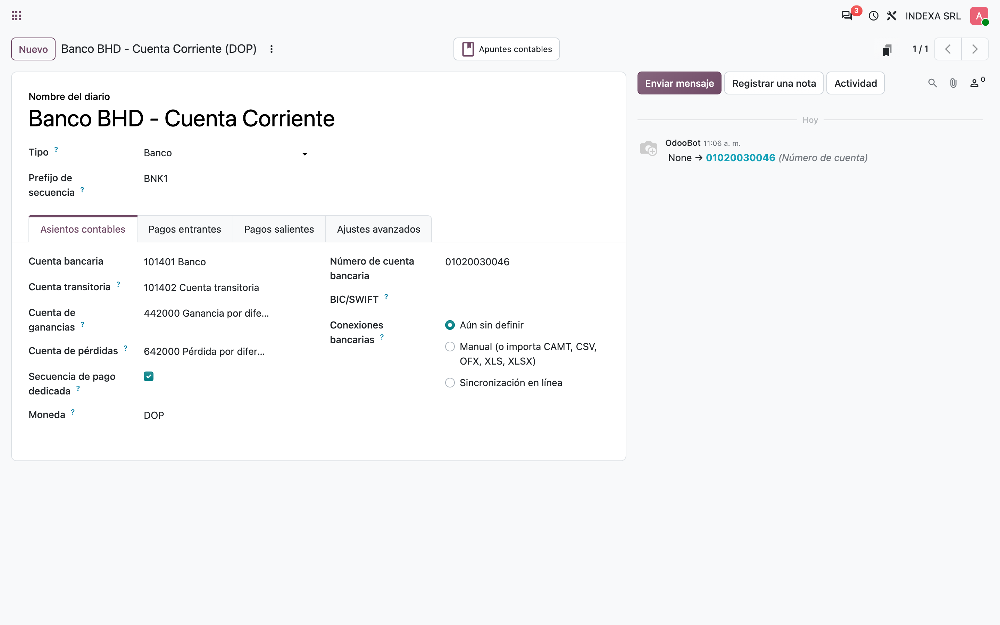
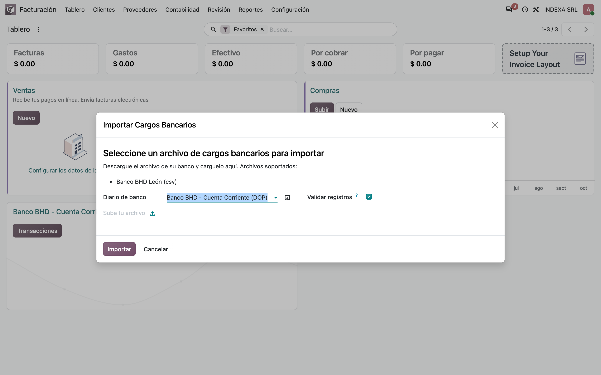
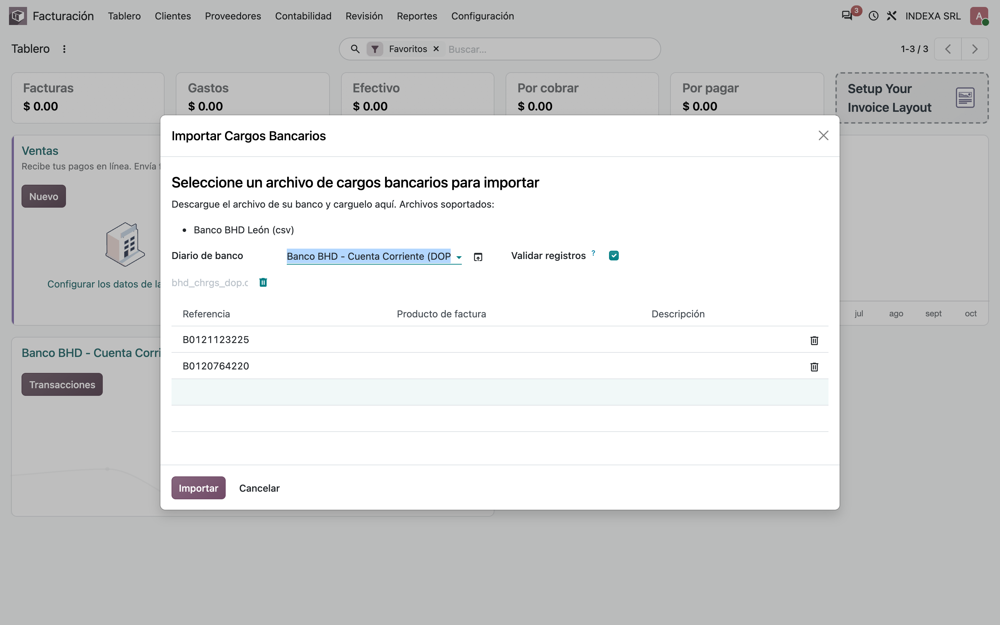
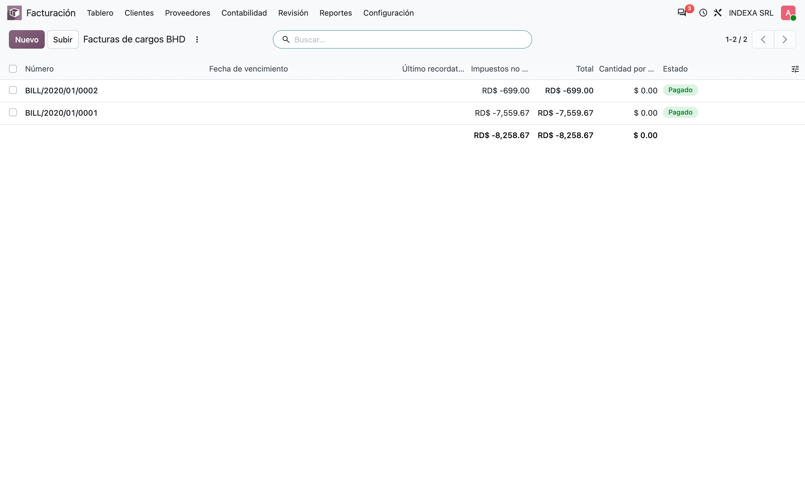
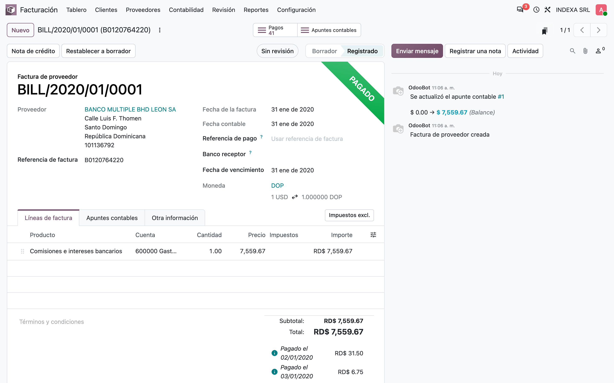
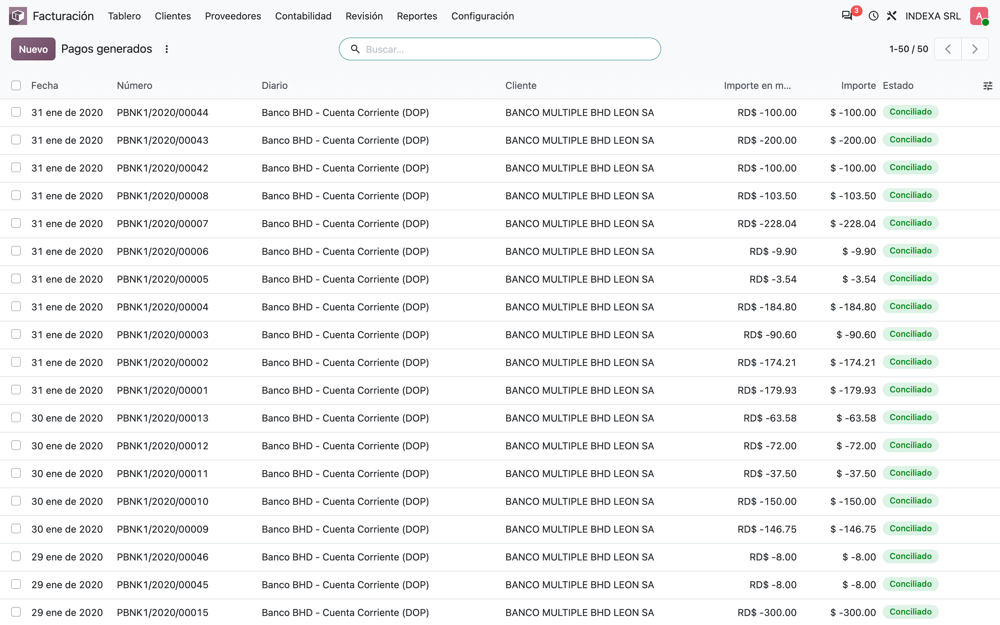

# Cargos bancarios del Banco BHD — Manual de usuario (account_bank_charge_import_bhd)

> Manual generado con `tools/manual-generator`. Las capturas se regeneran ejecutando el generador contra una base `test_v20_<módulo>`.

`account_bank_charge_import_base` sabe qué hacer con los cargos de un banco —facturarlos, pagarlos y conciliarlos— pero **no sabe leer ningún archivo**. Este módulo le enseña a leer los del **Banco BHD**.

Concretamente, el *Reporte NCF* que el BHD entrega en csv: un bloque por comprobante fiscal (`NCF: B01…`) con los cargos que ese NCF ampara debajo.

Qué aporta:

- Reconoce que un diario es del BHD por el banco marcado en su cuenta bancaria, y solo entonces se hace cargo del archivo. Si no, lo deja pasar al siguiente módulo de banco.
- Comprueba que el archivo tenga la forma del reporte del BHD (las tres líneas de cabecera) antes de leerlo.
- Agrupa los movimientos **por NCF**, que es la referencia con la que el módulo base crea una factura de proveedor, y saca el número de cuenta del propio archivo.
- Rellena la lista de referencias del asistente en cuanto se sube el archivo, para que el usuario solo tenga que elegir el producto de cada una.

Todo lo que pasa después —la factura, los pagos, la conciliación— es del módulo base. Este solo aporta la lectura y los datos fiscales del banco.

## Requisitos previos

- Módulo **`account_bank_charge_import_bhd`** instalado (v `20.0.1.1.0`, Odoo 20.0).
- Dependencia: **`account_bank_charge_import_base`** (v `20.0.2.0.1`), que a su vez trae `account` y `l10n_do_banks`.
- Un **diario de banco** cuya cuenta bancaria tenga **Banco Dominicano = Banco BHD**. Ese campo es lo único que activa este módulo.
- El número de cuenta del diario debe ser el mismo que trae el reporte; si no, el módulo base detiene la importación.
- El usuario necesita **Contabilidad: Facturación** (`account.group_account_basic`) como mínimo.
- Un **producto por cada tipo de cargo**, con su cuenta de gasto.

## 1. Lo que enciende el módulo: el banco de la cuenta

El módulo se activa con una sola condición: que la **cuenta bancaria** del diario tenga *Banco Dominicano = Banco BHD*. En el diario se ve el número de esa cuenta (`01020030046`); el banco se marca en la ficha de la cuenta bancaria.

Ese campo lo aporta `l10n_do_banks` sobre la cuenta bancaria. Si el diario no tiene cuenta, o su banco es otro, este módulo devuelve el archivo al siguiente de la cadena y no toca nada.

En la 19.0 la marca vivía en el banco (`res.bank`) y se llegaba a ella por el campo *Banco* del diario. En la 20.0 ese modelo desapareció y la marca está en la cuenta bancaria.



## 2. El asistente declara los formatos que sabe leer

Desde el tablero de Contabilidad, en el menú ⋮ del diario del BHD, **Importar cargos bancarios** abre el asistente del módulo base. Lo único que este módulo le agrega es una línea en la lista de *Archivos soportados*:

> **Banco BHD León (csv)**

Con varios bancos instalados la lista crece sola, y el usuario ve de un vistazo qué archivos acepta su instalación.



## 3. Al subir el archivo, las referencias aparecen solas

Este es el archivo de ejemplo que trae el módulo (`bhd_charges_file/bhd_chrgs_dop.csv`). Al soltarlo, el asistente muestra **dos referencias**, una por cada línea `NCF:` del reporte.

El reporte del BHD tiene esta forma:

```
DEMO COMPANY SRL - RNC 123456789
Reporte NCF - Enero 2020
Generado el 26/02/2020 09:29:55 AM
01020030046 - CUENTA CORRIENTE
NCF: B0120764220
RNC,Fecha,Referencia,Descripción,Moneda,Monto orig.,Monto RD$
101866861,31/01/2020,F7I7677131,Imp. Art. 12 ley 288-04,Pesos,179.93,179.93
…
```

Cada línea `NCF:` abre un comprobante y las filas que siguen son sus cargos, hasta el siguiente `NCF:`. Si las tres primeras líneas no tienen la forma de esa cabecera, el módulo entiende que el archivo no es del BHD y no lo lee.

Falta el paso del usuario: elegir el **producto** de cada referencia. Eso decide la cuenta de gasto y los impuestos de la factura.



## 4. El resultado: una factura por NCF

Las dos referencias del archivo se convirtieron en dos facturas de proveedor a nombre de **BANCO MULTIPLE BHD LEON SA** (RNC `101136792`), por **RD$ 8,258.67** entre las dos —el *Total Neto Cargos Producto* del reporte— y ambas **pagadas**.

El proveedor lo aporta este módulo: nombre, RNC, dirección y teléfono del BHD. El módulo base lo busca por RNC y lo crea si no existe.



## 5. Una factura por dentro

La factura más grande del lote. La **referencia** es el NCF y la **línea** lleva el producto que eligió el usuario con la suma de todos los cargos de ese NCF.

La factura es una sola por NCF; los cargos individuales se convierten en pagos, uno por cada fila del reporte.



## 6. Los pagos, conciliados contra sus facturas

**Cincuenta pagos** en el diario del BHD, uno por cada cargo del reporte, todos **conciliados** con su factura. Cada pago lleva la fecha y la referencia de la fila de la que salió.

Si en el asistente se desmarca **Validar registros?**, las facturas y los pagos quedan en borrador para revisarlos antes.



## 7. Reglas de lectura del reporte

| Dato | De dónde sale |
|---|---|
| Número de cuenta | La línea que sigue a las tres de cabecera, antes del guion (`01020030046 - CUENTA CORRIENTE`) |
| NCF | Cada línea `NCF:`; los 14 primeros caracteres tras los dos puntos |
| Cargo o devolución | Por el prefijo del NCF: `E34` y `B04` son devolución (nota de crédito) |
| Fecha del pago | Columna *Fecha*, `dd/mm/yyyy` |
| Referencia del pago | Columna *Referencia* |
| Monto | Columna *Monto RD$*; acepta montos con separador de miles entre comillas (`"3,062.47"`) |
| Moneda | *Pesos* → `DOP`, *Dólares* → `USD` |

El archivo se lee como **latin-1**, que es como lo exporta el banco. Las filas que no son de cargos (cabeceras, totales, líneas vacías) se saltan.

## 8. Qué cambió con el port a 20.0

| Qué | 19.0 | 20.0 |
|---|---|---|
| La marca del banco | `journal.bank_id.l10n_do_bank` sobre `res.bank` | `journal.bank_account_id.l10n_do_bank` sobre `res.partner.bank` |
| Leer el archivo subido | `base64.b64decode(self.data_file)` | `self.data_file.content` |
| `is_company` del banco | Se escribía al crear el contacto | Se quitó: el núcleo lo calcula |
| Pasar el archivo al parser | Se escribía a `/tmp/bank_charges.csv` y se releía | Se parsea en memoria |

Con la ruta fija de `/tmp`, dos usuarios importando a la vez se pisaban el archivo. Ahora no queda nada en disco.

## Notas

### Notas de la migración a 20.0

1. **`res.bank` desapareció, y con él `account.journal.bank_id`.** `_is_bhd_bank()` leía `journal.bank_id.l10n_do_bank` y fallaba con `AttributeError`; como es la condición que gobierna todos los caminos del módulo, el módulo entero quedaba muerto. Ahora se llega por `journal.bank_account_id`.
2. **Un campo `Binary` guarda el contenido crudo, ya no base64.** `onchange_data_file()` hacía `base64.b64decode(self.data_file)`; ahora lee `self.data_file.content`.
3. **`is_company` es calculado.** La escritura al crear el contacto del banco ya no tiene efecto y se quitó; el contacto sigue quedando como empresa.
4. **`invoice_payments_widget` pasó a `Json`.** Solo afectaba a las pruebas: las fechas vuelven como cadenas ISO.
5. El archivo ya no pasa por `/tmp` (paso 8), igual que en `account_bank_charge_import_bpd`.

No hizo falta script de migración: no cambió ninguna tabla, campo ni registro de seguridad.

### Pendiente / decisión funcional

- **El asistente no avisa de un archivo ya importado.** Volver a subir el mismo reporte genera otra vez las facturas y los pagos. Viene así desde antes del port.

### Reproducir este manual

El seed (`configs/account_bank_charge_import_bhd.seed.py`) arma, sobre una base limpia: la compañía con plan contable genérico, un diario de banco marcado como Banco BHD con la cuenta `01020030046`, un producto de cargo, y una importación real del csv de ejemplo del módulo, sin simular el parseo.
