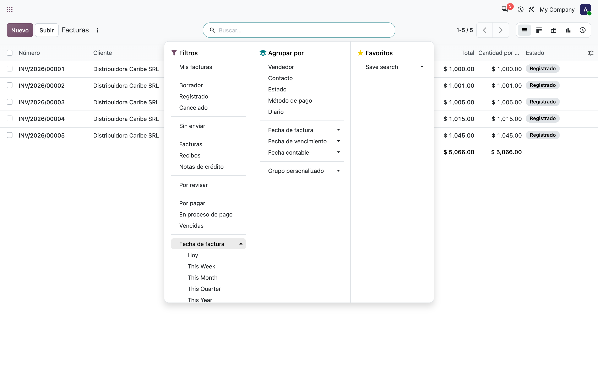
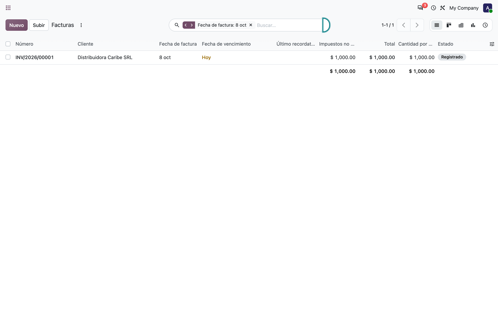
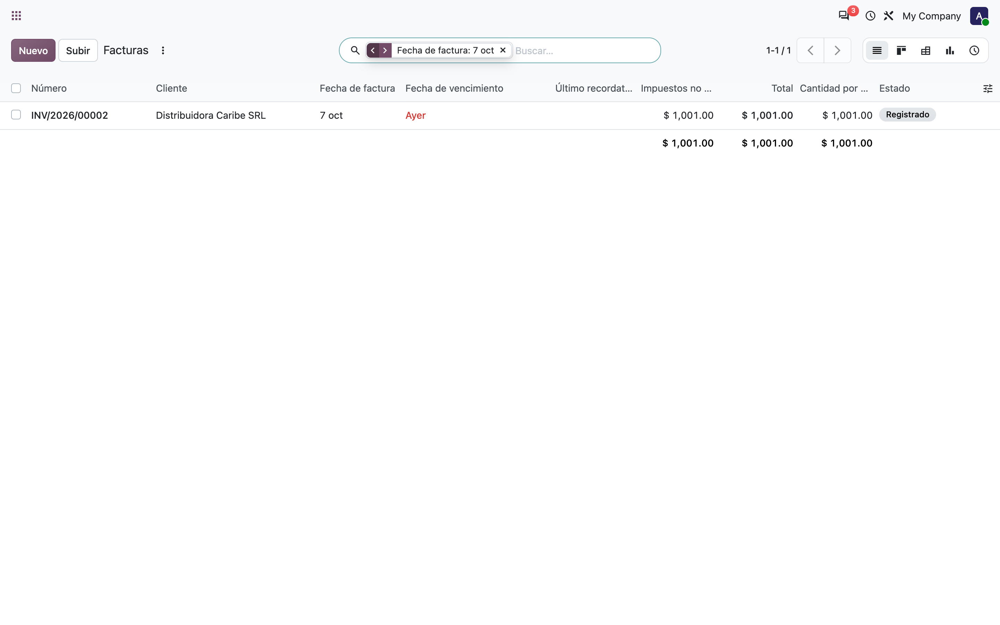
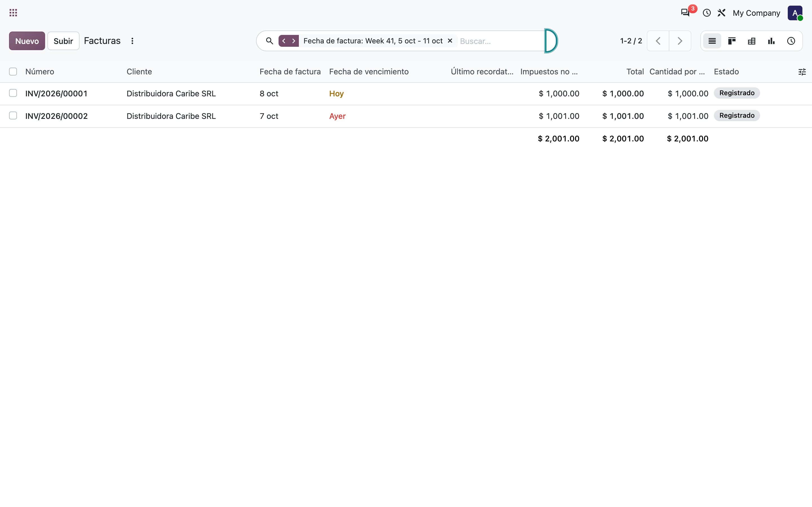
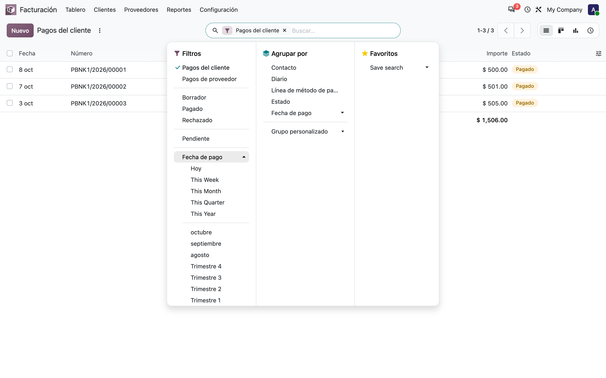
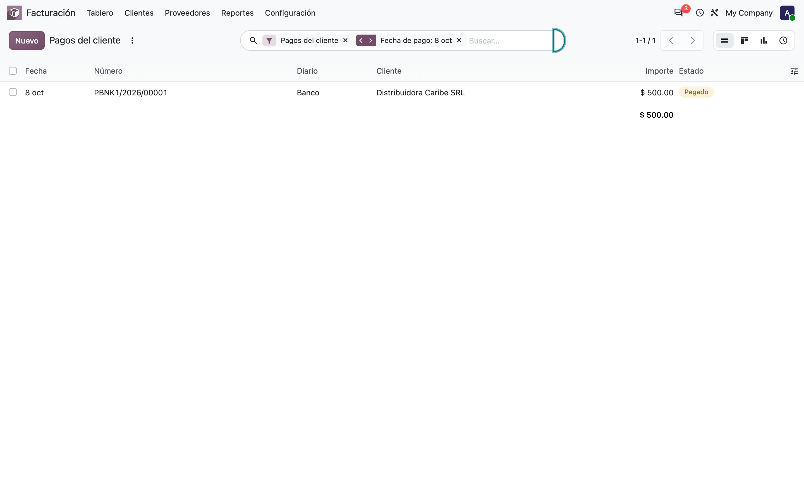

# Filtros de fecha en facturas y pagos — dónde quedaron en Odoo 20.0 (account_date_filters)

> Manual generado con `tools/manual-generator`. Las capturas se regeneran ejecutando el generador contra una base `test_v20_<módulo>`.

En 19.0 el módulo **`account_date_filters`** agregaba filtros fijos a las facturas (*Today's invoices*, *Yesterday invoices*, *This week invoices*, *This month invoices*) y a los pagos (*Today's payments*, *Yesterday payments*, *This week payments*).

**En Odoo 20.0 el módulo no se porta:** el propio Odoo agrega a todos los filtros de fecha (como *Fecha de factura* y *Fecha de pago*) las opciones **Hoy**, **This Week**, **This Month**, **This Quarter** y **This Year**, y la etiqueta del filtro activo trae flechas **‹ ›** para ir al período anterior o al siguiente (por ejemplo, de *Hoy* a *ayer*). Este documento muestra cómo obtener con Odoo estándar los mismos resultados que daban los filtros del módulo.

## Requisitos previos

- Odoo 20.0 con **Facturación / Contabilidad** (`account`). No hace falta ningún módulo adicional.
- Las bases que actualizan desde 19.0 pierden los filtros del módulo; los filtros favoritos guardados que los usaban deben volver a crearse con las opciones estándar descritas aquí.

## 1. Opciones de fecha en facturas

En *Contabilidad → Clientes → Facturas* abra el menú de búsqueda y despliegue **Fecha de factura**. Arriba aparecen las opciones relativas (**Hoy**, **This Week**, **This Month**, **This Quarter**, **This Year**); debajo, los meses, trimestres y años de siempre, y al final **Custom Date...**.

## 2. Facturas de hoy (antes «Today's invoices»)

Elija **Hoy**. La lista muestra solo las facturas con fecha de factura de hoy y la etiqueta del filtro en la barra de búsqueda indica la fecha.

## 3. Facturas de ayer (antes «Yesterday invoices»)

Con **Hoy** activo, pulse la flecha **‹** de la etiqueta del filtro: el filtro pasa al día anterior. Cada clic retrocede un día más; **›** avanza.

## 4. Facturas de la semana y del mes

**This Week** filtra la semana en curso y **This Month** el mes en curso (de calendario). Las flechas **‹ ›** pasan a la semana o al mes anterior/siguiente.

Diferencia con el módulo: *This week invoices* y *This month invoices* tomaban los **últimos 7 y 30 días** corridos. Si se necesita exactamente eso, cree un **Filtro personalizado** con la regla *Fecha de factura* · **está en** · **Last 7 days** (o **Last 30 days**), rangos predefinidos del editor de filtros de Odoo. Guarde la búsqueda como favorito para tenerla a un clic.

## 5. Los mismos filtros en pagos

En *Contabilidad → Clientes → Pagos* el filtro **Fecha de pago** ofrece las mismas opciones. **Hoy** reemplaza a *Today's payments*, **Hoy** + **‹** a *Yesterday payments* y **This Week** a *This week payments*.

## 6. Pagos de hoy

Al elegir **Hoy** quedan solo los pagos con fecha de hoy.

## Notas

- Los filtros estándar se aplican a facturas, notas de crédito, facturas de proveedor y pagos, porque todos usan las mismas vistas de búsqueda de Odoo.
- Las opciones **This Week**, **This Month**, etc. aparecen en inglés porque Odoo 20.0 todavía no trae su traducción al español.
- *This week invoices* del módulo también incluía facturas con fecha futura (su dominio era «fecha posterior a hace 7 días»); el filtro estándar no lo hace.
