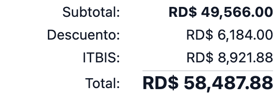
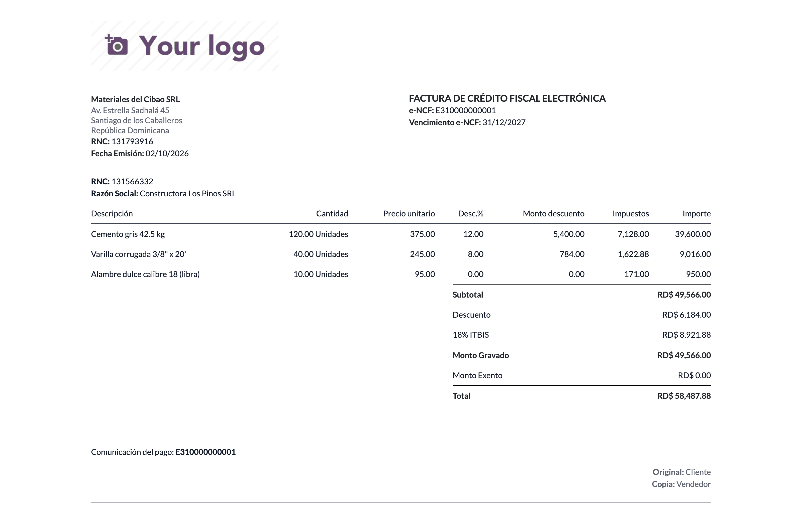
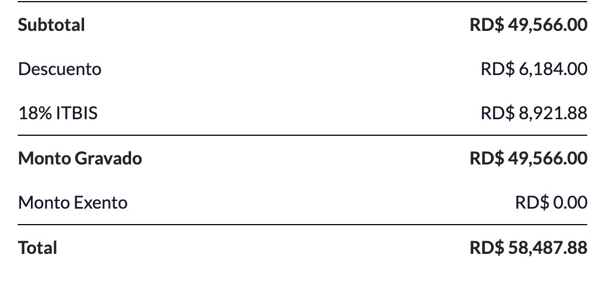
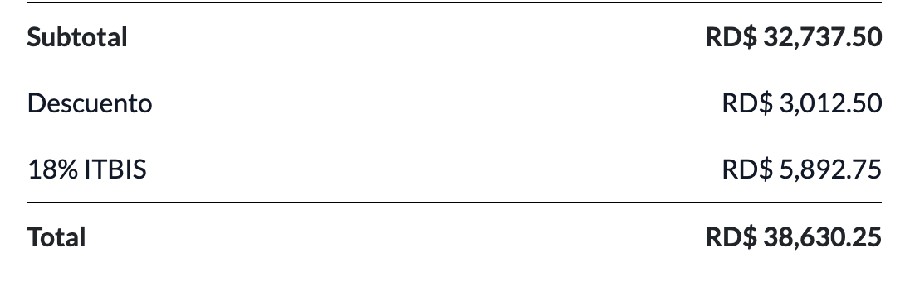
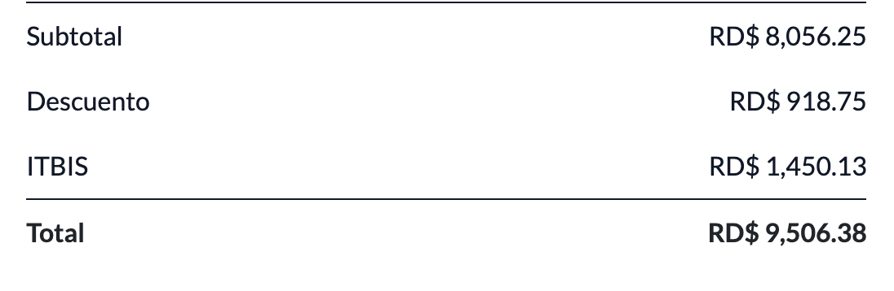
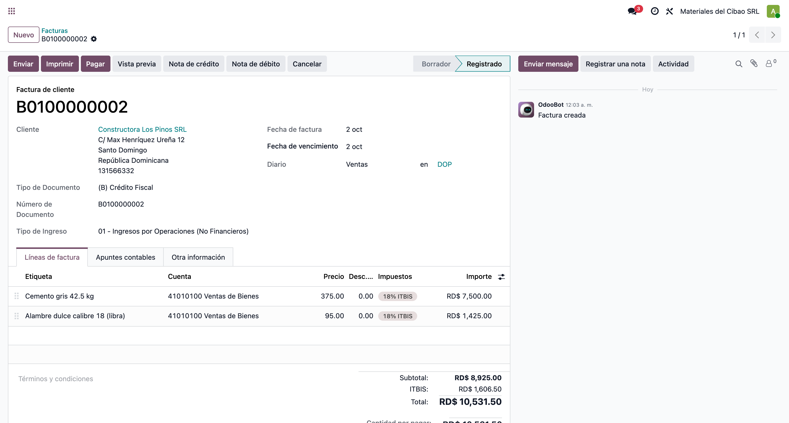
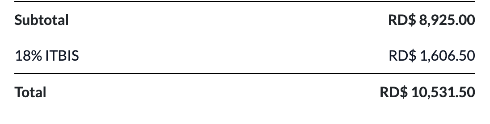
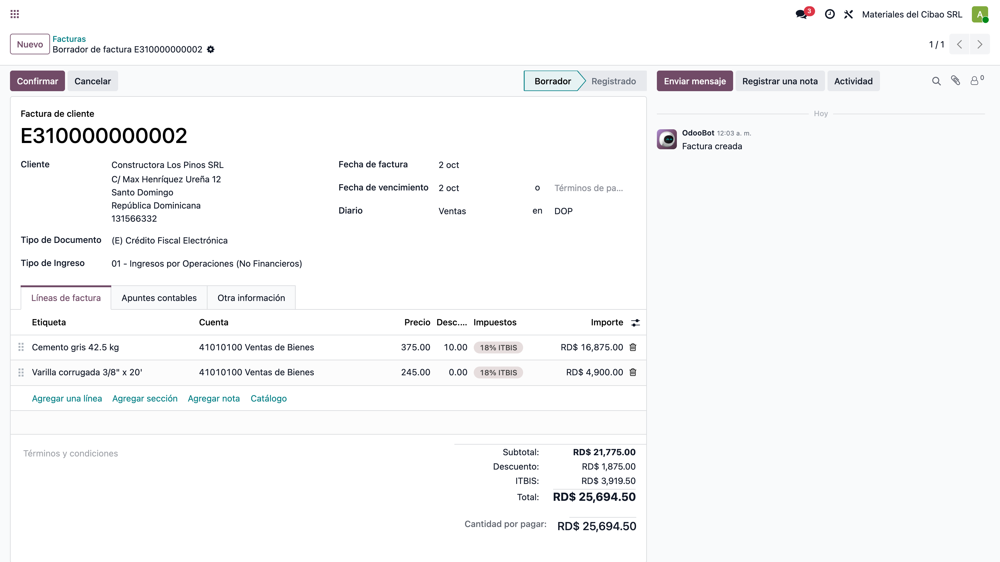

# Descuento total en facturas — Manual de usuario

> Manual generado con `tools/manual-generator`: `node capture.mjs --config=/Users/luisfernandez/repos/dev_env_odoo_pro-19/tools/manual-generator/configs/account_invoice_discount_display_amount.json --db=test_v19_account_invoice_discount_display_amount`. Las capturas se regeneran corriendo ese comando contra la base de pruebas.

En Odoo 17 la factura mostraba el **monto total del descuento** con el módulo OCA `account_invoice_discount_display_amount`. Ese módulo no existe para Odoo 19, así que al migrar la fila desaparecía de la pantalla y del PDF.

**Descuento total en facturas** (`account_invoice_discount_display_amount`) la recupera, ahora **debajo del Subtotal**:

- En el **formulario de la factura**, una fila **Descuento** dentro del bloque de totales, entre el Subtotal y el ITBIS.
- En el **PDF**, la misma fila en el mismo lugar, tanto en la plantilla estándar de Odoo como en la plantilla fiscal dominicana (NCF y e-CF).
- Si la factura no tiene descuento, la fila no aparece.

El importe que se muestra es el **descuento sin impuestos**: la diferencia entre el subtotal que tendría la factura sin descuentos y el subtotal real. Se calcula con el mismo motor de impuestos que Odoo usa para los totales, así que redondea igual que el Total impreso.

Las facturas fiscales dominicanas usan su propia tabla de totales; el módulo puente **Descuento total en facturas (Rep. Dominicana)** (`l10n_do_accounting_invoice_discount_display_amount`) agrega ahí la fila y se instala solo.

**Base de datos de las capturas:** Base de pruebas `test_v19_account_invoice_discount_display_amount`, compañía **Materiales del Cibao SRL** (RD, DOP, plan dominicano, emisora e-CF), sin datos de demostración. La siembra deja el cliente *Constructora Los Pinos SRL*, tres productos con ITBIS 18%, una factura e-CF E310000000001 y una NCF B0100000001 con descuentos, una B0100000002 sin descuento, una factura del diario *Ventas sin comprobante* y un borrador e-CF E310000000002.

## Requisitos previos

- Odoo 19 con `account_invoice_discount_display_amount` instalado.
- Para facturas fiscales dominicanas, `l10n_do_accounting`: el puente `l10n_do_accounting_invoice_discount_display_amount` se instala solo.
- La columna **Desc.%** de las líneas de factura es opcional en Odoo 19: se muestra desde el menú de columnas (⋮) a la derecha del encabezado de la tabla.

## 1. Factura con descuento

La factura e-CF **E310000000001** tiene tres líneas: el cemento con **12%** de descuento, la varilla con **8%** y el alambre sin descuento.

En el bloque de totales, debajo del **Subtotal**, aparece la fila **Descuento** con RD$ 6,184.00: lo que se descontó antes de impuestos. La cuenta cierra a la vista:

- Precio bruto de las líneas: 120 × 375.00 + 40 × 245.00 + 10 × 95.00 = RD$ 55,750.00
- Subtotal: RD$ 49,566.00
- Descuento: RD$ 55,750.00 − RD$ 49,566.00 = **RD$ 6,184.00**

El Subtotal, el ITBIS y el Total son los mismos de siempre; el módulo sólo agrega la fila.

La columna **Desc.%** se activa desde el menú de columnas opcionales (⋮) de la tabla de líneas; Odoo la recuerda para el usuario.

## 2. Detalle del bloque de totales

De cerca: **Subtotal**, **Descuento**, **18% ITBIS** y **Total**. La fila usa el mismo formato de moneda que el resto del bloque.

## 3. PDF de la factura e-CF

Al imprimir la factura (**Imprimir › Facturas**) la tabla de totales fiscal muestra la fila **Descuento** justo debajo del **Subtotal** y antes del **18% ITBIS**, el **Monto Gravado** y el **Monto Exento**.

El importe es el mismo del formulario: RD$ 6,184.00.

## 4. Detalle de los totales del e-CF

De cerca, la tabla de totales del PDF e-CF. Es la misma disposición de la imagen de referencia del requerimiento: Subtotal, **Descuento**, ITBIS, Monto Gravado, Monto Exento y Total.

## 5. PDF de una factura NCF de crédito fiscal (B01)

Las facturas con NCF tradicional usan la misma tabla fiscal, sin Monto Gravado ni Monto Exento. La factura **B0100000001** lleva 5% de descuento en el cemento y 10% en la varilla: la fila **Descuento** muestra RD$ 3,012.50, debajo del Subtotal.

## 6. PDF de un diario sin comprobantes fiscales

Una factura del diario *Ventas sin comprobante* (sin documentos fiscales) se imprime con la **plantilla estándar de Odoo**. La fila **Descuento** aparece también ahí, debajo del Subtotal: RD$ 918.75 por el 15% de descuento en la varilla.

## 7. Sin descuento no hay fila

La factura **B0100000002** no tiene descuento en ninguna línea: el bloque de totales queda exactamente como en Odoo estándar, sin la fila **Descuento**.

## 8. El PDF tampoco cambia

En el PDF de la misma factura la tabla de totales es la de siempre: Subtotal, ITBIS y Total.

## 9. Factura en borrador

El borrador **E310000000002** tiene 10% de descuento en el cemento: la fila **Descuento** marca RD$ 1,875.00 (50 × 375.00 × 10%).

## 10. Cambiar el descuento actualiza la fila

Al subir el descuento de la varilla de 0% a **20%** la fila se recalcula en el acto, antes de guardar: RD$ 1,875.00 + 20 × 245.00 × 20% = **RD$ 2,855.00**. El Subtotal baja en la misma cantidad.

## Notas

- El descuento que se muestra es **sin impuestos**, porque la fila va debajo del Subtotal y el Subtotal es un monto sin impuestos. El descuento con impuestos queda disponible en el campo **Total descuento** (`discount_total`) para informes o personalizaciones.
- Los tres campos se calculan al abrir o imprimir la factura y no se guardan en la base: instalar el módulo en una base con años de facturas no recalcula nada.
- El módulo conserva el nombre técnico del módulo OCA de Odoo 17, así que una base migrada desde 17 lo mantiene instalado.
