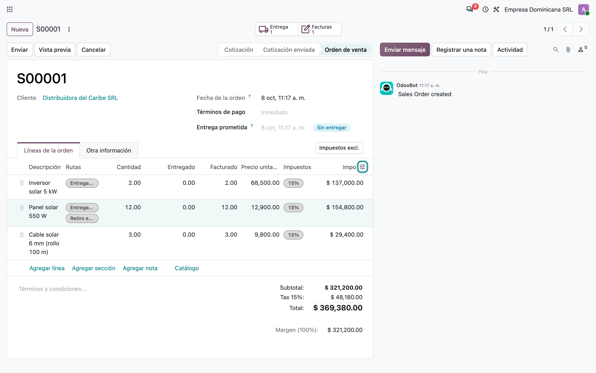
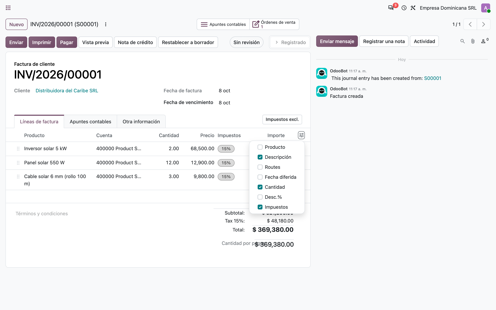
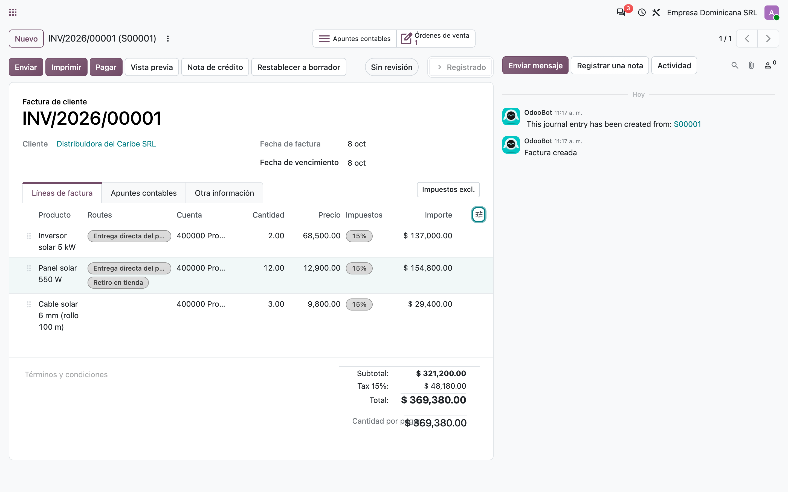

# Rutas en líneas de factura — Manual de usuario (account_move_route, Odoo 20.0)

> Manual generado con `tools/manual-generator`. Las capturas se regeneran ejecutando el generador contra una base `test_v20_<módulo>`.

Este módulo copia las **rutas de inventario** (`stock.route`: entrega directa, retiro en tienda, bajo pedido…) de cada línea de la orden de venta a la línea de factura que se genera desde ella, y las muestra en una columna opcional **Routes** de las líneas de factura.

Odoo 20.0 guarda las rutas solo en la línea de venta (`sale_stock`); la línea de factura no tiene ningún campo de ruta, por eso el módulo se porta.

**Qué cambió en 20.0:**

- En 20.0 las líneas de factura agrupan producto, descripción y etiqueta en una sola columna *Producto*. La columna **Routes** aparece justo después de esa columna.
- No hay cambios de datos: las rutas ya copiadas a facturas en 19.0 se conservan al actualizar.

## Requisitos previos

- Módulo **`account_move_route`** `20.0.1.0.0` instalado. Depende de **`account`**, **`sale_management`** y **`stock`** (con ellos Odoo instala `sale_stock`, que es el que agrega las rutas a la línea de venta).
- Para ver y elegir rutas en la **orden de venta**, el usuario necesita el grupo **Gestionar rutas de varios pasos** (*Inventario → Configuración → Ajustes → Rutas de varios pasos*).
- Rutas marcadas como **Seleccionable en línea de pedido de venta** (*Inventario → Configuración → Rutas*).

## 1. Elegir las rutas en la orden de venta

En la orden de venta active la columna opcional **Rutas** de las líneas (icono de ajustes a la derecha del encabezado) y elija una o varias rutas por línea. Una línea puede llevar varias rutas (segunda línea) o ninguna (tercera línea).

## 2. Activar la columna en la factura

Cree la factura desde la orden (**Crear factura**). En la factura, pestaña *Líneas de factura*, abra el selector de columnas opcionales y marque **Routes**. La columna está oculta por defecto; Odoo recuerda la elección en ese navegador.

## 3. Las rutas llegan a cada línea de factura

Cada línea de factura muestra las rutas de su línea de venta: **Entrega directa del proveedor** en el inversor, las dos rutas en los paneles y ninguna en el cable. La columna es de **solo lectura**: las rutas solo cambian al facturar de nuevo la línea de venta.

## Notas

- Las rutas se copian **al crear la factura**. Cambiar las rutas de la orden después no modifica las facturas ya creadas.
- La columna se llama **Routes** (en inglés): el módulo no trae traducción al español.
- Las notas de crédito creadas desde la factura (**Nota de crédito**) conservan las rutas de cada línea.
