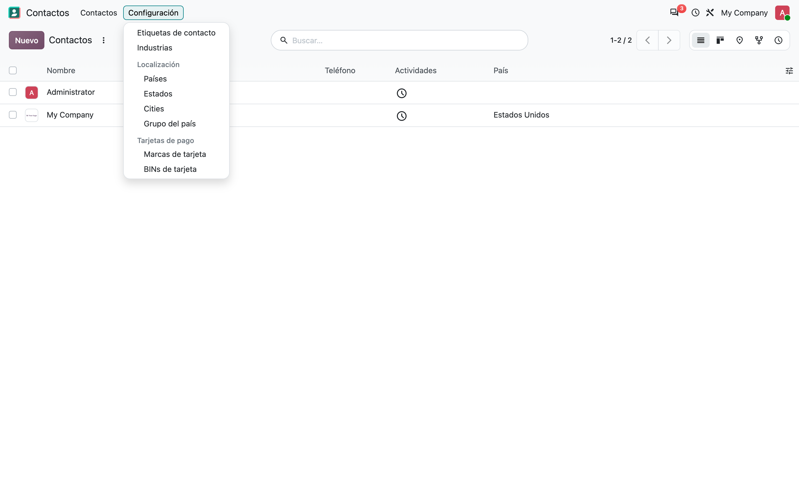
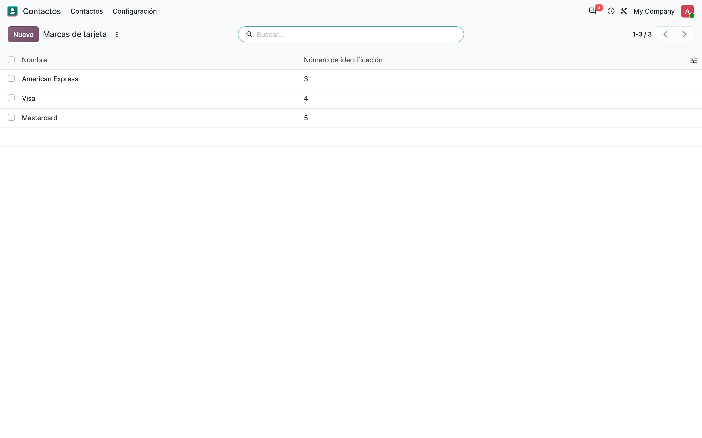
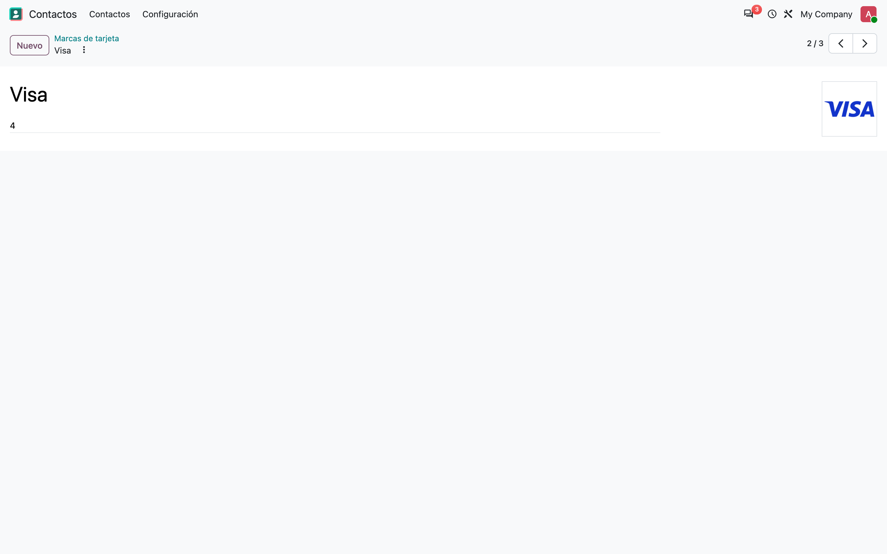
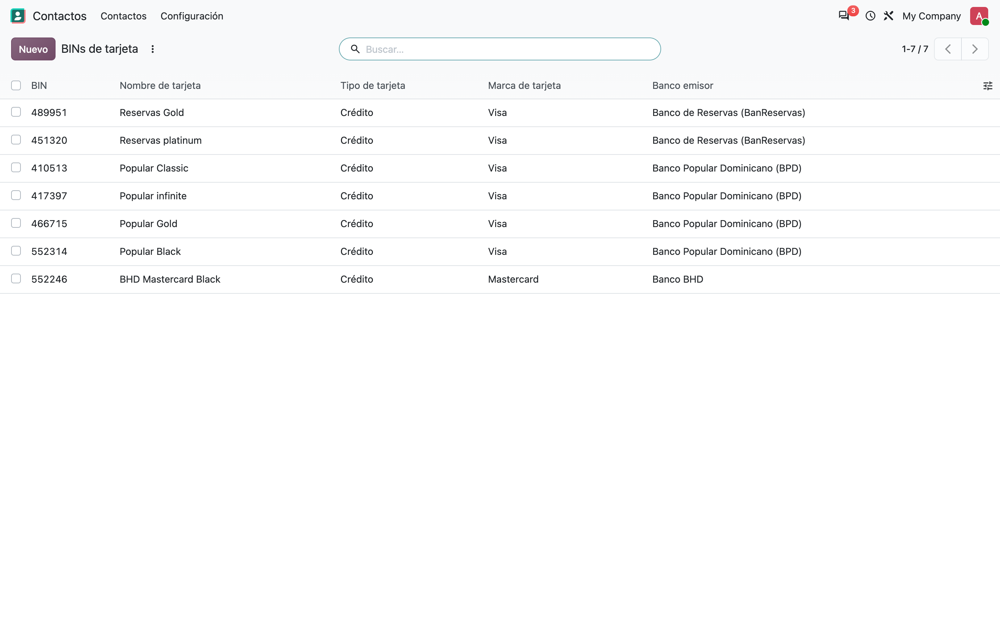
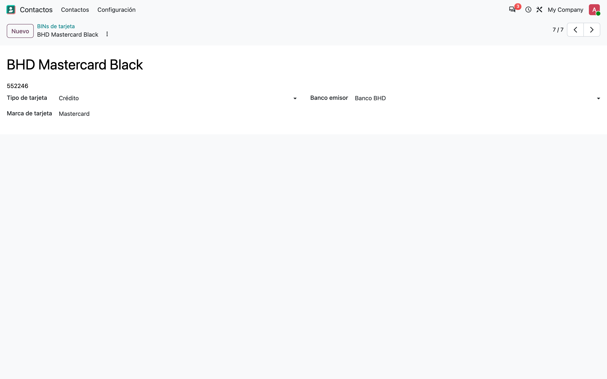
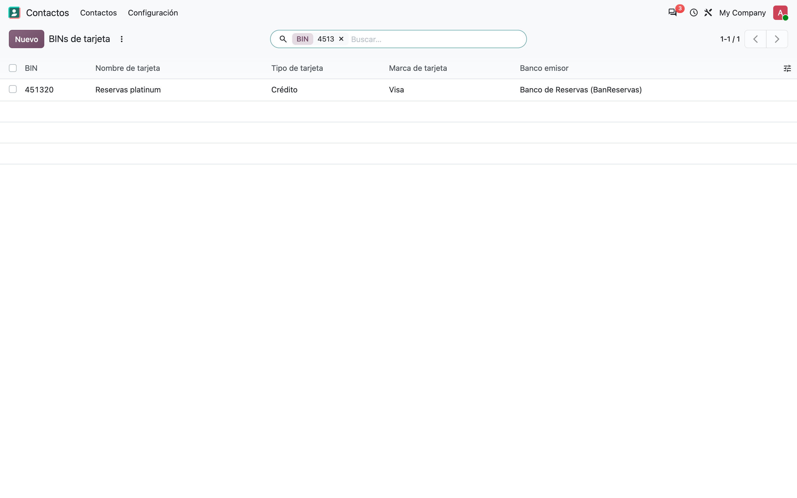

# BIN de tarjetas — Manual de usuario (account_payment_card_bin)

> Manual generado con `tools/manual-generator`. Las capturas se regeneran ejecutando el generador contra una base `test_v20_<módulo>`.

Cada tarjeta de crédito o débito empieza con un **BIN** (*Bank Identification Number*): los primeros 6 dígitos del número. El BIN dice qué banco emitió la tarjeta, de qué marca es (Visa, Mastercard, American Express) y si es de crédito o de débito.

Odoo core no trae un catálogo de BINs. Este módulo lo agrega: un maestro de **Marcas de tarjeta** y otro de **BINs**, cada BIN con su banco emisor dominicano. Es la base que usan las promociones por tarjeta (`account_payment_promotion_discount`) y el punto de venta en backend para reconocer la tarjeta con la que paga el cliente.

El módulo trae precargadas las tres marcas principales y los BINs de las tarjetas más comunes de Banreservas y Banco Popular.

## Requisitos previos

- Módulo **`account_payment_card_bin`** instalado (v `20.0.2.0.0`, Odoo 20.0).
- Dependencias: `account`, `contacts` y `l10n_do_banks` (lista de bancos dominicanos).
- Los menús están en *Contactos › Configuración*, visibles para usuarios con **Ajustes** (administrador).

## 1. Dónde están los menús

En *Contactos › Configuración* aparece la sección **Tarjetas de pago** con dos opciones:

- **Marcas de tarjeta**: Visa, Mastercard, American Express…
- **BINs de tarjeta**: el catálogo de BINs con su marca, tipo y banco emisor.

En Odoo 20.0 desapareció el submenú *Cuentas bancarias* donde vivían estos menús en 19.0; ahora tienen su propia sección.

## 2. Marcas de tarjeta

La lista de marcas. El **Número de identificación** es el primer dígito con el que empiezan las tarjetas de esa marca: `3` American Express, `4` Visa, `5` Mastercard.

Se pueden agregar marcas nuevas con **Nuevo**.

## 3. Ficha de una marca

Cada marca guarda su nombre, el dígito de identificación y su **logo**, que se muestra como avatar de la ficha.

## 4. Catálogo de BINs

La lista de BINs muestra, para cada uno, el **BIN** (6 dígitos), el **nombre de la tarjeta**, el **tipo** (crédito o débito), la **marca** y el **banco emisor**.

El banco emisor se elige de la lista de bancos dominicanos de `l10n_do_banks` (Banreservas, Banco Popular, BHD, Scotiabank…).

## 5. Registrar un BIN

La ficha del BIN: nombre de la tarjeta como título, el número BIN debajo, y a los lados el **tipo**, la **marca** y el **banco emisor**.

En el ejemplo, la tarjeta *BHD Mastercard Black* (BIN `552246`) creada para este manual.

## 6. Buscar por BIN o por nombre

Al buscar un BIN desde cualquier campo que lo use (por ejemplo, en un programa de promoción por tarjeta) se puede escribir **el número BIN o el nombre de la tarjeta**. En la lista, el buscador filtra igual: aquí, los BINs que contienen `4513`.

## Notas

- **Cambio en 20.0:** Odoo 20.0 eliminó el modelo de bancos (`res.bank`). El banco emisor de cada BIN pasó a ser la lista de bancos dominicanos de `l10n_do_banks`, la misma que usan las cuentas bancarias. Al actualizar desde 19.0, cada BIN conserva su banco.
- Los BINs precargados por el módulo se pueden editar; una actualización del módulo vuelve a escribir sus valores originales.
