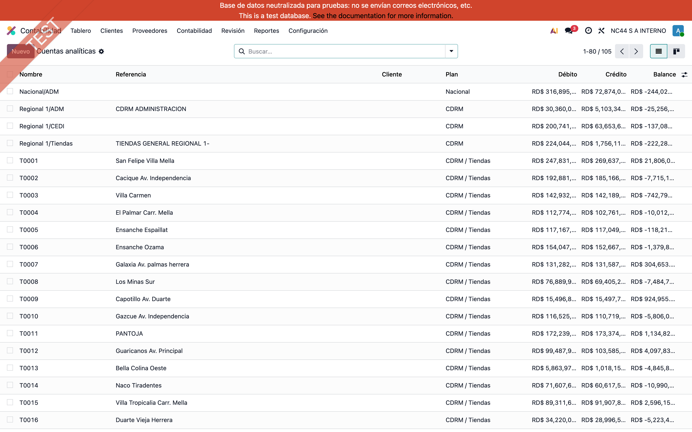
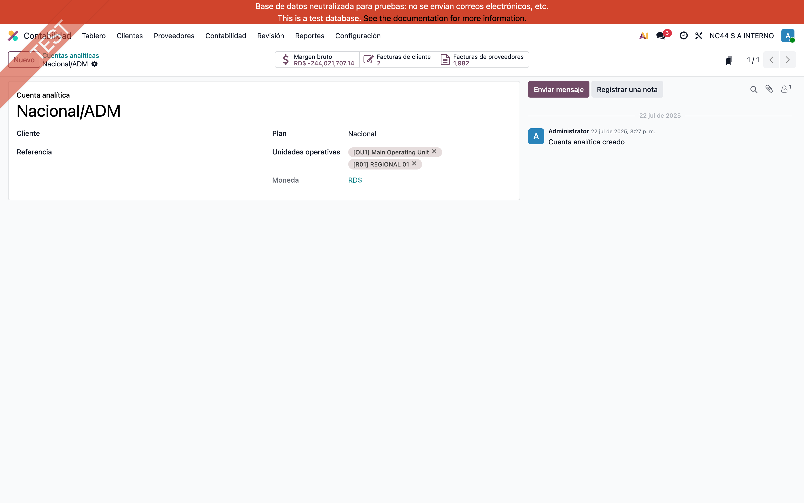

# Cuentas analíticas por unidad operativa — Manual de usuario

> Manual generado con `tools/manual-generator`: `node capture.mjs --config=configs/analytic_operating_unit_segregation.json --db=odoo-nc44-test-42073117`. Las capturas se regeneran corriendo ese comando contra la base de pruebas.

Una **unidad operativa** es una parte de la empresa que trabaja por su cuenta dentro de la misma compañía. En NC44 cada tienda es una unidad operativa (*Tienda San Felipe*, *Tienda Caciques*, …), además de **Main Operating Unit** (oficina central y CEDI) y **REGIONAL 01**.

El módulo **Cuentas analíticas por unidad operativa** (`analytic_operating_unit_segregation`) limita las cuentas analíticas por unidad:

- Cada cuenta analítica puede indicar las unidades que la usan.
- Cada usuario sólo ve las cuentas de sus unidades, más las que no tienen unidad.
- En documentos con un campo *Unidad operativa*, la distribución analítica sólo ofrece las cuentas de esa unidad o sin unidad.

Reemplaza a `analytic_operating_unit` (OCA).

**Base de datos de las capturas:** odoo-nc44-test-42073117 (upgrade de prueba NC44 17.0 → 19.0, Odoo.sh)

## Requisitos previos

- Odoo 19 con **Contabilidad analítica** y **Unidades operativas** (`operating_unit_base`).
- Módulo **Cuentas analíticas por unidad operativa** (`analytic_operating_unit_segregation`).
- Para ver y editar el campo, el grupo **Múltiples unidades operativas**.

## 1. Cuentas analíticas

Entra a **Contabilidad → Configuración → Contabilidad analítica → Cuentas analíticas**. Cada usuario ve las cuentas de sus unidades y las que no tienen unidad.

En NC44 sólo tres cuentas tienen unidad: **Nacional/ADM**, **Regional 1/CEDI** y **T0001**.

## 2. Unidades operativas de la cuenta

Abre la cuenta **Nacional/ADM**. El campo **Unidades operativas** está debajo del **Plan**. Puede llevar varias unidades; la cuenta la ven los usuarios de cualquiera de ellas.

Dejarlo vacío hace que la cuenta esté disponible para todos.

## 3. Distribución analítica en documentos con unidad

En un documento que tiene campo **Unidad operativa** (una transferencia de inventario, por ejemplo), el selector de **Distribución analítica** sólo propone las cuentas de esa unidad y las que no tienen unidad.

En NC44 no hay hoy documentos con unidad operativa que usen distribución analítica en pantalla, por eso este paso no lleva captura.

## 4. Qué hace y qué no hace el módulo

- **Limita lo que se ve y se propone.** No cambia las distribuciones analíticas ya registradas.
- **No verificado en esta revisión:** lo que ve un usuario de tienda. La revisión se hizo en solo lectura con un administrador que tiene todas las unidades.

## Notas

Revisión hecha en solo lectura sobre la base migrada: no se crearon ni modificaron registros. Las capturas se tomaron con un administrador que tiene asignadas todas las unidades operativas.
