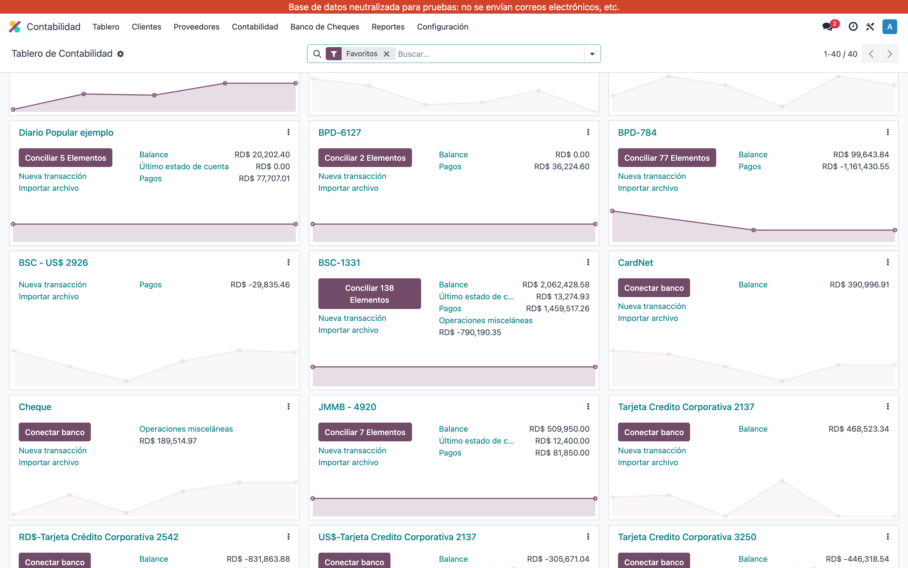
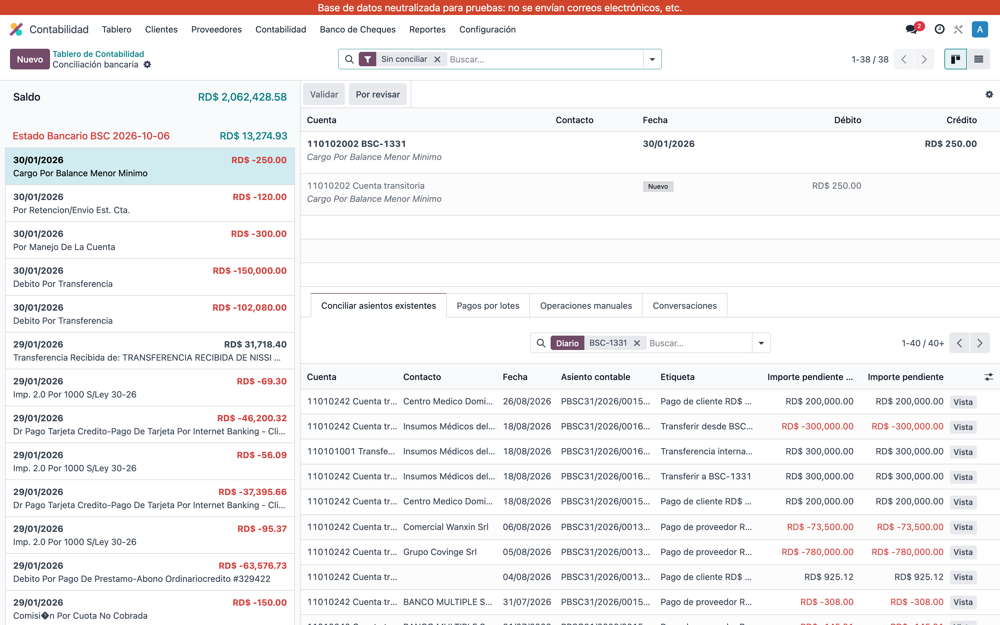
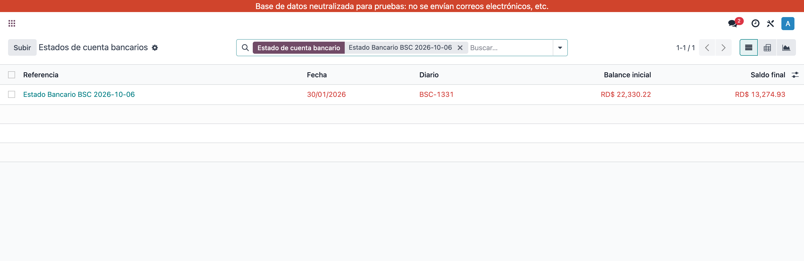
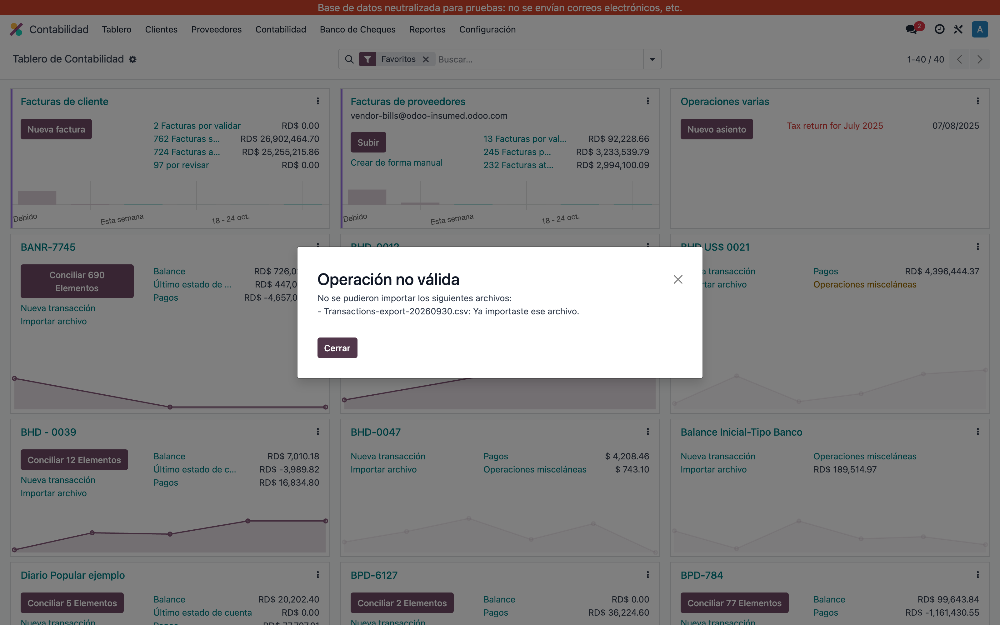
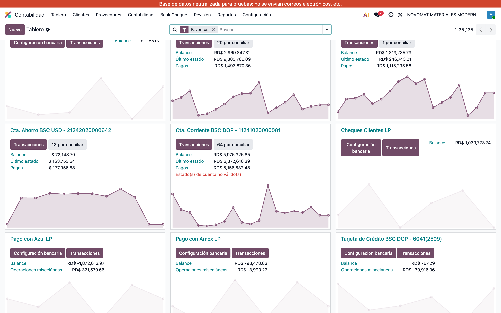
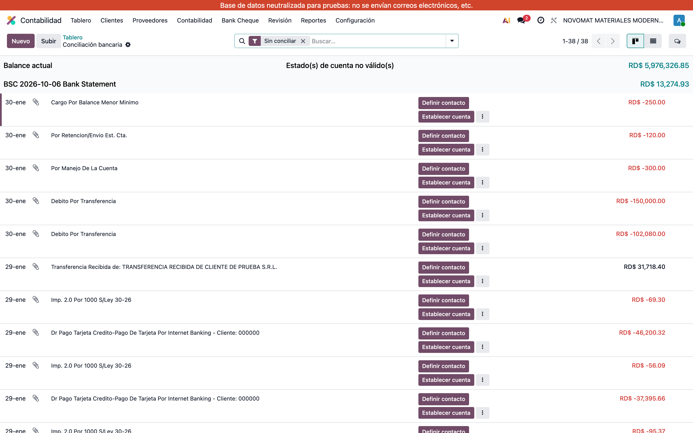
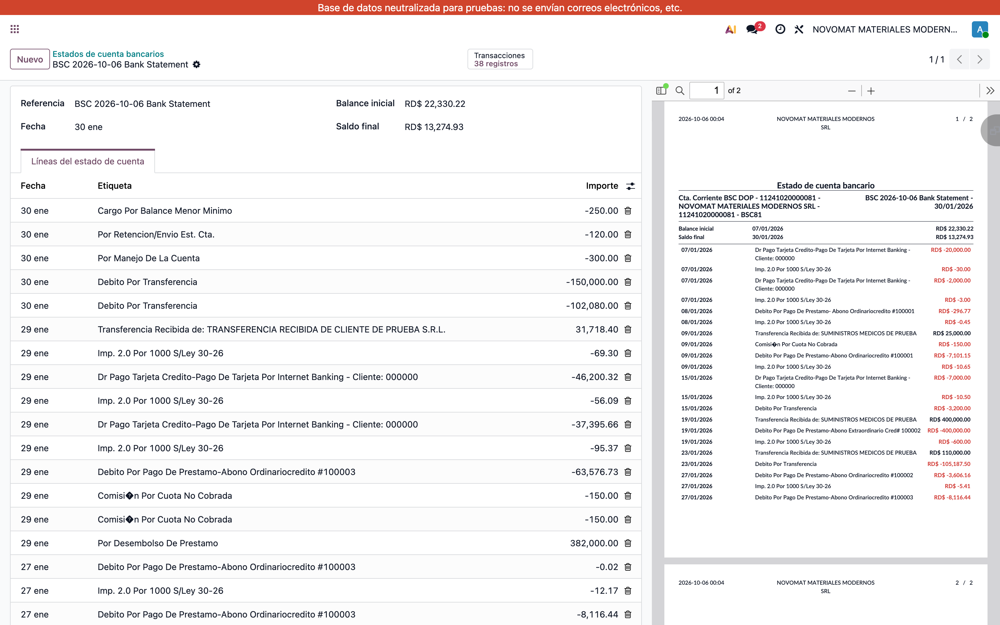
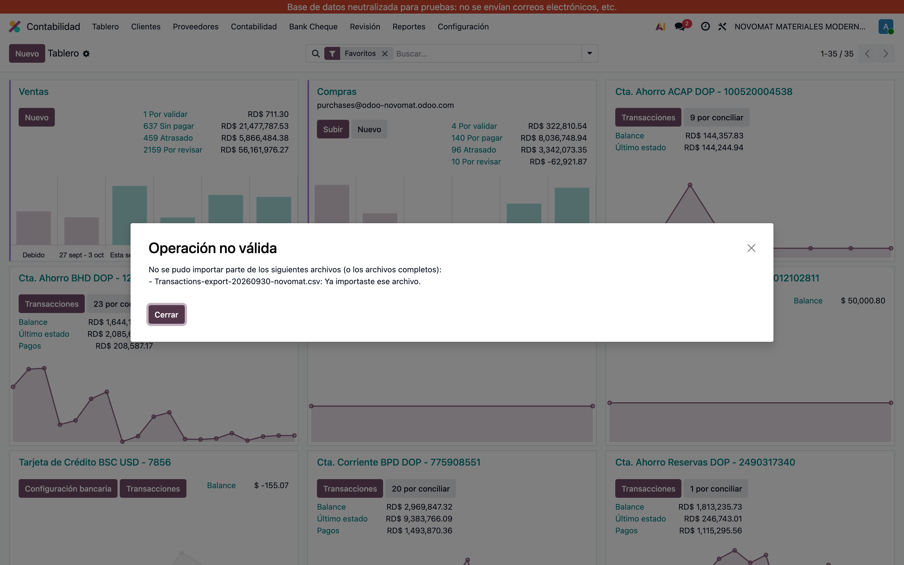

# Importación del estado de cuenta CSV de Banco Santa Cruz — Validación en staging

> Manual generado con `tools/manual-generator`: `node capture.mjs --config=configs/bsc_bank_statement_import_staging.json --db=odoo-insumed-staging-37707645`. Las capturas se regeneran corriendo ese comando contra la base de pruebas.

Banco Santa Cruz cambió el formato del estado de cuenta CSV que descarga su banca en línea (encabezado nuevo, 8 columnas, sin fila de saldo inicial, fila *Totales:* al final y, dentro de cada día, los movimientos del más reciente al más antiguo). Odoo lo rechazaba con *«No se pudo encontrar sentido al archivo»*.

El módulo **Bank Statement Import (BSC)** (`bsc_bank_statement_import`) ahora lee el formato nuevo y sigue leyendo el anterior. Este manual documenta la prueba en las dos instancias de staging con el archivo que entregó el cliente (`Transactions-export-20260930.csv`, cuenta 11431000001331, enero 2026):

- **INSUMED** — Odoo 17, diario **BSC-1331** (la misma cuenta del archivo), archivo original del cliente.
- **NOVOMAT** — Odoo 19, diario **Cta. Corriente BSC DOP - 11241020000081**, el mismo archivo con titular, cuenta, contrapartes y números de préstamo anonimizados.

## Requisitos previos

- `bsc_bank_statement_import` actualizado: 17.0.1.1.0 en INSUMED (PR #1284) y 19.0.1.1.0 en NOVOMAT (PR #1283).
- Diario bancario con un banco marcado como **Banco Santa Cruz** (en 19, el campo *Banco Dominicano* = Santa Cruz en el banco de la cuenta del diario).
- Usuario con permisos de contabilidad.

## Diario BSC-1331 en el tablero

En **Contabilidad > Tablero**, la tarjeta del diario **BSC-1331** tiene el enlace **Importar archivo**. Al pulsarlo se elige el CSV descargado de la banca en línea de Banco Santa Cruz.

## Movimientos importados

Odoo abre la **Conciliación bancaria** con el extracto **Estado Bancario BSC 2026-10-06** y sus 38 movimientos, listos para conciliar. El saldo final del extracto es **RD$ 13,274.93**, igual al último *Balance* del archivo.

## Extracto con saldos del banco

En **Contabilidad > Estados de cuenta bancarios**, el extracto del diario **BSC-1331** tiene **Balance inicial RD$ 22,330.22** y **Saldo final RD$ 13,274.93**, tomados de la columna *Balance* del archivo. Las líneas quedan en orden cronológico: dentro de cada día el banco lista primero el movimiento más reciente y el módulo las reordena.

La fila sale en rojo porque el extracto anterior de este diario en staging es una prueba previa con un archivo de 2019 (saldo final −1,586,549.83), y Odoo marca como no válido el extracto cuyo saldo inicial no coincide con el final del anterior. Con extractos consecutivos de la misma cuenta la cadena empata.

## Reimportar el mismo archivo

Subir de nuevo el mismo archivo en el diario muestra **«Ya importaste ese archivo»** y no crea líneas: cada movimiento se identifica por su *No. Referencia*.

## Diario BSC DOP en el tablero

En **Contabilidad > Tablero**, el CSV se suelta sobre la tarjeta **Cta. Corriente BSC DOP - 11241020000081** (o desde el menú ⋮ de la tarjeta, **Importar archivo**).

## Movimientos importados

Odoo abre la **Conciliación bancaria** con los 38 movimientos y el saldo del extracto **RD$ 13,274.93**.

La barra superior dice *Estado(s) de cuenta no válido(s)* porque el archivo de prueba es de otra cuenta: el extracto de agosto que ya existía en este diario arranca en 6,253,614.02 y no empata con el final de enero del archivo. No ocurre con los estados de cuenta reales de la cuenta de NOVOMAT.

## Extracto con saldos del banco

El extracto muestra **Balance inicial RD$ 22,330.22**, **Saldo final RD$ 13,274.93** y **38 registros**; el CSV queda adjunto y se imprime como *Estado de cuenta bancario*.

## Reimportar el mismo archivo

La segunda importación del mismo archivo se rechaza con **«Ya importaste ese archivo»**, sin duplicar líneas.

## Notas

Validado el 2026-10-06 sobre las instancias de staging. Además de las capturas, los saldos se verificaron por consulta a la base: en las dos instancias el extracto tiene 38 líneas, el saldo acumulado de cada línea coincide con la columna *Balance* del archivo y la suma de retiros (957,773.69) y depósitos (948,718.40) es igual a la fila *Totales:* del banco.

Los extractos importados quedan en los diarios de staging (INSUMED: extracto 131; NOVOMAT: extracto 10).
