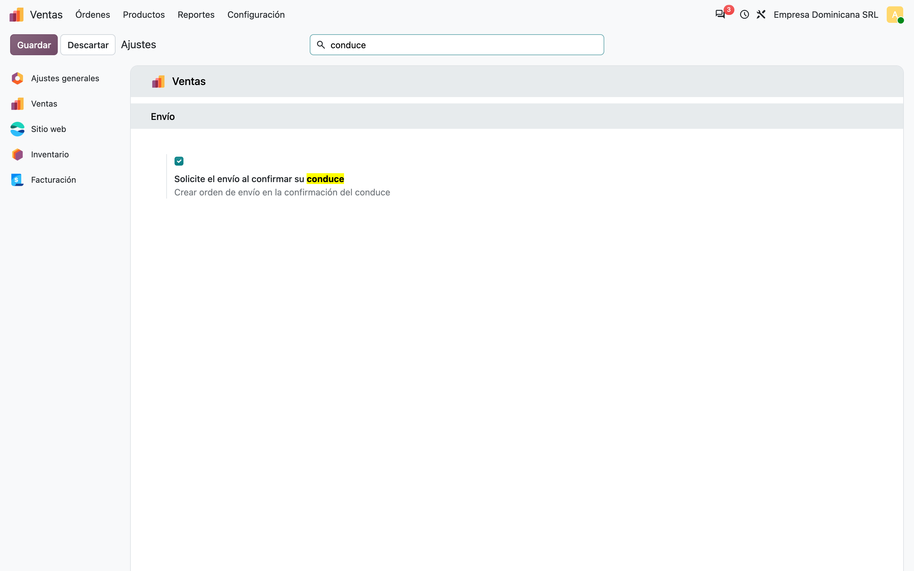
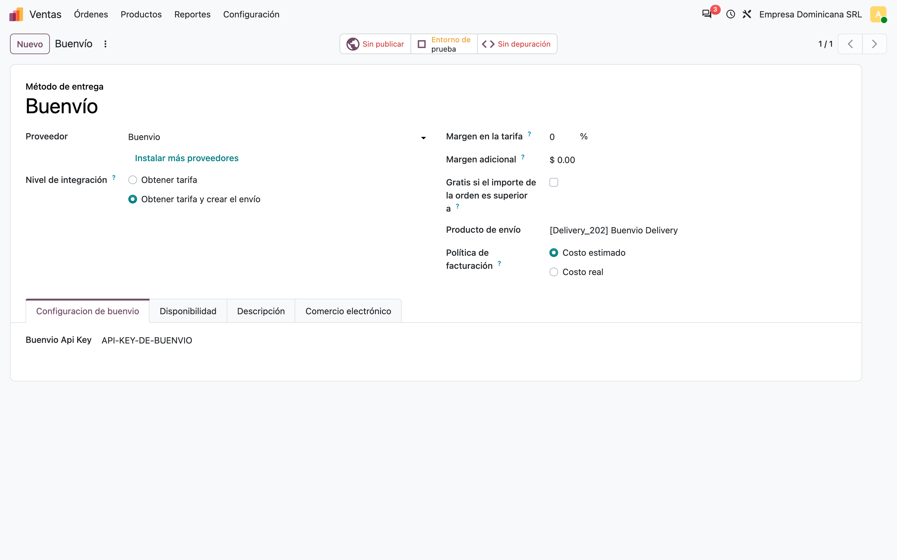
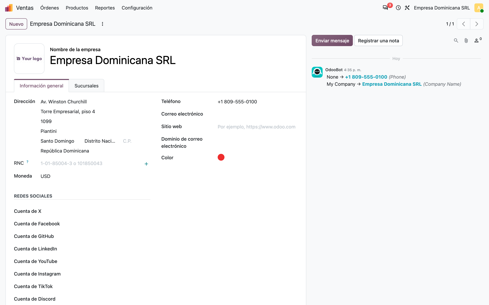
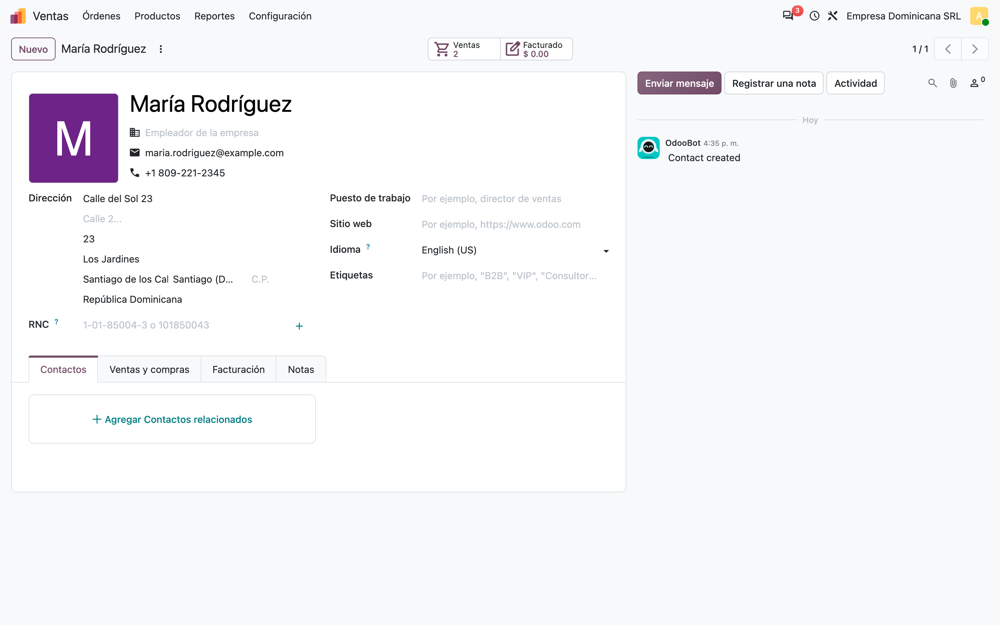
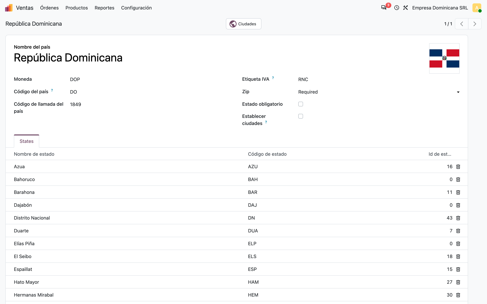
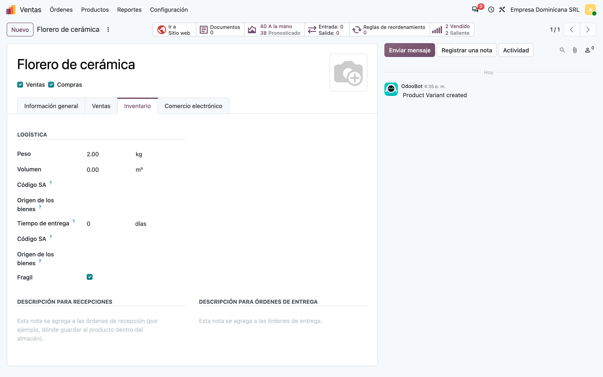
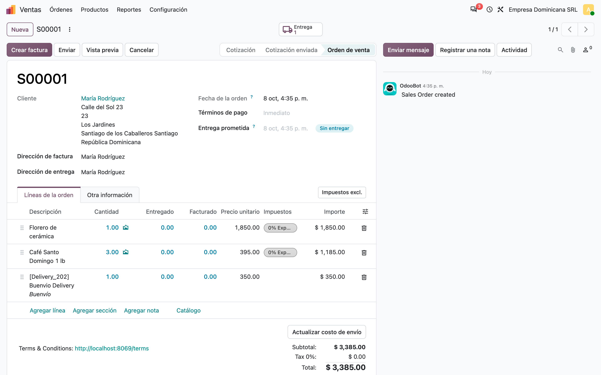
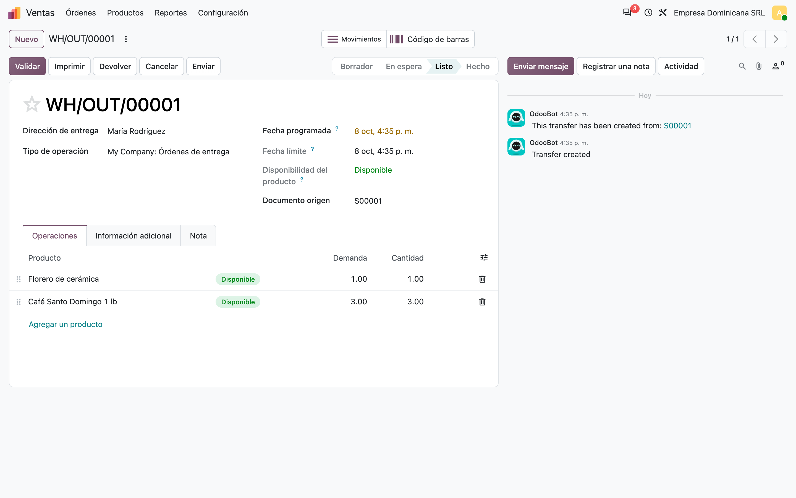
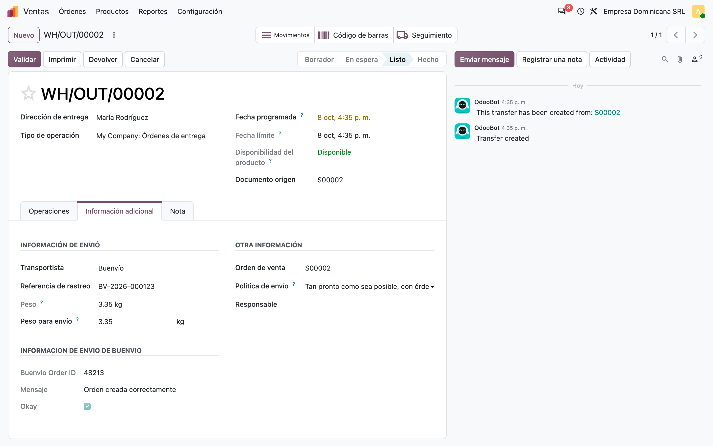
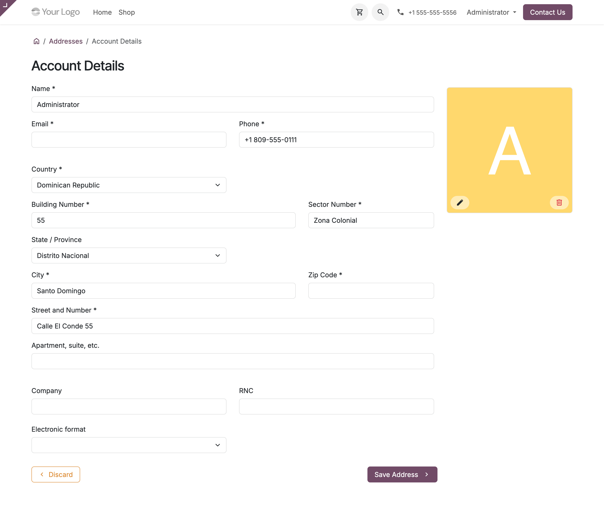

# Envíos con Buenvío — Manual de usuario (delivery_buenvio, Odoo 20.0)

> Manual generado con `tools/manual-generator`. Las capturas se regeneran ejecutando el generador contra una base `test_v20_<módulo>`.

Este módulo conecta Odoo con **Buenvío**, el servicio de mensajería dominicano. Permite cotizar el envío desde la orden de venta, crear la orden de envío en Buenvío al validar (o al confirmar) la entrega, guardar el número de rastreo y cancelar el envío.

Ni Odoo 20.0 ni Enterprise traen un conector con Buenvío, por eso el módulo se porta.

**Qué cambió en 20.0:**

- Los campos obligatorios del formulario de dirección (*Casa/Apt* y *Número del Sector* para República Dominicana) se declaran ahora en el contacto, que es donde Odoo 20.0 los consulta. Aplica a *Mi cuenta*, *Mis direcciones* y al checkout de la tienda.
- Odoo 20.0 ya no tiene *Empaquetados de producto* en la línea de venta: si se vende en una **unidad de medida de paquete** (p. ej. *Caja de 6*), el módulo envía a Buenvío **un bulto por cada paquete**, con el peso de las unidades que contiene.
- El contacto ya no tiene campo *Móvil*: el teléfono que se envía a Buenvío es el **Teléfono** de la dirección de entrega (o el del cliente).
- El ajuste *Solicite el envío al confirmar su conduce* está ahora en el bloque **Envío** de los ajustes de Ventas.

## Requisitos previos

- Módulo **`delivery_buenvio`** `20.0.1.0.0` instalado. Depende de **`delivery`**, **`stock`**, **`sale`** y **`website_sale`**.
- Aplicación **Ventas** (`sale_management`) instalada: sin ella Odoo no muestra la sección *Ventas* en Ajustes.
- Una **clave API** de Buenvío (cuenta de negocio en buenvio.com).
- Dirección de la compañía completa: calle, **Casa/Apt**, **Número del Sector** y provincia (la provincia debe tener su *Id de estado de Buenvío*).
- Contactos de República Dominicana con calle, Casa/Apt, sector, provincia, correo y teléfono.
- Peso en los productos: Buenvío cotiza por libras (si los pesos están en kg, el módulo los convierte).

## 1. Elegir cuándo se crea el envío

**Ventas → Configuración → Ajustes**, bloque *Envío*: **Solicite el envío al confirmar su conduce**.

- **Apagado** (por defecto): la orden de envío se crea en Buenvío al **Validar** la entrega.
- **Encendido**: la entrega muestra el botón **Enviar** para crear la orden en Buenvío antes de validarla; al validar ya no se envía de nuevo.

## 2. Crear el método de envío Buenvío

**Inventario → Configuración → Métodos de envío**: cree un método con **Proveedor = Buenvio**. El producto de envío *Buenvio Delivery* se asigna solo. En la pestaña **Configuracion de buenvio** escriba la **Buenvio Api Key**.

## 3. Dirección de salida: la compañía

En **Ajustes → Compañías**, complete **Casa/Apt** y **Número del Sector** bajo la dirección. Buenvío recoge en esta dirección; la provincia se envía con su *Id de estado de Buenvío*.

## 4. Dirección de entrega: el contacto

El contacto lleva los mismos dos campos. Si Buenvío rechaza la cotización por datos faltantes, la orden de venta recibe una nota con los campos que faltan (calle, casa, provincia, sector, nombre, correo o teléfono).

## 5. Provincias con su Id de Buenvío

En **Contactos → Configuración → Países → República Dominicana**, la lista de provincias muestra la columna **Id de estado de Buenvío**. El módulo la carga al instalarse; la acción planificada *Buenvio Fetch Cities* (inactiva por defecto) puede actualizarla desde la API.

## 6. Productos frágiles

En la variante del producto, pestaña **Inventario**, la casilla **Fragil** se envía a Buenvío con cada bulto de ese producto.

## 7. Cotizar el envío en la orden de venta

En la orden, **Agregar envío** → elija *Buenvío* → **Obtener tarifa**. Odoo cotiza con Buenvío (un bulto por unidad, o por paquete si la línea usa una unidad de paquete) y agrega la línea de envío con el costo, convertido desde pesos dominicanos si la orden está en otra moneda.

## 8. Enviar la entrega a Buenvío

Con el ajuste del paso 1 encendido, la entrega confirmada muestra el botón **Enviar**. Al pulsarlo, Odoo crea la orden en Buenvío y guarda el número de rastreo y el costo del envío.

## 9. Rastreo y datos de Buenvío

Una vez creada la orden en Buenvío, la pestaña **Información adicional** muestra el grupo **Informacion de envio de Buenvio** (Id de la orden, mensaje y confirmación) y el **Número de rastreo**. El botón **Rastreo** abre la página de seguimiento de Buenvío. **Cancelar envío** anula la orden en Buenvío y borra el rastreo y el costo.

## 10. Dirección en el portal y la tienda

En **Mi cuenta** (y en el checkout de la tienda) el formulario de dirección incluye **Casa/Apt** y **Número del Sector**. Para direcciones de República Dominicana ambos son obligatorios. En la captura el sitio web está en inglés (*Building Number* / *Sector Number*); con el sitio en español se muestran como *Casa/Apt* y *Número del Sector*. El asterisco confirma que Odoo los exige para República Dominicana.

## Notas

- El módulo no guarda la respuesta de cotización: cada vez que se pide la tarifa o se crea el envío, Odoo consulta de nuevo a Buenvío.
- Si la compañía no tiene la provincia con *Id de estado de Buenvío*, Buenvío rechaza la cotización.
- La acción planificada *Buenvio Fetch Cities* crea las provincias que Buenvío devuelva y no existan en Odoo.
