# Declaraciones DGII 606 / 607 / 608 / 609 — Manual de usuario (dgii_reports)

> Manual generado con `tools/manual-generator`. Las capturas se regeneran ejecutando el generador contra una base `test_v20_<módulo>`.

Este módulo genera, a partir de las facturas con NCF / e-CF de un mes, los **formatos de envío de datos de la DGII** y los archivos TXT listos para subir a la Oficina Virtual:

| Formato | Contenido | Origen |
|---|---|---|
| **606** | Compras de bienes y servicios | facturas y notas de crédito de proveedor con tipo de comprobante |
| **607** | Ventas de bienes y servicios | facturas y notas de crédito de cliente con tipo de comprobante |
| **608** | Comprobantes anulados | facturas anuladas con tipo de anulación |
| **609** | Pagos al exterior | facturas de proveedor B17 / E47 |

Además llena el resumen del **IT-1** (operaciones por tipo de NCF, por forma de venta y por tipo de ingreso) y el **resumen de facturas de consumo**.

Cada declaración es un registro por **período (MM/AAAA) y compañía**. Al generarla, el módulo marca el **estado fiscal** de cada factura incluida, de forma que una factura con retenciones pendientes vuelva a aparecer en el período en que se pague.

Los datos de este manual son de ejemplo: la compañía **INDEXA SRL (RNC 131793916)** con un mes completo (**08/2026**) de compras, ventas, una anulación y un pago al exterior.

## Requisitos previos

- Módulo **`dgii_reports`** instalado (v `20.0.2.0.0`, línea Odoo 20.0). Depende de **`l10n_do_accounting`**, que trae los tipos de comprobante (NCF / e-CF) y los campos fiscales de facturas y contactos.
- Compañía con **plan contable dominicano** y RNC. El nombre de los archivos TXT usa ese RNC: `DGII_606_131793916_202608.txt`.
- Diarios de compras y ventas con **Usar documentos** activo, y diarios de banco / efectivo con su **Forma de pago DGII** (la usa el 606 y el 607 para clasificar los cobros y pagos).
- Para declarar retenciones en el 606 / 607, las cuentas de retención deben tener su **Tipo fiscal de cuenta** (ver paso 3).
- Librería Python **`pycountry`** (código ISO numérico del país en el 609).
- Acceso: grupo **Contabilidad / Facturación** (`account.group_account_user`) para ver el menú; las pestañas DGII de la factura con los montos son de **Administrador contable**.

## 1. Dónde está: Contabilidad › Informes › DGII › Envío de datos

Cada fila es una declaración mensual. El ejemplo tiene tres:

| Período | Estado | Para qué está |
|---|---|---|
| 07/2026 | **Enviado** | un mes ya declarado |
| 08/2026 | **Generado** | el mes que se documenta aquí |
| 09/2026 | **Nuevo** | el mes en curso, aún sin generar |

Solo puede existir **una declaración por período y compañía**, y cada usuario ve únicamente las de las compañías que tiene activas.

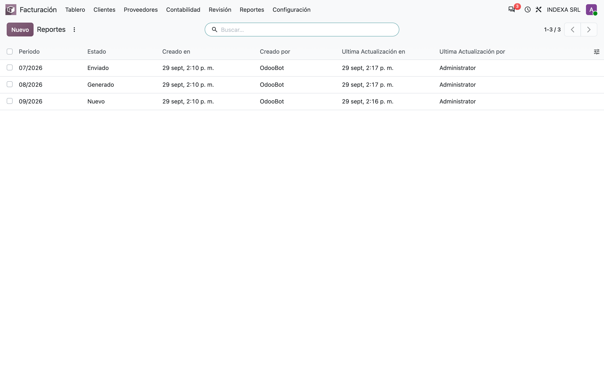

## 2. Modo de generación

En **Contabilidad › Configuración › Ajustes**, sección *República Dominicana*, el campo **Modo de declaración** decide cómo se generan los formatos:

| Modo | Botones en la declaración |
|---|---|
| **Todo junto** (por defecto) | un único *Generar declaraciones* que arma 606, 607, 608 y 609 a la vez y un único *Marcar como enviado* |
| **Por separado** | un botón *Generar* y un estado propio por formato; la declaración pasa a *Enviado* cuando los cuatro lo están |

## 3. Cuentas de retención: Tipo fiscal de cuenta

El 606 y el 607 no leen los impuestos de retención por su nombre sino por la **cuenta** en la que se contabilizan. En la ficha de la cuenta, debajo de *Cuenta principal*, el módulo agrega:

- **Tipo fiscal de cuenta** — la casilla del formulario IT-1 / 606 a la que va el saldo. Para retenciones: `A34` / `A36` (ITBIS retenido), `ISR` / `A38` (ISR retenido).
- **Tipo de retención ISR** — solo cuando el tipo es `ISR`; es la columna *Tipo de retención en ISR* del 606 (`02` = honorarios por servicios).

En el ejemplo la cuenta de la retención de ISR del 10% queda como `ISR` / `02`, y la del 100% de ITBIS como `A34`.

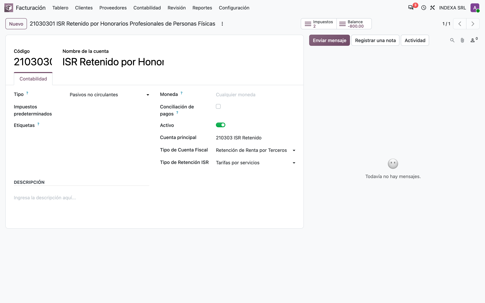

## 4. Contactos: Parte relacionada

En la ficha de un contacto dominicano, debajo del RNC / cédula, aparece **Relacionado** (*No relacionado* / *Relacionado*). Es la columna *Parte relacionada* del 609.

El campo solo se muestra cuando el país del contacto es República Dominicana.

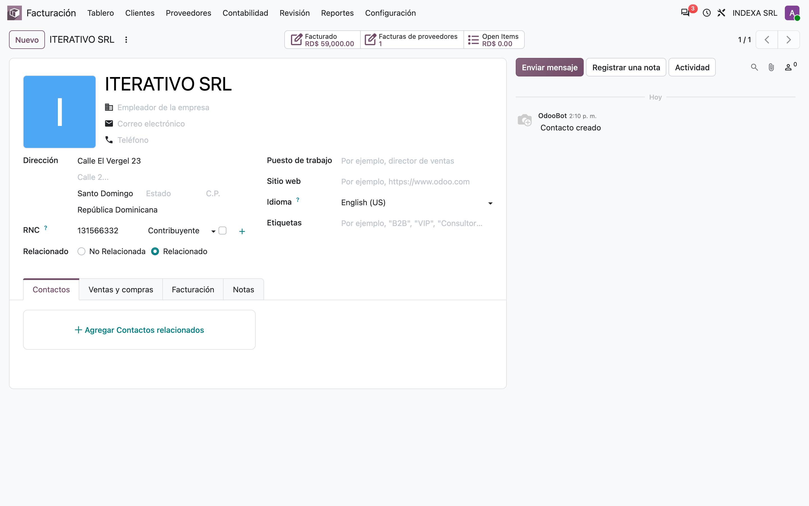

## 5. Facturas de pago al exterior (609)

Una factura de proveedor con comprobante **B17** (o **E47**) es un pago al exterior. Junto al número de documento el módulo pide:

- **Tipo de servicio** — obligatorio (*Gastos por trabajos, suministros y servicios* en el ejemplo).
- **Detalle del tipo de servicio** — la subcategoría DGII, filtrada por el tipo elegido (*Honorarios por servicios profesionales (personas morales)*, código `21`).

Esa factura va al **609**; en el 606 se declara con el **RNC de la propia compañía** y **sin retención de ISR**, que se declara en el 609.

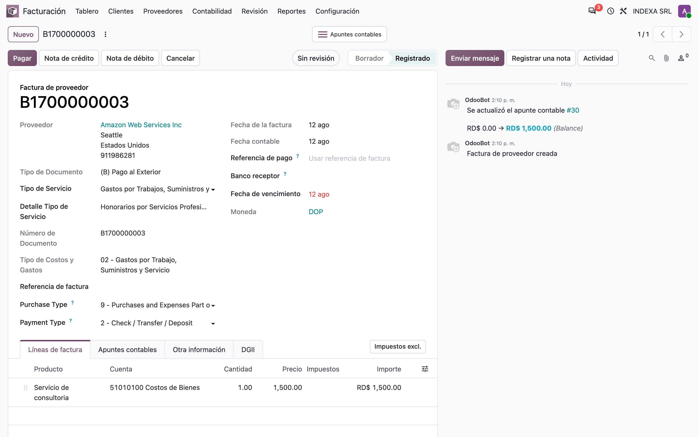

## 6. Crear la declaración del mes

**Nuevo**, escriba el **período** como `MM/AAAA` y guarde. Cualquier otro formato se rechaza.

Si existe una declaración **anterior** todavía en *Nuevo* o *Generado*, el formulario lo advierte: los meses se declaran en orden.

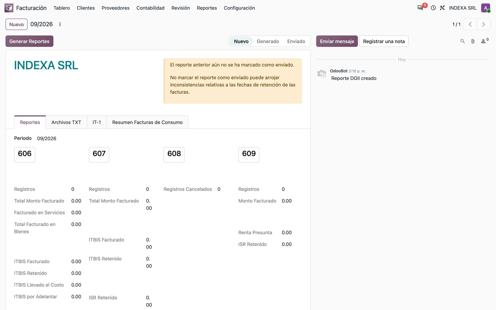

## 7. Generar: la pestaña Declaraciones

**Generar declaraciones** recorre las facturas del período y llena los cuatro formatos. La pestaña *Declaraciones* muestra los totales de cada uno:

| Formato | Registros | Qué incluye el ejemplo |
|---|---|---|
| 606 | 3 | compra fiscal B0100000045 (RD$25,000), compra informal B1100000012 (RD$8,000 con ITBIS e ISR retenidos), pago al exterior B1700000003 |
| 607 | 2 | venta fiscal B0100000101 (RD$50,000, cobrada en efectivo) y venta de consumo B0200000310 (RD$3,000 a crédito) |
| 608 | 1 | B0100000102 anulada, tipo `05` |
| 609 | 1 | B1700000003 de Amazon Web Services |

Cada recuadro tiene un botón para abrir las líneas del formato (pasos 11 a 14).

Entran al 606/607 las facturas **publicadas** del período y, además, las de meses anteriores que quedaron en estado fiscal *Parcial* y se pagaron en este mes (ver paso 15).

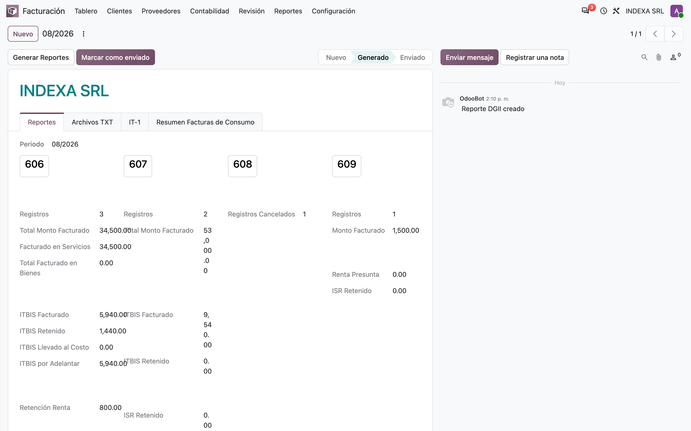

## 8. Los archivos TXT

La pestaña *Archivos TXT* tiene los cuatro archivos para subir a la DGII. Los del ejemplo:

**606** — la compra informal lleva fecha de pago, ITBIS retenido (1,440.00), tipo de retención ISR `02` con 800.00 y forma de pago `02`:

```
606|131793916  |202608|3
131566332|1|02|B0100000045||20260805||25000.00|0.00|25000.00|4500.00|0.00|0.00|0.00|4500.00|||0.00||0.00|0.00|0.00|04
22400559690|2|02|B1100000012||20260810|20260825|8000.00|0.00|8000.00|1440.00|1440.00|0.00|0.00|1440.00||02|800.00||0.00|0.00|0.00|02
131793916|1|02|B1700000003||20260812||1500.00|0.00|1500.00|0.00|0.00|0.00|0.00|0.00|||0.00||0.00|0.00|0.00|04
```

**607** — solo la venta fiscal: las facturas de consumo menores de RD$250,000 y los e-CF **no van en el TXT** (sí en las líneas y en el IT-1):

```
607|131793916  |202608|1
131566332  |1|B0100000101|                   |01|20260805||50000.00    |9000.00     |...|59000.00    |0.00 ...
```

**608** y **609**:

```
608|131793916  |202608|1
B0100000102|20260805|05

609|131793916  |202608|1
Amazon Web Services Inc                           |2|911986281 ...|840|2 |21|0|B1700000003 ...|20260812|1500.00 ...
```

Por defecto el 606 se escribe **sin espacios de relleno**. El parámetro del sistema `dgii.reports.txt.space` en `1` los conserva.

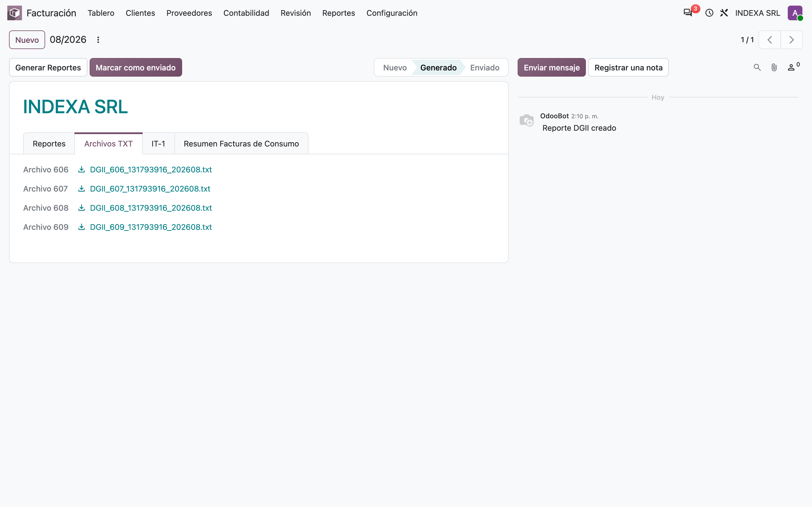

## 9. Resumen IT-1

La pestaña *IT-1* resume las ventas del período para copiar al formulario IT-1:

- **Operaciones del 607 por tipo de NCF** — cantidad y monto por comprobante (fiscal, consumo, e-CF, notas de crédito y débito, gubernamental, exportación...).
- **Operaciones por forma de venta** — efectivo, cheque / transferencia, tarjeta, a crédito, bonos, permuta, otras.
- **Operaciones por tipo de ingreso** — el *Tipo de ingreso* de cada factura de cliente.

En el ejemplo: RD$59,000 en efectivo (la B01 cobrada) y RD$3,540 a crédito (la B02 sin cobrar).

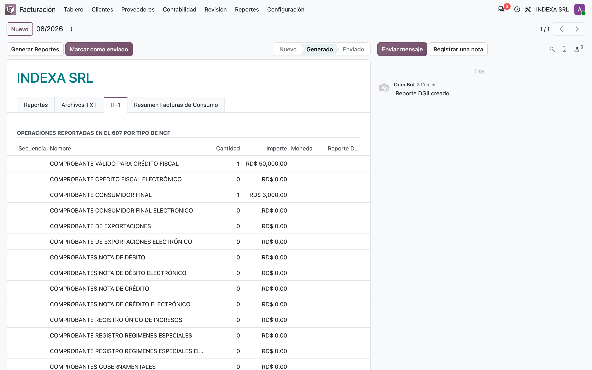

## 10. Resumen de facturas de consumo

La pestaña *Resumen de facturas de consumo* totaliza los comprobantes de consumo (B02 / E32) del período: cantidad, montos, ITBIS, ISC, otros impuestos, propina y forma de venta. Es la parte del IT-1 que la DGII pide por separado para consumidor final.

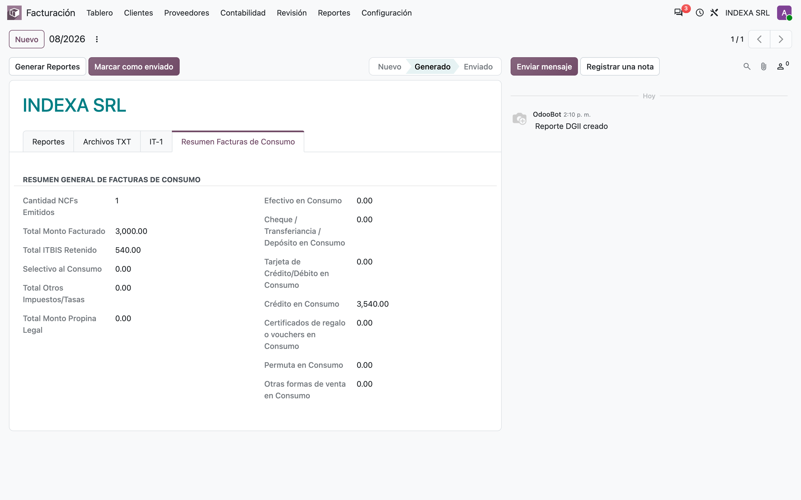

## 11. Líneas del 606

Una línea por factura de proveedor, con las mismas columnas del TXT. Los filtros permiten separar persona física / jurídica, retenciones de ITBIS o de ISR, y agrupar por contacto, tipo de gasto, tipo de retención o forma de pago.

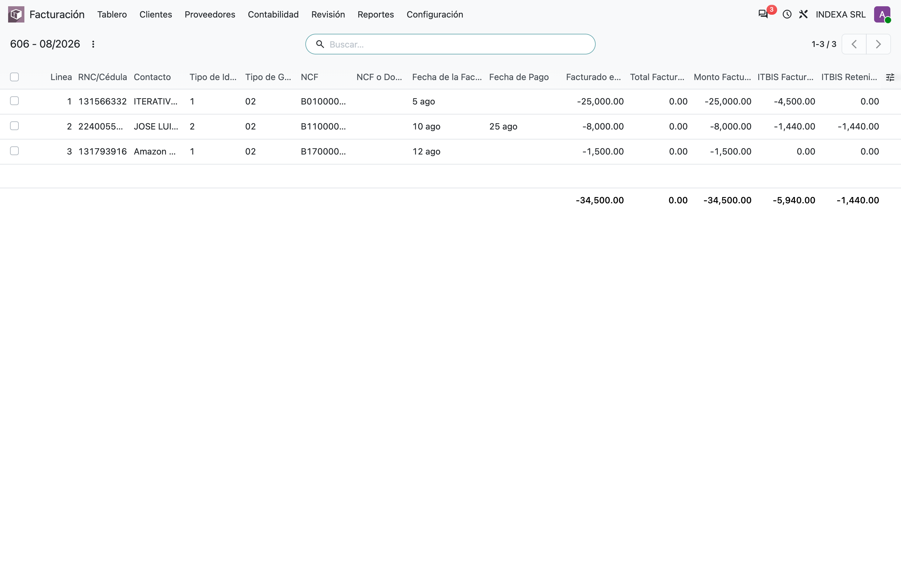

## 12. Líneas del 607

Las ventas del período con el desglose por forma de cobro. Las líneas de consumo por debajo de RD$250,000 aparecen atenuadas: están en el 607 del sistema pero no en el TXT.

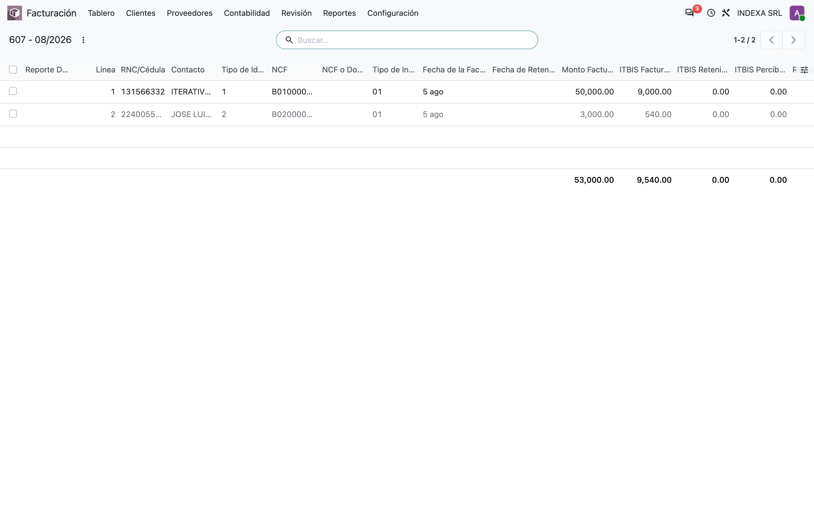

## 13. Líneas del 608

Comprobantes anulados: número, fecha y **tipo de anulación**, que se elige en el asistente al anular la factura (`l10n_do_accounting`).

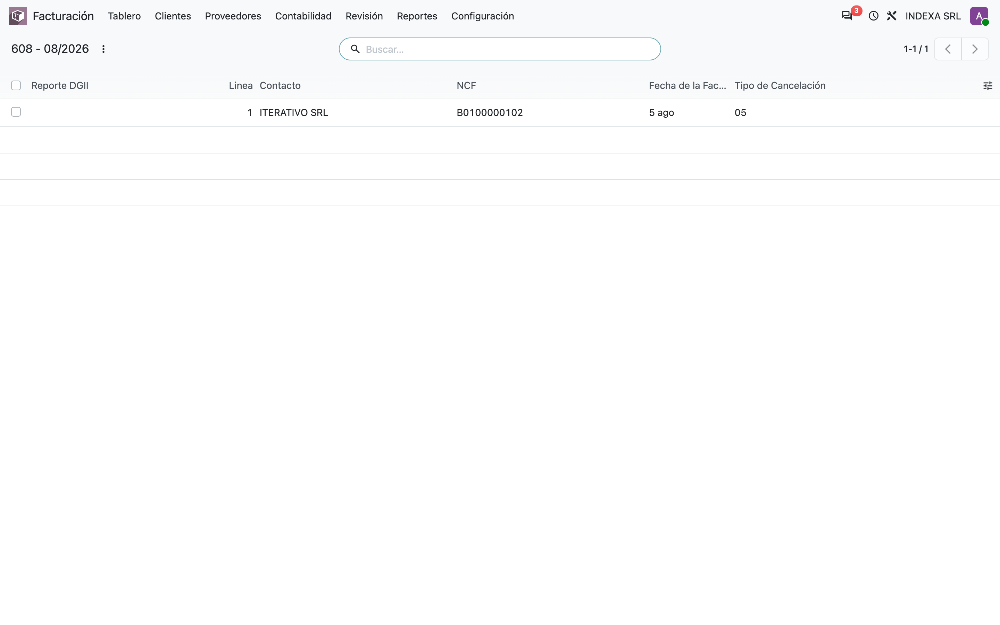

## 14. Líneas del 609

Pagos al exterior: razón social, identificación tributaria, **país en código ISO numérico** (`840` = EE. UU.), tipo y detalle del servicio, parte relacionada, fecha y monto.

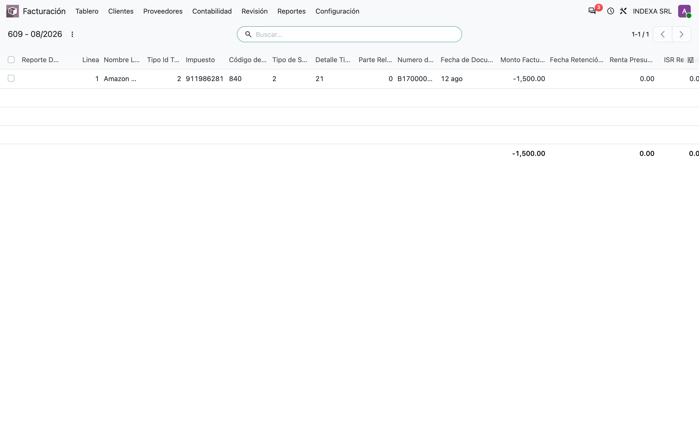

## 15. La pestaña DGII de la factura y su estado fiscal

Cada factura con comprobante tiene una pestaña **DGII** con los montos que la declaración va a usar: ITBIS facturado, retenido, llevado al costo, ISC, propina, fecha y forma de pago, servicios / bienes y tipo de retención ISR. Se recalculan al publicar y al registrar pagos.

El **estado fiscal** indica qué pasó con la factura en las declaraciones:

| Estado | Significado |
|---|---|
| (vacío) | todavía no entró en ninguna declaración |
| **No enviado** (rojo) | está en una declaración generada pero no enviada |
| **Parcial** (gris) | se declaró, pero tiene retenciones o un pago pendiente: volverá a aparecer en el mes en que se pague |
| **Declarado** (verde) | declarada por completo |

La compra informal del ejemplo está en *No enviado* porque 08/2026 está generada y aún no se marca como enviada.

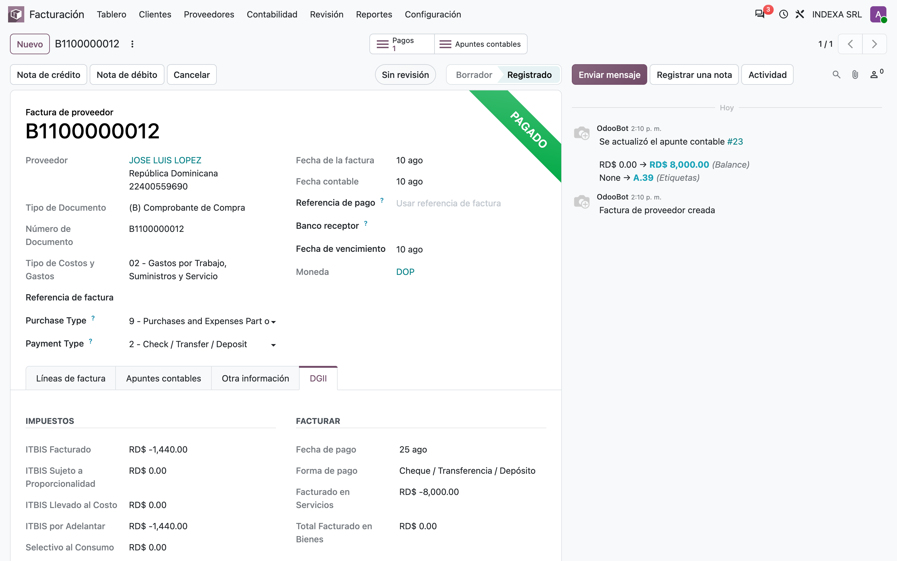

## 16. Volver a generar

Sobre una declaración ya generada, **Generar declaraciones** pide confirmación: al regenerar, los datos pueden cambiar respecto del archivo que ya se envió a la DGII. Regenerar borra y vuelve a crear las líneas de los cuatro formatos.

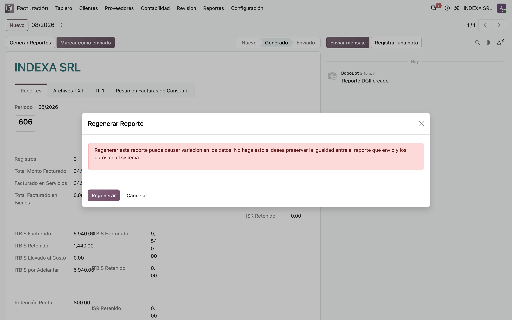

## 17. Marcar como enviada

Tras subir los archivos a la DGII, **Marcar como enviado** cierra la declaración: queda en *Enviado*, igual que sus cuatro formatos, y cada factura incluida pasa a **Declarado**, o a **Parcial** si todavía tiene retenciones o pagos por declarar.

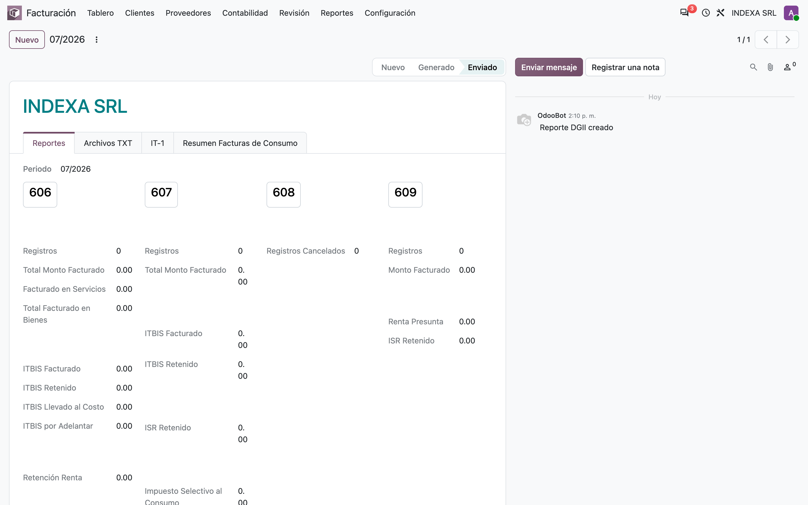

## Notas

### Reglas que conviene conocer

- **Anulación de e-CF por E34.** Una E41, E43 o E47 que tenga una nota de crédito **E34** publicada que la anule se excluye del 606 **junto con la nota**, aunque la E34 sea de un mes posterior.
- **Pagos al exterior y gastos menores** (B17 / E47 / B13) se declaran en el 606 con el **RNC de la compañía**.
- **Comprobante de compras (B11 / E41)**: no se puede publicar sin retener el **100% del ITBIS**.
- **Régimen especial y gasto menor**: una factura de cliente B14 / B13 no admite ITBIS ni ISC.
- Una línea de factura admite **una sola tasa de ITBIS**, y una factura **una sola retención** de cada tipo (ITBIS, ISR).

### Notas de la migración a la línea 20.0

Veredicto: **se porta**. Odoo Enterprise 20.0 trae en `l10n_do_reports` una exportación del **606 solamente**, calculada desde las cuadrículas de impuestos del informe de diarios; no tiene 607, 608, 609, IT-1, registro de declaraciones ni estado fiscal de las facturas.

Cambios que el usuario puede notar:

1. **Grupos de impuestos del plan dominicano.** En 19.0 todos los ITBIS (tasas y retenciones) estaban en un solo grupo *ITBIS*; en 20.0 las tasas están en *ITBIS 18% / 16% / Exento* y las retenciones en *Retenciones*. El módulo ahora reconoce los impuestos por el **registro del grupo** y no por su nombre. Sin ese cambio, ninguna factura informal se podía publicar, el ITBIS al 16% no llegaba al 606 y las validaciones de régimen especial, una tasa por línea y una retención por tipo no se disparaban. Las bases que vienen de 19.0 con el grupo *ITBIS* siguen funcionando.
2. El campo **Relacionado** del contacto ahora está debajo del RNC (20.0 quitó el selector Persona / Compañía donde estaba).
3. Los campos fiscales de la cuenta están debajo de **Cuenta principal** (20.0 reemplazó los grupos de cuentas).
4. **Seguridad**: permisos y la regla multicompañía pasan al nuevo modelo `ir.access`; un script de migración (`migrations/2.0.0`) libera los identificadores anteriores. Sin él la actualización se detiene.

### Pendiente / decisión funcional

- **Tipo de identificación del 609**: se escribe siempre `2` (persona jurídica). En 19.0 se comparaba con un valor que el campo nunca tuvo, así que ya salía siempre `2`; 20.0 eliminó ese campo y se mantuvo el resultado. Corregirlo (p. ej. `1` para personas físicas) es un cambio de contenido del 609.
- El 606 y el 607 muestran **fecha y forma de pago solo cuando la factura tiene retenciones**; una compra pagada sin retención sale como forma `04` (a crédito). Es la lógica heredada.
- El módulo identifica *Otros impuestos* y *Propina* por el **nombre** del grupo de impuestos, que es traducible.
- Los enlaces del 606/607 (widget `dgii_reports_url`) no tienen JavaScript desde la 13.0 y se muestran como texto.

### Reproducir este manual

El seed (`configs/dgii_reports.seed.py`) arma sobre una base limpia la compañía INDEXA SRL con plan dominicano en español, las cuentas de retención clasificadas, los terceros, el mes 08/2026 completo y las tres declaraciones.
