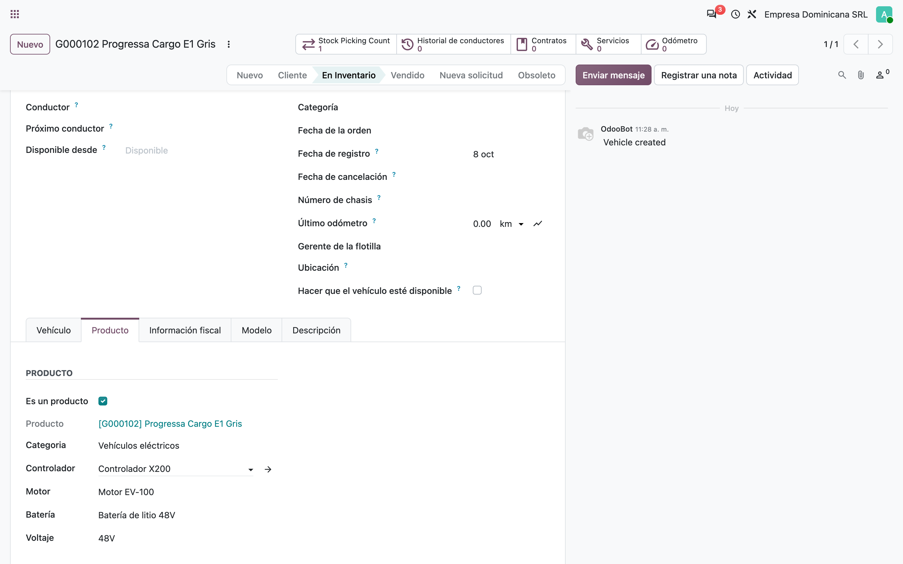
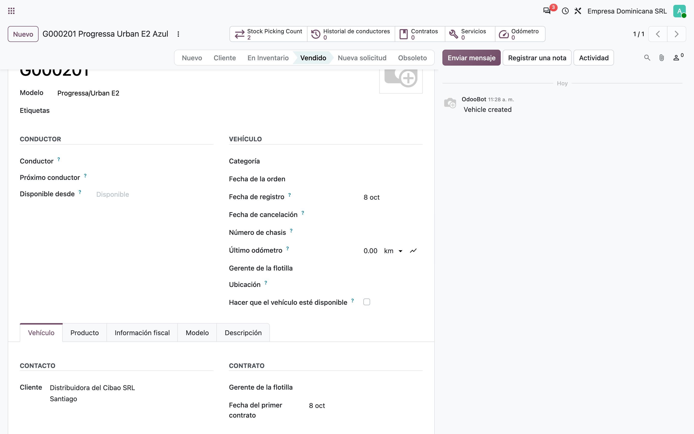
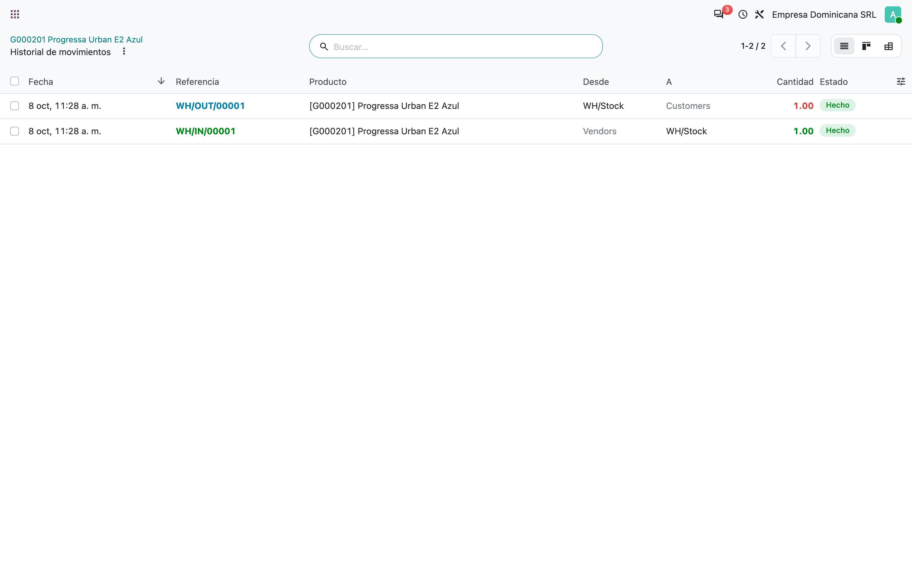
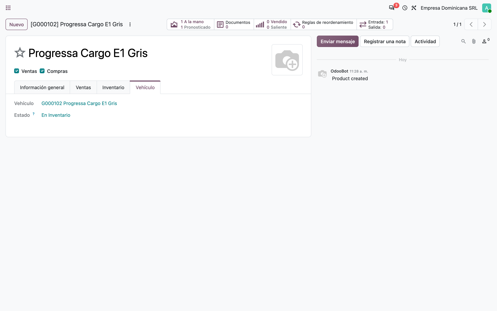
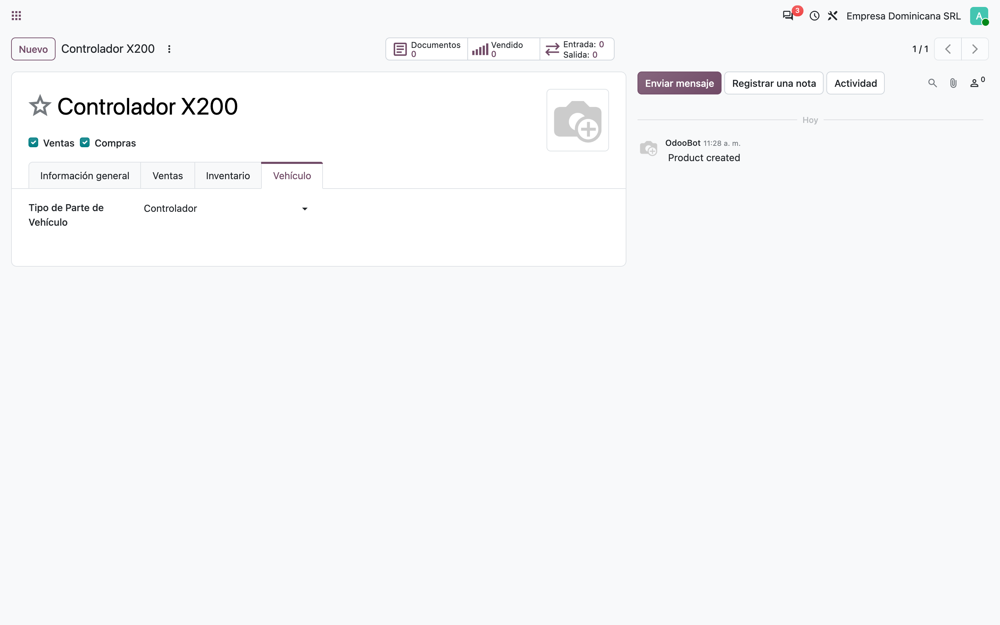
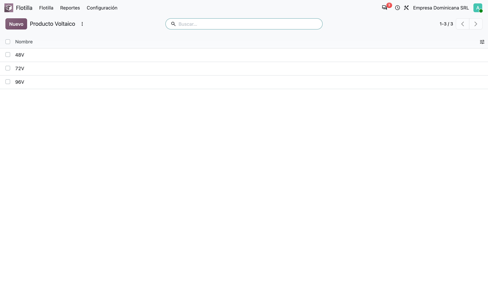
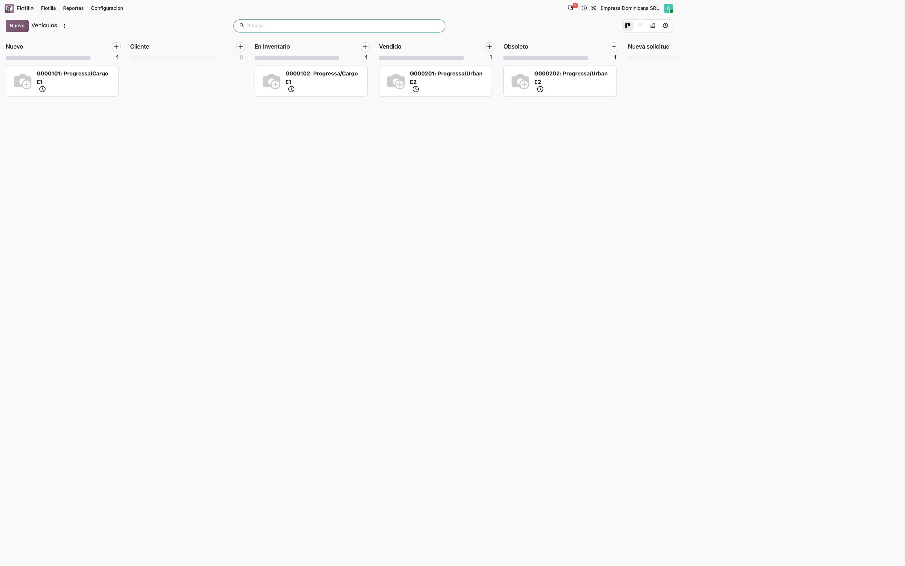

# Vehículos como productos — Manual de usuario (fleet_product_management, Odoo 20.0)

> Manual generado con `tools/manual-generator`. Las capturas se regeneran ejecutando el generador contra una base `test_v20_<módulo>`.

Este módulo convierte cada **vehículo de Flota** en un **producto almacenable** de Inventario. El estado del vehículo (*Nuevo*, *Cliente*, *En Inventario*, *Vendido*, *Obsoleto*) deja de cambiarse a mano y lo decide cada **movimiento de inventario** validado del producto: recepciones, entregas y desechos. Además registra los **componentes** del vehículo (controlador, motor, batería) y su **voltaje**.

Ni Odoo 20.0 ni Enterprise vinculan un vehículo de Flota con un producto ni derivan su estado de los movimientos de inventario, por eso el módulo se porta.

**Qué cambió en 20.0:**

- Odoo 20.0 eliminó el modelo de desechos `stock.scrap`: un desecho es ahora un movimiento de inventario marcado como desecho (*Inventario → Operaciones → Desechos*). El módulo reconoce ese movimiento y pasa el vehículo a **Obsoleto**.
- Los permisos pasan al nuevo modelo de accesos de 20.0 (`ir.access`): los usuarios de Flota leen los voltajes y los responsables de Flota los administran, igual que en 19.0.

## Requisitos previos

- Módulo **`fleet_product_management`** `20.0.2.0.0` instalado. Depende de **Flota** (`fleet`), **Inventario** (`stock`), **Productos** y **Alquiler** (`sale_renting`, Enterprise).
- Usuario con grupo **Flota: Responsable** para configurar voltajes y **Inventario: Usuario** para ver el botón de movimientos del vehículo.
- El vehículo debe tener **Es un producto** marcado (valor por defecto) para que Odoo cree su producto.

## 1. Vehículo con su producto y componentes

**Flotilla → Flotilla**, abra un vehículo y vaya a la pestaña **Producto**:

- **Es un producto**: al guardarlo, Odoo crea un producto almacenable con el nombre *Marca Modelo Color* y lo enlaza al vehículo.
- **Categoría**: es la categoría del producto enlazado.
- **Controlador**, **Motor** y **Batería** solo ofrecen productos marcados con ese *Tipo de Parte de Vehículo*.
- **Voltaje**: tomado de *Flotilla → Configuración → Producto Voltaico*.

La barra de estado de la cabecera ya no es clicable: el estado lo fija el inventario. La matrícula que aparece delante del nombre es la **Referencia interna** del producto.

## 2. Vehículo vendido: el cliente lo pone la entrega

Al validar una **entrega** a una ubicación de cliente cuyo documento origen es una orden de venta (*S…*), el vehículo pasa a **Vendido** y la pestaña **Vehículo** muestra el **Contacto** de la entrega. Una entrega a cliente sin orden de venta, o desde una orden de alquiler, lo deja en **Cliente**. Cuando el vehículo vuelve a una ubicación interna pasa a **En Inventario** y el contacto se borra.

## 3. Historial de movimientos del vehículo

El botón inteligente de movimientos del vehículo (rotulado *Stock Picking Count*) abre las líneas de movimiento de inventario de su producto: aquí la recepción y la entrega que lo llevaron a *Vendido*.

## 4. El producto enlazado

En **Inventario → Productos**, el producto de un vehículo tiene la pestaña **Vehículo** con el vehículo enlazado y su estado. Mientras esté enlazado, el **Tipo de producto** queda bloqueado y la pestaña de variantes se oculta.

## 5. Productos componentes

Un producto que **no** es un vehículo muestra en la pestaña **Vehículo** el campo **Tipo de Parte de Vehículo** (*Controlador*, *Motor*, *Batería*). Solo los productos con ese tipo aparecen en los campos de componentes del vehículo. Un producto enlazado a un vehículo no puede ser, a la vez, un componente.

## 6. Configurar voltajes

**Flotilla → Configuración → Producto Voltaico**: lista editable de los voltajes que se asignan a los vehículos.

## 7. Vehículos por estado

La vista kanban de **Flotilla → Flotilla** agrupa los vehículos por estado. Con los datos de ejemplo: uno recién creado (*Nuevo*), uno recibido en almacén (*En Inventario*), uno entregado por una orden de venta (*Vendido*) y uno enviado a desecho (*Obsoleto*).

## Notas

- El estado solo cambia con movimientos **validados**; un cambio manual del estado de un vehículo enlazado a un producto se rechaza.
- Una orden de alquiler con *Albaranes de alquiler* activado entrega a la ubicación interna *Clientes/Alquiler*: el módulo la trata como ubicación interna y deja el vehículo en **En Inventario**, no en *Cliente* (comportamiento heredado de 19.0).
- La **Referencia interna** de cualquier producto es única en toda la base mientras el módulo esté instalado, no solo la de los vehículos.
