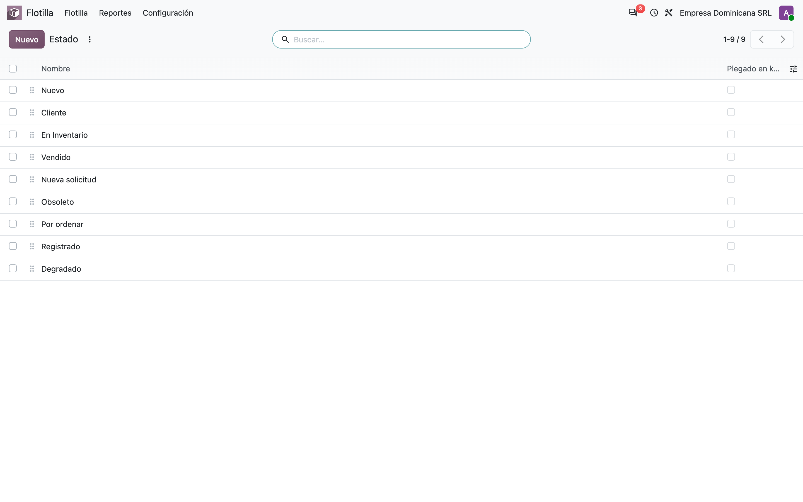
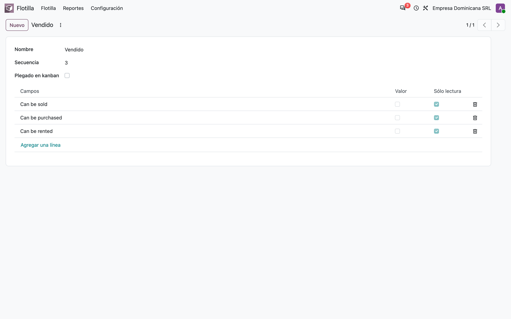
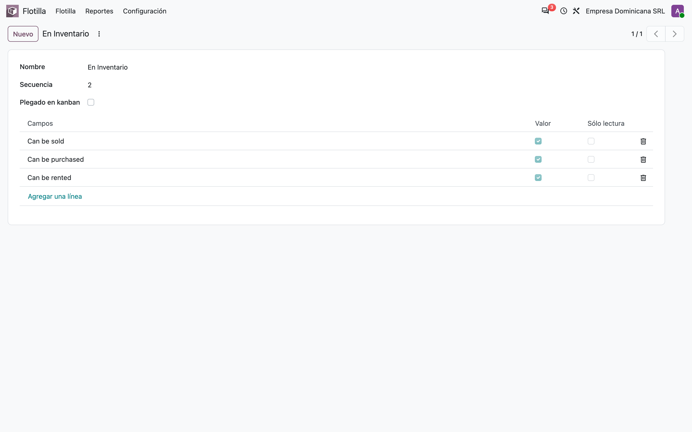
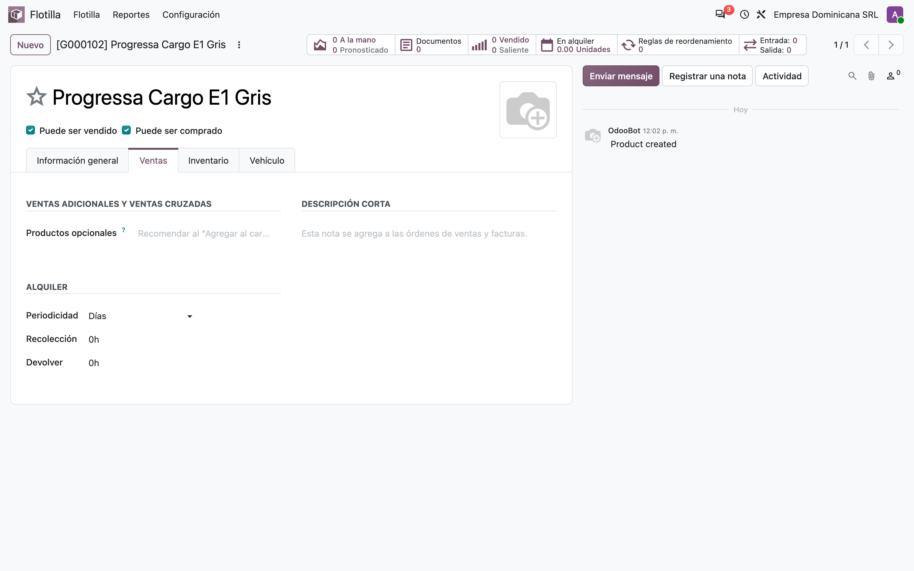
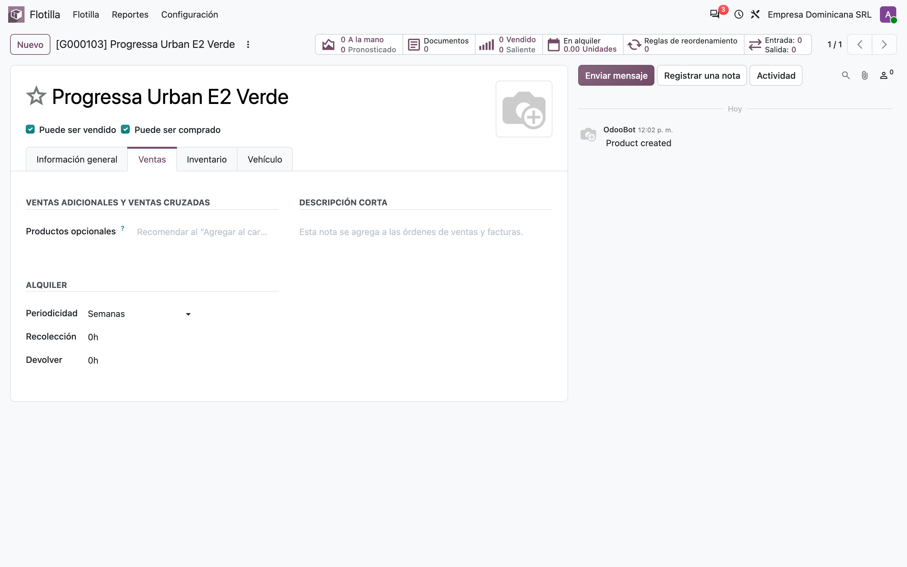
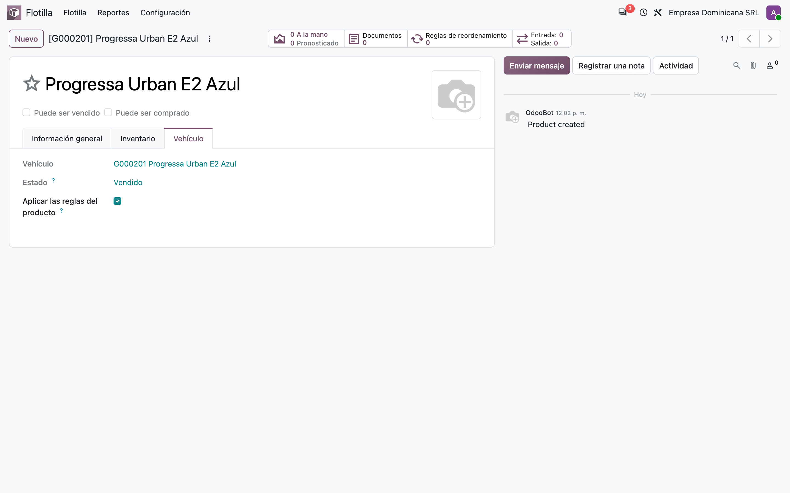
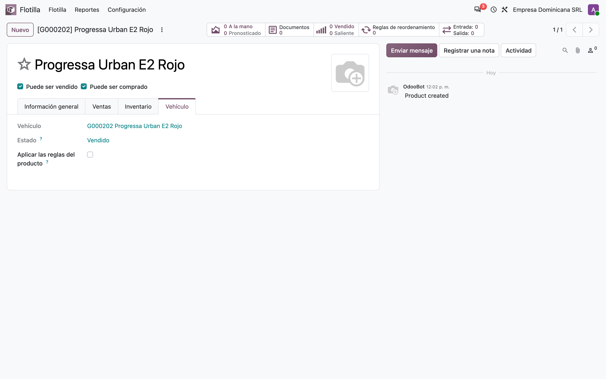

# Reglas de producto por estado del vehículo — Manual de usuario (fleet_product_rules, Odoo 20.0)

> Manual generado con `tools/manual-generator`. Las capturas se regeneran ejecutando el generador contra una base `test_v20_<módulo>`.

Este módulo permite definir, en cada **estado de vehículo** de Flota, **reglas** que deciden si el producto enlazado al vehículo (ver `fleet_product_management`) **se puede vender**, **se puede comprar** o **se puede alquilar**. Cuando el vehículo cambia de estado, el producto se ajusta solo, y una regla marcada como **Sólo lectura** impide cambiar ese indicador a mano en la ficha del producto.

Ni Odoo 20.0 ni Enterprise controlan los indicadores de venta, compra o alquiler de un producto según el estado de un vehículo, por eso el módulo se porta.

**Qué cambió en 20.0:**

- Alquiler (`sale_renting`) eliminó la casilla *Alquilable* (`rent_ok`). Un producto se alquila ahora cuando tiene una **Periodicidad de alquiler** (*Horas*, *Días*, *Noches*, *Semanas*), en la pestaña **Ventas → Alquiler**. La regla *Can be rented* (alquilar) controla esa periodicidad: **desactivada** la vacía (el producto deja de ser alquilable); **activada** conserva la periodicidad que el producto ya tenía, o pone **Días** si no tenía ninguna.
- Las reglas de alquiler de una base 19.0 se convierten solas al actualizar el módulo.
- Los permisos pasan al nuevo modelo de accesos de 20.0 (`ir.access`): los usuarios de Flota leen las reglas y los responsables de Flota las administran, igual que en 19.0.

## Requisitos previos

- Módulo **`fleet_product_rules`** `20.0.2.0.0` instalado. Depende de **`fleet_product_management`** (vehículos como productos), que a su vez depende de **Flota**, **Inventario** y **Alquiler** (`sale_renting`, Enterprise).
- Usuario con grupo **Flota: Responsable** para crear o cambiar reglas; **Flota: Usuario** solo las consulta.
- El vehículo debe estar enlazado a un producto (**Es un producto** marcado en el vehículo).

## 1. Estados de vehículo

**Flotilla → Configuración → Estados**. Con el módulo, la lista deja de ser editable en línea: al hacer clic en un estado se abre su formulario, donde están sus reglas. Al instalar el módulo cada estado estándar (*Nuevo*, *Cliente*, *En Inventario*, *Vendido*, *Obsoleto*) recibe tres reglas: vender y comprar activadas, alquilar desactivada. Los estados propios de Flota (*Nueva solicitud*, *Por ordenar*, *Registrado*, *Degradado*) no traen reglas.

## 2. Reglas de un estado: vehículo vendido

En el formulario del estado, la tabla de reglas tiene tres columnas:

- **Campos**: qué indicador controla la regla: *Can be sold* (vender), *Can be purchased* (comprar) o *Can be rented* (alquilar). Estas opciones se muestran en inglés aunque el usuario use español (también en 19.0).
- **Valor**: el valor que toma el producto mientras el vehículo esté en este estado.
- **Sólo lectura**: si está marcado, el indicador queda bloqueado en la ficha del producto.

En el ejemplo, un vehículo **Vendido** no se puede vender, comprar ni alquilar, y nadie puede cambiarlo desde el producto.

## 3. Permitir el alquiler en un estado

En el estado **En Inventario** del ejemplo, la regla *Can be rented* tiene **Valor** activado: los vehículos en almacén quedan disponibles para alquilar. Si hay varias reglas para el mismo indicador en un estado, gana la última de la lista.

## 4. Producto de un vehículo en inventario

En el producto del vehículo (**Inventario → Productos**), pestaña **Ventas**, grupo **Alquiler**: la regla del estado *En Inventario* puso la **Periodicidad** en **Días** porque el producto no tenía ninguna. *Se puede vender* y *Se puede comprar* (casillas de la cabecera) siguen las reglas de vender y comprar del estado.

## 5. La regla respeta la periodicidad existente

Este otro producto ya se alquilaba por **Semanas** antes de pasar a *En Inventario*. La regla *Can be rented* activada no la cambia: solo pone *Días* cuando el producto no tiene periodicidad.

## 6. Producto de un vehículo vendido: indicadores bloqueados

El vehículo pasó a **Vendido**: *Se puede vender* y *Se puede comprar* están desmarcados y en sólo lectura, y la periodicidad de alquiler se vació. Como el producto ya no se vende, Odoo 20.0 oculta además la pestaña **Ventas** (y con ella la periodicidad de alquiler). La pestaña **Vehículo** muestra el vehículo, su estado y la casilla **Aplicar las reglas del producto**.

## 7. Excluir un producto de las reglas

Desmarque **Aplicar las reglas del producto** en la pestaña **Vehículo** para que un producto concreto deje de seguir las reglas de su estado. Sus indicadores vuelven a ser editables a mano: aquí el vehículo está *Vendido* pero su producto sigue a la venta.

## Notas

- Las reglas se aplican cuando el vehículo cambia de estado (por un movimiento de inventario validado, ver `fleet_product_management`) o cuando se modifican las reglas del estado.
- La periodicidad que pone la regla es siempre **Días**, con horas de recogida y devolución a las 00:00; ajústelas en la pestaña **Ventas** si el alquiler es por días.
- Si un producto pasa por un estado que desactiva el alquiler y luego vuelve a uno que lo activa, recupera **Días**, no la periodicidad que tenía antes.
- Al desmarcar **Aplicar las reglas del producto**, los indicadores no siempre se quedan como estaban: pueden volver al último valor guardado antes de la regla (comportamiento heredado de 19.0).
