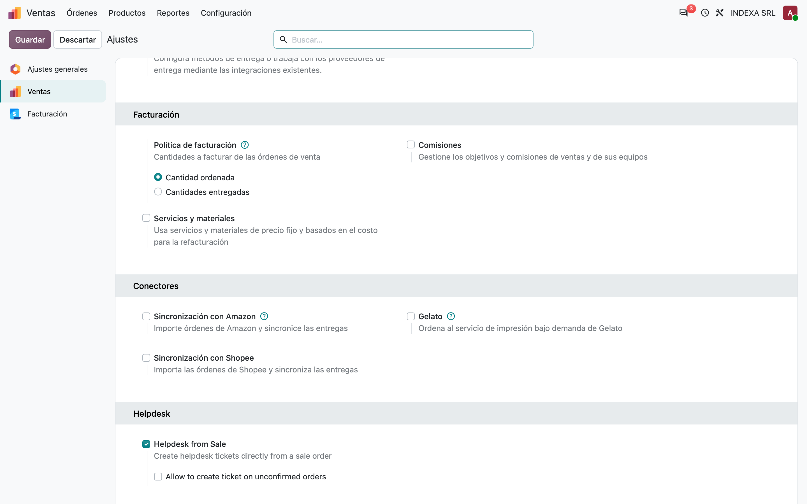
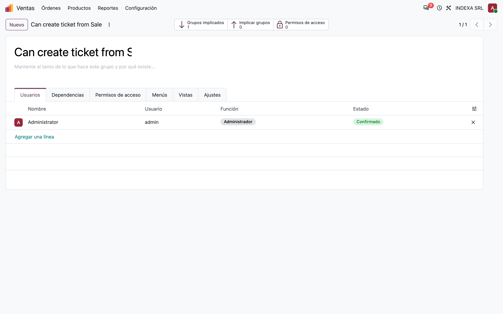
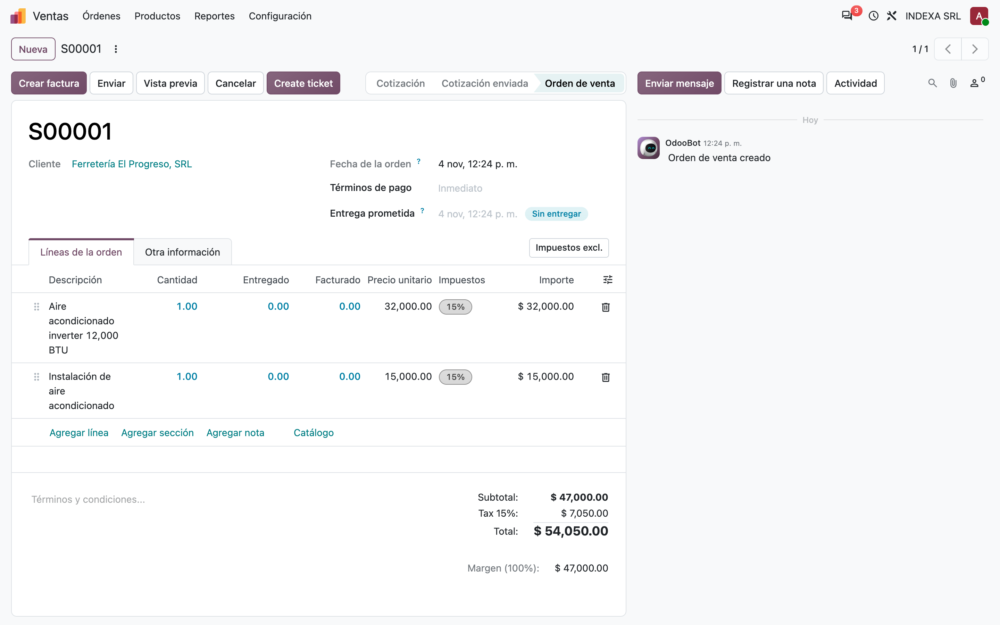
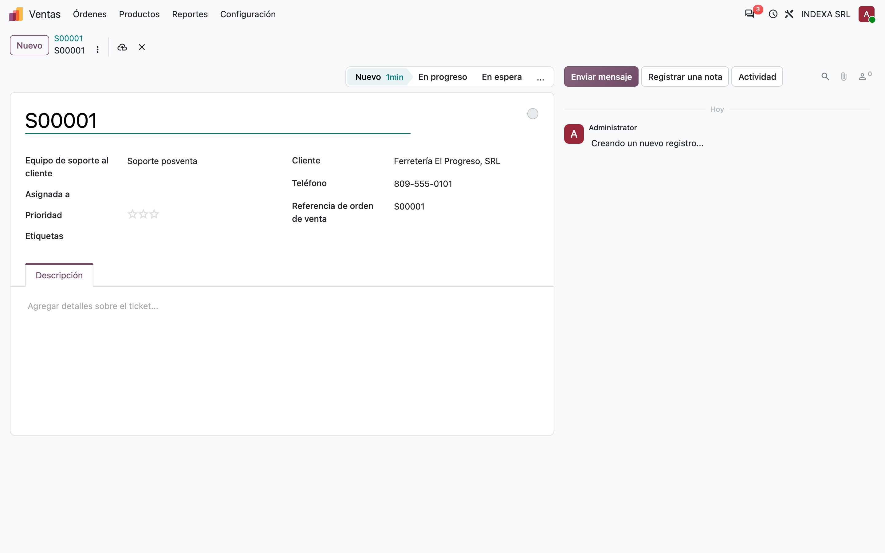
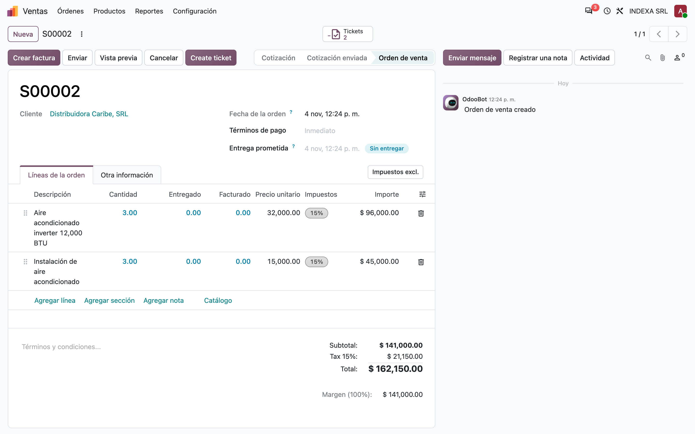
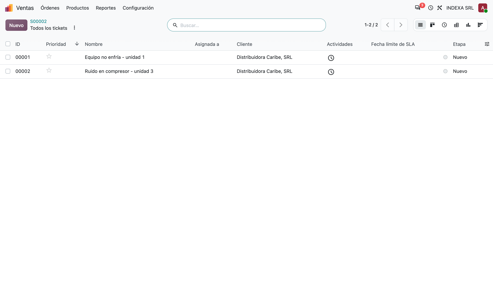
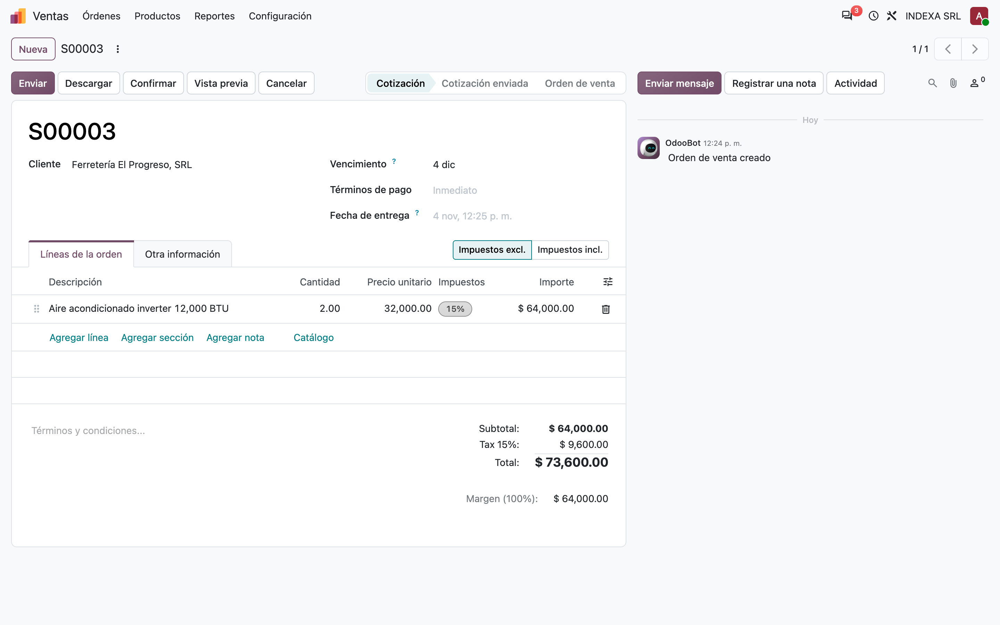
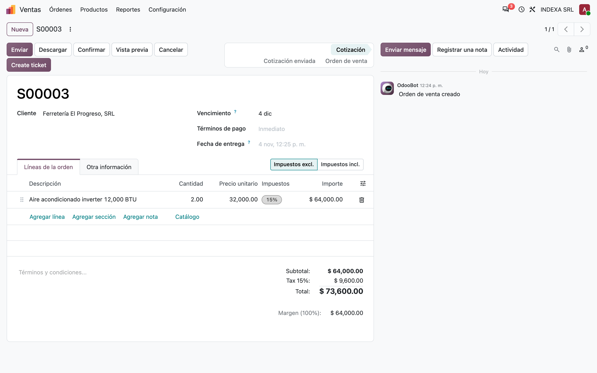

# Tickets de soporte desde el pedido de venta — Manual de usuario (helpdesk_sale_custom)

> Manual generado con `tools/manual-generator`. Las capturas se regeneran ejecutando el generador contra una base `test_v20_<módulo>`.

En Odoo estándar un ticket de **Soporte** se puede vincular a un pedido de venta, pero solo desde el ticket, y el campo *Pedido de venta* queda oculto cuando el equipo de soporte no factura tiempo. Desde el pedido no hay forma de abrir un ticket.

Este módulo invierte el camino: el vendedor abre el ticket **desde el propio pedido de venta**, con el cliente, la compañía y la referencia del pedido ya rellenados, y el pedido muestra un botón inteligente **Tickets** con los casos abiertos para él.

Además agrega un grupo de seguridad, **Can create ticket from Sale**, que decide qué vendedores pueden crear o modificar tickets.

## Requisitos previos

- Módulo **`helpdesk_sale_custom`** instalado (versión `20.0.2.0.0`, línea 20.0). Depende de **`helpdesk_sale`** (Enterprise), que a su vez instala *Soporte* y *Ventas*.
- La opción **Helpdesk from Sale** encendida en *Ventas › Configuración › Ajustes* (por compañía).
- El usuario debe pertenecer al grupo **Can create ticket from Sale** o ser usuario de *Soporte* para crear o modificar tickets.

## 1. Encender la opción en Ventas

En *Ventas › Configuración › Ajustes* aparece el bloque **Helpdesk** con la opción **Helpdesk from Sale** (*Create helpdesk tickets directly from a sale order*).

Al encenderla se muestra una segunda casilla, **Allow to create ticket on unconfirmed orders**, que permite abrir tickets también desde cotizaciones que todavía no se han confirmado.

Ambas opciones son **por compañía** (se guardan en `res.company`).

## 2. Quién puede crear tickets

El módulo crea el grupo **Can create ticket from Sale**. Solo los usuarios de ese grupo ven el botón **Create ticket** en el pedido.

Al crear o modificar un ticket se valida que el usuario pertenezca a este grupo **o** sea usuario de *Soporte*. Un vendedor que no esté en ninguno de los dos recibe el mensaje *You are not authorized to modify this document*.

Los tickets que llegan por el formulario del sitio web o del portal se siguen creando sin restricción.

## 3. El botón Create ticket en el pedido confirmado

En un pedido de venta **confirmado** aparece el botón **Create ticket** en la cabecera, junto a los botones de Odoo.

El botón solo se muestra cuando la opción del paso 1 está encendida y el usuario pertenece al grupo del paso 2.

## 4. El ticket se abre con los datos del pedido

Al pulsar **Create ticket** se abre el formulario de un ticket nuevo con estos datos ya rellenados:

| Campo | Valor |
|---|---|
| **Título** | la referencia del pedido (p. ej. `S00001`) |
| **Cliente** | el cliente del pedido |
| **Pedido de venta** | el pedido desde el que se abrió |
| **Compañía** | la compañía del pedido |

El campo **Pedido de venta** queda visible en el ticket aunque el equipo no facture tiempo, para que el vínculo con la venta siempre se vea. Se completa el resto (equipo, descripción, prioridad) y se guarda.

## 5. El botón inteligente Tickets

Cuando el pedido ya tiene tickets vinculados aparece el botón inteligente **Tickets** con la cantidad. En el ejemplo, el pedido de *Distribuidora Caribe, SRL* tiene **2** tickets abiertos.

## 6. Los tickets del pedido

Al pulsar el botón **Tickets** se abre la lista con los tickets de ese pedido. Si el pedido tiene **un solo** ticket, se abre directamente su formulario.

## 7. Cotizaciones sin confirmar

Con **Allow to create ticket on unconfirmed orders** apagado, una cotización en borrador **no** muestra el botón **Create ticket**: solo los pedidos confirmados permiten abrir tickets.

## 8. Permitir tickets desde cotizaciones

Al encender **Allow to create ticket on unconfirmed orders** en los ajustes y guardar, la misma cotización ya muestra **Create ticket**, y el botón **Tickets** también se muestra en cotizaciones que tengan tickets.

## Notas

**Alcance y límites**

- Las etiquetas del módulo (*Create ticket*, *Helpdesk from Sale*, *Can create ticket from Sale*) están en inglés: el módulo no trae traducción al español.
- Si además está instalado `helpdesk_sale_timesheet`, el pedido muestra el botón **Tickets** de Odoo junto al de este módulo.
- Un vendedor sin el grupo **Can create ticket from Sale** y sin ser usuario de *Soporte* no puede crear ni modificar tickets, aunque su permiso de acceso de vendedor lo permita.

**Notas de la migración a 20.0**

- La seguridad pasó de `ir.model.access.csv` a **`security/ir.access.csv`** (`ir.model.access` e `ir.rule` se fusionaron en `ir.access`). El script `migrations/20.0.1.0.0/pre-migrate.py` libera los xmlid viejos antes de cargar el archivo nuevo.
- La acción de la lista de tickets se lee con `_for_xml_id()` en lugar de `read()` sobre la acción.
