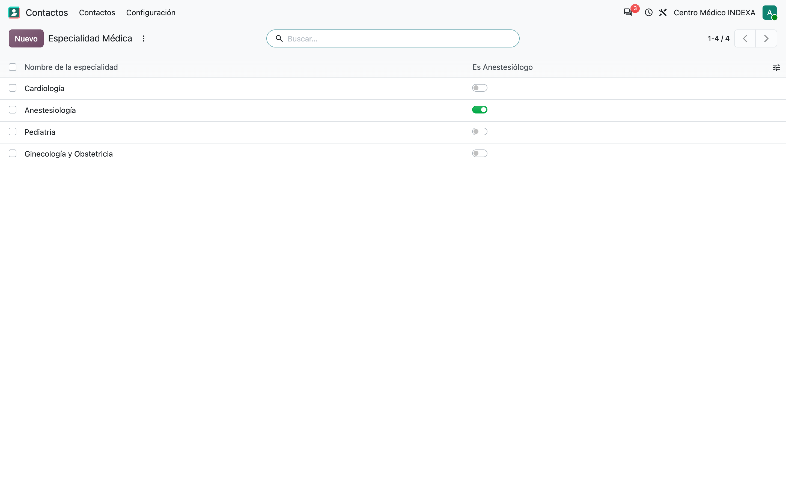
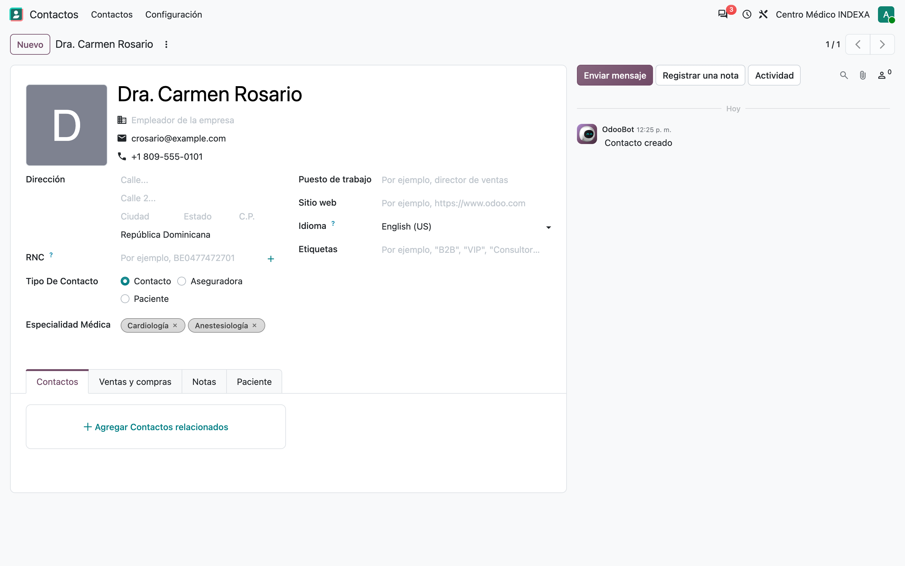
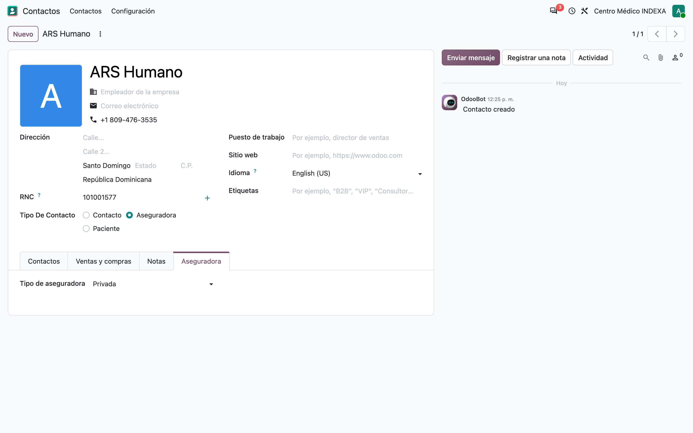
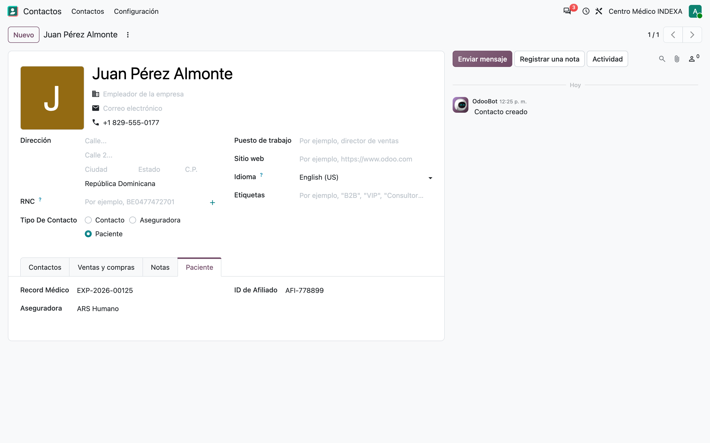
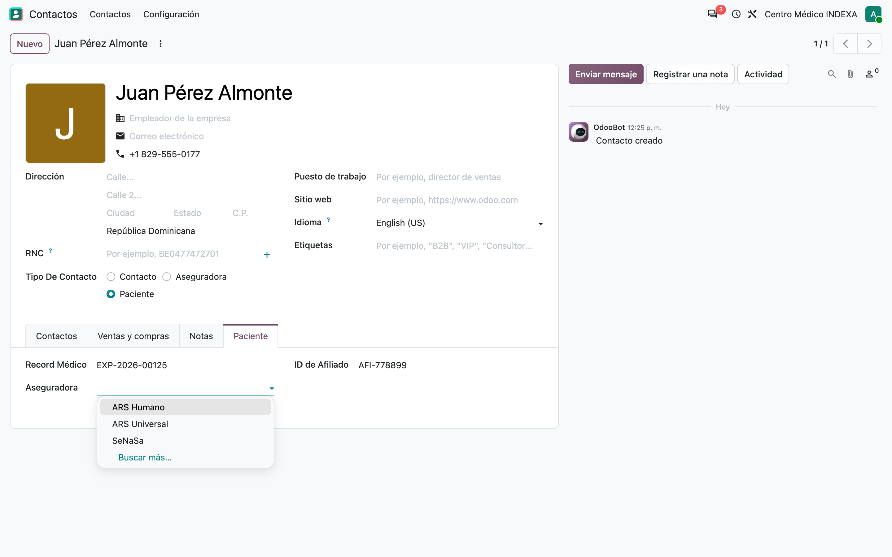
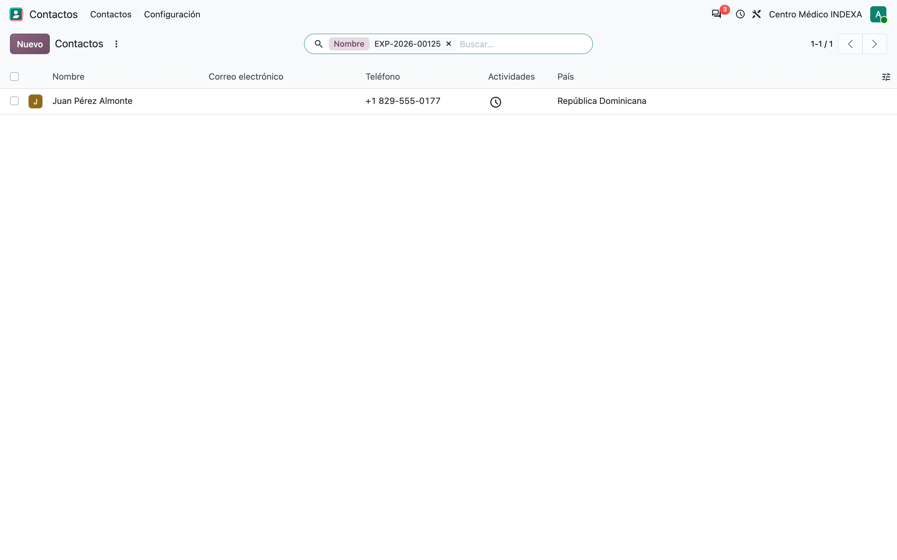

# HMS Contactos — Manual de usuario (hms_partner)

> Manual generado con `tools/manual-generator`. Las capturas se regeneran ejecutando el generador contra una base `test_v20_<módulo>`.

El módulo **HMS Partner** adapta los **Contactos** de Odoo a un centro de salud. Cada contacto se clasifica como **Contacto** (médicos, suplidores y demás), **Aseguradora** (ARS) o **Paciente**, y según esa clasificación el formulario muestra los datos que corresponden: especialidades médicas para los médicos, tipo de aseguradora para las ARS, y expediente, aseguradora e ID de afiliado para los pacientes.

Es la base de los demás módulos HMS (`hms_account`, `hms_sales`): ellos leen estos campos para facturar a la aseguradora correcta.

## Requisitos previos

- Módulo **`hms_partner`** instalado (v `20.0.1.0.0`, Odoo 20.0). Depende solo de **Contactos** (`contacts`).
- El usuario debe pertenecer al grupo **Medical Service User** (*Ajustes › Usuarios › Permisos*). Sin ese grupo los campos médicos y las pestañas *Paciente* / *Aseguradora* no aparecen, y el catálogo de especialidades queda inaccesible. Al instalar, el administrador queda en el grupo.

## 1. Catálogo de especialidades médicas

En *Contactos › Configuración › Especialidad Médica* se mantiene el catálogo de especialidades que luego se asignan a los médicos.

Cada especialidad tiene un nombre y el interruptor **Es Anestesiólogo**. Ese interruptor marca automáticamente como anestesiólogo a todo médico que tenga la especialidad (campo `is_anesthesiologist` del contacto), lo que los módulos de facturación usan para distinguir los honorarios de anestesia.

## 2. Un médico: tipo Contacto con especialidades

Debajo del RNC/Cédula aparece **Tipo De Contacto**, con tres opciones: *Contacto*, *Aseguradora* y *Paciente*. Con *Contacto* seleccionado se muestra **Especialidad Médica**, donde se asignan una o varias especialidades del catálogo.

La Dra. Carmen Rosario tiene *Anestesiología* y *Cardiología*: como Anestesiología está marcada como especialidad de anestesia, el sistema la considera anestesióloga sin que haya que marcar nada más en el contacto.

## 3. Una aseguradora (ARS)

Con **Tipo De Contacto = Aseguradora** desaparecen las especialidades y la pestaña *Paciente*, y aparece la pestaña **Aseguradora** con el **Tipo de aseguradora**: *Privada* (ARS Humano, ARS Universal…) o *Pública* (SeNaSa).

Solo los contactos de este tipo pueden elegirse luego como aseguradora de un paciente.

## 4. Un paciente: expediente, aseguradora y afiliado

Con **Tipo De Contacto = Paciente** la pestaña **Paciente** recoge:

| Campo | Uso |
|---|---|
| **Record Médico** | número de expediente del paciente en el centro |
| **Aseguradora** | la ARS del paciente; la lista solo ofrece contactos de tipo *Aseguradora* |
| **ID de Afiliado** | número de afiliado en esa ARS; se vuelve **obligatorio** en cuanto se elige una aseguradora |

Un paciente sin seguro (pago privado) deja *Aseguradora* vacía y no necesita ID de afiliado.

## 5. El campo Aseguradora solo ofrece ARS

Al desplegar **Aseguradora** en un paciente, la lista muestra únicamente contactos de tipo *Aseguradora*. Médicos, pacientes y demás contactos no aparecen, lo que evita asignar por error una aseguradora que no lo es.

## 6. Buscar un paciente por expediente o afiliado

El buscador de contactos encuentra a un paciente escribiendo su **número de expediente** o su **ID de afiliado**, igual que si se escribiera su nombre. Esto funciona también en cualquier campo que seleccione un contacto (por ejemplo el cliente de una factura o de un pedido): basta escribir `EXP-2026-00125` para que aparezca Juan Pérez Almonte.

El panel de búsqueda además ofrece **Record Médico** e **ID de Afiliado** como criterios explícitos.

## 7. Permisos

Todo lo anterior está restringido al grupo **Medical Service User**. Un usuario interno que no lo tenga ve el formulario de contacto estándar de Odoo, sin *Tipo De Contacto* ni pestañas médicas, y no puede abrir el catálogo de especialidades.

El módulo crea además el grupo **Edit medical info when order is confirmed**, que no se usa aquí: lo consultan `hms_account` y `hms_sales` para permitir corregir los datos médicos de facturas publicadas y pedidos ya confirmados.

## Notas

**Notas de la migración a 20.0**

- La seguridad pasó de `ir.model.access.csv` a **`security/ir.access.csv`** (`ir.model.access` e `ir.rule` se fusionaron en `ir.access`). El script `migrations/20.0.1.0.0/pre-migrate.py` libera el xmlid viejo antes de cargar el CSV nuevo; sin él, actualizar una base 19.0 falla.
- Odoo 20.0 eliminó el campo `company_registry` de `res.partner`; se quitó de la búsqueda por nombre del contacto. La búsqueda por expediente, afiliado, teléfono, correo, referencia y RNC sigue igual.
- Odoo 20.0 eliminó el selector *Persona / Compañía* (`company_type`): un contacto es compañía cuando tiene RNC. Los datos de demostración del módulo ya no lo usan.
- En el formulario de contacto de 20.0 el RNC vive dentro de una fila en línea; *Tipo De Contacto* y *Especialidad Médica* se movieron debajo de ese bloque para que tengan su propia fila con etiqueta (antes quedaban apretados dentro de la fila del RNC).
