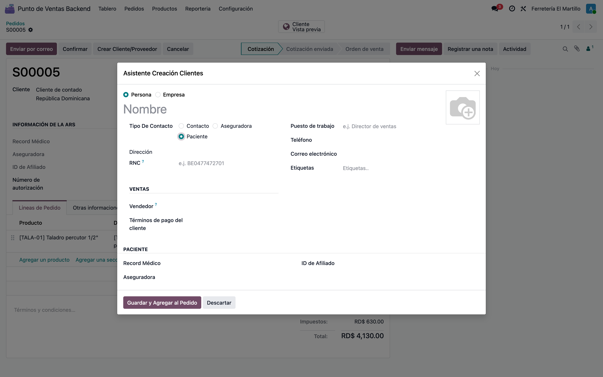
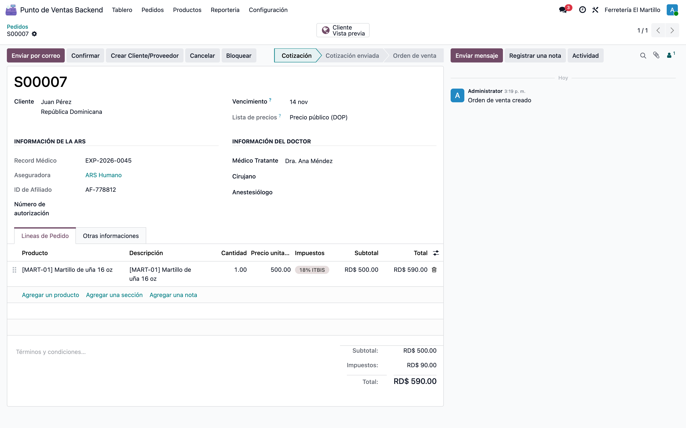
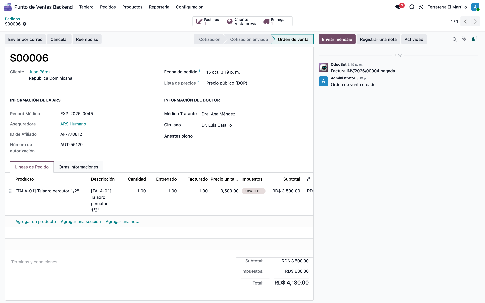
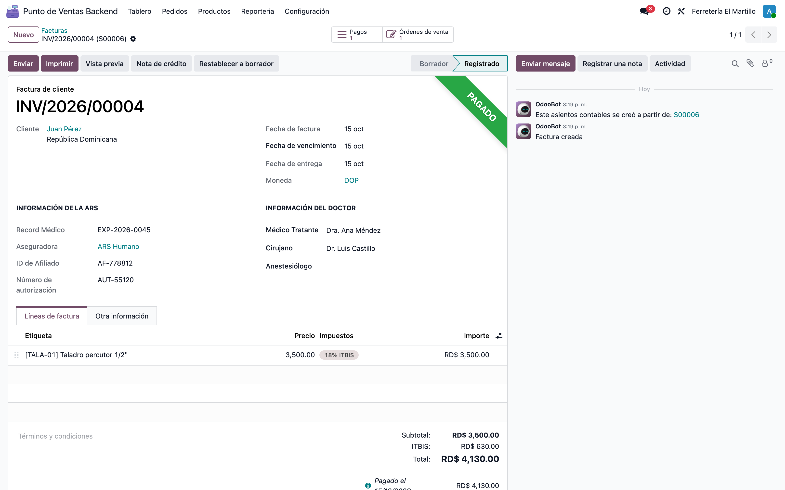

# Punto de Ventas Backend — Datos médicos (HMS) — Manual de usuario

> Manual generado con `tools/manual-generator`: `node capture.mjs --config=/Users/luisfernandez/repos/dev_env_odoo_pro-19/tools/manual-generator/configs/hms_sale_pos_backend.json --db=test_v19_hms_sale_pos_backend`. Las capturas se regeneran corriendo ese comando contra la base de pruebas.

**Punto de Ventas Backend — Datos médicos** (`hms_sale_pos_backend`) lleva a la caja del backend los datos clínicos de los módulos HMS:

- En el formulario rápido de **cliente** de la caja: tipo de contacto (contacto, aseguradora, paciente), especialidades, expediente, ARS y número de afiliado.
- En el **pedido de caja**: información de la ARS (expediente, aseguradora, afiliado, número de autorización) y del médico (tratante, cirujano, anestesiólogo), más el botón **Bloquear** para cotizaciones de pacientes.
- La **factura** hereda médicos y autorización, y el **ticket de caja** imprime el médico tratante.

La lógica médica (validaciones de médicos, bloqueo, paso a la factura) viene de `hms_sales` y `hms_account`; este módulo sólo la pone en las pantallas de la caja.

**Base de datos de las capturas:** Base de pruebas `test_v19_hms_sale_pos_backend`: la misma siembra del manual de `sale_pos_backend` (Ferretería El Martillo, Caja Principal con sesión abierta) más la ARS *ARS Humano*, la Dra. Ana Méndez (Traumatología), el Dr. Luis Castillo (Cirugía general) y el paciente *Juan Pérez* (expediente EXP-2026-0045, afiliado AF-778812). Hay un pedido del paciente facturado con autorización AUT-55120 y una cotización abierta.

## Requisitos previos

- Odoo 19 con `hms_sale_pos_backend` (instala `sale_pos_backend`, `hms_sales` y `hms_account`).
- Usuario con el grupo **Servicios médicos / Usuario** para ver los datos médicos.
- Médicos con al menos una **especialidad** (el campo médico tratante sólo propone contactos con especialidad).

## 1. Crear un paciente desde la caja

*Crear Cliente/Proveedor* en el pedido de caja abre el formulario corto de contacto. Con este módulo trae el **tipo de contacto** (contacto, aseguradora o paciente) y, según el tipo:

- **Paciente**: expediente, ARS y número de afiliado (obligatorio si tiene ARS).
- **Aseguradora**: tipo de seguro (privado o público).
- **Contacto**: especialidades médicas, para usarlo como médico.

*Guardar y agregar al pedido* lo pone como cliente del pedido.

## 2. Cotización de un paciente

Al elegir al paciente, el bloque **Información de la ARS** toma el expediente, la aseguradora y el afiliado del contacto; el número de autorización de la ARS se escribe aquí. En **Información del Doctor** se eligen el médico tratante, el cirujano y el anestesiólogo.

**Bloquear** (sólo cotizaciones de pacientes) congela la cotización y crea una copia nueva enlazada a ella como *pedido de origen*, para seguir trabajando sobre la copia.

## 3. Pedido confirmado y facturado

Confirmado el pedido, los médicos quedan de sólo lectura (salvo para el grupo *Editar datos médicos con el pedido confirmado*). El cobro y la factura siguen el flujo normal de la caja.

## 4. La factura con los datos médicos

La factura de caja recibe el médico tratante, el cirujano, el anestesiólogo y el número de autorización del pedido. El **ticket de caja** imprime *Médico tratante: Dra. Ana Méndez* en el bloque de datos de la factura.

## 5. Notas de la migración a 19.0

- El módulo no tiene Python: sólo vistas y la plantilla del ticket.
- Se añadió `hms_sales` a las dependencias (los campos médicos del pedido y `action_lock` viven ahí).
- **Bloquear** copia el pedido. En 19.0 la copia fallaba para usuarios sin el grupo de lotes porque `sale_stock_serial` copiaba `lot_id`, un campo restringido a ese grupo; se corrigió en un PR aparte de `sale_stock_serial` (`copy=False`).

## Notas

**Si no aparecen los bloques médicos:** el usuario necesita el grupo *Servicios médicos / Usuario*.

**Si el médico no aparece en la lista:** el contacto no tiene especialidad médica.
