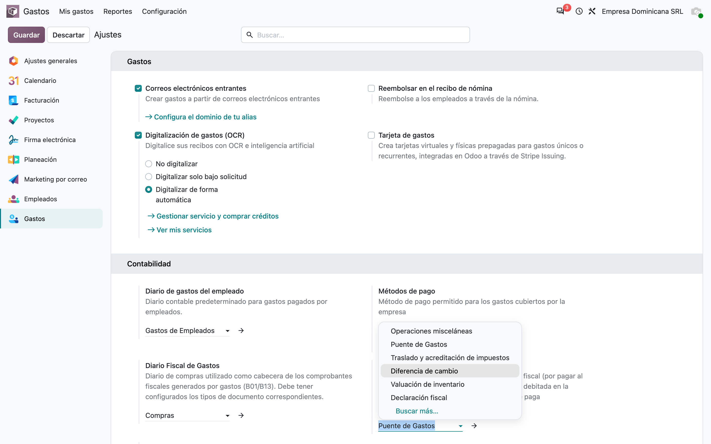
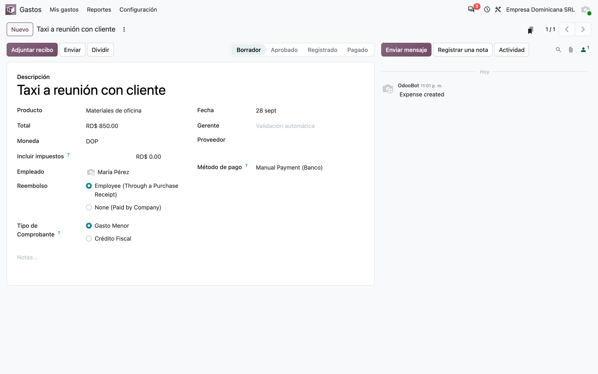
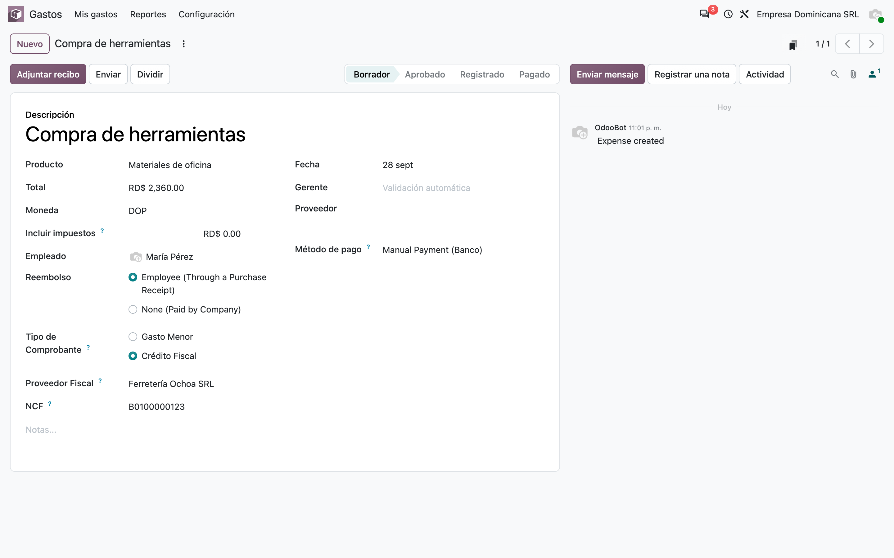
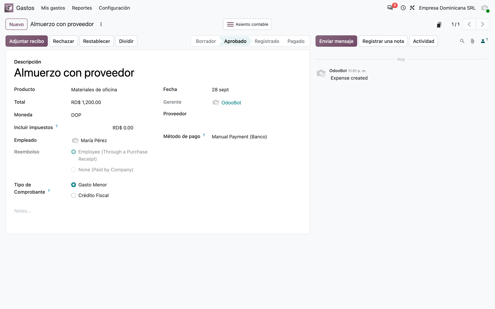
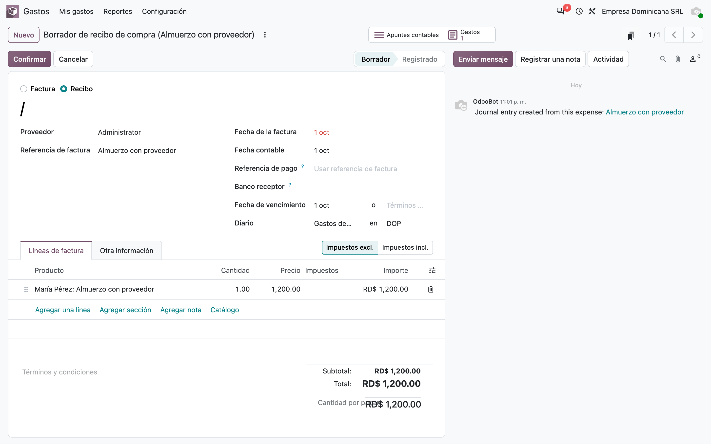
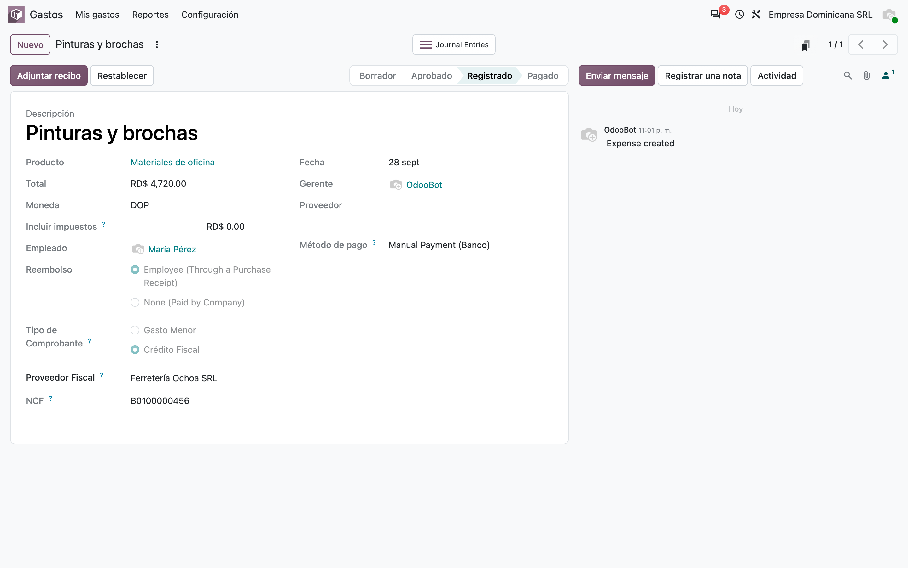
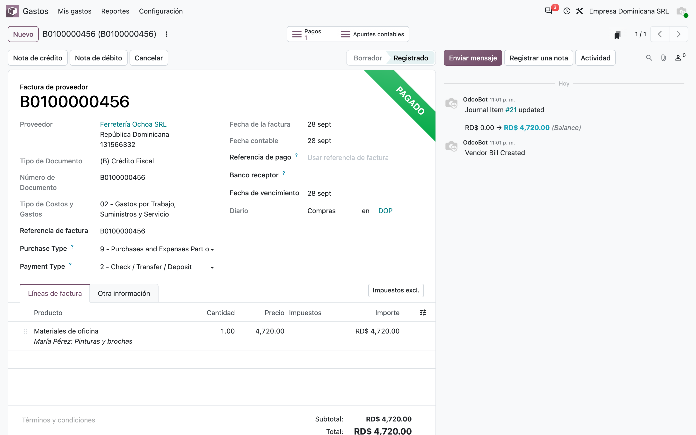
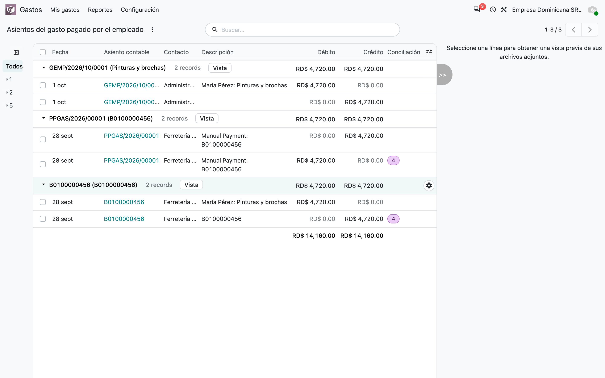
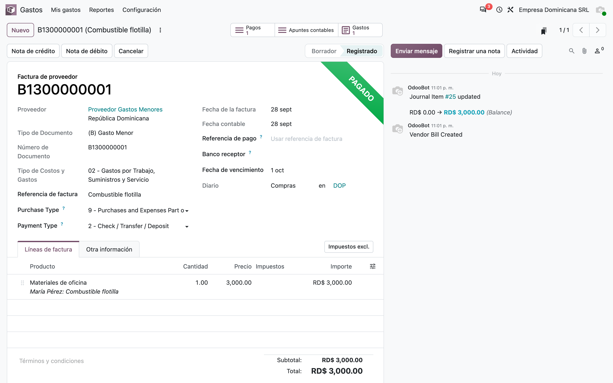
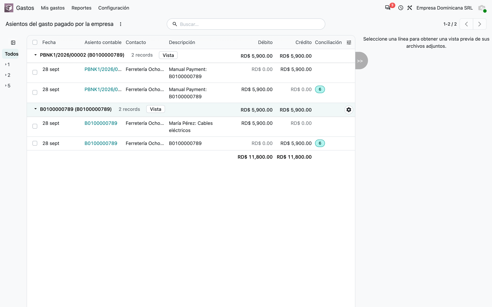

# Gastos dominicanos — Manual de usuario (l10n_do_hr_expense, Odoo 20.0)

> Manual generado con `tools/manual-generator`. Las capturas se regeneran ejecutando el generador contra una base `test_v20_<módulo>`.

Este módulo adapta los **Gastos** de Odoo a la DGII: cada gasto de un empleado termina en una **factura de proveedor fiscal** con su comprobante (**B13/E43** *Gasto Menor* o **B01/E31** *Crédito Fiscal*), lista para el reporte 606.

- **Paga el empleado**: se crea el recibo **F1** que reconoce la deuda con el empleado contra una **cuenta puente**, y la factura fiscal **F2** del proveedor, pagada contra esa misma cuenta puente. La cuenta puente queda en cero.
- **Paga la empresa**: se crea una sola factura fiscal **F**, pagada contra el diario del método de pago.

Odoo 20.0 no genera comprobantes fiscales dominicanos desde un gasto, por eso el módulo se porta.

**Qué cambió en 20.0:**

- Odoo 20.0 eliminó el asistente **Publicar asientos** de los gastos: los asientos se crean al **aprobar** el gasto. Por eso las validaciones de configuración (diario fiscal, diario puente) se ejecutan al aprobar.
- *Paga el empleado*: al aprobar queda el recibo **F1 en borrador**; la factura fiscal F2 se crea, publica y paga cuando el contador **confirma F1**.
- *Paga la empresa*: al aprobar se crea, publica y paga la factura fiscal, como el paso *Publicar* de 19.0.
- Un gasto vinculado a una **factura existente** (función nueva de 20.0) sigue el flujo nativo: esa factura ya es el comprobante fiscal.

## Requisitos previos

- Módulo **`l10n_do_hr_expense`** `20.0.1.0.0` instalado. Depende de **`hr_expense`** y **`l10n_do_accounting`**.
- Compañía con país República Dominicana y el plan contable dominicano.
- Un **diario de compras con documentos** (B01/B13) para las facturas fiscales y un **diario puente** (efectivo o general) con cuenta por defecto. La cuenta de pago saliente del diario puente debe ser esa misma cuenta.
- Cada proveedor usado (proveedor de gasto menor y proveedores fiscales) con **Tipo de Gasto y Costo** (606) en su pestaña Contabilidad.
- Para *Paga la empresa*, un método de pago permitido en **Ajustes → Gastos**.

## 1. Configuración

**Gastos → Configuración → Ajustes**. Debajo de los métodos de pago de la empresa aparecen tres campos, solo para compañías dominicanas:

- **Diario Fiscal de Gastos**: diario de compras con los tipos de documento B01/B13 (o E31/E43); allí se emiten las facturas fiscales.
- **Diario Puente de Gastos**: diario de efectivo o general cuya cuenta por defecto es la **cuenta puente** entre F1 y F2.
- **Proveedor de Gasto Menor**: proveedor que encabeza las facturas B13/E43. Si se deja vacío se usa la propia compañía.

## 2. Registrar un Gasto Menor

En el gasto, el campo **Tipo de Comprobante** (bajo *Pagado por*) decide el comprobante:

- **Gasto Menor** (por defecto): sin RNC ni NCF. Al contabilizarse toma el siguiente número de la secuencia B13 (o E43 si la compañía es emisora electrónica).

## 3. Registrar un Crédito Fiscal

Con **Crédito Fiscal** aparecen y se vuelven obligatorios el **Proveedor Fiscal** (el proveedor que emitió el comprobante) y el **NCF** que trae la factura física. El NCF se valida con las reglas de la DGII (B + 10 dígitos, o E + 12) y no se puede repetir para el mismo proveedor.

## 4. Aprobar: el recibo F1 queda en borrador

El empleado **envía** y el responsable **aprueba**. Al aprobar, Odoo 20.0 valida la configuración y crea el asiento **en borrador**; el gasto queda *Aprobado*. Para *Paga el empleado* ese asiento es el recibo **F1**, que se abre con el botón **Asiento contable**.

Si falta el diario fiscal o el diario puente, la aprobación se detiene con un mensaje que dice qué completar.

## 5. El recibo F1

El recibo F1 está a nombre del empleado y lleva **una sola línea contra la cuenta puente**, sin impuestos: los impuestos van en la factura fiscal. El contador lo revisa y pulsa **Confirmar**. En ese momento el módulo crea la factura fiscal F2, la publica y la paga contra el diario puente.

## 6. El gasto contabilizado

Con F1 confirmado el gasto pasa a **Contabilizado** (queda pendiente el reembolso al empleado). El botón **Journal Entries** reemplaza al nativo y abre juntos F1 y F2.

## 7. La factura fiscal F2

F2 es una factura de proveedor en el **diario fiscal**, a nombre del **Proveedor Fiscal**, con el **NCF** del gasto y el tipo de documento **B01** (o E31 si el NCF empieza por E). El **Tipo de Gasto y Costo** se copia del proveedor para el 606. Ya aparece **Pagado**: el pago sale del diario puente.

## 8. Los apuntes: la cuenta puente queda en cero

Agrupados por asiento: **F1** debita la cuenta puente y acredita la cuenta por pagar del empleado; **F2** debita el gasto y acredita al proveedor; el **pago de F2** debita al proveedor y acredita la cuenta puente. Resultado: gasto contra la deuda con el empleado, con el comprobante fiscal en el 606.

## 9. Paga la empresa: la factura fiscal

Si pagó la empresa (tarjeta corporativa, caja chica), al **aprobar** el gasto se crea, se publica y se paga la **factura fiscal**, a nombre del proveedor de gasto menor (B13, numerada por la secuencia del diario fiscal) o del Proveedor Fiscal (B01 con el NCF del gasto). El pago sale del diario del método de pago del gasto y queda conciliado; el gasto pasa a *Pagado*.

## 10. Paga la empresa: factura y pago

Una sola factura fiscal (en el ejemplo un Crédito Fiscal B01 con el NCF del gasto) y su pago desde el banco. No hay recibo F1 ni cuenta puente.

## Notas

- **Corregir un gasto pagado por el empleado**: mientras F1 esté en borrador, **Rechazar** o **Restablecer** el gasto lo borra. Con F1 o la factura fiscal confirmados, primero hay que pasarlos a borrador o revertirlos desde Contabilidad.
- **Reconfirmar** un F1 o una factura fiscal que se pasó a borrador no duplica F2 ni el pago.
- Si el proveedor no tiene **Tipo de Gasto y Costo**, la factura fiscal no se crea: en *Paga la empresa* falla la aprobación; en *Paga el empleado*, la confirmación de F1.
- Odoo 20.0 trae su propio campo **Proveedor** en el gasto; el módulo sigue usando **Proveedor Fiscal** para el comprobante. El botón **Journal Entries** sale en inglés: su texto no está en el `es_DO.po` del módulo.
- F1 toma la fecha del día en que se aprueba (comportamiento de Odoo); la factura fiscal toma la fecha del gasto.
- Los PDF de la carpeta `doc/` del módulo describen todavía el asistente de publicación de 19.0.
