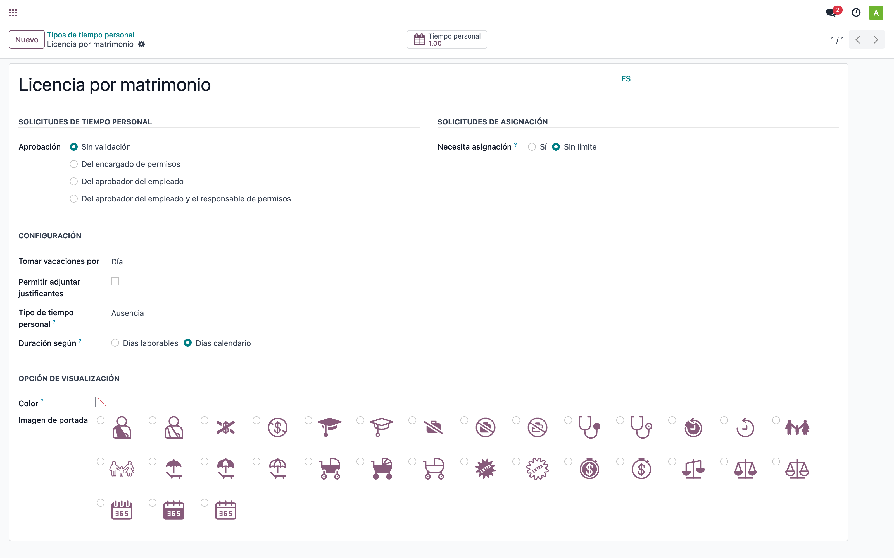
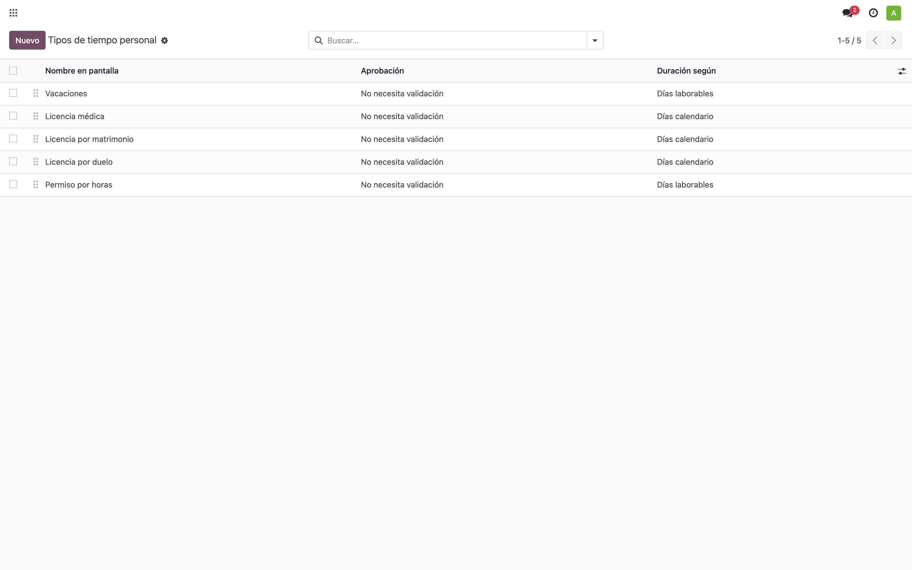
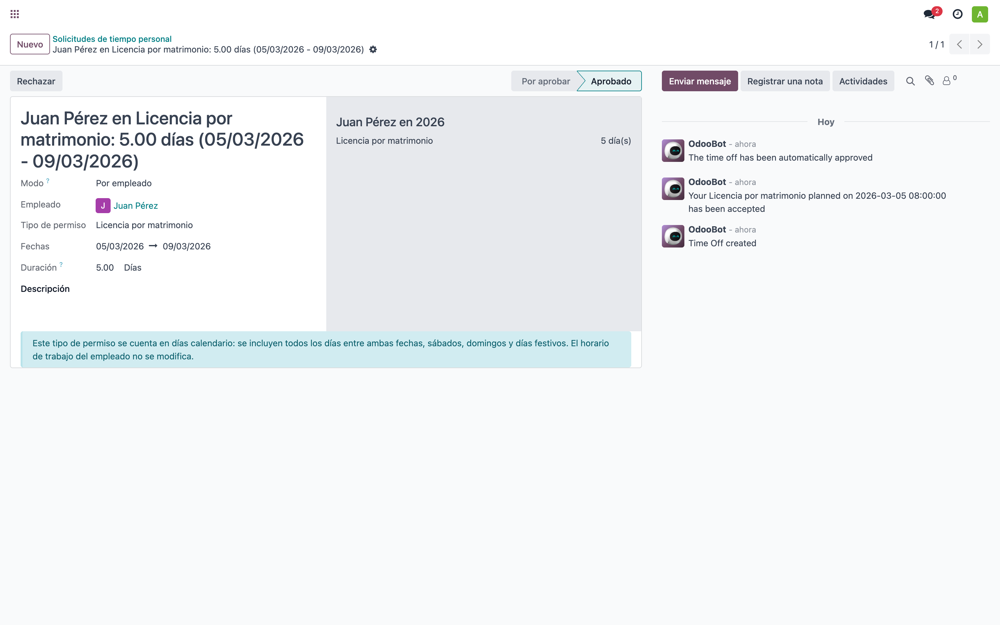
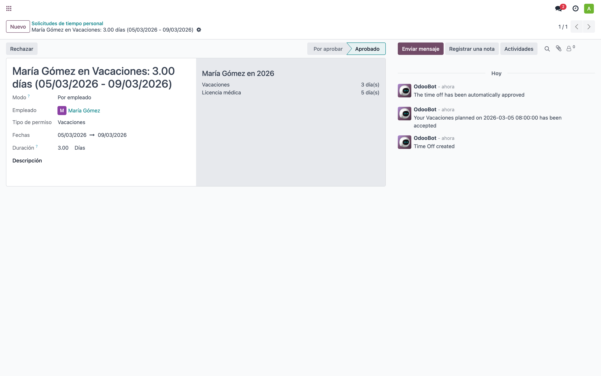
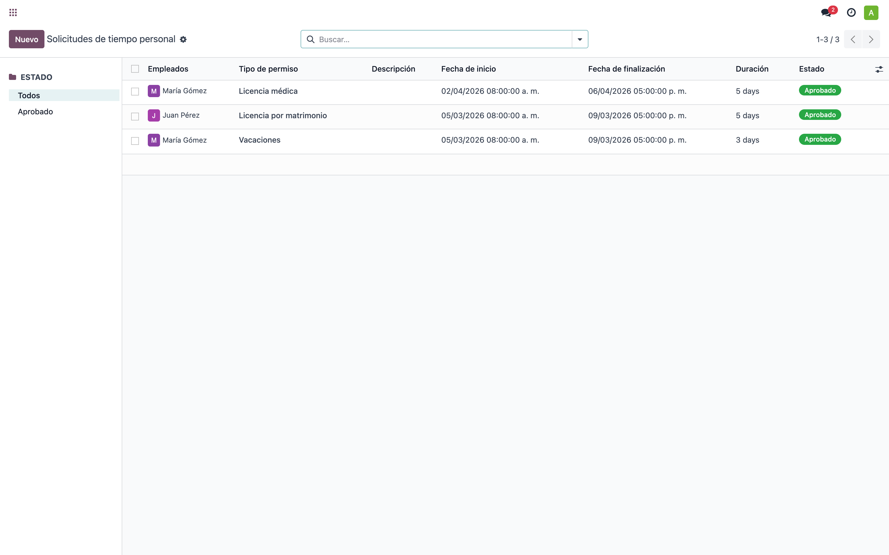
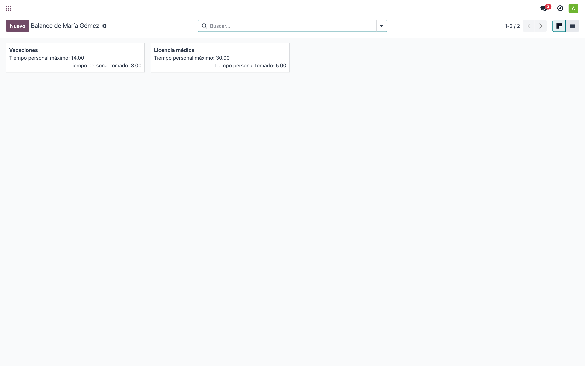

# Tiempo Personal en días calendario — Configuración y pruebas funcionales

> Manual generado con `tools/manual-generator`: `node capture.mjs --config=configs/l10n_do_hr_holidays.json --db=test_do_holidays`. Las capturas se regeneran corriendo ese comando contra la base de pruebas.

El módulo `l10n_do_hr_holidays` agrega a cada **tipo de tiempo personal** un campo **Duración según**, que decide cómo se mide la duración de la solicitud:

- **Días laborables** — comportamiento estándar de Odoo: sólo cuentan los días que el empleado debe trabajar según su horario.
- **Días calendario** — cuentan **todos** los días entre la fecha inicial y la final: `fecha final - fecha inicial + 1`, con sábados, domingos y días festivos incluidos.

Esto es lo que exige el Código de Trabajo dominicano en las licencias que la ley cuenta por días corridos (matrimonio, duelo, maternidad), mientras que las vacaciones se siguen contando en días laborables.

**Lo que el módulo NO cambia:** el horario de trabajo del empleado, las ausencias del recurso, las entradas de trabajo ni los días trabajados del recibo de nómina. Contar una licencia como 5 días calendario no convierte el sábado y el domingo en días laborables pagados: las **horas** de la solicitud siguen siendo las del calendario laboral.

**Base de datos de las capturas:** `test_do_holidays` (usuario `admin`, clave `admin`). Preparada con `tools/manual-generator/configs/l10n_do_hr_holidays.seed.py`: compañía dominicana, jornada lunes a viernes de 8 horas, dos empleados y cinco tipos de tiempo personal.

## Requisitos previos

- Módulo instalado: `l10n_do_hr_holidays` (arrastra `hr_holidays` y `l10n_do_hr`).
- Empleados con horario de trabajo asignado: la base de comparación son los días laborables de ese horario.
- Acceso con perfil **Tiempo personal / Administrador** para configurar los tipos.
- Interfaz en español (es_DO).

## 1. Configurar un tipo en días calendario

En *Tiempo personal ▸ Configuración ▸ Tipos de tiempo personal*, abre el tipo y en el bloque **Configuración** aparece **Duración según**. Aquí la *Licencia por matrimonio* está en **Días calendario**: la ley dominicana da 5 días corridos, no 5 días laborables.

El campo sólo se muestra cuando **Tomar vacaciones por** es *Día*. Si el tipo se pide por medio día o por horas, la duración vuelve a ser la estándar de Odoo y el campo se oculta.

## 2. Ver la base de cálculo de todos los tipos

La lista de tipos trae la columna opcional **Duración según** (se activa con el selector de columnas, arriba a la derecha). De un vistazo se ve qué tipos cuentan días corridos y cuáles siguen en días laborables: *Vacaciones* y *Permiso por horas* en **Días laborables**; *Licencia médica*, *Licencia por matrimonio* y *Licencia por duelo* en **Días calendario**.

## 3. Solicitud contada en días calendario

*Licencia por matrimonio* de Juan Pérez, del **jueves 05/03/2026 al lunes 09/03/2026**. Como el tipo está en días calendario, la duración es **5 días**: jueves, viernes, sábado, domingo y lunes. El aviso azul al pie del formulario recuerda que el sábado y el domingo entran en la cuenta y que el horario del empleado no se toca.

## 4. La misma semana contada en días laborables

*Vacaciones* de María Gómez, **exactamente el mismo rango de fechas**: del jueves 05/03/2026 al lunes 09/03/2026. Como *Vacaciones* se quedó en días laborables, la duración es **3 días** — jueves, viernes y lunes — porque el sábado y el domingo no son días de trabajo en su horario. Es el comportamiento estándar de Odoo, intacto.

## 5. Las dos solicitudes, una al lado de la otra

Mismas fechas, distinta base de cálculo, distinta duración: 5 días la licencia en días calendario, 3 días las vacaciones en días laborables. La tercera línea es la licencia médica de abril, también en días calendario.

## 6. La asignación se consume en días calendario

Cuando el tipo exige asignación, el saldo se descuenta con la misma unidad con la que se mide la solicitud. Balance de María Gómez: en *Vacaciones* (días laborables) figuran **3 días tomados** por la solicitud del 05/03 al 09/03, y en *Licencia médica* (días calendario) figuran **5 días tomados** por la del 02/04 al 06/04, que en días laborables habrían sido 3. El mismo rango de cinco fechas descuenta 3 o 5 días del saldo según la base de cálculo del tipo.

## 7. Alcance y límites

**Qué cambia**

- La **duración en días** de la solicitud (`number_of_days`) y lo que muestra *Solicitado (Días/Horas)*.
- El consumo de la **asignación**, que se descuenta en la misma unidad.
- La validación de saldo: pedir más días calendario de los asignados se rechaza.

**Qué NO cambia**

- El **horario de trabajo** del empleado: el sábado sigue siendo día libre.
- Las **horas** de la solicitud (`number_of_hours`), que siguen saliendo del calendario laboral porque son las que usan las entradas de trabajo y la nómina.
- Las **entradas de trabajo** y los **días trabajados** del recibo de nómina.

**Restricciones**

- **Días calendario** sólo se puede usar en tipos que se solicitan por día. Si se cambia *Tomar vacaciones por* a medio día o a horas, el sistema lo impide con un mensaje de validación y, en el formulario, el campo vuelve solo a *Días laborables*.
- El valor por defecto es **Días laborables**: instalar el módulo no altera ningún tipo ya configurado ni recalcula solicitudes existentes por sí solo.

## Notas

Las 17 pruebas automatizadas de `l10n_do_hr_holidays/tests/test_l10n_do_leave_duration.py` cubren uno a uno los casos de esta tabla y corren en CI.

La implementación intercepta `_get_duration` de `hr.leave` y sustituye únicamente los días; las horas se dejan tal cual las calculó Odoo. Ése es el motivo de que la nómina y las entradas de trabajo no se vean afectadas.
