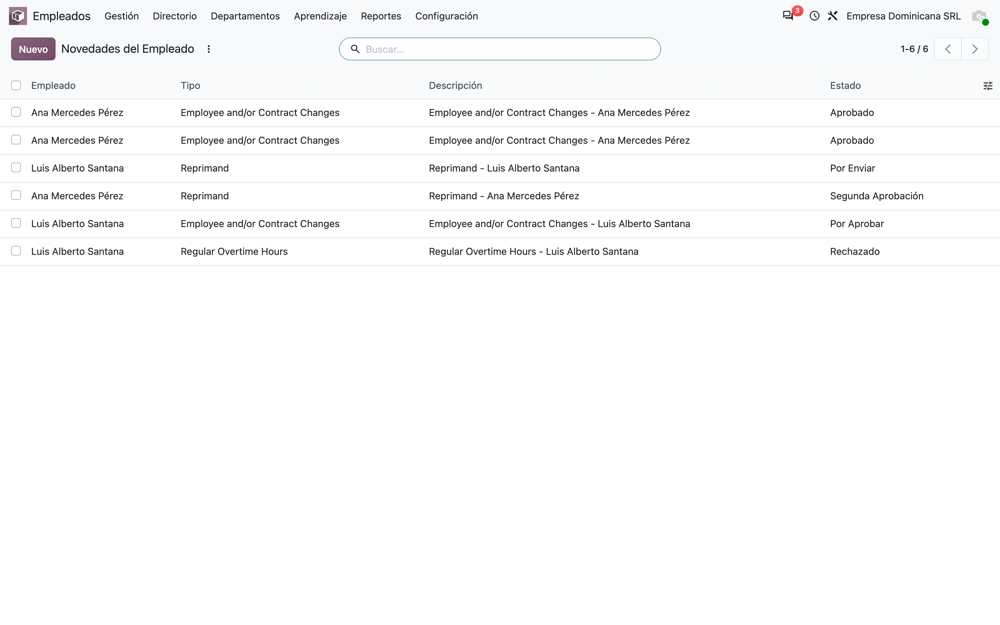
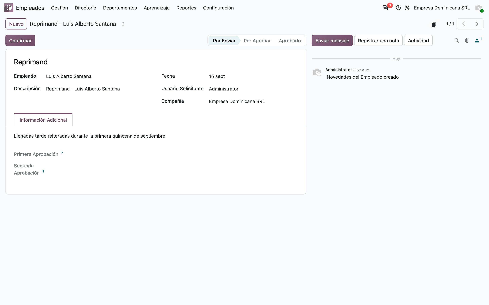
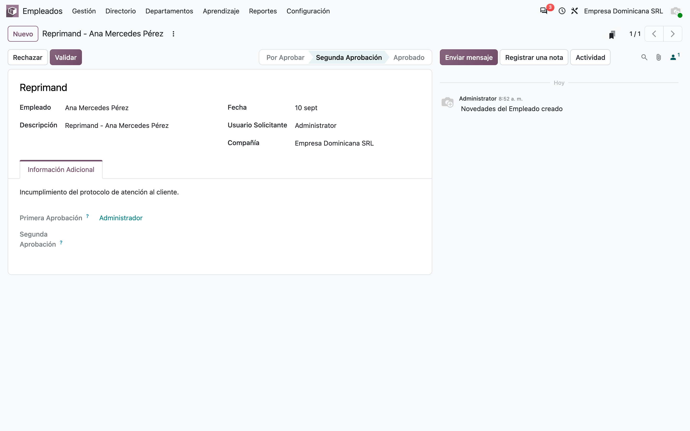
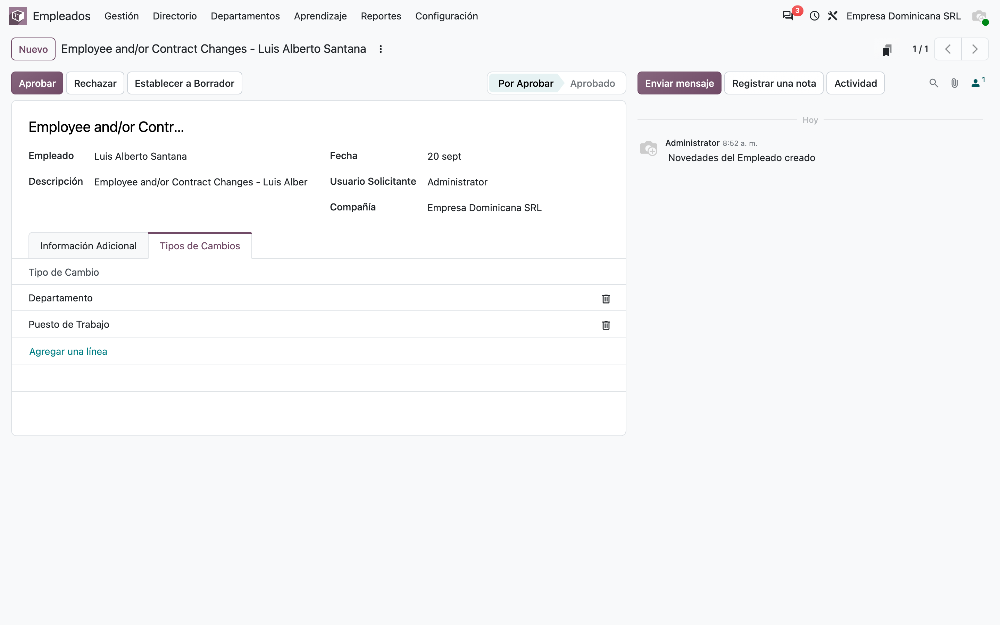
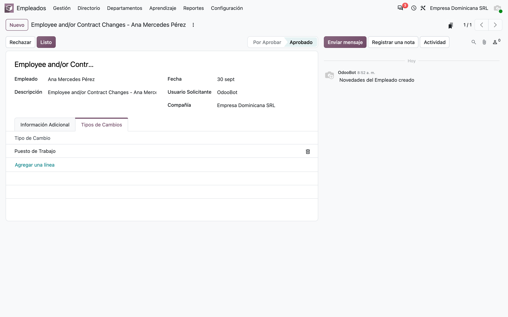
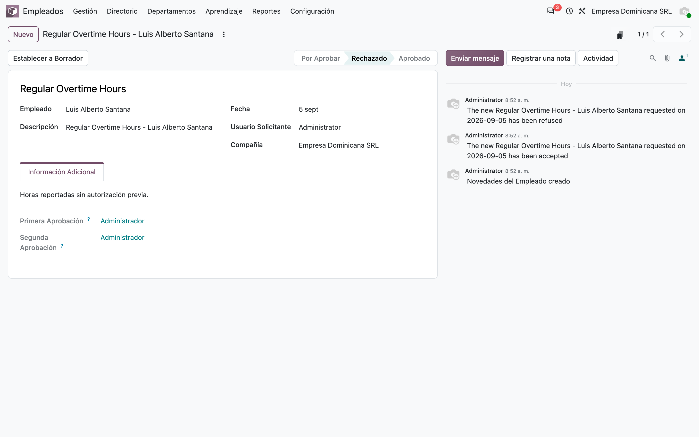
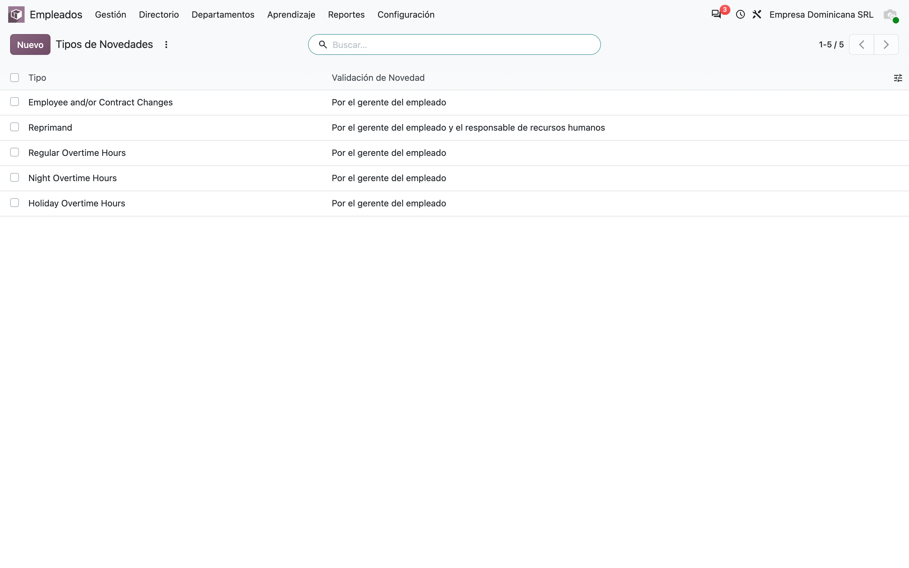
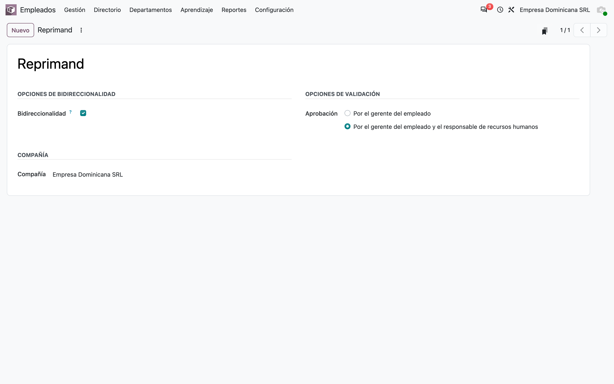

# Novedades del Empleado — Manual de usuario (l10n_do_hr_news, Odoo 20.0)

> Manual generado con `tools/manual-generator`. Las capturas se regeneran ejecutando el generador contra una base `test_v20_<módulo>`.

Este módulo registra las **novedades del empleado**: cualquier hecho de RR. HH. que necesita quedar documentado y aprobado antes de aplicarse (amonestaciones, horas extra, cambios de puesto, departamento, salario o encargado).

Cada novedad tiene un **flujo de aprobación** de uno o dos niveles, su bitácora en el chatter y, para el tipo *Cambios de Empleado y/o Contrato*, aplica el cambio sobre la ficha del empleado al aprobarse y lo revierte si se rechaza.

Odoo 20.0 no trae un modelo equivalente (el historial de versiones del empleado guarda el cambio, pero no la solicitud ni su aprobación), por eso el módulo se porta completo.

**Qué cambió en 20.0:** solo la seguridad. Odoo 20.0 unió `ir.model.access` e `ir.rule` en el modelo `ir.access`; los permisos y las reglas del módulo ahora viven en `security/ir.access.csv` y conservan sus identificadores. Puesto, departamento y salario ahora viven en la versión del empleado (`hr.version`); al escribirlos en el empleado se escriben en su versión, así que la creación automática de novedades funciona igual.

## Requisitos previos

- Módulo **`l10n_do_hr_news`** `20.0.2.0.0` instalado. Depende solo de `hr` (Empleados).
- Permisos: **Novedades / Usuario** para crear y ver sus propias novedades; **Novedades / Responsable** para ver también las de su equipo y aprobar; **Empleados / Administrador** (`hr.group_hr_manager`) ve todas, valida la segunda aprobación y las marca como **Listo**.
- El usuario que aprueba debe estar ligado a un **empleado**: su empleado queda como *Primera aprobación* o *Segunda aprobación*.

## 1. Dónde está: Empleados → Gestión → Novedades del Empleado

El listado muestra **Empleado**, **Tipo**, **Descripción** y **Estado**. Solo aparecen las novedades de los empleados de las compañías activas.

En la base de ejemplo hay una novedad en cada estado: *Por Enviar*, *Por Aprobar*, *Segunda Aprobación*, *Aprobado* y *Rechazado*.

> Los nombres de los tipos de novedad (*Employee and/or Contract Changes*, *Reprimand*, *Regular Overtime Hours*…) vienen en inglés porque son datos del módulo sin traducción en `es_DO.po`; se pueden renombrar desde **Tipos de Novedades**.

## 2. Registrar una novedad

**Nuevo** abre el formulario. Se elige el **Tipo** (título), el **Empleado** y, si se quiere, una **Descripción**; si se deja vacía se arma sola como *Tipo - Empleado*. **Fecha** y **Usuario Solicitante** se llenan por defecto.

La pestaña **Información Adicional** guarda los comentarios y, más adelante, quién aprobó. **Confirmar** pasa la novedad a *Por Aprobar*.

## 3. Aprobación en dos niveles

Si el tipo de novedad pide aprobación **Por el gerente del empleado y el responsable de recursos humanos**, el primer **Aprobar** la deja en *Segunda Aprobación* y registra la *Primera Aprobación*. El botón **Validar** (solo *Empleados / Administrador*) la aprueba y registra la *Segunda Aprobación*; **Rechazar** sigue disponible.

Con aprobación de un solo nivel, **Aprobar** la valida directamente. Al validarse se avisa en el chatter al usuario solicitante. Una novedad aprobada se cierra con **Listo**.

## 4. Novedad de cambios del empleado

El tipo **Employee and/or Contract Changes** abre la pestaña **Tipos de Cambios**. Cada línea es un cambio: **Puesto de Trabajo**, **Departamento**, **Salario** o **Responsable**; al elegir el tipo, el valor *actual* se llena desde la ficha del empleado y solo se digita el *nuevo*.

Al **aprobar**, los valores nuevos se escriben en el empleado. Si luego se **rechaza**, se restauran los valores actuales.

## 5. Novedades creadas desde la ficha del empleado

Con **Bidireccionalidad** activa en el tipo *Employee and/or Contract Changes*, editar directamente en la ficha del empleado su **puesto**, **departamento**, **responsable** o **salario** crea sola una novedad ya aprobada con el valor anterior y el nuevo, para que el cambio quede registrado.

La captura es la novedad que se creó al cambiar el puesto de *Ana Mercedes Pérez* desde su ficha. Un cambio de salario genera una novedad aparte por empleado.

## 6. Rechazar y volver a borrador

**Rechazar** deja la novedad en *Rechazado*, registra quién la rechazó y avisa al solicitante en el chatter. **Establecer a Borrador** la devuelve a *Por Enviar* y limpia las aprobaciones, para corregirla y confirmarla otra vez.

## 7. Tipos de novedad

**Empleados → Configuración → Novedades → Tipos de Novedades** (solo *Empleados / Administrador*). El módulo trae cinco: cambios del empleado, amonestación y las horas extra regulares, nocturnas y feriadas.

## 8. Configurar un tipo de novedad

En cada tipo se define:

- **Bidireccionalidad**: si está activa, los cambios hechos desde las pantallas nativas crean su novedad (sección 5). Solo tiene efecto en *Employee and/or Contract Changes*.
- **Aprobación**: *Por el gerente del empleado* (un nivel) o *Por el gerente del empleado y el responsable de recursos humanos* (dos niveles, sección 3).
- **Compañía**.

Un tipo archivado deja de ofrecerse al crear novedades.

## 9. Quién ve qué

| Grupo | Novedades que ve y edita |
|---|---|
| Novedades / Usuario | Las que solicitó y las que no tienen solicitante |
| Novedades / Responsable | Además, las de los empleados que tiene a cargo |
| Empleados / Administrador | Todas |

En todos los casos solo las de sus compañías permitidas. En 20.0 estas reglas son filas de `security/ir.access.csv`; al actualizar una base 19.0, el script `migrations/2.0.0` libera los identificadores viejos para que se vuelvan a crear como `ir.access`.

## Notas

Probado en Odoo 20.0 (`odoo/odoo@20.0` y `enterprise@20.0`): instalación limpia, 30/30 verificaciones de flujo (vistas, aprobación en uno y dos niveles, aplicación y reversión de cambios, creación automática desde el empleado con y sin bidireccionalidad, reglas por grupo y por compañía) y actualización de una base con forma 19.0, que falla sin el script de migración y pasa con él.
