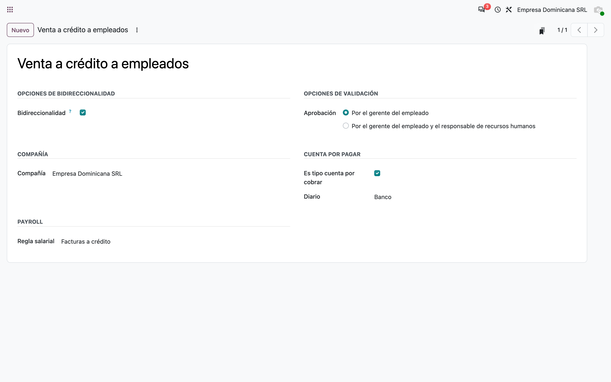
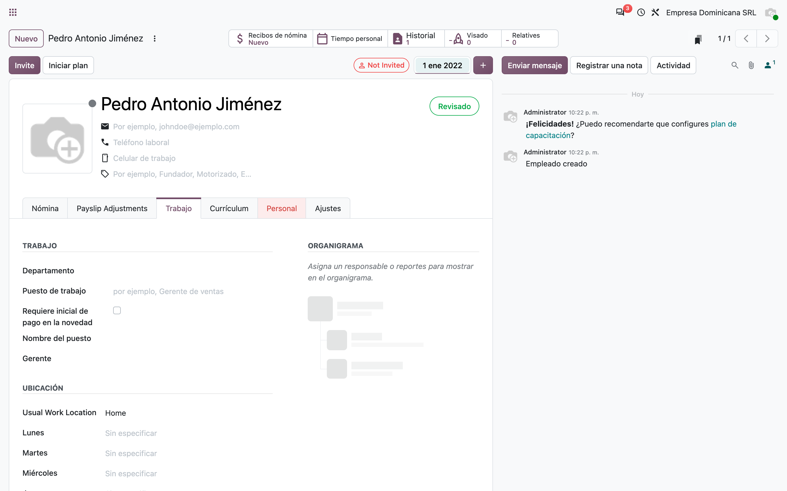
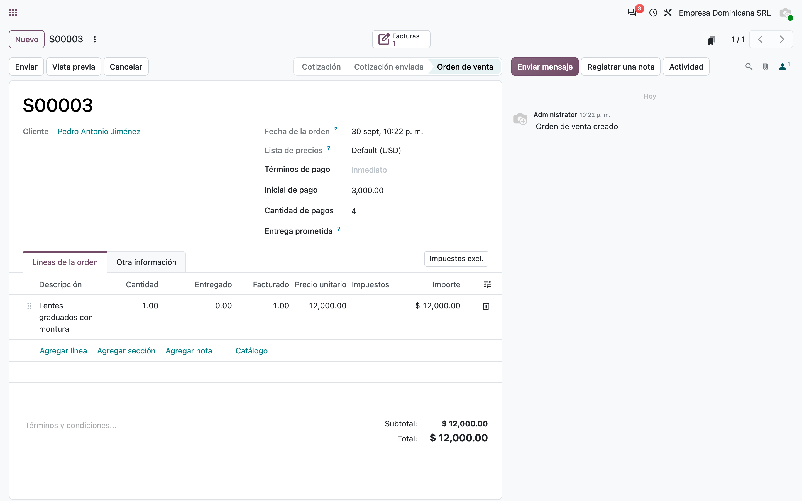
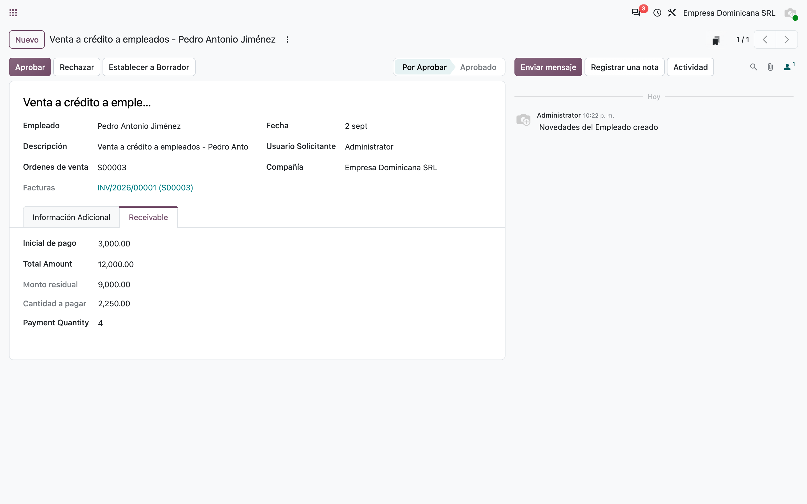
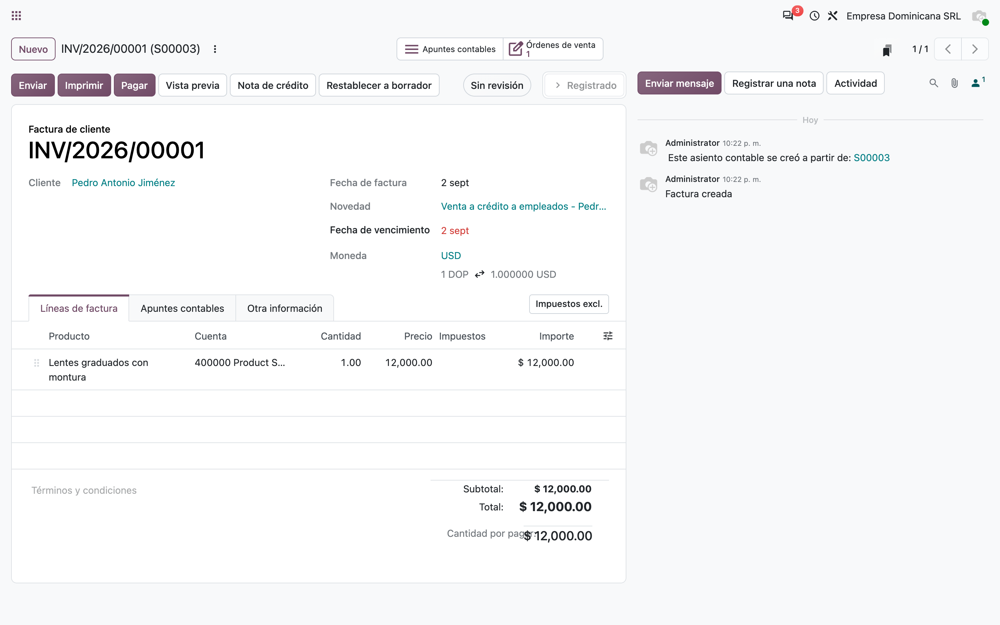
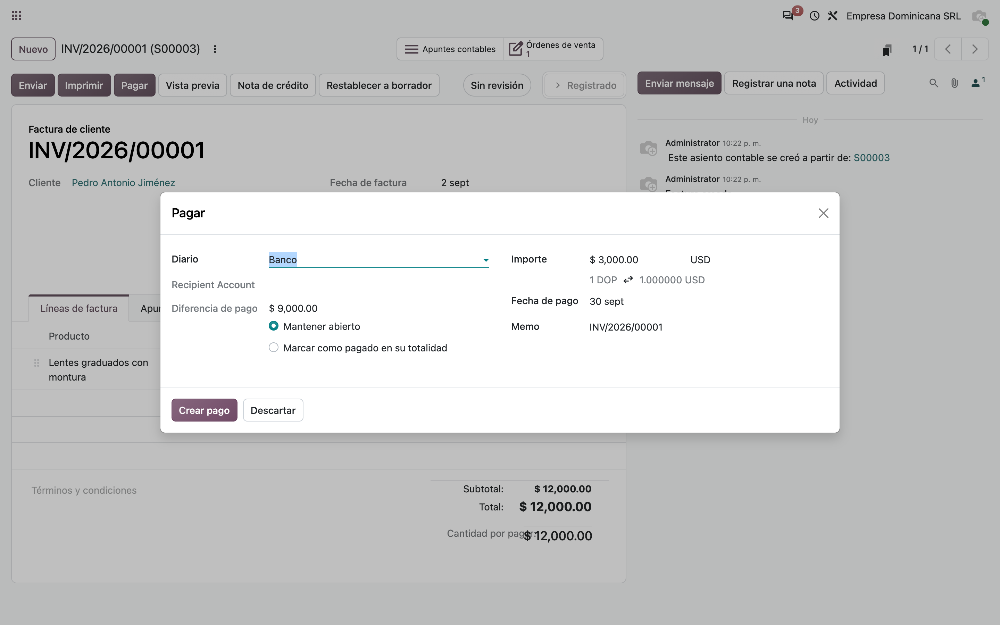
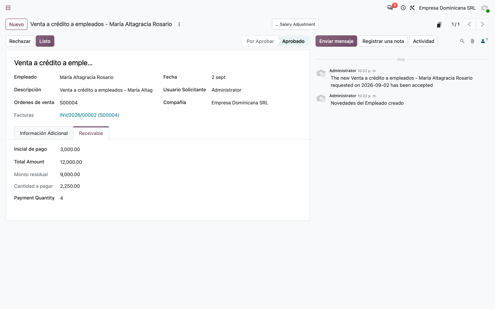
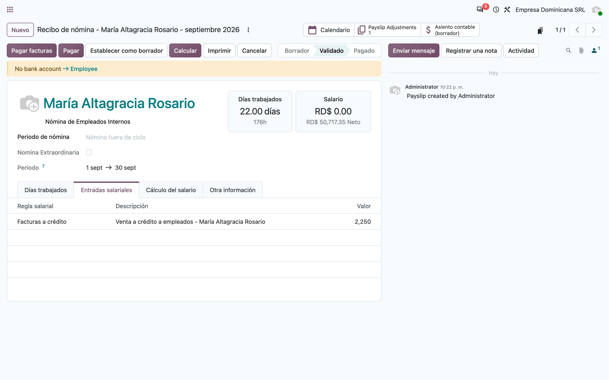
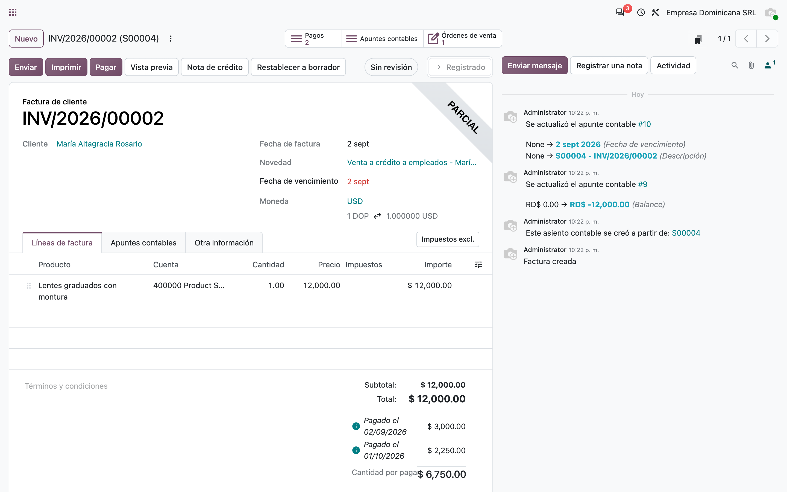

# Ventas a crédito a empleados — Manual de usuario (l10n_do_hr_news_accounts_receivable, Odoo 20.0)

> Manual generado con `tools/manual-generator`. Las capturas se regeneran ejecutando el generador contra una base `test_v20_<módulo>`.

Este módulo permite **vender a crédito a un empleado y cobrarle por nómina**. La venta se registra como una orden de venta normal con un **primer pago** y una **cantidad de cuotas**; una **novedad** de tipo *cuentas por cobrar* une la venta, su factura y la nómina. Al registrar el primer pago la novedad se aprueba y crea el **ajuste de nómina** que descuenta la cuota en cada recibo; al validar cada recibo se registra el **pago de la cuota** contra la factura.

Odoo 20.0 no trae un flujo que descuente por nómina una factura de cliente del propio empleado, por eso el módulo se porta.

**Qué cambió en 20.0:**

- Los tipos de novedad ya no usan *Tipo de entrada* sino **Regla salarial** (cambio de `l10n_do_hr_payroll_news`); el tipo de cuentas por cobrar exige la regla salarial.
- El botón **Pagar facturas** del recibo y el pago automático de la cuota usan el estado **Validado** del recibo. El módulo seguía buscando el estado *Hecho* de 18.0, que ya no existía en 19.0, y por eso nunca pagaba las cuotas.
- El campo **Novedad** de la factura solo ofrecía novedades ya aprobadas, pero publicar la factura y el pago inicial son los que aprueban la novedad. Ahora ofrece las novedades *Por aprobar*.
- El botón **Pagar** de la factura abre el asistente sobre los apuntes de la factura y el módulo solo miraba la factura: el importe no proponía el primer pago, no se podía cambiar y pagar no aprobaba la novedad. Ahora sí.
- Si una cuota es igual al primer pago, pagarla ya no intenta aprobar otra vez la novedad (eso hacía fallar la validación del recibo).

## Requisitos previos

- Módulo **`l10n_do_hr_news_accounts_receivable`** `20.0.1.0.0` instalado. Depende de **`l10n_do_hr_payroll_news`** (`20.0.2.0.0`) y **`sale`**.
- Compañía con país República Dominicana y la nómina dominicana configurada (ver el manual de `l10n_do_hr_payroll_news`).
- Un diario de **banco o efectivo** para los cobros, con una **cuenta de cobros pendientes** en sus métodos de pago entrantes (ver la nota final).
- El empleado debe tener **contacto de trabajo**: es el cliente de la orden de venta y de la factura.
- Permisos de Ventas, Facturación (*Facturación* para el botón **Pagar facturas**) y Nómina.

## 1. El tipo de novedad de cuentas por cobrar

**Empleados → Configuración → Novedades → Tipos de Novedades**. En la sección de cuentas por cobrar:

- **Es tipo cuenta por cobrar**: marca el tipo como venta a crédito al empleado.
- **Diario**: banco o efectivo donde se registran el primer pago y las cuotas. Es obligatorio en este tipo.

La **Regla salarial** (sección *Payroll*) pasa a ser obligatoria: es la deducción que lleva la cuota al recibo. En el ejemplo, **Facturas a crédito** (`FCCR`).

> La sección sale como *Cuenta por pagar*: la traducción `es_DO` de *Account Receivable* está mal desde versiones anteriores; la migración no la cambió.

## 2. El empleado

En la ficha del empleado, pestaña **Trabajo**, debajo del **Puesto de trabajo**, la casilla **Requiere inicial de pago en la novedad** permite confirmar una novedad de cuentas por cobrar **sin primer pago**. Apagada (lo normal), la novedad no se puede confirmar si no tiene primer pago.

> La etiqueta dice lo contrario de lo que hace: marcada, el primer pago **deja** de ser obligatorio. Es así desde versiones anteriores y la migración no la cambió.

## 3. La orden de venta al empleado

Se vende al **contacto de trabajo** del empleado. Cuando el cliente es un empleado, la orden muestra debajo de los **Términos de pago**:

- **Inicial de pago**: lo que el empleado paga al recibir la factura.
- **Cantidad de pagos**: en cuántas nóminas se descuenta el resto.

En el ejemplo: lentes de 12,000, inicial de 3,000 y 4 cuotas. Se confirma la orden y se crea la factura como siempre.

## 4. La novedad une la venta con la nómina

Se crea una novedad con el tipo de cuentas por cobrar para el empleado y se elige la **Orden de venta**. La pestaña **Receivable** se llena sola desde la orden:

- **Inicial de pago** y **Total Amount** (total de la orden).
- **Monto residual** = total − inicial (9,000).
- **Cantidad a pagar** = residual / **Payment Quantity** (2,250 por nómina).

La novedad pasa esos montos a la nómina como un ajuste **Limited**: 2,250 por recibo hasta completar 9,000. Por eso la pestaña *Payslip* no aparece en este tipo.

Se **confirma** la novedad (queda *Por aprobar*). El campo **Facturas** se llena al publicar la factura.

## 5. La factura enlazada a la novedad

En la factura, junto a la **Fecha de factura**, el campo **Novedad** elige la novedad (solo las de cuentas por cobrar *Por aprobar* y sin factura). Al **publicar**:

- la novedad guarda la factura en **Facturas**;
- si la novedad no tiene inicial de pago, se aprueba en ese momento.

Odoo no deja publicar una factura que viene de una orden de venta con novedad si no se le eligió la novedad, ni publicar una segunda factura para la misma novedad.

## 6. El primer pago

**Pagar** en la factura propone como **Importe** el **inicial de pago** de la novedad (3,000) y deja editarlo; la diferencia queda abierta (*Mantener abierto*). Al crear el pago por ese importe, la novedad se **aprueba** y se crea su ajuste de nómina.

## 7. Novedad aprobada y su ajuste de nómina

Tras el pago inicial la novedad queda **Aprobado**, con la factura en **Facturas** y el botón **Salary Adjustment**, que abre el ajuste: regla **Facturas a crédito**, 2,250 por recibo, *Repeat* encendido y fecha estimada de fin cuando se completan las cuotas.

## 8. El recibo descuenta la cuota y la paga

El recibo del mes trae en **Entradas salariales** la línea *Facturas a crédito* por 2,250. Al **validar** el recibo se registra automáticamente un pago de la cuota contra la factura, en el diario del tipo de novedad.

El botón **Pagar facturas** (recibos validados, usuarios de Facturación) y la acción **Create Invoice Payment** del menú *Acciones* del recibo repiten ese cobro, por ejemplo si se validó el recibo antes de publicar la factura. Una factura ya pagada no recibe más pagos.

## 9. La factura con el primer pago y la primera cuota

La factura de *María Altagracia Rosario* muestra los dos cobros: el inicial (3,000) y la cuota de septiembre (2,250). Queda **Parcial** con 6,750 por cobrar, que se descuentan en las tres nóminas siguientes.

## Notas

**Cuenta de cobros pendientes.** El módulo deja de pagar cuotas en cuanto la factura queda *En proceso de pago* o *Pagada*. Si el diario de la novedad no tiene **cuenta de cobros pendientes** en sus métodos de pago entrantes, Odoo marca la factura *En proceso de pago* desde el primer pago parcial (el pago no genera asiento hasta conciliarlo con el banco) y las cuotas de nómina no se registran. Configure esa cuenta en **Contabilidad → Configuración → Diarios → (diario) → Pagos entrantes**. Es el comportamiento de Odoo desde antes de 20.0; la migración no lo cambió.

Probado en Odoo 20.0 (`odoo/odoo@20.0` y `enterprise@20.0`): instalación limpia, 42/42 verificaciones de flujo (vistas, campos de la orden de venta, llenado de la novedad desde la orden, novedad sin inicial aprobada al publicar la factura, bloqueos al confirmar sin primer pago y al publicar sin novedad o con una segunda factura, pago inicial desde el botón *Pagar* que aprueba la novedad y crea el ajuste `FCCR`, cuota en el recibo, pago automático al validar, botón *Pay Invoices*, pago desde el lote y factura pagada sin pagos extra) y actualización desde `19.0.1.0.0`.
