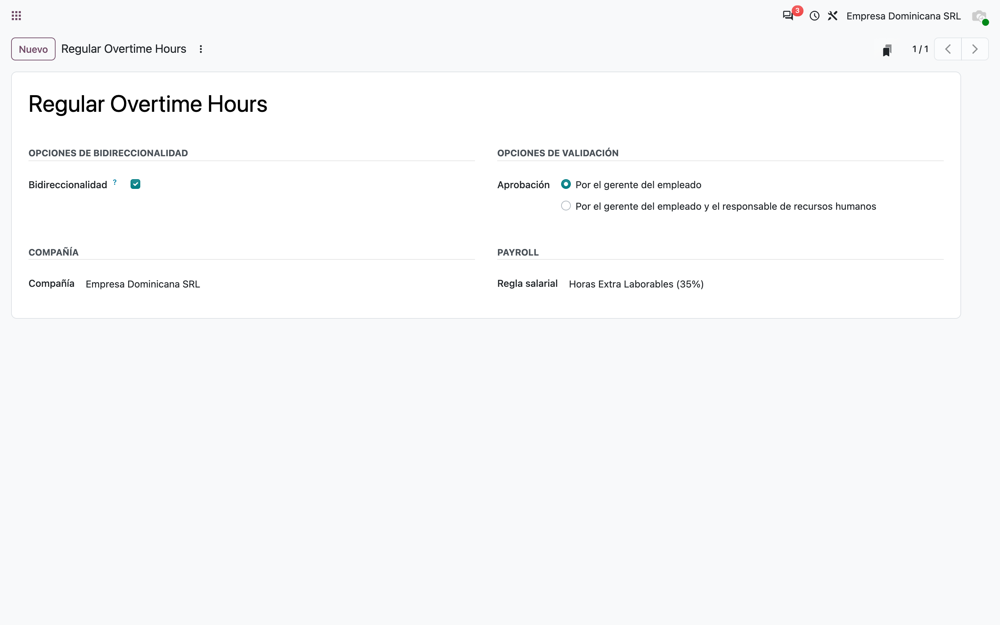
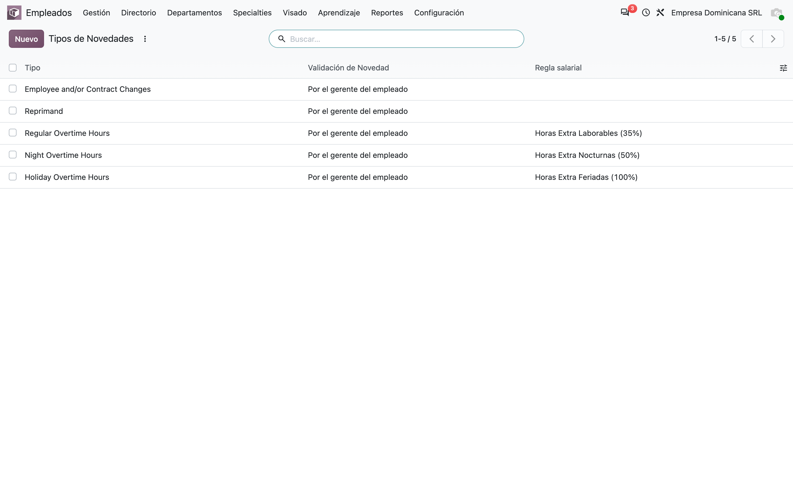
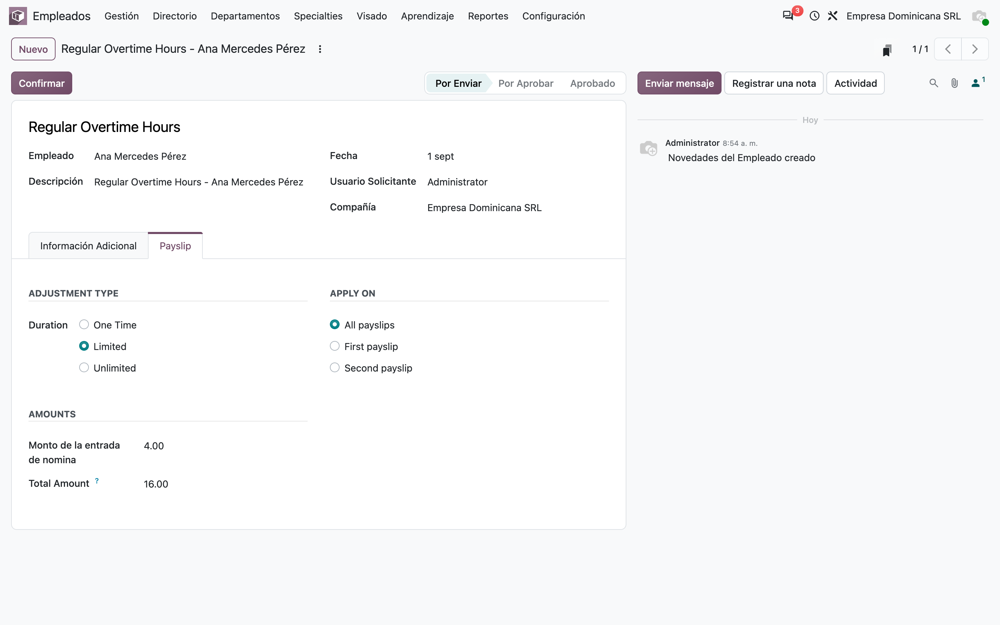
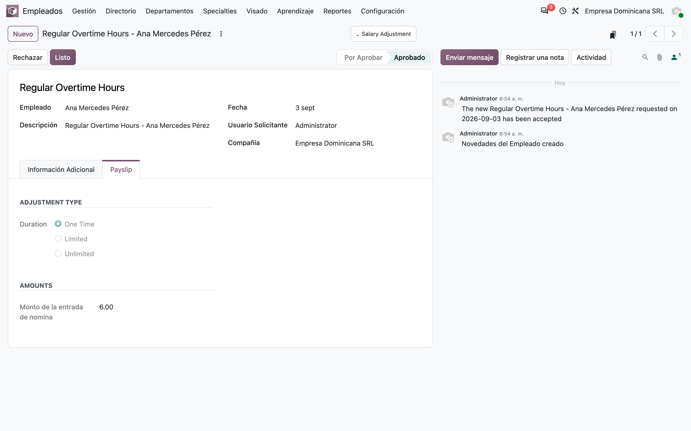
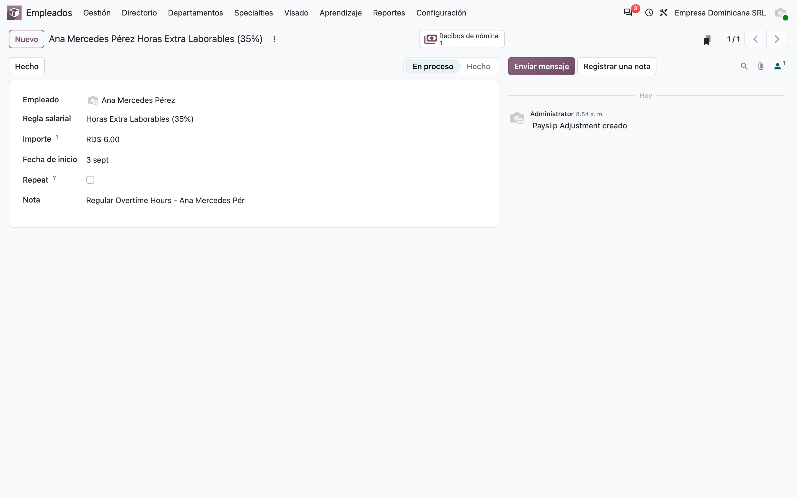

# Novedades en Nómina — Manual de usuario (l10n_do_hr_payroll_news, Odoo 20.0)

> Manual generado con `tools/manual-generator`. Las capturas se regeneran ejecutando el generador contra una base `test_v20_<módulo>`.

Este módulo conecta las **novedades del empleado** (`l10n_do_hr_news`) con la **nómina dominicana** (`l10n_do_hr_payroll`): cuando se aprueba una novedad cuyo tipo tiene una **regla salarial**, se crea sola el **ajuste de nómina** que la lleva a los recibos del empleado. Así, unas horas extra aprobadas por el encargado llegan a la nómina sin que nadie las vuelva a digitar.

Odoo 20.0 no trae este puente entre una solicitud aprobada y un ajuste de nómina, por eso el módulo se porta.

**Qué cambió en 20.0:**

- Odoo 20.0 eliminó los **tipos de entrada** (`hr.payslip.input.type`). Las entradas y los ajustes de nómina ahora apuntan a una **regla salarial** marcada como *disponible en el recibo*. El campo *Tipo de entrada* del tipo de novedad pasa a ser **Regla salarial**.
- El ajuste de nómina de 20.0 tiene **un** empleado, un **monto por recibo** y la marca **Repeat**; ya no tiene *monto total*. La novedad conserva sus tres duraciones y las traduce a esa forma (sección 4).
- Al actualizar una base 19.0, el script `migrations/2.0.0` pasa cada tipo de novedad de su tipo de entrada a la regla salarial dominicana con el mismo código.

## Requisitos previos

- Módulo **`l10n_do_hr_payroll_news`** `20.0.2.0.0` instalado. Depende de **`l10n_do_hr_news`** y **`l10n_do_hr_payroll`** (ambos `20.0.2.0.0`).
- Compañía con país República Dominicana.
- El empleado debe estar en una estructura cuyo tipo incluya la regla salarial de la novedad (en el ejemplo, *Nómina de Empleados Internos*, quincenal).
- Permisos de novedades (ver el manual de `l10n_do_hr_news`) y de Nómina para ver los ajustes y recibos.

## 1. El tipo de novedad lleva una regla salarial

**Empleados → Configuración → Novedades → Tipos de Novedades**, sección **Payroll**. La **Regla salarial** solo ofrece las reglas dominicanas que se pueden usar como entrada del recibo.

El módulo deja configuradas las horas extra: *Regular Overtime Hours* → **Horas Extra Laborables (35%)** (`HEL`), *Night Overtime Hours* → **Horas Extra Nocturnas (50%)** (`HEN`) y *Holiday Overtime Hours* → **Horas Extra Feriadas (100%)** (`HEF`). Un tipo sin regla salarial sigue siendo una novedad normal y no toca la nómina.

> Varias etiquetas del módulo salen en inglés (*Payroll*, *Payslip*, *Duration*…) porque su `es_DO.po` es de la 15.0 y no las trae; la migración no lo cambió.

## 2. Lista de tipos

La lista de tipos muestra la columna **Regla salarial**, para ver de un vistazo qué novedades llegan a la nómina.

## 3. La pestaña Payslip de la novedad

Si el tipo tiene regla salarial, la novedad muestra la pestaña **Payslip**:

- **Duration**: *One Time* (una vez), *Limited* (limitado) o *Unlimited* (ilimitado).
- **Apply On**: *All payslips*, *First payslip* o *Second payslip* del mes. Solo aparece si el empleado cobra por quincena (o cada dos semanas) y la duración no es *One Time*.
- **Monto de la entrada de nomina** (monto por recibo) y, en *Limited*, **Total Amount**; en *Unlimited*, una **End Date** opcional.

El valor es la cantidad que recibe la regla: en las horas extra, **horas**; la regla calcula el pago. Una vez aprobada la novedad estos campos quedan de solo lectura.

En la captura: 4 horas por quincena hasta completar 16.

## 4. Cómo se traduce cada duración al ajuste de nómina

Al **aprobar** (o validar, si pide dos niveles) se crea el ajuste de nómina con el empleado, la regla salarial, la fecha de la novedad como inicio, la descripción y el *Apply On*:

| Duración de la novedad | Ajuste de nómina en 20.0 |
|---|---|
| One Time | *Repeat* apagado: se paga una vez y se cierra al confirmar el recibo |
| Limited | *Repeat* encendido, con **fecha estimada de fin** al cierre del mes en que se completan las cuotas: `Total Amount / monto por recibo` cuotas, dos por mes si el empleado cobra por quincena en todas las nóminas, una si no |
| Unlimited | *Repeat* encendido; la *End Date* de la novedad, si se puso, es la fecha estimada de fin |

20.0 ya no guarda un monto total en el ajuste, por eso *Limited* se expresa con la fecha estimada de fin, igual que hace `l10n_do_hr_payroll` al migrar los ajustes limitados de 19.0.

## 5. Novedad aprobada y su ajuste

La novedad aprobada muestra el botón **Salary Adjustment**, que abre el ajuste que creó.

- **Rechazar** la novedad cierra su ajuste si seguía *En proceso*.
- **Establecer a Borrador** (desde *Rechazado*) borra el ajuste si ningún recibo lo usó, o lo deja cerrado si ya se pagó en alguno.

## 6. El ajuste de nómina creado

El ajuste queda *En proceso* con la **Regla salarial** *Horas Extra Laborables (35%)*, el **Importe** por recibo, *Repeat* apagado (novedad *One Time*) y la descripción de la novedad como **Nota**. Es un ajuste nativo de Odoo: se puede marcar como **Hecho** y ver los **Recibos de nómina** donde se usó.

> El campo *Importe* del ajuste es monetario, pero en las horas extra lleva horas (aquí 6), como en 19.0: la regla `HEL` lo multiplica por el valor de la hora.

## 7. El recibo toma la novedad

El recibo de la primera quincena de septiembre de *Ana Mercedes Pérez* trae, en **Entradas salariales**, la línea *Horas Extra Laborables (35%)* con las 6 horas aprobadas.

Si alguien borra a mano el ajuste de una novedad aprobada cuya fecha cae dentro del período, **Calcular** lo vuelve a crear antes de calcular el recibo.

> El aviso *Payslip periods mismatch pay schedule* es del recibo de ejemplo, creado a mano fuera de un lote de nómina.

## Notas

Probado en Odoo 20.0 (`odoo/odoo@20.0` y `enterprise@20.0`): instalación limpia, 32/32 verificaciones de flujo (vistas, regla salarial de cada tipo y dominio de reglas, ajuste para cada duración y *Aplicar en*, entrada HEL en el recibo, restauración del ajuste borrado, un solo ajuste al validar con un recibo en borrador abierto, rechazo y vuelta a borrador) y actualización de una base con forma 19.0: sin el script el tipo de novedad propio pierde su regla salarial; con él queda en la regla dominicana del mismo código, y repetir la actualización no cambia nada.
