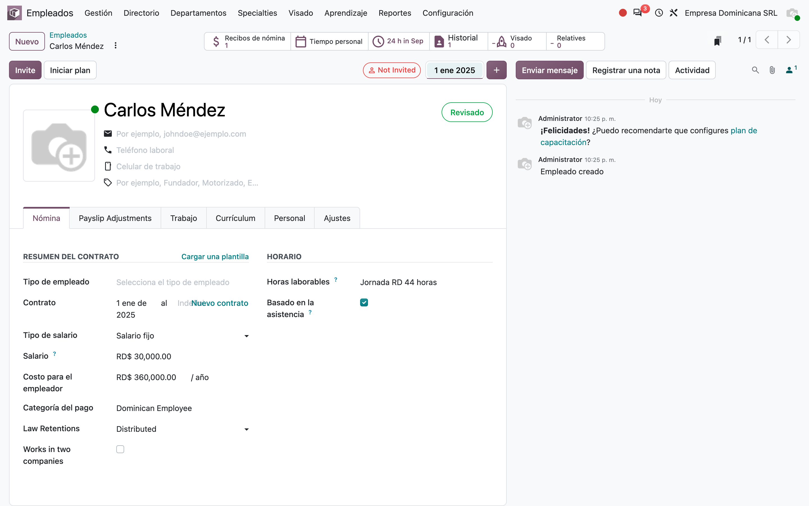
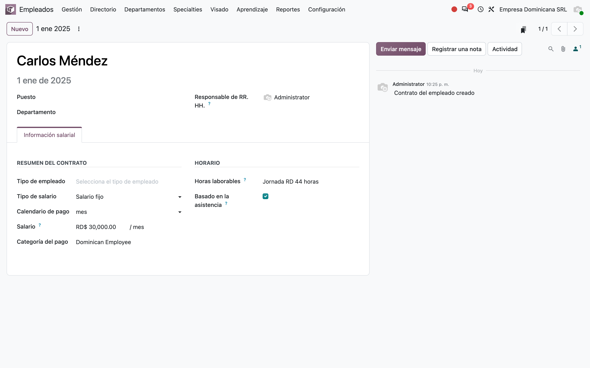
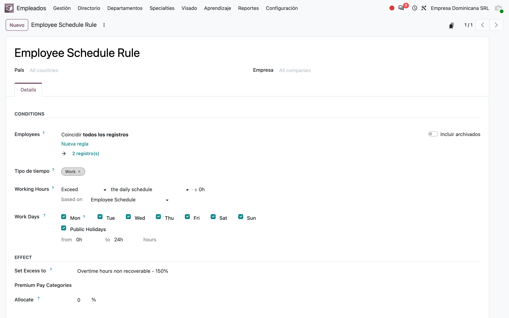
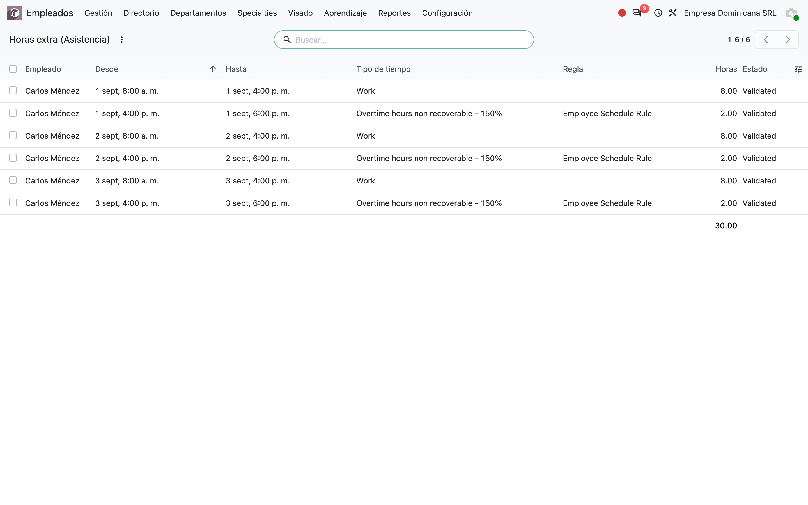
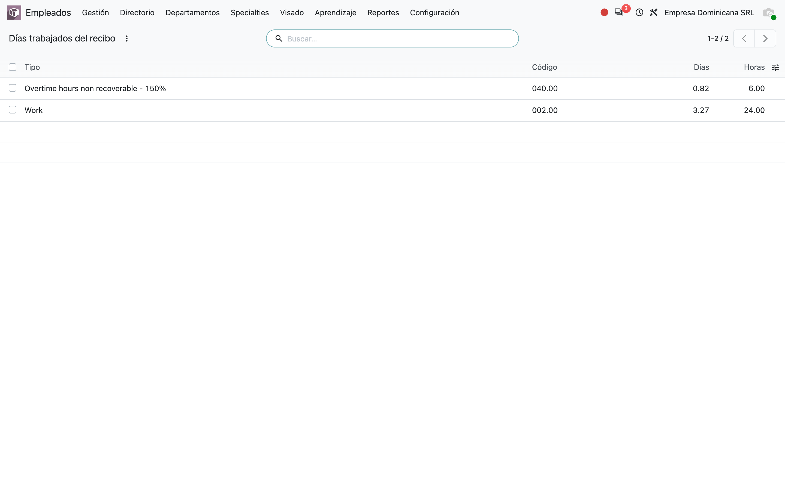
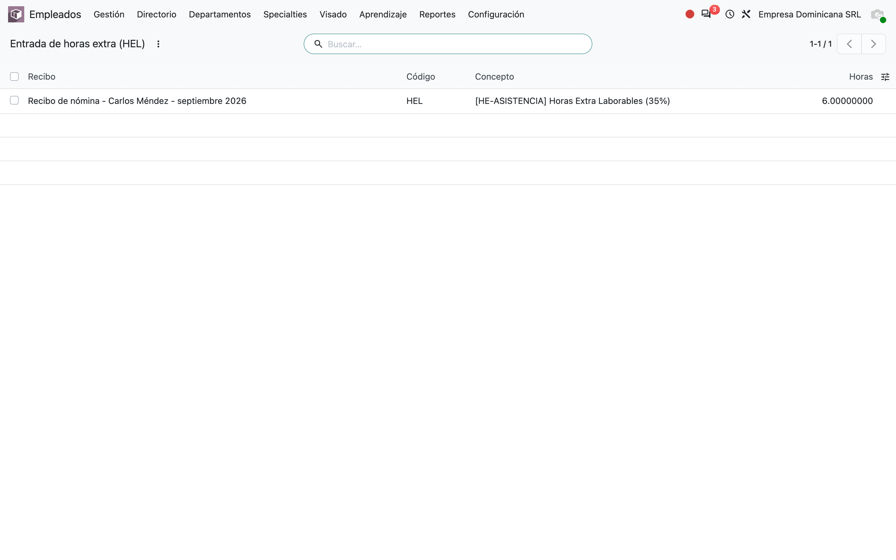
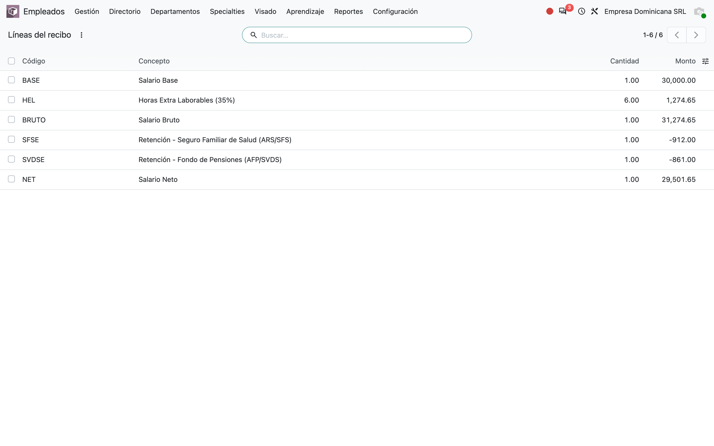

# Horas extra de asistencia → input de nómina (HEL) — Manual de configuración y validación (20.0)

> Manual generado con `tools/manual-generator`. Las capturas se regeneran ejecutando el generador contra una base `test_v20_<módulo>`.

Este manual muestra, **desde una base de datos limpia en Odoo 20.0**, cómo dejar el flujo funcionando: el motor **nativo** de Odoo (reglas de tiempo de *Asistencias*) clasifica las horas trabajadas por encima de la jornada como **horas extra** y las pone en el recibo como línea de *Días trabajados* (`040.00` — *Overtime hours non recoverable - 150%*); el módulo **`l10n_do_hr_payroll_news_attendance`** lleva esas horas a la **entrada (input) de horas extra** dominicana (`HEL`), que es de donde la estructura RD paga el recargo del 35%.

**Cómo se calcula el monto:** el input `HEL` lleva el **número de horas** extra; la regla salarial las multiplica por el salario/hora y el recargo: `HEL = (salario / DIAS_LAB_MES / HORAS_LAB_DIA) × EXTRA_DIURNA × horas`. En el ejemplo: salario RD$30,000, 6 h extra → `(30000/23.83/8)×1.35×6 = 1,274.65`.

> **Qué cambió en 20.0:** las *Reglas de horas extra* (overtime rulesets) y el *origen de entradas de trabajo* del contrato ya no existen. Las horas extra las genera una **regla de tiempo** (`hr.time.rule`) como asistencias de salida con su propio tipo de tiempo; el ajuste de nómina ya no tiene tipo de entrada sino **regla salarial** (`HEL`).

> La base de ejemplo se siembra con `configs/l10n_do_hr_payroll_news_attendance.seed.py`.

## Requisitos previos

- Instalar **`l10n_do_hr_payroll_news_attendance`** — arrastra `hr_payroll_attendance`, `hr_attendance`, `hr_payroll`, `l10n_do_hr_payroll` y `l10n_do_hr_payroll_news`.
- Compañía con localización RD: **país** República Dominicana, **moneda** DOP y **tipo de riesgo laboral**. El **tipo de tiempo de asistencia** de la compañía debe ser el genérico *Work* (`002.00`), que es el que lee la regla de tiempo.
- **Asistencias → Configuración → Ajustes → Validación de asistencias = aprobación automática** (para la prueba; si requiere aprobación, hay que validar las asistencias antes de calcular).
- Un **horario de trabajo** que represente la jornada teórica (ej. RD 44h: L-V 8-12 y 13-17, sábado 8-12). El exceso sobre esa jornada son las horas extra.
- Una **regla de tiempo** activa que clasifique el exceso como horas extra: la genérica *Employee Schedule Rule* viene instalada.
- Interfaz en español (es_DO).

## 1. Empleado

**Empleados → Empleados.** Crear el empleado (en el ejemplo *Carlos Méndez*) con sus datos RD: cédula, NSS, sexo, fecha de nacimiento y salario mensual (RD$30,000).

## 2. Contrato: basado en asistencias + horario

En la **configuración de nómina** del contrato del empleado:

- **Basado en asistencias** marcado → la nómina toma las horas reales registradas.
- **Horario de trabajo** = la jornada teórica (RD 44h).

En 20.0 las horas extra también fluyen para contratos por calendario: la regla de tiempo se aplica igual.

## 3. Regla de tiempo (horas extra)

**Asistencias → Configuración → Reglas de tiempo.** La regla genérica *Employee Schedule Rule*: **Horario = del empleado**, **Período = Día**, **Condición = exceder**, **Tipo de tiempo de condición = Work** (`002.00`) y **Tipo de tiempo de salida** = *Overtime hours non recoverable - 150%* (`040.00`).

> Para nocturno/feriado: crear reglas con su propio tipo de tiempo (ventana horaria, días feriados) y mapear su código en `_l10n_do_overtime_input_map` (`HEN`/`HEF`).

## 4. Horas extra generadas desde la asistencia

Al registrar la asistencia (**Asistencias → Gestión**), la regla de tiempo compara las horas reales con la jornada y **parte** la asistencia: el tramo dentro de la jornada queda como *Work* y el exceso como una asistencia de salida con el tipo de horas extra y la regla que la generó. En el ejemplo: 3 días de 08:00 a 18:00 vs jornada de 8 h → **2 h extra/día = 6 h**, ya **validadas** (solo las validadas pasan a la nómina).

## 5. Recibo: Días trabajados con la línea de horas extra

**Nómina → Recibos → Nuevo** para el empleado y el período, estructura **Dominican Republic - Base**, botón **Calcular**. En **Días trabajados** aparece *Overtime hours non recoverable - 150%* (`040.00`) con las 6 h, separada del trabajo normal.

## 6. Entrada de horas extra (HEL) — lo que agrega este módulo

Al calcular, el módulo lee la línea `040.00` de Días trabajados y crea la **entrada `HEL` — Horas Extra Laborables (35%)** con las **6 horas**. Sin este módulo, las horas quedarían solo en Días trabajados y **no** se pagarían en la estructura RD.

## 7. Ajuste de nómina [HE-ASISTENCIA]

La entrada se respalda en un **ajuste de nómina** (`hr.salary.attachment`) de un solo período: regla salarial **HEL**, monto = **horas**, sin repetición, desde el inicio del recibo y con su fin como fecha estimada, descripción `[HE-ASISTENCIA] …`. Cada *Calcular* lo crea, actualiza o reabre; si las horas extra desaparecen, lo **cierra** (no lo borra). Al validar el recibo se consumen las horas y el ajuste queda **Hecho**.

![7. Ajuste de nómina [HE-ASISTENCIA]](img/07-ajuste-he-asistencia.png)

## 8. Líneas del recibo: HEL pagado + Neto

La regla **HEL — Horas Extra Laborables (35%)** paga `(30000/23.83/8)×1.35×6 = 1,274.65`. El **Salario Neto** sube en ese monto respecto al mismo recibo sin horas extra.

## Notas

### Criterios de aceptación

1. Días trabajados del recibo tiene la línea de horas extra (`040.00`) con las horas extra.
2. El recibo tiene la entrada **HEL** con cantidad = horas extra, respaldada por un ajuste `[HE-ASISTENCIA]` **En curso**.
3. La regla **HEL** paga `(salario/DIAS_LAB_MES/HORAS_LAB_DIA)×EXTRA_DIURNA×horas` (ej. 1,274.65) y el **Neto** sube en ese monto.
4. **Idempotencia:** recalcular varias veces no duplica el ajuste ni las horas.
5. Si las horas extra desaparecen, el ajuste se **cierra** y el recibo deja de tener `HEL`; si vuelven, se reabre el mismo ajuste.
6. **Validar** el recibo consume las horas del ajuste (queda *Hecho*) sin error.

### Troubleshooting

- **"Cambié las asistencias y el recibo sigue con las horas viejas."** *Calcular* no regenera los Días trabajados: primero actualizar el recibo desde las entradas de trabajo y luego **Calcular**.
- **"No aparece la línea `040.00`."** Revisar que el tipo de tiempo de asistencia de la compañía sea el genérico *Work* (`002.00`) y que la regla de tiempo esté activa; una compañía creada con otro país conserva el tipo de tiempo de ese país.
- **Nocturno/feriado:** definir reglas de tiempo con su propio tipo de tiempo y mapear su código en `_l10n_do_overtime_input_map`.
