# Datos para reportes laborales RD (TSS · DGT-2/3/4 · IR-3) — Manual de usuario (l10n_do_hr_report_base, Odoo 20.0)

> Manual generado con `tools/manual-generator`. Las capturas se regeneran ejecutando el generador contra una base `test_v20_<módulo>`.

Este módulo es la **capa de datos** de los reportes laborales y fiscales de la nómina dominicana. Guarda en la base todo lo que piden la **TSS** (autodeterminación), el **Ministerio de Trabajo** (formularios **DGT-2**, **DGT-3** y **DGT-4** del SIRLA) y la **DGII** (IR-3): el nombre completo del empleado separado en nombres y apellidos, los catálogos oficiales del SIRLA, los establecimientos (RNL), los turnos, los movimientos de personal, la causa de cada hora extra y el cálculo común de salarios que comparten la TSS y el IR-3.

Los formularios DGT no se generan en Odoo: los sistemas externos (SIRLA, fiscalización) leen estos datos por una conexión externa. El archivo de la TSS lo genera el módulo `tss_report` (tiene su propio manual).

Odoo 20.0 no trae nada de esto para República Dominicana, por eso el módulo se porta.

**Qué cambió en 20.0:**

- Odoo 20.0 eliminó las **líneas de horas extra** (`hr.attendance.overtime.line`) y los **conjuntos de reglas de horas extra**. Ahora las horas extra son **asistencias** que crean las **reglas de tiempo** (*Asistencias → Configuración → Reglas automáticas*), y el recargo lo lleva la regla. La causa (Art. 153) y el % de recargo RD pasan a esas asistencias (sección 9).
- El conjunto de reglas *Horas Extra RD* pasa a ser **dos reglas de tiempo RD**: 35 % sobre 44 horas a la semana y 100 % en domingo y días feriados. Llegan **archivadas**, porque en 20.0 una regla activa se aplica sola a todos los empleados de la compañía y en 19.0 había que asignar el conjunto a cada contrato.
- Al actualizar una base 19.0, el script `migrations/2.0.0` pasa la causa de cada línea de horas extra a la asistencia de horas extra del mismo empleado y día.

## Requisitos previos

- Módulo **`l10n_do_hr_report_base`** `20.0.2.0.0` instalado. Depende de **`l10n_do_hr_payroll`** y de **`hr_attendance`**.
- Compañía con país República Dominicana y **RNC** cargado.
- Permisos de Empleados (*Oficial* para editar los datos SIRLA, *Administrador* para los catálogos) y de Asistencias (*Administrador*) para activar las reglas de tiempo.

## 1. La compañía con su RNC

**Ajustes → Empresas**. La compañía debe tener país **República Dominicana** y su **RNC** (solo dígitos): encabeza el archivo de la TSS.

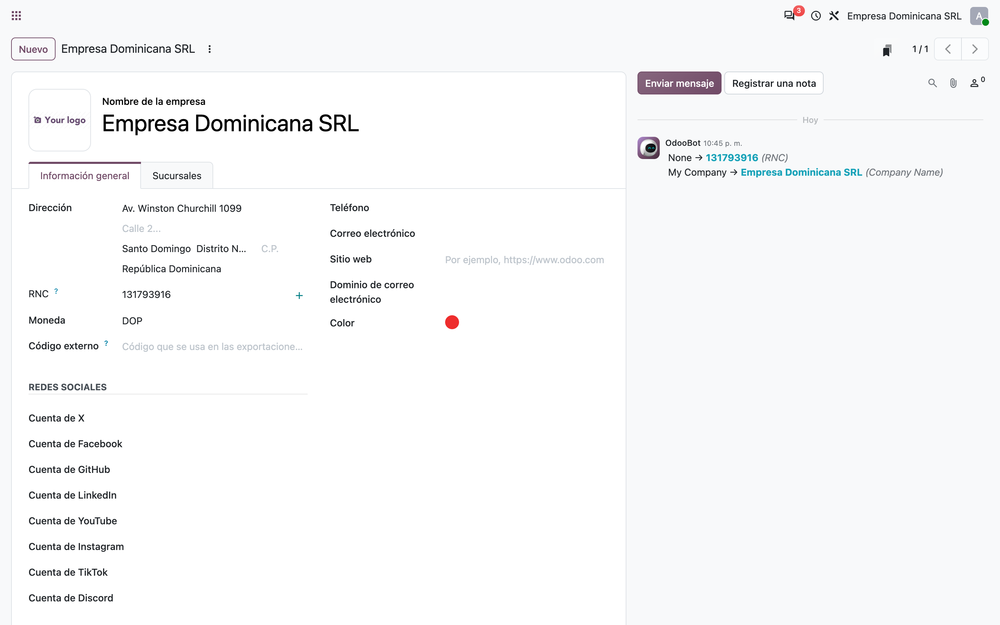

## 2. Establecimientos (RNL)

**Empleados → Configuración → Reportes SIRLA / DGT → Establecimientos**. Cada establecimiento tiene su **código RNL** del Ministerio de Trabajo. El campo **Empresas** dice qué compañías pueden usarlo; vacío, lo usan todas. Al crearlo se completan el nombre, la dirección y la provincia con los de la compañía.

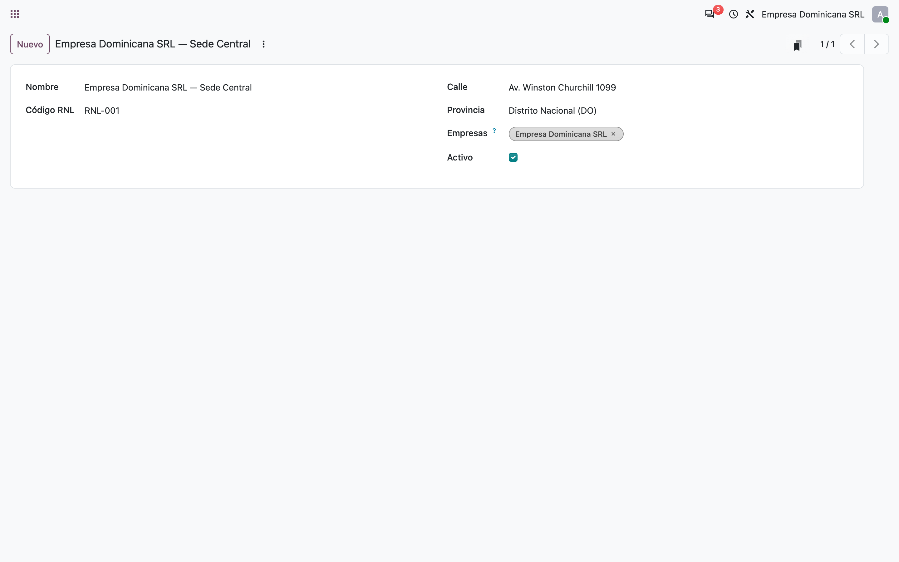

## 3. Catálogos SIRLA

**Empleados → Configuración → Reportes SIRLA / DGT**: **Ocupaciones**, **Nacionalidades**, **Niveles educativos** y **Discapacidades** vienen cargados de los catálogos oficiales del Ministerio de Trabajo (más de 2,000 ocupaciones). En la misma sección están las **Causas de horas extra** (Art. 153, literales a–e).

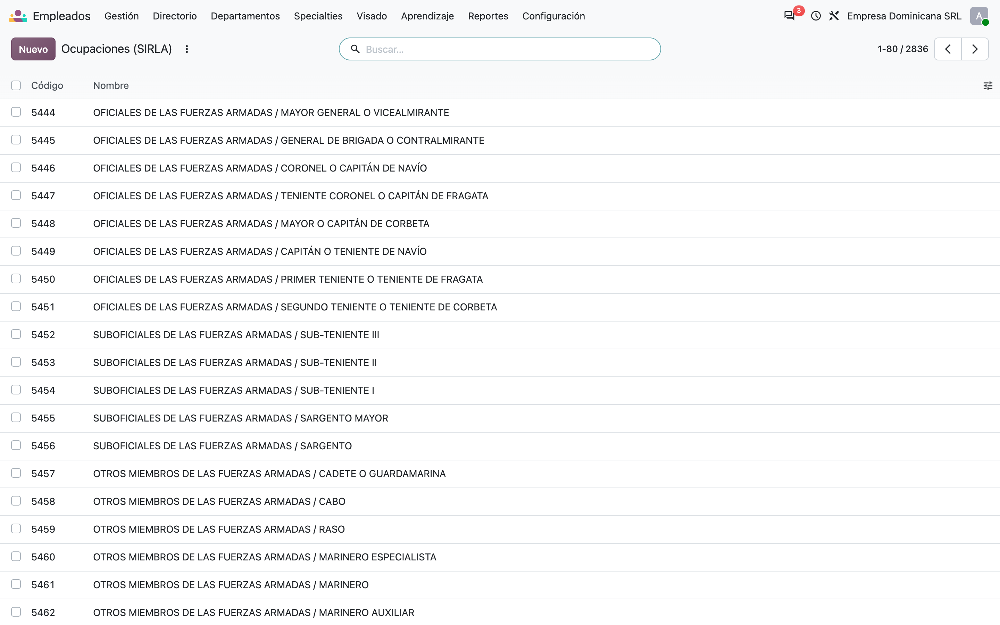

## 4. Turnos de trabajo

**Turnos** del SIRLA, con su código y horario. Se asignan a cada empleado.

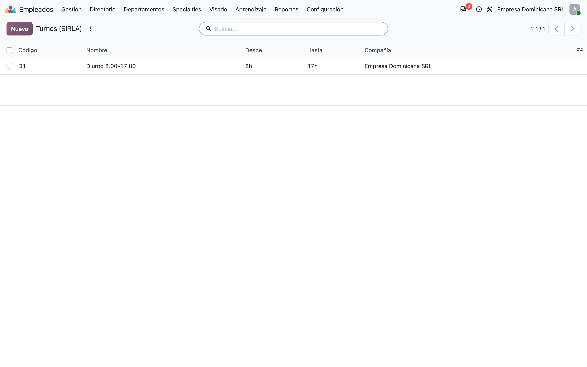

## 5. Ocupación del puesto

En **Empleados → Configuración → Puestos de trabajo**, cada puesto puede llevar su **Ocupación (SIRLA)**, como referencia para los empleados de ese puesto.

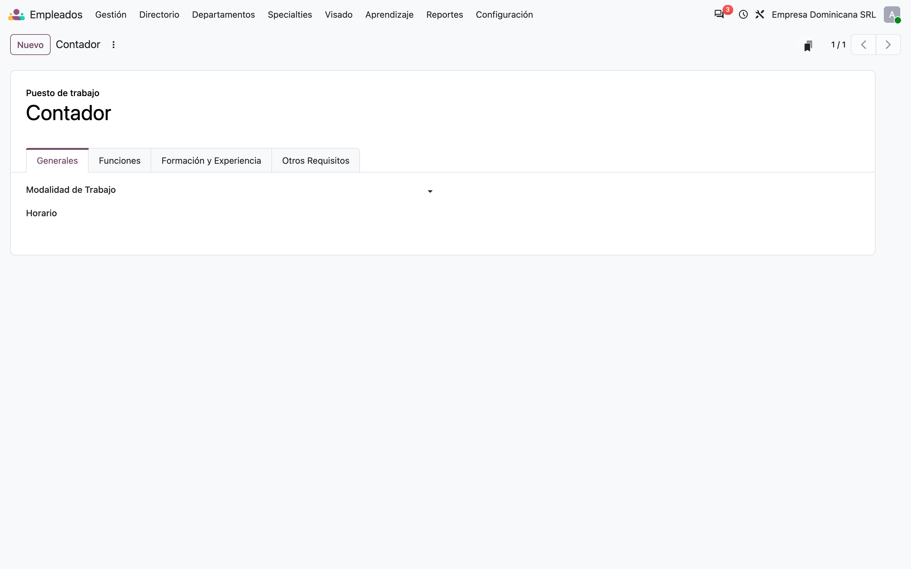

## 6. Empleado: pestaña TSS / DGT

En la ficha del empleado, la pestaña **TSS / DGT** guarda:

- **Nombre completo**: nombres, primer y segundo apellido por separado, como los pide la TSS (los dos primeros son obligatorios).
- **Datos SIRLA**: tipo de documento, nacionalidad, ocupación, nivel educativo, turno, establecimiento (RNL) y discapacidad.

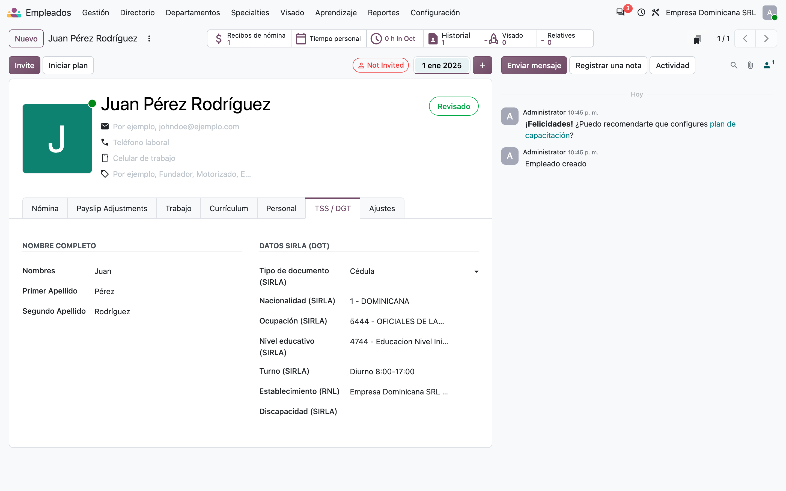

## 7. Empleado: clave de nómina y tipo de ingreso

En la pestaña **Nómina** del empleado, junto a la categoría de pago, el módulo agrega:

- **Clave de nómina**: la nómina de la TSS a la que pertenece el empleado (por defecto *Nómina Principal*, clave `001`).
- **Tipo de ingreso**: el código de la TSS (`0001` Normal, `0002` Trabajador ocasional, `0003` Por hora o tiempo parcial…). Por defecto `0001`.

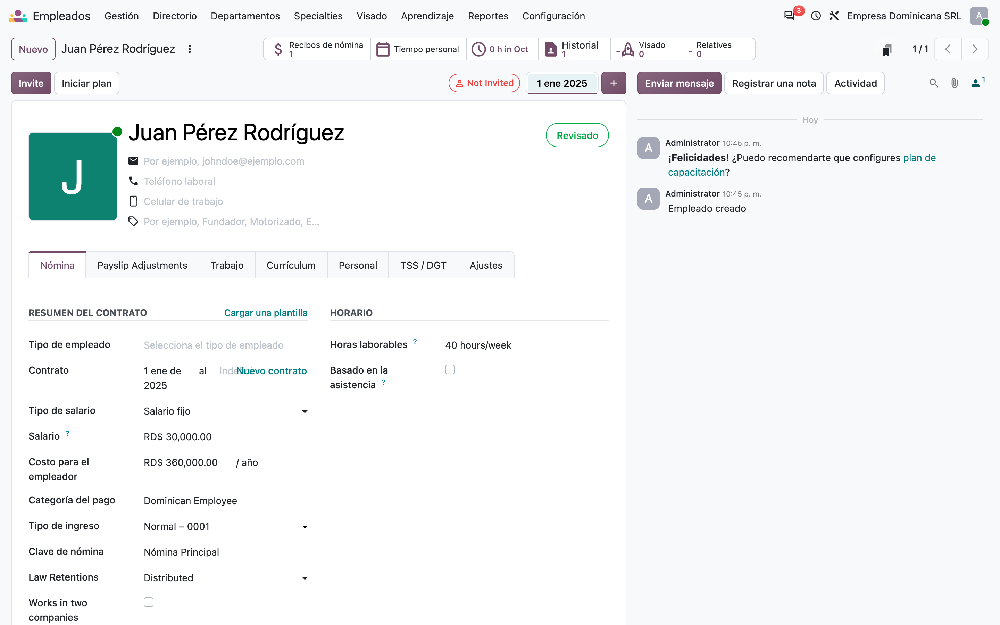

## 8. Movimientos de personal (DGT-4)

**Movimientos (DGT-4)**: cada alta (**NI**), salida (**NS**) o cambio (**NC**) de un empleado, con fecha y motivo. Es la fuente del formulario DGT-4.

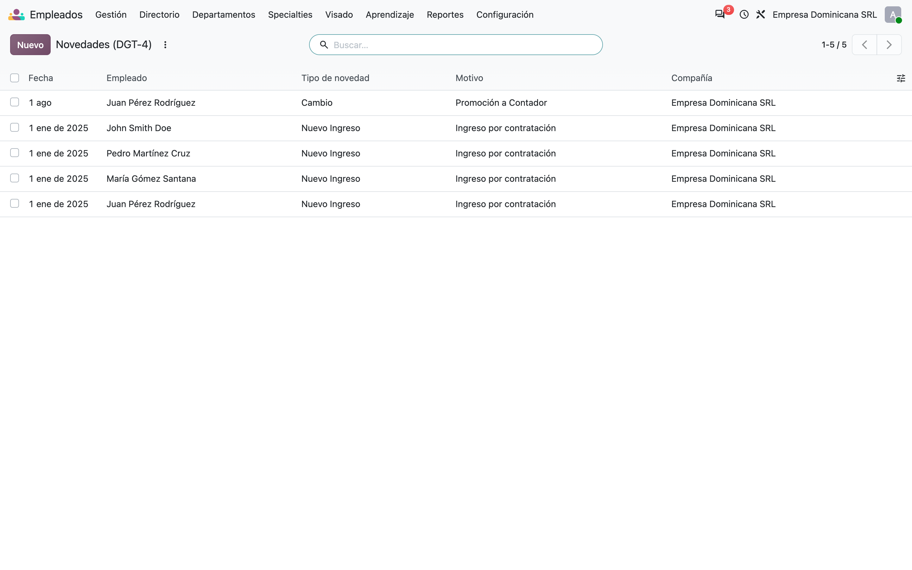

## 9. Reglas de tiempo RD

**Asistencias → Configuración → Reglas automáticas**. El módulo trae dos reglas para República Dominicana, **archivadas**:

- **Recargo 35 % (más de 44 h semanales)**: las horas que pasan de 44 en la semana.
- **Recargo 100 % (descanso semanal / día feriado)**: las horas trabajadas un domingo o un día feriado.

Para usarlas, quitarles el archivado. Odoo trae además la regla genérica *Employee Schedule Rule*, activa para todos los países, que marca como horas extra lo que pasa del horario de cada día con tasa 1.0; si se deja activa junto a las reglas RD, parte de esas horas queda con 0 % de recargo. En la captura las dos reglas RD ya están activas y la genérica archivada.

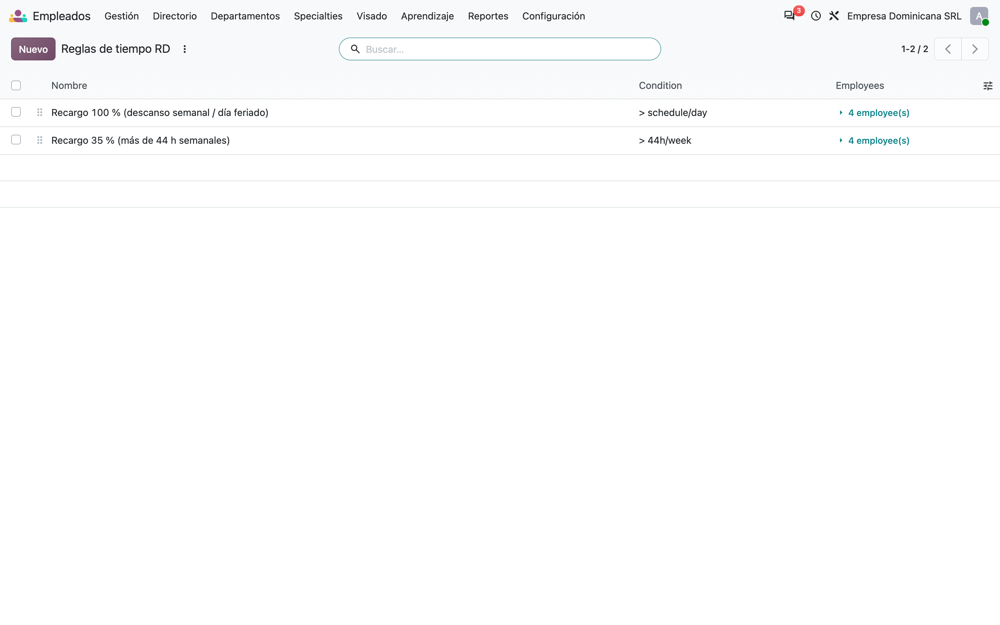

## 10. Detalle de la regla del 35 %

La regla compara las horas **por semana** con **44 horas** y le pone a lo que sobra la **tasa salarial 1.35**. De esa tasa sale el **% RD**: 1.35 → 35 %, 2.0 o más → 100 %.

El excedente se marca con el tipo de tiempo genérico de horas extra de Odoo (código `040.00`, que Odoo nombra *Overtime hours non recoverable - 150%*). Ese nombre es de Odoo: el % RD sale de la tasa de la regla, no del tipo. La nómina dominicana paga las horas extra por sus propias reglas (`HEL`, `HEN`, `HEF`), no por este tipo.

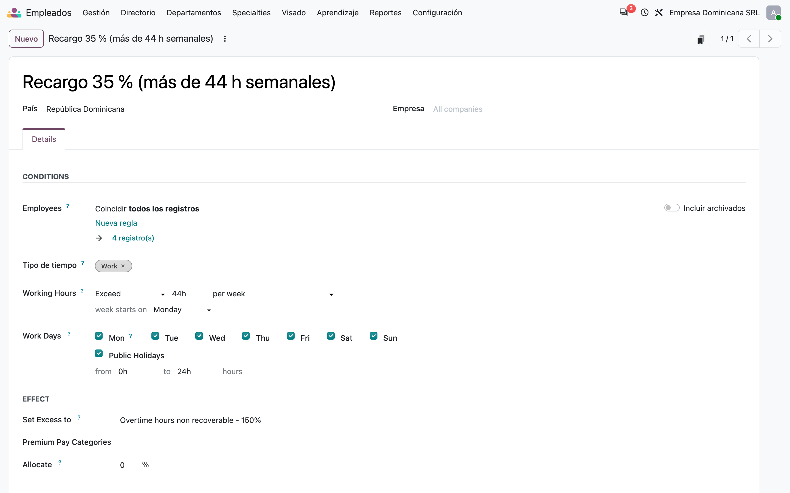

## 11. Horas extra (DGT-2)

La acción **Horas Extra (DGT-2)** lista las asistencias de horas extra que crearon las reglas de tiempo: empleado, día, horas, regla, **% RD** y **Causa (Art. 153)**. La causa se escoge en la misma lista. Es la fuente del formulario DGT-2.

En el ejemplo, Juan trabajó 10 horas de lunes a viernes, 4 el sábado y 4 el domingo: 6 h del viernes y 4 del sábado pasan de 44 en la semana (35 %) y las 4 del domingo van al 100 %.

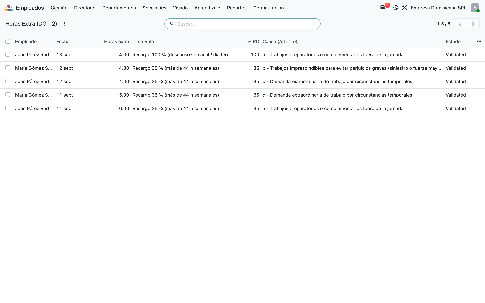

## 12. El recibo muestra el tipo de ingreso

El recibo de nómina muestra el **Tipo de ingreso** del contrato, que la TSS usa en el archivo de autodeterminación.

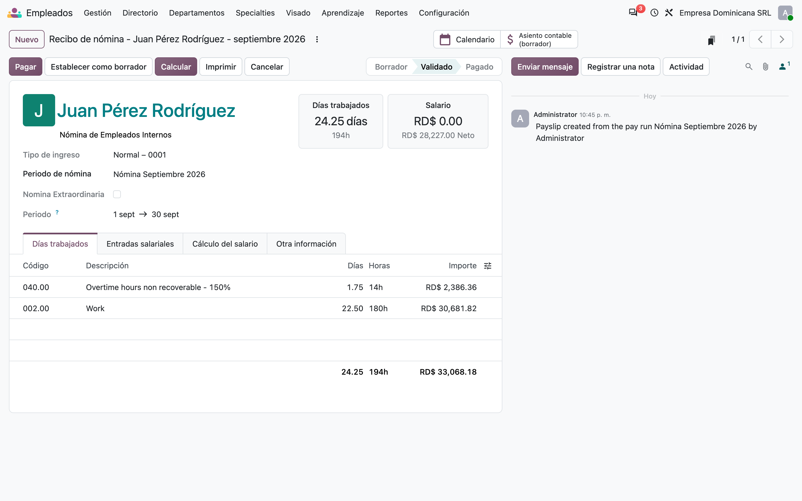

## Notas

- Los formularios **DGT-2/3/4** se generan fuera de Odoo. Los sistemas que leían las líneas de horas extra (`hr_attendance_overtime_line`) deben leer ahora `hr_attendance` filtrando `time_rule_id` (columnas `l10n_do_overtime_cause_id` y `l10n_do_overtime_pct`).
- Una línea de horas extra de 19.0 cuya asistencia de horas extra no aparece después de la actualización se informa en el registro de la migración y su causa no se pasa.
- El IR-3 (`dgii_ir3_report`) todavía no está portado a 20.0.
