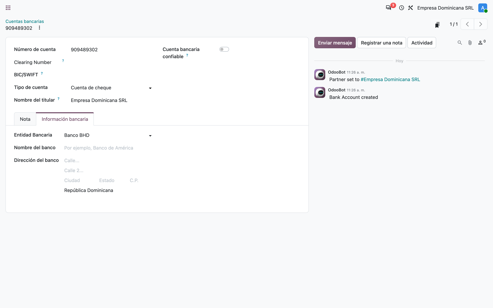
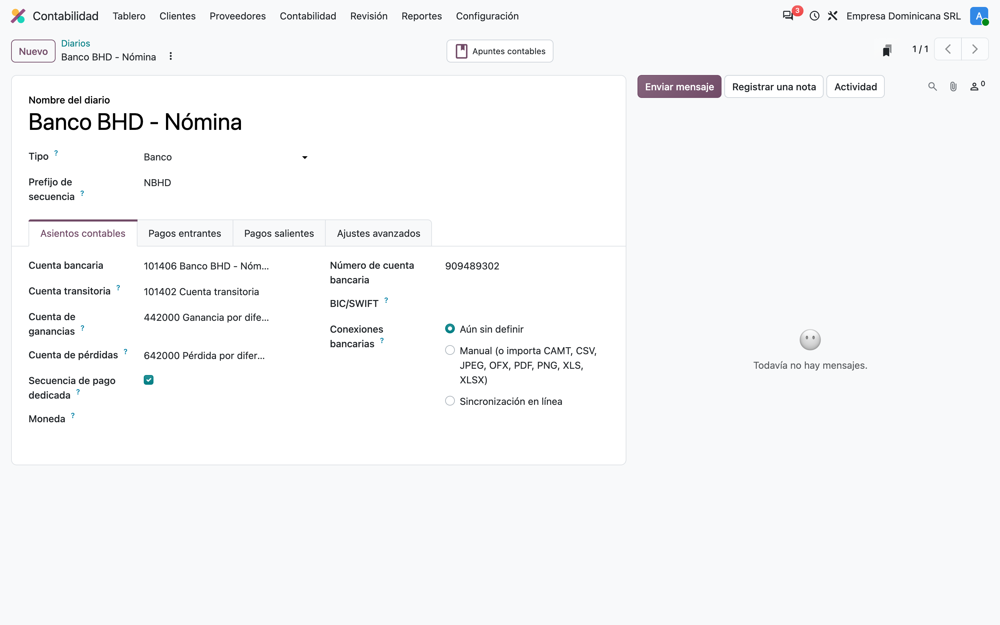
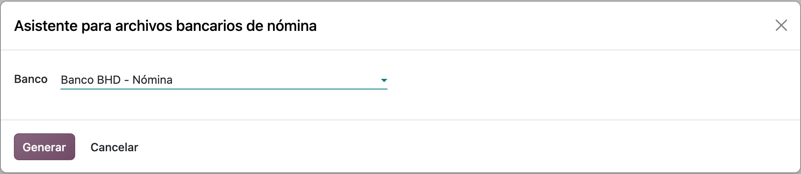
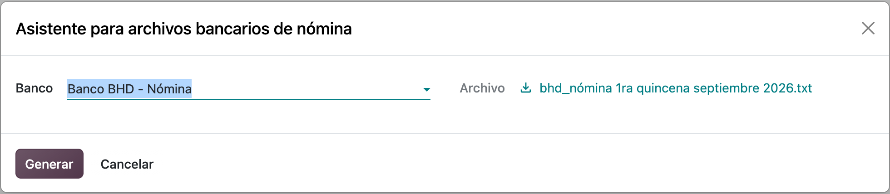

# Archivo de pago de nómina Banco BHD — Manual de usuario (Odoo 20.0)

> Manual generado con `tools/manual-generator`. Las capturas se regeneran ejecutando el generador contra una base `test_v20_<módulo>`.

El módulo **l10n_do_payroll_bhd_file** genera, desde un periodo de nómina, el archivo de **pago de nómina del Banco BHD**: un `.txt` con una línea por colaborador y los campos separados por punto y coma, listo para subir a la banca empresarial del BHD.

Se apoya en **l10n_do_payroll_file_base** (acción **Archivo de Banco** del periodo de nómina) y se activa cuando el diario elegido tiene una cuenta bancaria cuya **Entidad Bancaria** es *Banco BHD*.

**Cambios en Odoo 20.0:** Odoo eliminó el catálogo de bancos (`res.bank`) y el campo *Banco* del diario. El módulo reconoce ahora el diario del BHD por la **Entidad Bancaria** de su cuenta bancaria.

## Requisitos previos

- Módulo instalado: l10n_do_payroll_bhd_file (arrastra l10n_do_payroll_file_base, l10n_do_hr_payroll y l10n_do_banks).
- Un diario de tipo **Banco** con la cuenta de la empresa en *Banco BHD*.
- Cada colaborador con cuenta bancaria (o marcado como *Se paga con cheque*).
- Un periodo de nómina en estado **Hecho** con los recibos validados.

## 1. Cuenta de la empresa en el BHD

La cuenta bancaria de la empresa asociada al diario de nómina tiene como **Entidad Bancaria** *Banco BHD* (pestaña *Información bancaria*). Es lo que hace que el asistente genere el formato del BHD.



## 2. Diario de banco de nómina BHD

Diario de tipo **Banco** con esa cuenta en *Número de cuenta bancaria*.



## 3. Asistente con el diario del BHD

Desde el menú **⋮** de la tarjeta del periodo (estado **Hecho**) ▸ **Archivo de Banco**, se elige el diario **Banco BHD - Nómina**. El BHD no pide datos adicionales.



## 4. Archivo generado

Con **Generar**, el asistente muestra el archivo `bhd_<periodo>.txt` para descargar. Si algún recibo del periodo no está validado, se lista como aviso debajo del archivo.



## Notas

**Ejemplo real** del periodo de este manual (`bhd_nómina 1ra quincena septiembre 2026.txt`, fin de línea CRLF):

```
9601234567;Ana Mercedes Pérez;Recibo de nómina - Ana Mercedes Pérez - 01/09/2026 - 15/09/2026;39192.76;Recibo de nómina - Ana Mercedes Pérez - 01/09/2026 - 15/09/2;ana.perez@correo.do
774555001;Beto Antonio Gómez;Recibo de nómina - Beto Antonio Gómez - 01/09/2026 - 15/09/2026;21170.25;Recibo de nómina - Beto Antonio Gómez - 01/09/2026 - 15/09/2;beto.gomez@correo.do
12345678;Carlos Pérez Marval;Recibo de nómina - Carlos Pérez Marval - 01/09/2026 - 15/09/2026;24463.40;Recibo de nómina - Carlos Pérez Marval - 01/09/2026 - 15/09/;-
```

Cada línea lleva, separados por `;`:

1. **Cuenta destino** del colaborador, sin guiones ni espacios (la cuenta puede ser de cualquier banco).
2. **Nombre** del colaborador.
3. **Referencia**: el nombre del recibo de nómina.
4. **Monto** neto (regla *Salario Neto*), con dos decimales y punto.
5. **Descripción**: el nombre del recibo, hasta 60 caracteres.
6. **Correo privado** del colaborador; si no tiene, se escribe `-` (caso de Carlos Pérez Marval).

Los colaboradores que se pagan con cheque no aparecen en el archivo.

**Migración a 20.0:** no requiere pasos; la **Entidad Bancaria** de cada cuenta la traslada `l10n_do_banks` al actualizar.
