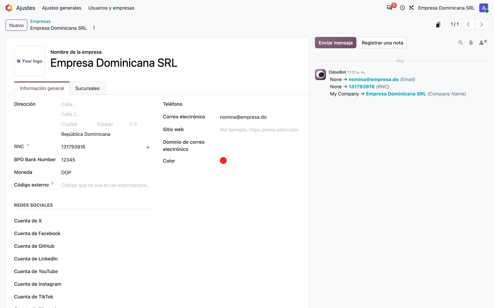
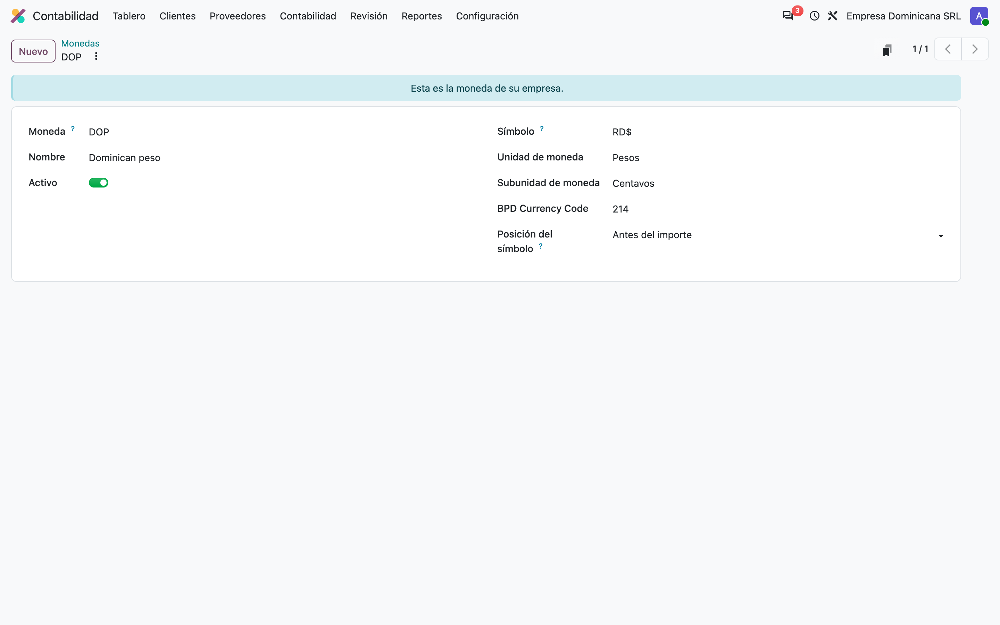
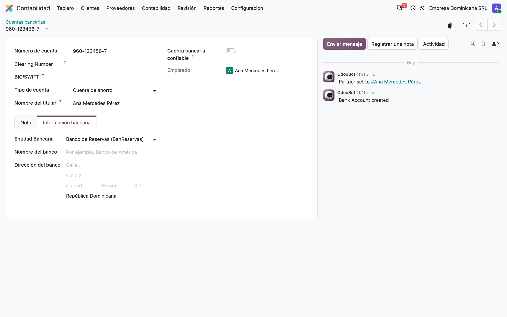
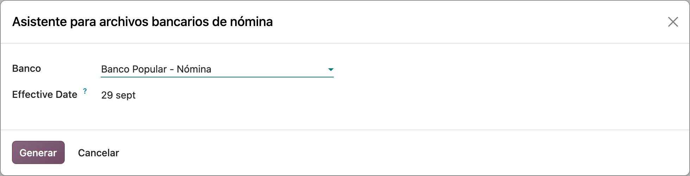
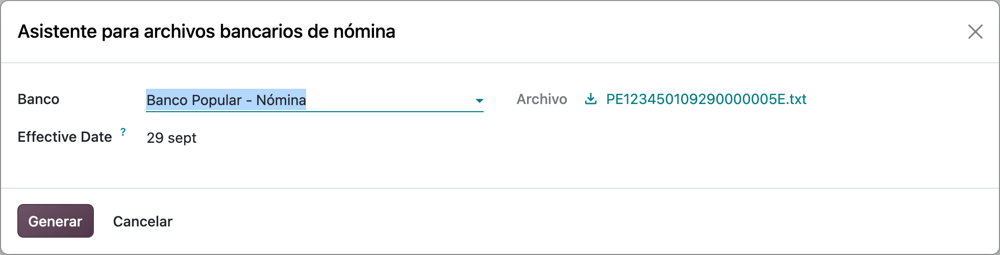

# Archivo de pago de nómina Banco Popular (BPD) — Manual de usuario (Odoo 20.0)

> Manual generado con `tools/manual-generator`. Las capturas se regeneran ejecutando el generador contra una base `test_v20_<módulo>`.

El módulo **l10n_do_payroll_bpd_file** genera, desde un periodo de nómina, el archivo de **pago de nómina de Banco Popular Dominicano** (formato de ancho fijo `PE…E.txt`) que se sube al portal empresarial del banco.

Se apoya en **l10n_do_payroll_file_base** (acción **Archivo de Banco** del periodo de nómina) y se activa cuando el diario elegido tiene una cuenta bancaria cuya **Entidad Bancaria** es *Banco Popular Dominicano (BPD)*.

**Cambios en Odoo 20.0:** Odoo eliminó el catálogo de bancos (`res.bank`). El **código de ruta** y el **dígito verificador** que Banco Popular exige para cada banco destino ya no se editan en una ficha de banco: vienen con el módulo para los 22 bancos y asociaciones que el banco publica, y se toman de la **Entidad Bancaria** de la cuenta del colaborador. El tipo de cuenta (corriente / ahorro) se indica en la cuenta bancaria.

## Requisitos previos

- Módulo instalado: l10n_do_payroll_bpd_file (arrastra l10n_do_payroll_file_base, l10n_do_hr_payroll y l10n_do_banks).
- Empresa con **RNC** y **Número de banco BPD** (5 dígitos, lo asigna Banco Popular).
- Un diario de tipo **Banco** con la cuenta de la empresa en *Banco Popular Dominicano (BPD)*.
- Cada colaborador con cuenta bancaria (**Entidad Bancaria** y **Tipo de cuenta**) y con **cédula** o **pasaporte**.
- Un periodo de nómina en estado **Hecho** con los recibos validados.

## 1. Número de banco BPD de la empresa

En **Ajustes ▸ Empresas**, la ficha de la empresa tiene el campo **Número de banco BPD** junto al RNC. Es el número de 5 dígitos con que Banco Popular identifica a la empresa, y forma parte del nombre del archivo (`PE<número>01<MMDD><secuencia>E.txt`).



## 2. Código de moneda BPD

Cada moneda lleva su **Código de moneda BPD** (DOP `214`, USD `840`, EUR `978`, ya cargados por el módulo). El archivo lo escribe en cada transacción según la moneda de la cuenta destino.



## 3. Cuenta bancaria del colaborador

La **Entidad Bancaria** (pestaña *Información bancaria*) decide el código de ruta y el dígito verificador del banco destino. El **Tipo de cuenta** decide el tipo (`1` corriente, `2` ahorro) y el código de transacción (`22` / `32`). Una cuenta sin tipo detiene la generación con un aviso.



## 4. Asistente con el diario de Banco Popular

Desde el menú **⋮** de la tarjeta del periodo ▸ **Archivo de Banco**, se elige el diario de **Banco Popular**. Aparece la **Fecha efectiva**: el día en que el banco debe acreditar los pagos (no puede quedar vacía).



## 5. Archivo generado

Con **Generar**, el asistente muestra el archivo `PE…E.txt` listo para descargar y subir al portal de Banco Popular. Si algún recibo del periodo no está validado, se lista como aviso debajo.



## Notas

**Ejemplo real** del periodo de este manual (`PE123450109290000006E.txt`, se muestran los primeros 130 caracteres de cada línea; el archivo usa fin de línea CRLF):

```
H131793916      Empresa Dominicana SRL             0000006012026092900000000000000000000000000000000003000000848264100000000000000
N131793916      000000600000169601234567          2214101010106320000003919276CE00112345678    Ana Mercedes Pérez                 
N131793916      00000060000017774555001           1214101010708220000002117025CE40298765432    Beto Antonio Gómez                 
N131793916      0000006000001812345678            2214101012308320000002446340PSVEN1234567     Carlos Pérez Marval                
```

- La línea **H** (encabezado) lleva el RNC de la empresa, el nombre, la secuencia del archivo, la fecha efectiva, la cantidad de créditos y el total en centavos.
- Cada línea **N** es una transacción: cuenta destino (sin guiones), tipo de cuenta (`1` corriente / `2` ahorro), moneda (`214`), **código de ruta + dígito verificador** del banco destino, código de transacción (`22` / `32`), monto en centavos, tipo de documento y documento, nombre, referencia y correo.
- Las tres líneas van a tres bancos distintos: BanReservas (`10101010` / `6`), Banco Popular (`10101070` / `8`) y BHD (`10101230` / `8`).
- **Tipo de documento:** con cédula de 11 dígitos, `CE`; con otra identificación nacional, `RN`; sin identificación pero con **pasaporte**, `PS` y el número de pasaporte (caso de Carlos Pérez Marval, colaborador extranjero). Sin ninguno de los dos, la generación se detiene con el nombre del colaborador.
- **Depósitos a terceros** del recibo (pestaña del recibo de nómina) generan su propia línea hacia la cuenta del tercero, que debe tener RNC.

**Bancos con código de ruta** (22): Popular, BanReservas, BHD, Santa Cruz, Citibank, Scotiabank, BDI, López de Haro, Vimenca, Promerica, Asociación Popular, Caribe, Bancamérica, Asociación Cibao (ACAP), Banesco, Asociación La Nacional, Lafise, Bell Bank, Empire, Atlántico, ADEMI y BACF. Una cuenta destino en otro banco se escribe sin código de ruta y Banco Popular rechazará esa línea.

**Migración a 20.0:** no requiere pasos. Los códigos que antes se guardaban en la ficha de cada banco (`res.bank`, eliminada en 20.0) ahora vienen en el módulo con los mismos valores; la **Entidad Bancaria** de cada cuenta la traslada `l10n_do_banks` al actualizar.

**Pendiente conocido:** algunas etiquetas propias del módulo (*BPD Bank Number*, *BPD Currency Code*, *Effective Date*) aparecen en inglés: el archivo de traducción del módulo nunca las tradujo.
