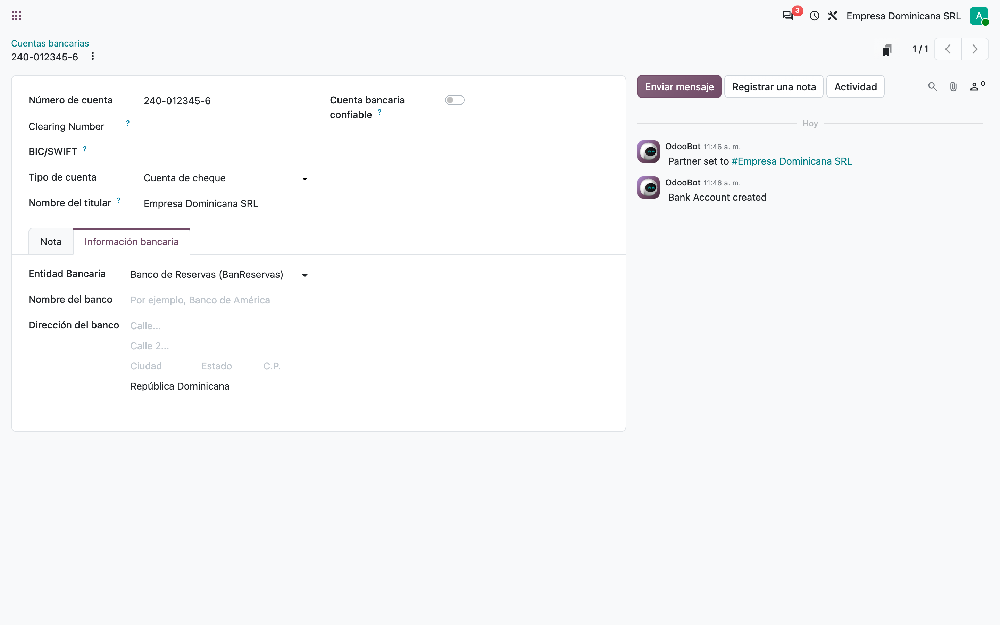
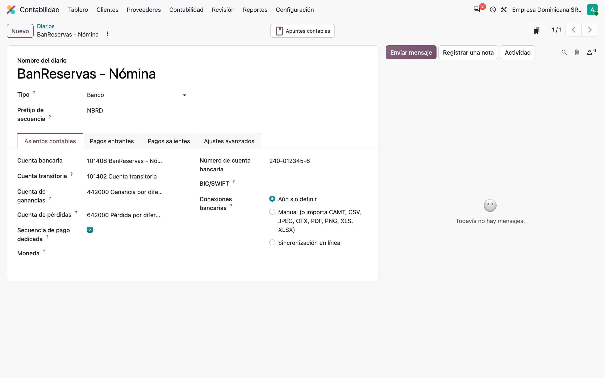
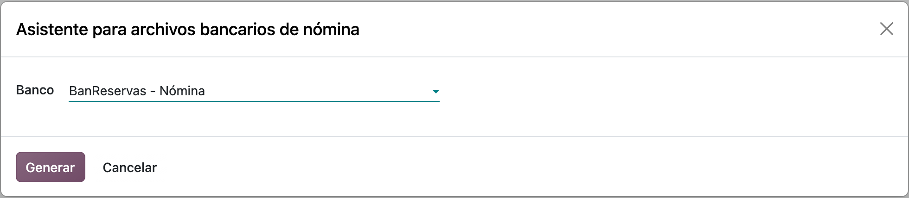
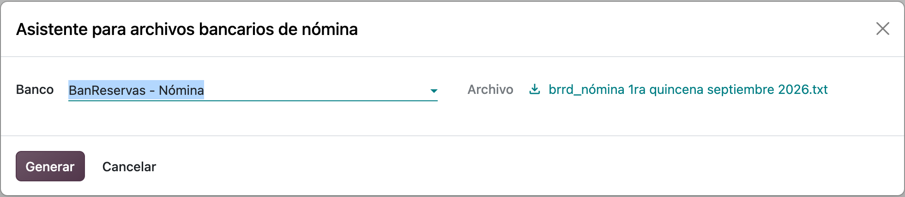

# Archivo de pago de nómina BanReservas (BRRD) — Manual de usuario (Odoo 20.0)

> Manual generado con `tools/manual-generator`. Las capturas se regeneran ejecutando el generador contra una base `test_v20_<módulo>`.

El módulo **l10n_do_payroll_brrd_file** genera, desde un periodo de nómina, el archivo de **pago de nómina de Banco de Reservas (BanReservas)**: un `.txt` con una línea por colaborador y los campos separados por comas, para subir a la banca empresarial de BanReservas.

Se apoya en **l10n_do_payroll_file_base** (acción **Archivo de Banco** del periodo de nómina) y se activa cuando el diario elegido tiene una cuenta bancaria cuya **Entidad Bancaria** es *Banco de Reservas (BanReservas)*.

**Cambios en Odoo 20.0:** Odoo eliminó el catálogo de bancos (`res.bank`) y el campo *Banco* del diario. El módulo reconoce ahora el diario de BanReservas por la **Entidad Bancaria** de su cuenta bancaria.

## Requisitos previos

- Módulo instalado: l10n_do_payroll_brrd_file (arrastra l10n_do_payroll_file_base, l10n_do_hr_payroll y l10n_do_banks).
- Un diario de tipo **Banco** con la cuenta de la empresa en *Banco de Reservas (BanReservas)*: su número es la cuenta origen del archivo.
- Cada colaborador con cuenta bancaria (o marcado como *Se paga con cheque*).
- Un periodo de nómina en estado **Hecho** con los recibos validados.

## 1. Cuenta de la empresa en BanReservas

La cuenta bancaria de la empresa asociada al diario de nómina tiene como **Entidad Bancaria** *Banco de Reservas (BanReservas)* (pestaña *Información bancaria*). Su **Número de cuenta** se escribe tal cual como cuenta origen en cada línea del archivo.



## 2. Diario de banco de nómina BanReservas

Diario de tipo **Banco** con esa cuenta en *Número de cuenta bancaria*.



## 3. Asistente con el diario de BanReservas

Desde el menú **⋮** de la tarjeta del periodo (estado **Hecho**) ▸ **Archivo de Banco**, se elige el diario **BanReservas - Nómina**. BanReservas no pide datos adicionales.



## 4. Archivo generado

Con **Generar**, el asistente muestra el archivo `brrd_<periodo>.txt` para descargar. Si algún recibo del periodo no está validado, se lista como aviso debajo del archivo.



## Notas

**Ejemplo real** del periodo de este manual (`brrd_nómina 1ra quincena septiembre 2026.txt`, fin de línea CRLF):

```
240-012345-6,9601234567,39192.76,Ana Mercedes Pérez
240-012345-6,774555001,21170.25,Beto Antonio Gómez
240-012345-6,12345678,24463.40,Carlos Pérez Marval
```

Cada línea lleva, separados por `,`:

1. **Cuenta origen**: el número de la cuenta de la empresa del diario, tal como está escrito.
2. **Cuenta destino** del colaborador, sin guiones ni espacios (puede ser de cualquier banco).
3. **Monto** neto (regla *Salario Neto*), con dos decimales y punto.
4. **Referencia**: el nombre del colaborador.

Los colaboradores que se pagan con cheque no aparecen en el archivo.

**Migración a 20.0:** no requiere pasos; la **Entidad Bancaria** de cada cuenta la traslada `l10n_do_banks` al actualizar.
