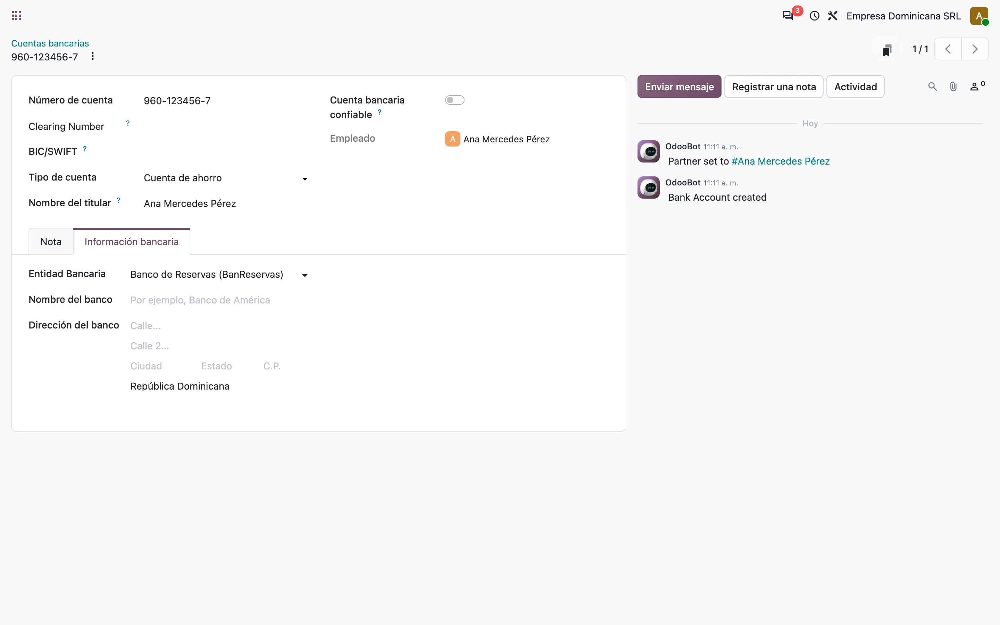
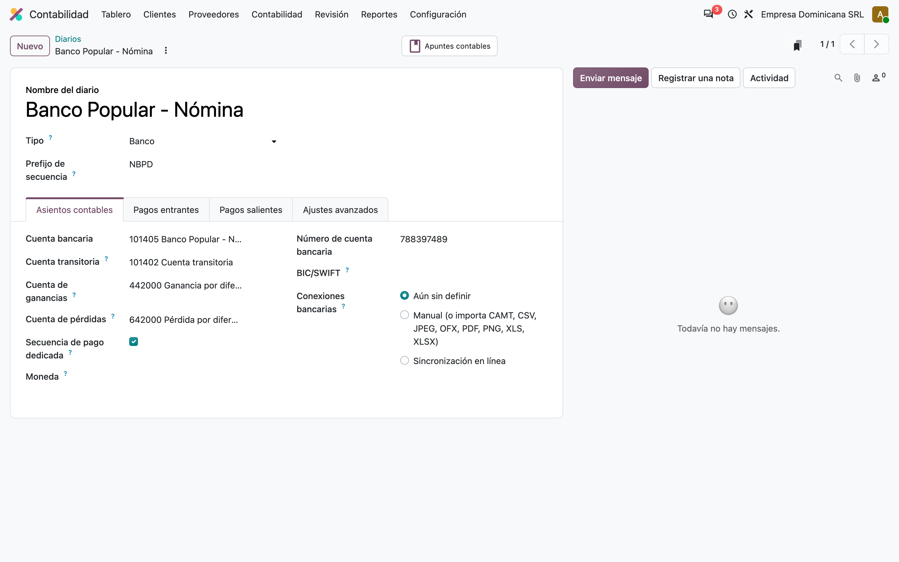
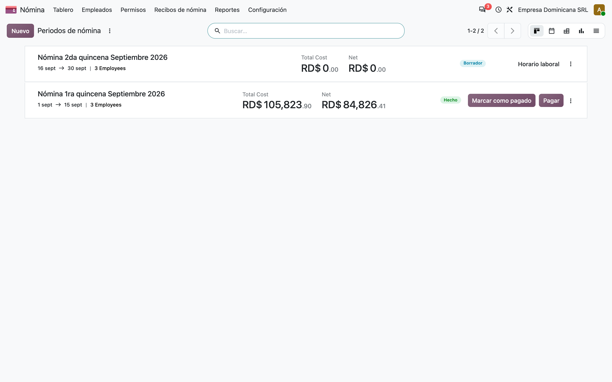
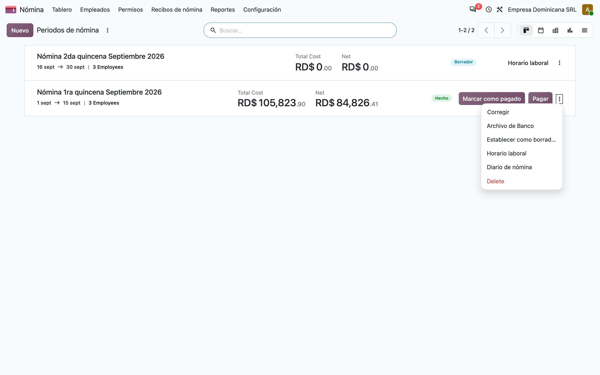
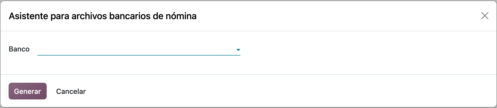
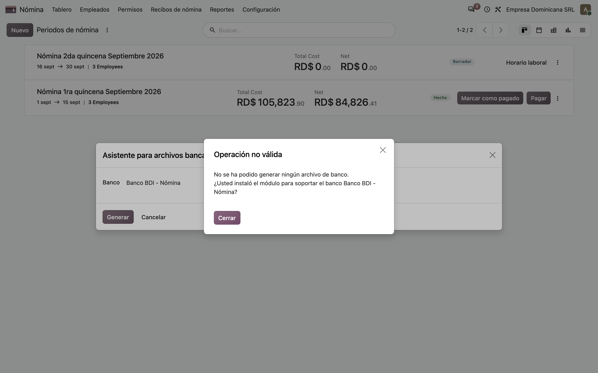

# Archivo de Banco de Nómina (base) — Manual de usuario (Odoo 20.0)

> Manual generado con `tools/manual-generator`. Las capturas se regeneran ejecutando el generador contra una base `test_v20_<módulo>`.

El módulo **l10n_do_payroll_file_base** agrega a los periodos de nómina la acción **Archivo de Banco**: un asistente que genera el archivo de pago que se sube a la banca en línea para acreditar el neto de cada colaborador.

Este módulo es la **base**: define el asistente, toma el neto (regla *Salario Neto*) y la cuenta principal de cada empleado, y delega el formato a los módulos de cada banco (**l10n_do_payroll_bpd_file** para Banco Popular, **l10n_do_payroll_bhd_file** para BHD). Sin un módulo de banco instalado el asistente avisa que falta.

**Cambios en Odoo 20.0:** la tarjeta del periodo de nómina es nueva y solo muestra como botones las acciones principales; **Archivo de Banco** está ahora en el menú **⋮** de la tarjeta. El banco dominicano se indica en la propia cuenta bancaria (campo *Entidad Bancaria*), porque Odoo 20.0 eliminó el catálogo de bancos (`res.bank`).

## Requisitos previos

- Módulo instalado: l10n_do_payroll_file_base (arrastra l10n_do_hr_payroll y l10n_do_banks).
- Un módulo de banco para generar el archivo: l10n_do_payroll_bpd_file o l10n_do_payroll_bhd_file.
- Un diario de tipo **Banco** con cuenta bancaria de la empresa, cuya *Entidad Bancaria* sea la del archivo.
- Cada colaborador con una **cuenta bancaria** (o marcado como *Se paga con cheque*).
- Un periodo de nómina en estado **Hecho** con los recibos validados.

## 1. Cuenta bancaria del colaborador

Cada colaborador necesita una **cuenta bancaria** (Empleados ▸ ficha ▸ cuentas bancarias, o Contabilidad ▸ Configuración ▸ Cuentas bancarias). En la pestaña **Información bancaria** se indica el **Entidad Bancaria**; en la parte superior, el **Tipo de cuenta** (corriente o de ahorro). Es la cuenta destino del pago. Los colaboradores marcados como *Se paga con cheque* se excluyen del archivo.

## 2. Diario de banco de nómina

El diario desde el que se paga la nómina es de tipo **Banco** y tiene asociada la cuenta bancaria de la empresa. El **Entidad Bancaria** de esa cuenta (aquí Banco Popular) decide qué formato de archivo se genera.

## 3. Periodo de nómina en estado «Hecho»

En **Nómina ▸ Periodos de nómina**, el periodo validado aparece como **Hecho**. La tarjeta muestra como botones *Marcar como pagado* y *Pagar*.

## 4. Acción «Archivo de Banco» en el menú ⋮

Con el menú **⋮** de la tarjeta se despliegan el resto de acciones; entre ellas **Archivo de Banco**. Solo aparece cuando el periodo está en estado **Hecho**.

## 5. Asistente «Archivo de Banco»

El asistente pide el **Banco** (diario de banco) desde el que se paga. Al pulsar **Generar** se construye el archivo con el formato del banco de ese diario.

## 6. Banco sin módulo de archivo

Si el diario elegido es de un banco para el que no hay módulo de archivo instalado (aquí **Banco BDI**), el asistente no genera nada y avisa: *No se pudo generar ningún archivo bancario. ¿Instaló el módulo para admitir el banco …?*.

## Notas

**Qué toma el archivo de cada recibo:**

- **Cuenta destino:** la cuenta principal del colaborador, sin guiones ni espacios.
- **Monto:** la línea de la regla **Salario Neto** del recibo (`l10n_do_hr_payroll.hr_rule_net`), con dos decimales. Si el recibo no la tiene, el asistente lo informa.
- **Nombre** y **correo privado** del colaborador.

**Validaciones:**

- El periodo debe tener al menos un recibo **validado**; los que no lo están se listan como aviso junto al archivo.
- Un colaborador sin cuenta bancaria y que no se paga con cheque detiene la generación, con la lista de nombres.

**Migración a 20.0:** los permisos del asistente pasaron al nuevo modelo de accesos de Odoo 20.0 (`ir.access`); la actualización de una base 19.0 los carga sola.
