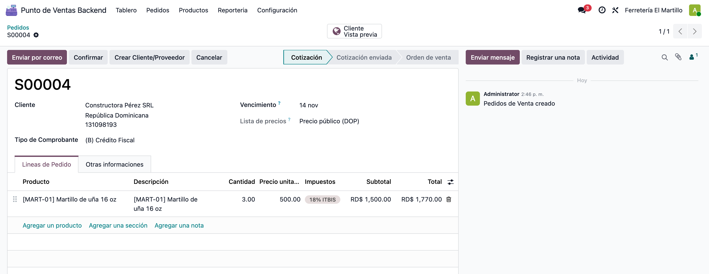
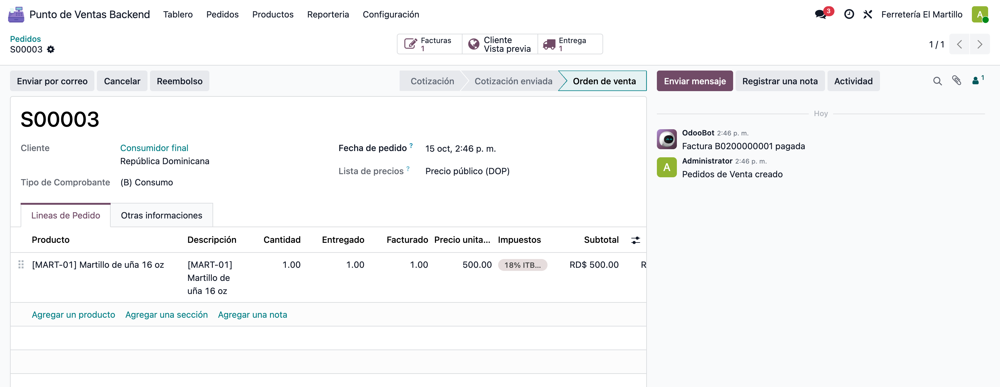
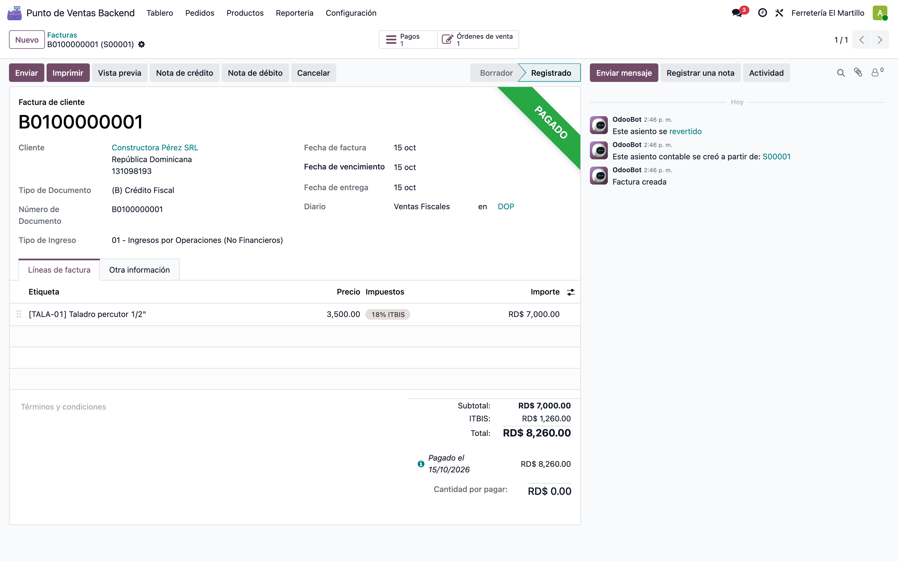
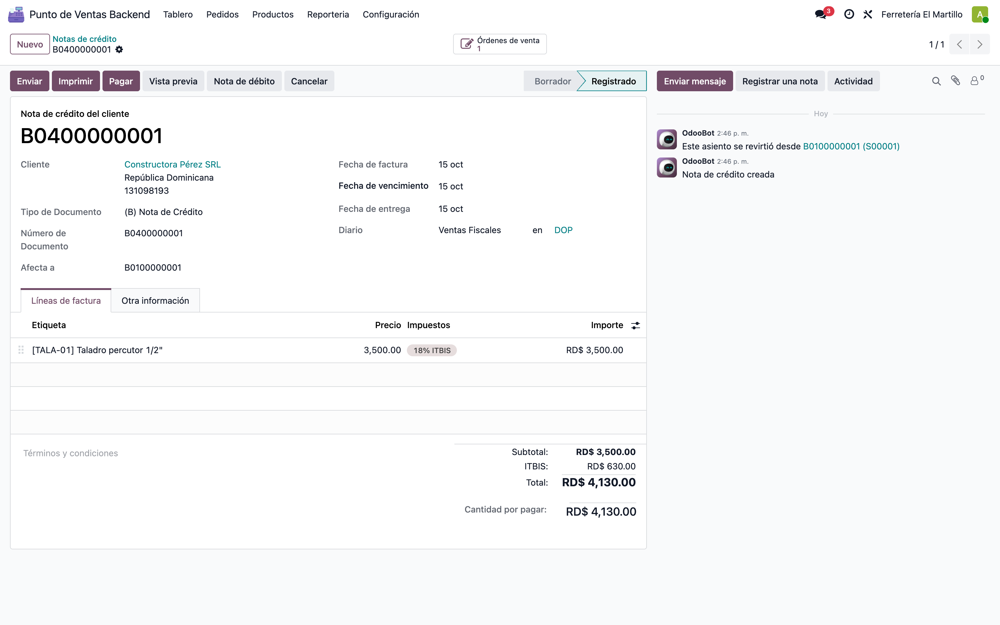

# Punto de Ventas Backend — Localización dominicana — Manual de usuario

> Manual generado con `tools/manual-generator`: `node capture.mjs --config=/Users/luisfernandez/repos/dev_env_odoo_pro-19/tools/manual-generator/configs/l10n_do_sale_pos_backend.json --db=test_v19_l10n_do_sale_pos_backend`. Las capturas se regeneran corriendo ese comando contra la base de pruebas.

**Punto de Ventas Backend — Localización dominicana** (`l10n_do_sale_pos_backend`) conecta la caja del backend (`sale_pos_backend`) con los comprobantes fiscales de `l10n_do_accounting`:

- El pedido de caja elige el **tipo de comprobante** (B01 crédito fiscal, B02 consumo, B14, B15…) según el cliente y el diario de ventas de la caja, y la factura sale con ese **NCF**.
- El **reembolso** de la caja genera la **nota de crédito B04** que modifica el NCF original, con el código de modificación de e-CF cuando la compañía es emisora electrónica.
- La nota de crédito respeta la regla de **ITBIS ya declarado**: pasados los días configurados, la nota sale sin ITBIS.
- El **ticket de caja** imprime tipo de comprobante, NCF / e-NCF, NCF modificado, vencimiento, ITBIS por línea y, para e-CF, el código QR, el código de seguridad y la fecha de firma.

**Base de datos de las capturas:** Base de pruebas `test_v19_l10n_do_sale_pos_backend`, compañía **Ferretería El Martillo** (RNC 131793898, DOP, plan contable dominicano). La siembra crea el diario **Ventas Fiscales** con documentos, la posición fiscal **ITBIS ya declarado** (ITBIS 18% → exento) configurada a 31 días, la **Caja Fiscal** con una sesión abierta, dos ventas a *Constructora Pérez SRL* (una de hoy y otra de hace 45 días) con sus reembolsos, una venta a *Consumidor final* y una cotización.

## Requisitos previos

- Odoo 19 con `l10n_do_sale_pos_backend` (instala `sale_pos_backend` y `l10n_do_accounting`).
- Compañía dominicana con RNC y el plan contable `do`.
- El **diario de ventas de la caja** con *Usar documentos* activo.
- Para la regla de ITBIS declarado: en *Ajustes › Contabilidad* la **posición fiscal** de notas de crédito y los **días de pago del ITBIS**.

## 1. Tipo de documento en el pedido de caja

Debajo del cliente aparece **Tipo de documento**. Se calcula con el mismo dominio que la factura (diario de ventas de la caja + tipo de contribuyente del cliente): *Constructora Pérez SRL* tiene RNC, así que el pedido propone **Crédito Fiscal (B01)**. Mientras el pedido esté en borrador se puede cambiar por cualquiera de los tipos permitidos; al confirmarlo queda fijo.

El campo sólo se muestra cuando el diario de la caja usa documentos.

## 2. Venta a consumidor final

El cliente por defecto de la caja, *Consumidor final*, no tiene RNC: el pedido propone **Consumo (B02)** y la factura sale con **B0200000001**.

## 3. La factura con NCF

*Crear factura* en el pedido usa el tipo de documento del pedido: la factura de los dos taladros queda como **B0100000001** por RD$ 8,260.00 en el diario *Ventas Fiscales*, pagada y ligada a la sesión de caja.

## 4. Nota de crédito B04 (dentro del plazo)

El reembolso de un taladro genera la nota **B0400000001**, que modifica **B0100000001**. Como la factura es de hoy, el ITBIS no se ha declarado y la nota lo conserva: RD$ 3,500.00 + 18% = **RD$ 4,130.00**.

## 5. Nota de crédito con ITBIS ya declarado

La segunda venta es de hace 45 días y la compañía tiene 31 días de pago del ITBIS. La nota **B0400000002** toma la posición fiscal **ITBIS ya declarado**, que cambia el ITBIS 18% por el exento: el martillo devuelto se acredita a **RD$ 500.00**, sin impuesto.

La regla la aplica `l10n_do_accounting` al crear la nota; este módulo vuelve a mapear los impuestos de las líneas que arma el reembolso de la caja con la posición fiscal de la nota, para que la regla no se pierda.

## 6. Datos fiscales en el ticket

El ticket de caja (*Imprimir › Factura de caja*) agrega en el encabezado el nombre del comprobante, **NCF** (o **e-NCF** si la factura es electrónica), **NCF modificado** en las notas de crédito y **Válida hasta** con el vencimiento de la secuencia. En facturas electrónicas añade la columna **Impuestos** por línea y, al pie, el **QR** del timbre, el **código de seguridad** y la **fecha de firma digital**.

## 7. Cambios de la migración a 19.0

- Dependencia `l10n_do_credit_note` → `l10n_do_accounting`. En 19 la nota de crédito hereda `invoice_currency_rate` de la factura, así que se eliminaron `_get_price_unit` (conversión de precios) y el `onchange` de *nota de crédito en moneda de la compañía*.
- El reembolso ajusta los impuestos con el hook `_prepare_credit_note_lines` de `sale_pos_backend`; en 17 se hacía guardando los ids de las facturas en `env.context`.
- **Corrección**: *¿Es venta fiscal?* lee el diario de la caja (el mismo que usa la factura). En 17 leía el diario de ventas por defecto y, si sólo el diario de la caja usaba documentos, la factura fallaba con *el diario requiere un tipo de documento*.
- **Corrección**: el tipo de documento se calcula también cuando el pedido ya está confirmado y el campo está vacío. En 17 sólo se calculaba en borrador; un pedido confirmado sin abrirlo en pantalla quedaba sin tipo y la factura fallaba con el mismo error.
- Las vistas se anclan en `partner_id`: el formulario de ventas de 19 ya no tiene el nodo `authorized_transaction_ids`.

## Notas

**Si la factura de caja falla con *el diario requiere un tipo de documento*:** revisar que el diario de ventas de la caja use documentos y que el cliente tenga un tipo de contribuyente con comprobantes permitidos en ese diario.

**Si la nota de crédito no quita el ITBIS de una factura vieja:** configurar la posición fiscal de notas de crédito y los días de pago del ITBIS en *Ajustes › Contabilidad*, y que la posición fiscal mapee el ITBIS 18% a un impuesto exento.
