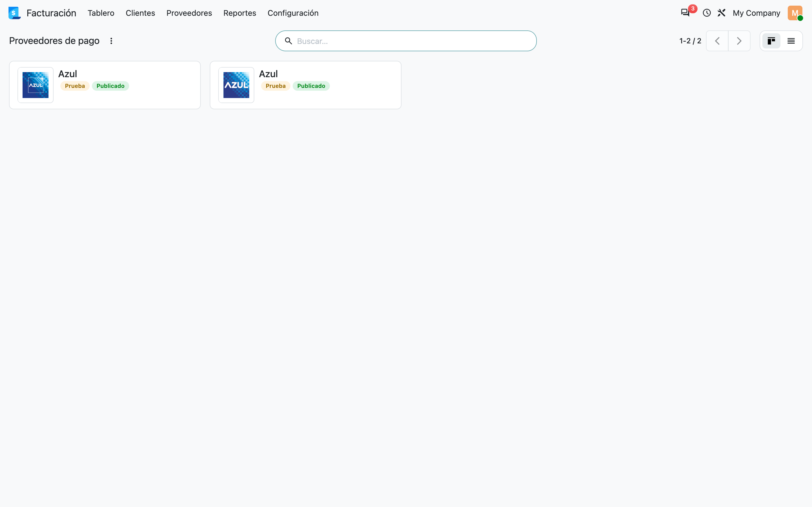
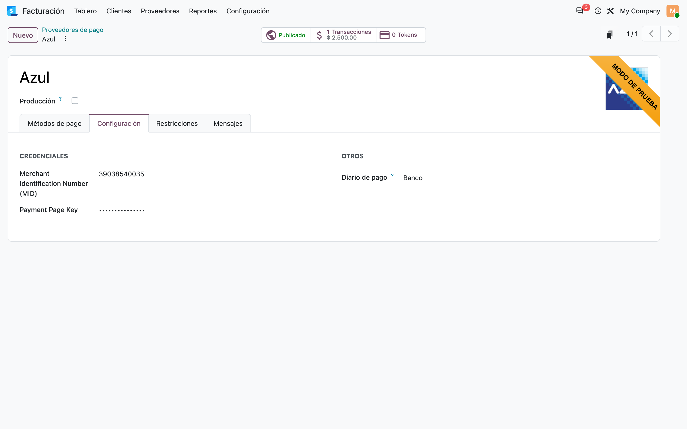
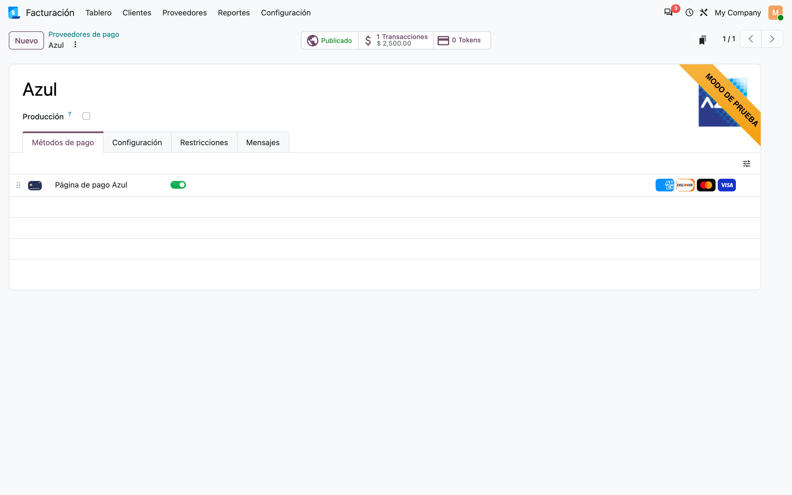
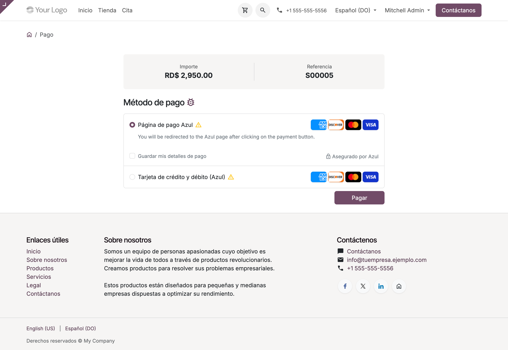
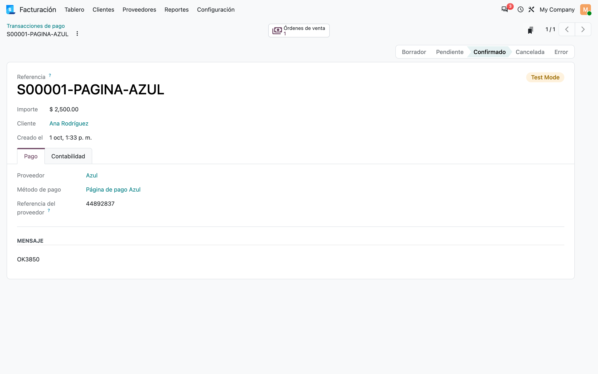

# Azul — Página de pago (payment_azul_webpages) — Manual de configuración y uso (20.0)

> Manual generado con `tools/manual-generator`. Las capturas se regeneran ejecutando el generador contra una base `test_v20_<módulo>`.

El módulo **`payment_azul_webpages`** agrega el proveedor de pago **Azul** en su modalidad *Página de pago*: al pagar, el cliente es redirigido a la página segura de Azul, introduce allí los datos de la tarjeta y Azul devuelve el resultado a Odoo, que confirma la transacción y el pedido.

Este manual se generó sobre **Odoo 20.0** con los dos módulos de Azul instalados a la vez (`payment_azul_webpages` y `payment_azul_webservices`), para mostrar que conviven: cada uno ofrece su propia opción en el formulario de pago.

> **Qué cambió en 20.0:** los métodos de pago ya no son globales; cada proveedor tiene los suyos. El proveedor *Página de pago* trae su método **Página de pago Azul** (código `azul`) con las marcas VISA, MasterCard, American Express y Discover. Odoo muestra un solo método por código en el formulario de pago, por eso cada módulo de Azul usa su propio código y las dos opciones aparecen juntas. El modo de prueba ahora es la casilla **Producción** (desactivado = pruebas en `pruebas.azul.com.do`).

> La base de ejemplo se siembra con `configs/payment_azul_webpages.seed.py` (credenciales de prueba, sin conexión real con Azul).

## Requisitos previos

- Instalar **`payment_azul_webpages`** (depende de `payment` y `website_sale`).
- Tener activas las monedas **DOP** y/o **USD**: el proveedor sólo se ofrece en esas monedas y envía siempre el monto en pesos dominicanos (convierte USD con la tasa del día).
- Credenciales de Azul: **número de afiliado (MID)** y **llave de la página de pago**.
- Interfaz en español (es_DO).

## 1. Proveedores de pago

**Contabilidad / Sitio web → Configuración → Proveedores de pago.** Con los dos módulos instalados aparecen dos proveedores **Azul**: el de *Página de pago* (código `azul`) y el de *Webservices* (código `azul_webservices`).

## 2. Credenciales y modo de prueba

Abrir el proveedor **Azul** (Página de pago), pestaña **Configuración**:

- **Merchant Identification Number (MID)** y **Payment Page Key**: los entrega Azul. Son obligatorios cuando el proveedor está en **Producción**.
- **Producción** desmarcada (cinta *Modo de prueba*): los pagos van al ambiente de pruebas de Azul. Activarlo envía los pagos a `pagos.azul.com.do`.
- **Publicado**: hace visible el proveedor en el sitio web.

## 3. Métodos de pago del proveedor

Pestaña **Métodos de pago**: el proveedor trae su método **Página de pago Azul** con las marcas VISA, MasterCard, American Express y Discover, activos desde la instalación.

## 4. El cliente paga: las dos opciones de Azul

En el formulario de pago (carrito, portal del pedido o de la factura) aparecen **Página de pago Azul** y **Tarjeta de crédito y débito (Azul)** (esta última es del módulo Webservices). Al elegir *Página de pago Azul* y pulsar **Pagar**, el cliente es redirigido a la página de Azul con el número de orden, el monto y el ITBIS en pesos dominicanos, firmados con la llave del comercio.

## 5. La transacción aprobada

Cuando Azul devuelve el resultado, Odoo lo procesa: con código `00` la transacción queda **Confirmada**, guarda el **número de orden de Azul** como referencia del proveedor y el **código de autorización** como mensaje; el pedido se confirma y se registra el pago. En la página de estado y en el portal del pedido el cliente ve *Su número de autorización es: …*. Si el cliente cancela en la página de Azul, la transacción queda **Cancelada**; un rechazo del banco la cancela con el motivo y la recomendación de Azul.

## Notas

- **Convivencia con `payment_azul_webservices`:** los dos módulos pueden estar instalados a la vez y se probaron juntos (instalación, pruebas de ambos módulos en la misma base, formulario de pago y desinstalación de uno con el otro funcionando).
- **Migración desde 19.0:** el script `migrations/2.0.0` reutiliza los métodos de pago que el upgrade de Odoo haya dejado en el proveedor (renombra *Card* a *Página de pago Azul* y conserva los tokens guardados) en lugar de duplicarlos.
- Para guardar tarjetas (DataVault) el proveedor debe tener **Permitir guardar métodos de pago** activo.
