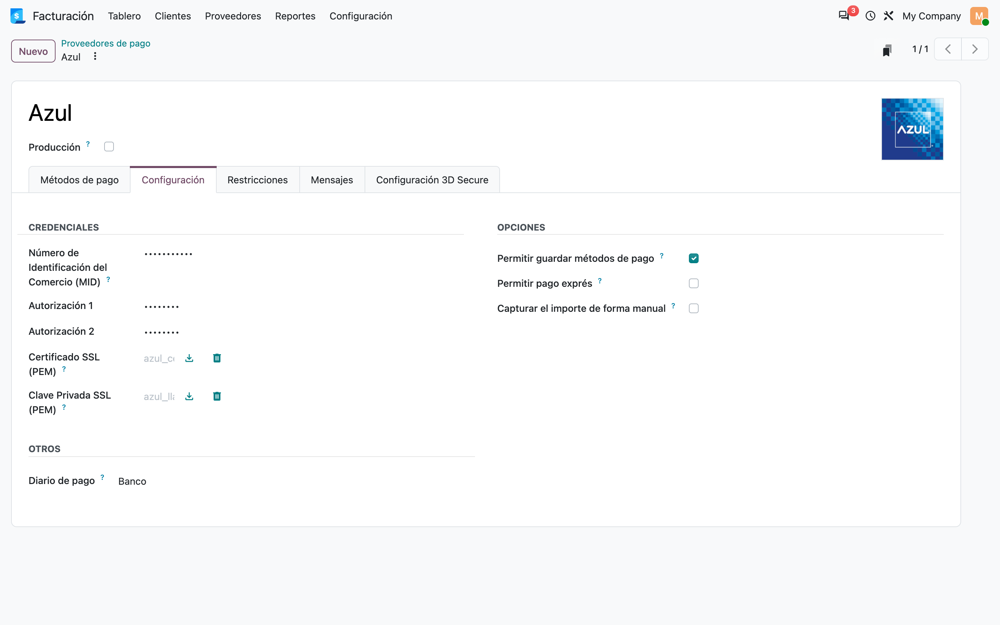
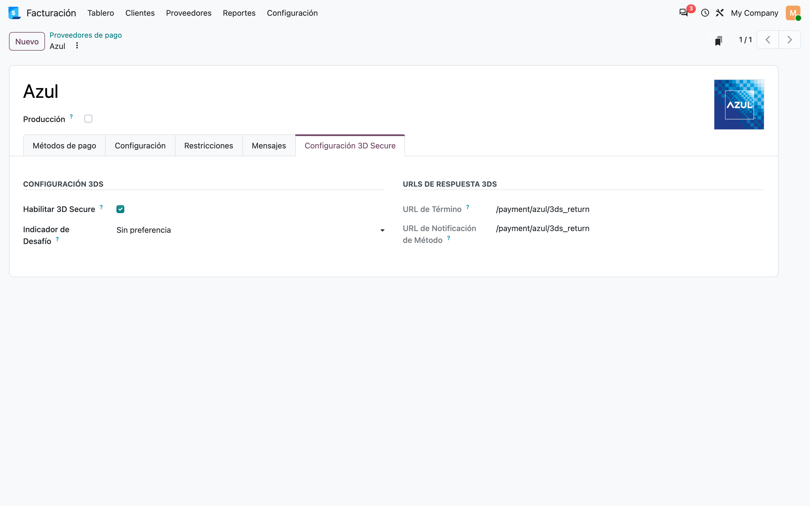
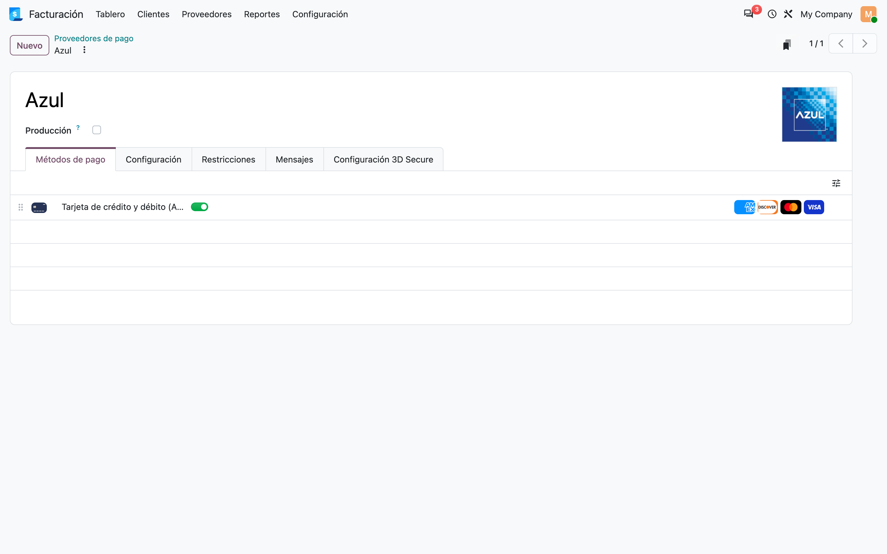
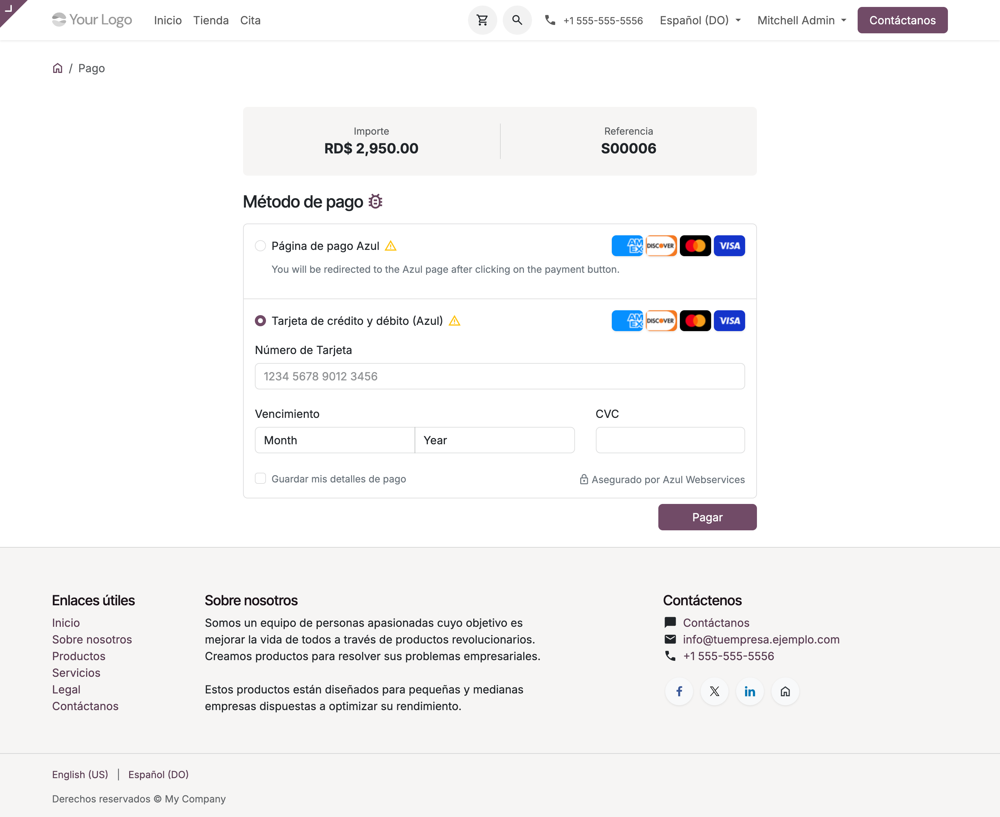
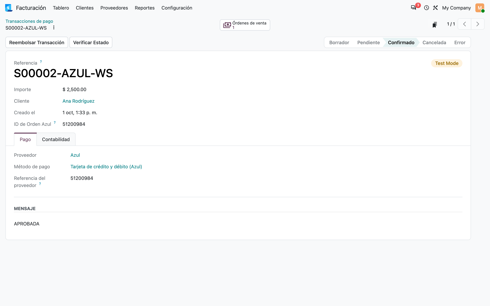

# Azul — Webservices (payment_azul_webservices) — Manual de configuración y uso (20.0)

> Manual generado con `tools/manual-generator`. Las capturas se regeneran ejecutando el generador contra una base `test_v20_<módulo>`.

El módulo **`payment_azul_webservices`** agrega el proveedor de pago **Azul** en su modalidad *Webservices*: el cliente escribe los datos de la tarjeta en el formulario de pago de Odoo y Odoo cobra directamente contra la API de Azul (con autenticación **3D Secure 2**), sin salir del sitio. Permite guardar la tarjeta (DataVault), autorizar y capturar después, anular y reembolsar.

Este manual se generó sobre **Odoo 20.0** con los dos módulos de Azul instalados a la vez (`payment_azul_webservices` y `payment_azul_webpages`), para mostrar que conviven: cada uno ofrece su propia opción en el formulario de pago.

> **Qué cambió en 20.0:** cada proveedor tiene sus métodos de pago; el de Webservices es **Tarjeta de crédito y débito (Azul)** (código `azul_webservices`) con las marcas VISA, MasterCard, American Express y Discover. El modo de prueba es la casilla **Producción** (desmarcada = ambiente de pruebas de Azul). Los reembolsos, capturas y anulaciones se registran como transacciones hijas de la original. El paso *3DS Method* y el *challenge* del banco se resuelven desde el propio formulario de pago.

> La base de ejemplo se siembra con `configs/payment_azul_webservices.seed.py` (credenciales y certificados ficticios, sin conexión real con Azul; la transacción de ejemplo se aprobó con la respuesta de Azul simulada).

## Requisitos previos

- Instalar **`payment_azul_webservices`** (depende de `payment` y `website_sale`) y la librería Python **`pyazul==3.2.1`**.
- Monedas **DOP** y/o **USD** activas: Azul cobra siempre en pesos dominicanos; los montos en USD se convierten con la tasa del día.
- Credenciales de Azul: **MID**, **Authorization 1 y 2**, el **certificado SSL (PEM)** y su **llave privada** generada con el CSR.
- Interfaz en español (es_DO).

## 1. Credenciales y modo de prueba

**Configuración → Proveedores de pago → Azul** (el de código `azul_webservices`), pestaña **Configuración**: número de afiliado (MID), *Authorization 1* y *2*, el certificado y la llave privada. Odoo valida que los archivos sean PEM. Son obligatorios cuando el proveedor está en **Producción**; desmarcada, los pagos van al ambiente de pruebas de Azul. En *Opciones* se activa **Permitir guardar métodos de pago** y **Capturar el importe manualmente** (autorizar y capturar al despachar).

## 2. Configuración 3D Secure

Pestaña **Configuración 3D Secure**: activar o no 3D Secure y la preferencia de *challenge*. Las URLs de retorno (`/payment/azul/3ds_return`) son las que Azul y el banco usan para devolver el resultado de la autenticación.

## 3. Métodos de pago del proveedor

Pestaña **Métodos de pago**: **Tarjeta de crédito y débito (Azul)** con sus marcas, activos desde la instalación. Al guardar una tarjeta, el token queda con la marca que informa Azul (VISA, MasterCard…).

## 4. El cliente paga con tarjeta

En el formulario de pago aparecen las dos opciones de Azul: **Página de pago Azul** (módulo *Página de pago*) y **Tarjeta de crédito y débito (Azul)**. Al elegir esta última se despliega el formulario de tarjeta (número, vencimiento y CVC) y, si el proveedor lo permite, *Guardar mis detalles de pago*.

Al pulsar **Pagar**:

1. Odoo envía el cobro a Azul. Si no hace falta 3D Secure, la transacción queda aprobada y el cliente pasa a la página de estado.
2. Si el banco pide el **3DS Method**, se ejecuta en segundo plano en el mismo formulario (unos segundos) y Odoo continúa la autenticación.
3. Si el banco pide un **challenge**, el navegador va a la página del banco; al terminar, el banco devuelve al cliente a Odoo, que consulta el resultado y muestra el estado.

Un pago con tarjeta guardada sigue el mismo camino de 3D Secure.

## 5. La transacción aprobada

La transacción aprobada queda **Confirmada** con el **ID de orden de Azul** (referencia del proveedor) y el mensaje de Azul. Desde la transacción se puede **Verificar estado** (consulta a Azul) y, si está confirmada, **Reembolsar**; con captura manual aparecen **Capturar** y **Anular**. Cada reembolso, captura o anulación crea una transacción hija; la original pasa a *Confirmado* cuando se captura todo o a *Cancelado* cuando se anula. Un cron cada 30 minutos verifica en Azul las transacciones que quedan pendientes (por ejemplo, un 3D Secure abandonado).

## Notas

- **Convivencia con `payment_azul_webpages`:** los dos módulos pueden estar instalados a la vez y se probaron juntos: instalación, pruebas de ambos módulos en la misma base, formulario de pago con las dos opciones y desinstalación de uno con el otro funcionando.
- **Migración desde 19.0:** el script `upgrades/2.0.0` reutiliza los métodos de pago que el upgrade de Odoo haya dejado en el proveedor (renombra *Card* a *Tarjeta de crédito y débito (Azul)* y conserva los tokens) y convierte el certificado y la llave si siguen guardados en base64, para que el cliente de Azul los pueda leer.
- Las pruebas en el ambiente de Azul requieren el certificado real emitido por Azul para el comercio.
