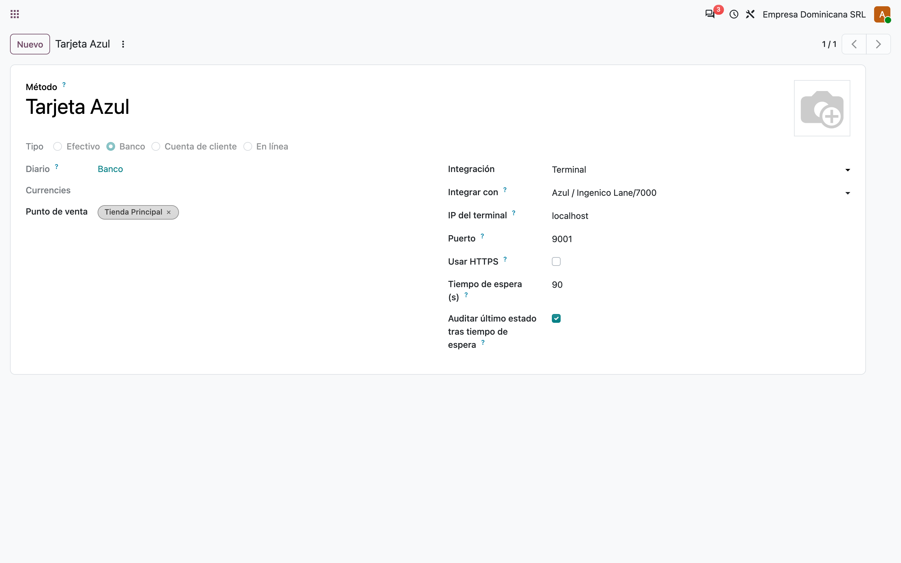
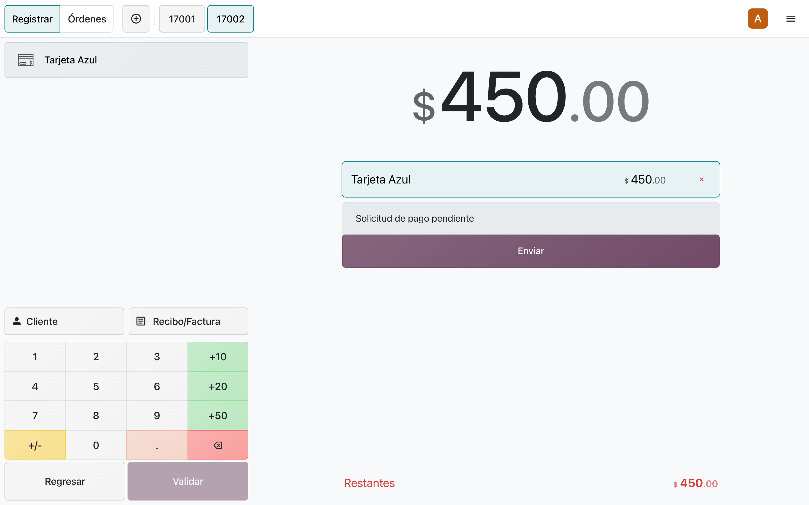
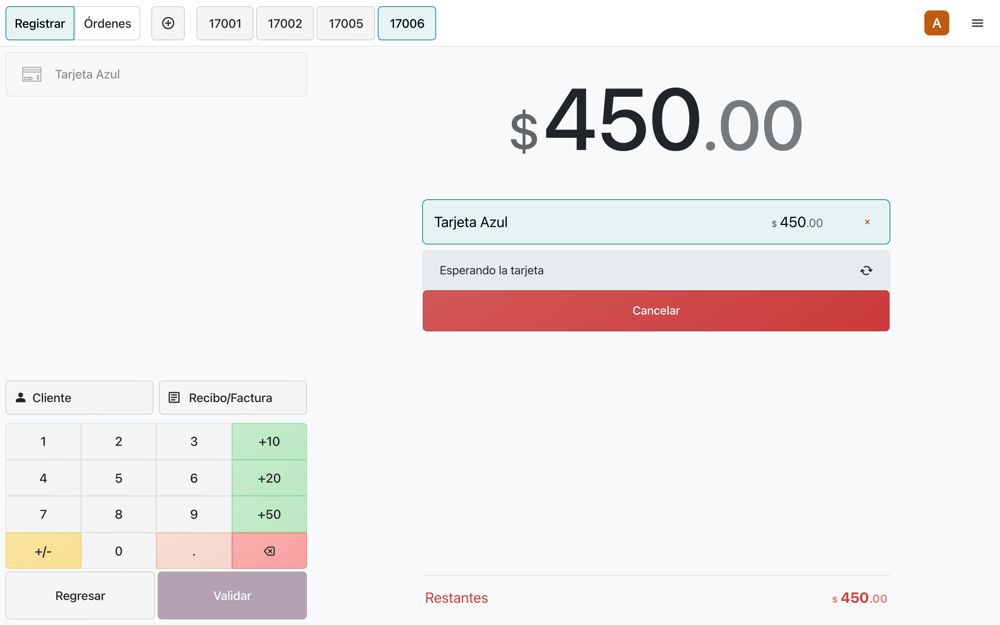
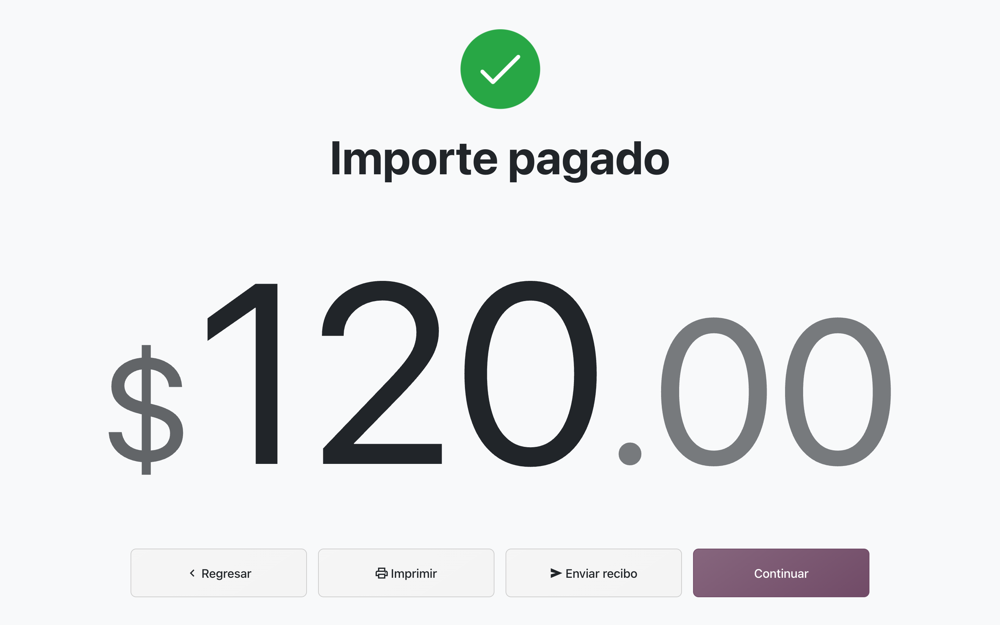
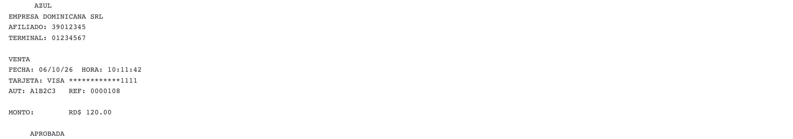
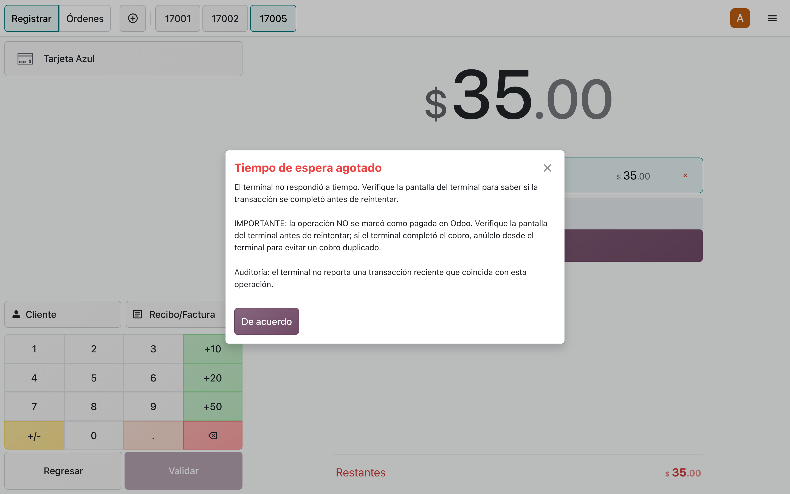

# Azul / Ingenico Lane/7000 en el Punto de Venta — Manual de usuario (pos_azul, Odoo 20.0)

> Manual generado con `tools/manual-generator`. Las capturas se regeneran ejecutando el generador contra una base `test_v20_<módulo>`.

Este módulo conecta el **Punto de Venta** de Odoo con el terminal **Ingenico Lane/7000** de **Azul**. El navegador de la caja habla directamente con el integrador Azul instalado en la red de la tienda: envía el monto, espera a que el cliente pase la tarjeta y, al aprobarse, marca el pago como realizado e imprime el comprobante del terminal.

Odoo 20.0 no trae una integración con Azul (sus terminales nativos son Adyen, Stripe, Mercado Pago, etc.), por eso el módulo se porta.

**Qué cambió en 20.0:**

- El terminal se elige en el método de pago con **Integración: Terminal** e **Integrar con: Azul / Ingenico Lane/7000** (en 19.0 era el campo *Usar un terminal de pago*). Al actualizar, los métodos Azul existentes se pasan solos al nuevo esquema.
- Mientras el terminal espera la tarjeta solo se ofrece **Cancelar**: el botón *Forzar como hecho* no aparece en las líneas Azul, para no registrar un cobro que el banco no aprobó.
- El comprobante del terminal se imprime con la **impresora de recibos del PdV** (copia cajero + copia cliente); si el PdV no tiene impresora, se abre la impresión del navegador.
- Odoo 20.0 eliminó la *reversión* de pagos desde la pantalla de pago: una venta cobrada se anula desde el terminal.

## Requisitos previos

- Módulo **`pos_azul`** `20.0.5.0.0` instalado. Depende de **`pos_iot`** (Enterprise).
- Integrador Azul funcionando en la red de la tienda con la API REST expuesta (normalmente `http://<equipo>:9001`) y el lector Ingenico Lane/7000 emparejado.
- El navegador de la caja debe estar en la **misma red** que el integrador: el servidor de Odoo no se conecta al terminal.
- (Opcional) Impresora de recibos configurada en el Punto de Venta.

## 1. Configurar el método de pago

**Punto de Venta → Configuración → Métodos de pago**. En un método de tipo **Banco**:

- **Integración**: *Terminal*.
- **Integrar con**: *Azul / Ingenico Lane/7000*.
- **IP del terminal** y **Puerto** del integrador Azul (por defecto 9001). Se valida que la IP/host y el puerto sean válidos.
- **Usar HTTPS** si el integrador corre con TLS.
- **Tiempo de espera (s)**: cuánto espera la caja la respuesta del terminal (mínimo 30, recomendado 180).
- **Auditar último estado tras tiempo agotado**: al agotarse el tiempo, consulta la última transacción del terminal para avisar al cajero si se cobró. Nunca confirma el pago por sí sola.

Luego agregue el método a la configuración del Punto de Venta.

## 2. Cobrar con Azul

En la pantalla de pago elija **Tarjeta Azul**. Se agrega la línea con el monto pendiente y el botón **Enviar**, que manda el cobro al terminal.

## 3. Esperando la tarjeta

Mientras el cliente inserta o acerca la tarjeta, la línea muestra **Esperando la tarjeta** y solo ofrece **Cancelar**. Cancelar envía la cancelación al terminal y deja la línea lista para *Volver a intentar*; el pago **no** se marca como realizado.

## 4. Pago aprobado

Cuando Azul aprueba, la línea queda **pagada** y, si el PdV valida automáticamente los pagos con terminal, la orden se cierra. El comprobante del terminal se imprime solo (copia del cajero y del cliente en la impresora de recibos).

## 5. Comprobante del terminal

El texto que devuelve el terminal se imprime tal cual, con la plantilla *pos_azul.ingenico_receipt* del PdV.

## 6. Tiempo de espera agotado

Si el terminal no responde dentro del tiempo configurado, la caja **no** marca el pago como realizado: envía una cancelación al terminal, consulta la última transacción (si la auditoría está activa) y muestra al cajero qué hacer. Si el terminal reporta que sí cobró, indica autorización, factura y tarjeta para anularlo en el terminal o conciliarlo a mano.

## Notas

- El integrador atiende **una sola transacción a la vez**: mientras hay una venta activa no se puede cancelar ni consultar por HTTP; si el terminal sigue mostrando la operación, cancele en el propio terminal.
- Las devoluciones (órdenes con total negativo) usan el endpoint *Refund* de Azul, que el banco debe habilitar para el comercio.
- Para anular una venta ya cobrada use el terminal: Odoo 20.0 no ofrece reversión desde la pantalla de pago.
