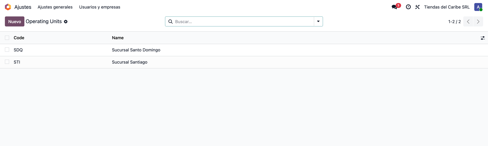
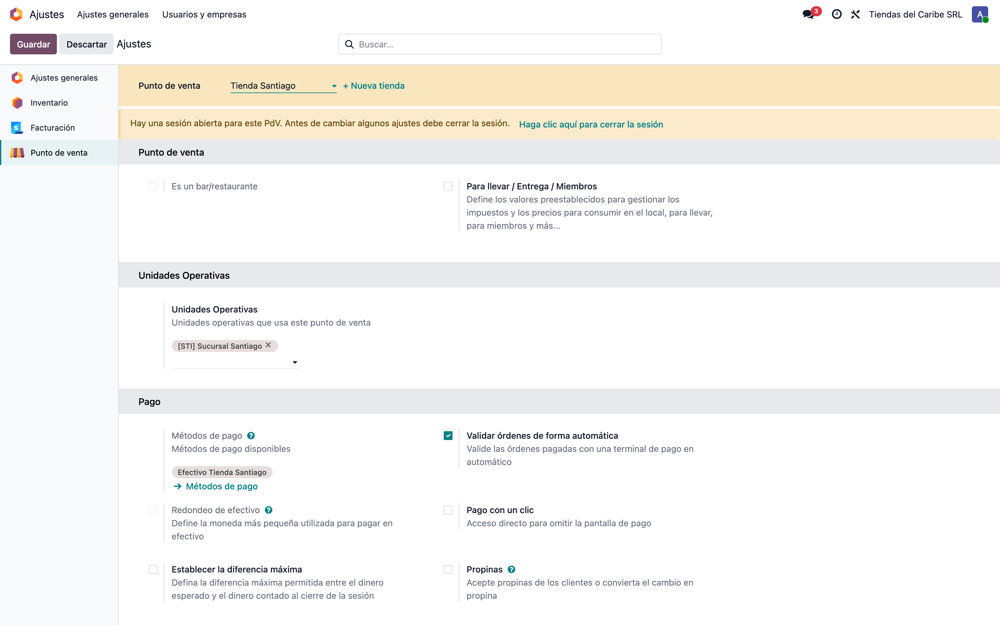
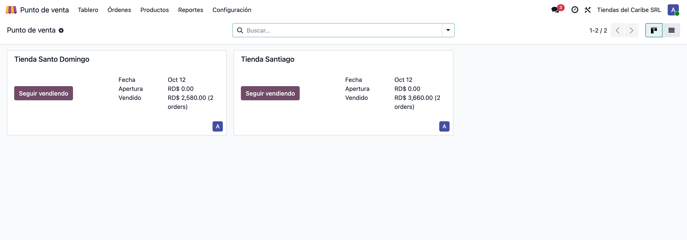
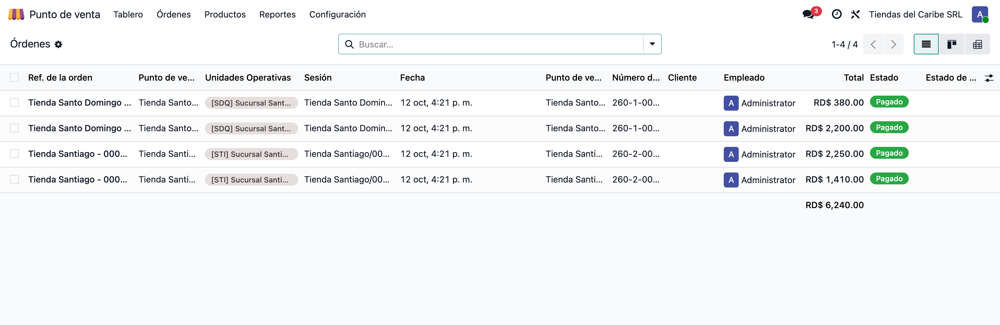
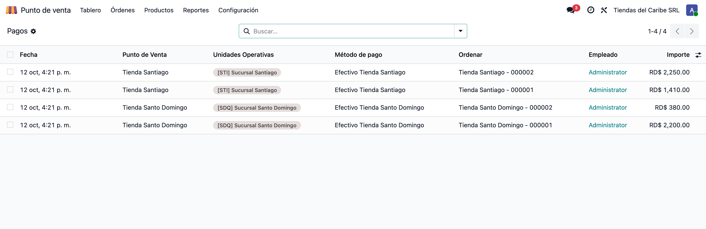
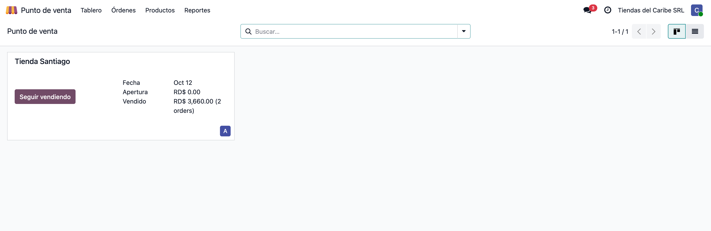
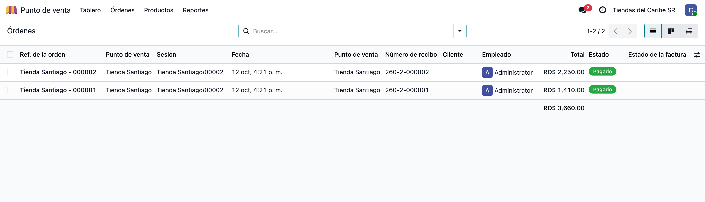

# Punto de venta por unidad operativa — Manual de usuario

> Manual generado con `tools/manual-generator`: `node capture.mjs --config=/Users/luisfernandez/repos/dev_env_odoo_pro-19/tools/manual-generator/configs/pos_operating_unit.json --db=test_v19_pos_operating_unit`. Las capturas se regeneran corriendo ese comando contra la base de pruebas.

Una **unidad operativa** es una parte de la empresa que trabaja por su cuenta dentro de la misma compañía: una sucursal, una tienda, una división. El módulo base `operating_unit` las crea y dice a qué unidades pertenece cada usuario.

Con **POS with Operating Units** cada punto de venta pertenece a una o varias unidades operativas, y todo lo que se vende en él queda marcado con esas unidades:

- Las **sesiones**, **órdenes**, **líneas** y **pagos** toman las unidades operativas del punto de venta en el momento en que se crean.
- Cada usuario **sólo ve** los puntos de venta, sesiones, órdenes, pagos y el análisis de ventas de sus unidades operativas.

Así el cajero de una sucursal abre su caja y revisa sus ventas sin ver las de las demás tiendas de la compañía.

**Base de datos de las capturas:** test_v19_pos_operating_unit

## Requisitos previos

- Odoo 19 con `point_of_sale` instalado.
- Módulo `operating_unit` (OCA/operating-unit 19.0).
- Módulo `pos_operating_unit` instalado (store-addons 19.0).
- Para asignar unidades operativas a un punto de venta, el usuario necesita el grupo **Manager of Operating Units**. Para ver la columna de unidades en órdenes y pagos, **Multiple Operating Unit**.

## 1. Las unidades operativas

Las unidades operativas se crean en **Ajustes → Usuarios y compañías → Operating Units** y se asignan a cada usuario en su ficha, pestaña **Permisos de acceso**, bloque **Operating Units** (*Allowed Operating Units* y *Default Operating Unit*).

En el ejemplo hay dos: **Sucursal Santo Domingo** (SDQ) y **Sucursal Santiago** (STI). El administrador tiene las dos; el *Cajero Santiago* sólo la de Santiago.

Las pantallas del módulo base `operating_unit` (OCA) todavía no están traducidas al español.

## 2. Asignar las unidades operativas al punto de venta

Entra a **Punto de venta → Configuración → Ajustes**, elige el punto de venta arriba (aquí *Tienda Santiago*) y busca el bloque **Unidades Operativas**. Ahí se eligen las unidades a las que pertenece esa caja.

Puede llevar más de una: una caja compartida por dos sucursales la ven los usuarios de cualquiera de las dos.

El campo sólo se ve y se edita con el grupo **Manager of Operating Units**.

## 3. El tablero del administrador

En **Punto de venta → Tablero** el administrador, que tiene las dos unidades operativas, ve las dos cajas: **Tienda Santo Domingo** y **Tienda Santiago**, cada una con su sesión abierta.

## 4. Cada orden queda marcada con su unidad

Entra a **Punto de venta → Órdenes → Órdenes**. Las columnas **Punto de venta** y **Unidades Operativas** muestran de dónde salió cada venta. La unidad se copia del punto de venta cuando la caja sincroniza la orden, y lo mismo pasa con sus líneas y sus pagos.

Si después se cambian las unidades del punto de venta, las órdenes ya registradas conservan las que tenían.

## 5. Los pagos también

En **Punto de venta → Órdenes → Pagos** (quitando la agrupación por método de pago) cada pago lleva el punto de venta y las unidades operativas de su orden. Sirve para cuadrar los cobros de cada sucursal por separado.

## 6. Entrar como el cajero de Santiago

Lo que sigue se ve con el usuario **Cajero Santiago**, que sólo tiene la unidad operativa *Sucursal Santiago* y el permiso normal de usuario del punto de venta.

## 7. Sólo su caja

En el **Tablero** el cajero ve **únicamente Tienda Santiago**. La caja de Santo Domingo no aparece: no la puede abrir ni consultar.

## 8. Sólo sus ventas

En **Órdenes** el cajero ve sólo las dos ventas de Santiago. Lo mismo pasa con las sesiones, los pagos y el reporte *Análisis de ventas*: las reglas de acceso del módulo filtran por la unidad operativa del usuario, no por la vista.

## 9. Qué hace y qué no hace el módulo

- **Separa por unidad operativa, no por compañía.** Las cajas siguen en la misma compañía, con los mismos productos y el mismo plan contable.
- **Un punto de venta sin unidades operativas lo ven todos.** Conviene asignarlas en todas las cajas.
- **La marca se pone al crear.** Las sesiones, órdenes, líneas y pagos toman las unidades del punto de venta cuando se crean; no se recalculan si después cambia la configuración.
- **Las reglas son de lectura.** El módulo limita lo que cada usuario ve. Quién puede crear o modificar sigue dependiendo de los permisos normales del punto de venta.
- **Inventario y contabilidad.** Este módulo no lleva la unidad operativa a los movimientos de inventario ni a los asientos; para el inventario está `stock_operating_unit`, con su propio manual.

## Notas

Usuarios de la base de ejemplo: **admin / admin** (las dos unidades operativas) y **santiago / santiago** (sólo Sucursal Santiago).
