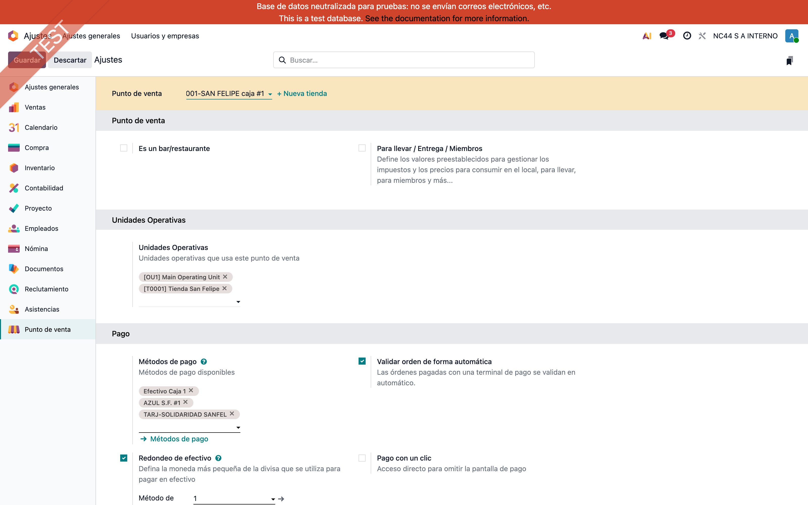
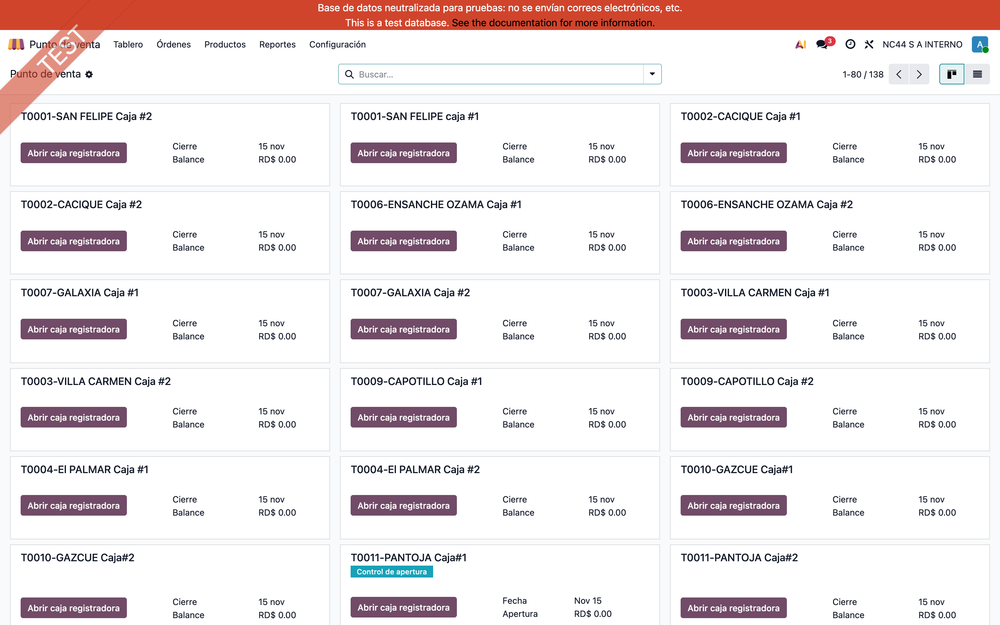
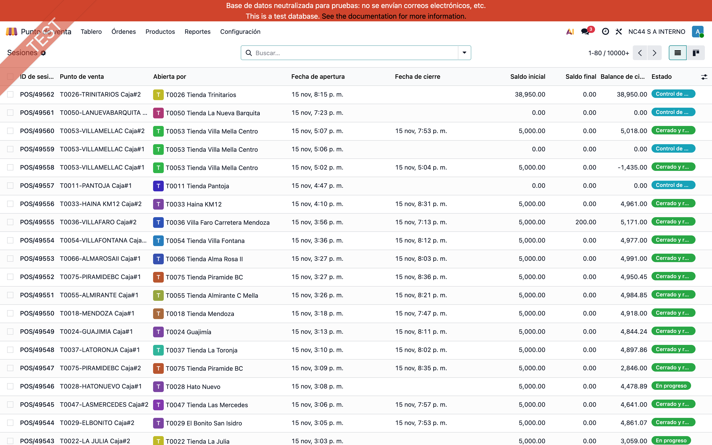
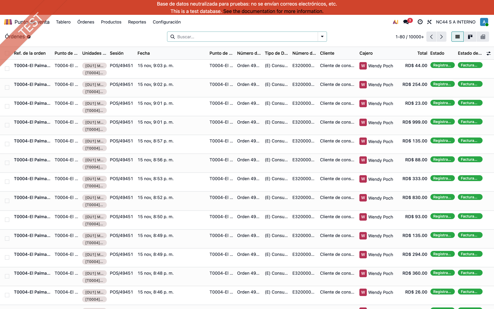
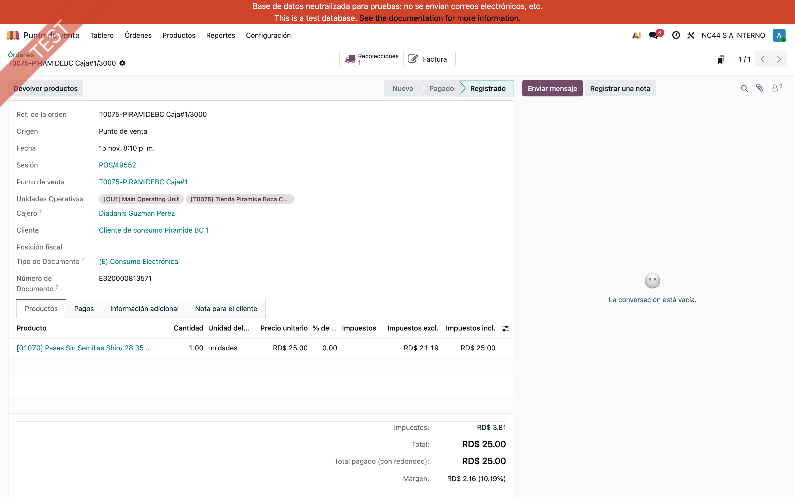
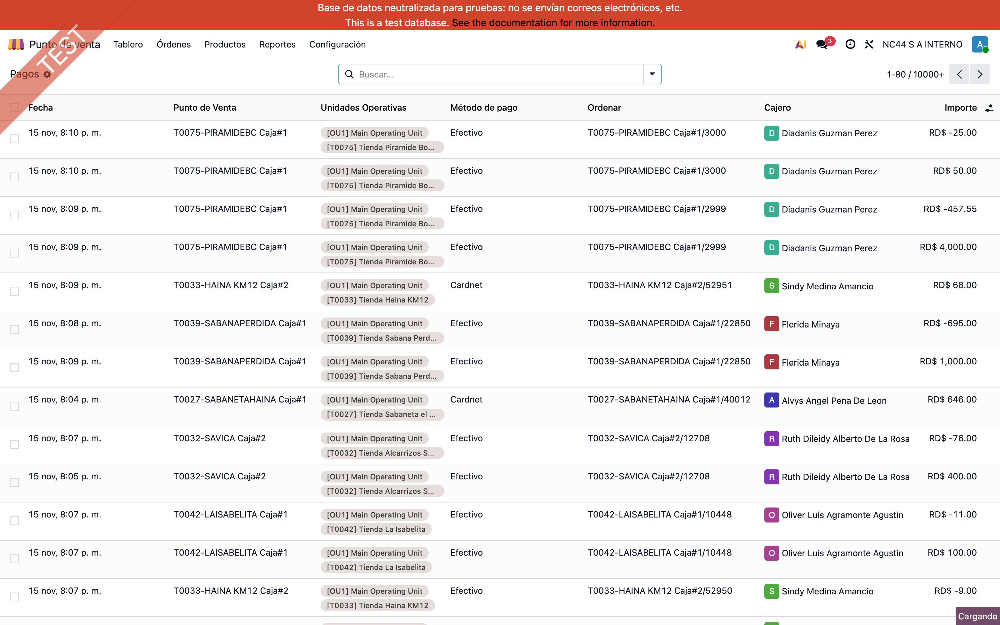

# Punto de venta por unidad operativa — Manual de usuario

> Manual generado con `tools/manual-generator`: `node capture.mjs --config=configs/pos_operating_unit_visibility.json --db=odoo-nc44-test-42073117`. Las capturas se regeneran corriendo ese comando contra la base de pruebas.

Una **unidad operativa** es una parte de la empresa que trabaja por su cuenta dentro de la misma compañía. En NC44 cada tienda es una unidad operativa (*Tienda San Felipe*, *Tienda Caciques*, …), además de **Main Operating Unit** (oficina central y CEDI) y **REGIONAL 01**.

El módulo **Punto de venta por unidad operativa** (`pos_operating_unit_visibility`) asigna cada caja a una o varias unidades:

- Las **sesiones**, **órdenes**, **líneas** y **pagos** toman las unidades de la caja cuando se crean.
- Cada usuario sólo ve las cajas, sesiones, órdenes y pagos de sus unidades, más los que no tienen unidad.

Los asientos, facturas y movimientos de inventario del punto de venta siguen centralizados. Reemplaza a `pos_operating_unit` (store-addons); en la base migrada, las unidades de cajas, sesiones, órdenes y pagos siguen en su lugar.

**Base de datos de las capturas:** odoo-nc44-test-42073117 (upgrade de prueba NC44 17.0 → 19.0, Odoo.sh)

## Requisitos previos

- Odoo 19 con **Punto de venta** y **Unidades operativas** (`operating_unit_base`).
- Módulo **Punto de venta por unidad operativa** (`pos_operating_unit_visibility`).
- Para asignar unidades a una caja, el grupo **Responsable de las unidades operativas**. Para ver la columna en órdenes y pagos, **Múltiples unidades operativas**.

## 1. Unidades operativas de la caja

Entra a **Punto de venta → Configuración → Ajustes**, elige la caja arriba (aquí la caja #1 de San Felipe) y busca el bloque **Unidades operativas**.

En NC44 cada caja tiene dos unidades: **Main Operating Unit** (oficina central) y la de su tienda. Así la oficina central ve todas las cajas y cada tienda sólo las suyas.

El campo sólo se ve y se edita con el grupo **Responsable de las unidades operativas**.

## 2. Tablero de cajas

En **Punto de venta → Tablero** cada usuario ve sólo las cajas de sus unidades. El administrador, con todas las unidades, ve las 138 cajas de NC44.

## 3. Sesiones

En **Punto de venta → Órdenes → Sesiones** cada sesión queda con las unidades de su caja al abrirse. Un usuario de tienda sólo ve las sesiones de sus cajas.

## 4. Órdenes

En **Punto de venta → Órdenes → Órdenes** las columnas **Punto de venta** y **Unidades operativas** muestran de qué caja y unidades es cada venta.

Cada orden toma las unidades de la caja al registrarse; si después cambian las unidades de la caja, las órdenes ya registradas no cambian.

## 5. Unidades operativas en la orden

Al abrir una orden, el campo **Unidades operativas** aparece junto a la sesión y el punto de venta. Es de solo lectura.

## 6. Pagos

En **Punto de venta → Órdenes → Pagos** cada pago muestra su punto de venta y sus unidades operativas.

## 7. Qué hace y qué no hace el módulo

- **La marca se pone al crear.** Sesiones, órdenes, líneas y pagos no se recalculan si cambia la configuración de la caja.
- **Contabilidad e inventario centralizados.** Asientos, facturas y movimientos de inventario de la caja no llevan unidad por este módulo.
- **Registros sin unidad:** 76 sesiones, 1.143 órdenes y 1.927 pagos antiguos no tienen unidad; los ven todos los usuarios del punto de venta. Conviene revisar si deben asignarse a una unidad.
- **No verificado en esta revisión:** lo que ve un cajero de tienda. La revisión se hizo en solo lectura con un administrador que tiene todas las unidades.

## Notas

Revisión hecha en solo lectura sobre la base migrada: no se crearon ni modificaron registros. Las capturas se tomaron con un administrador que tiene asignadas todas las unidades operativas.
