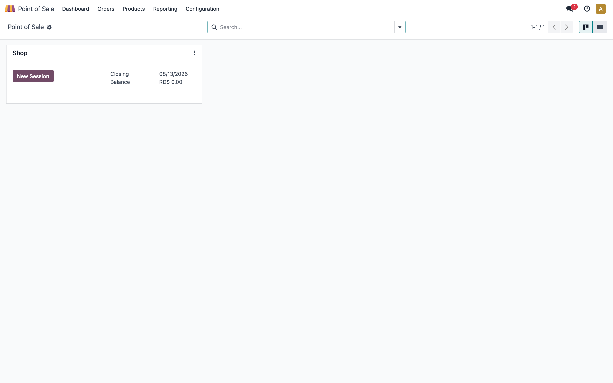
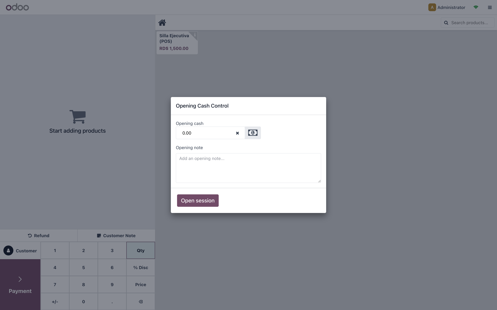
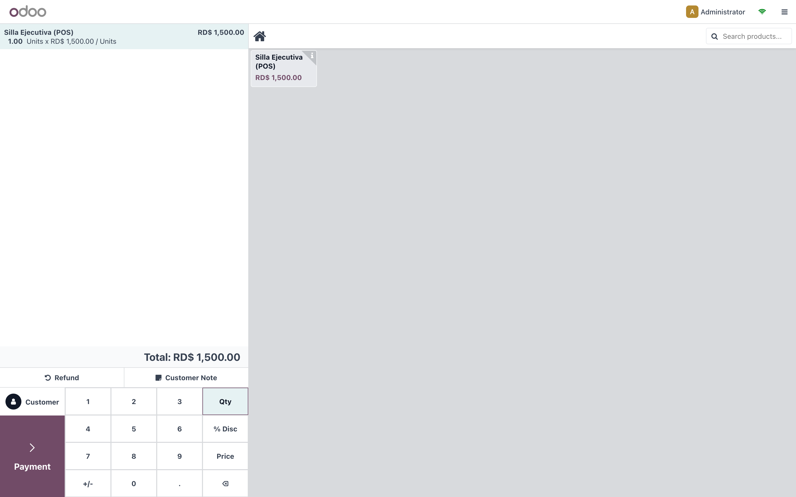
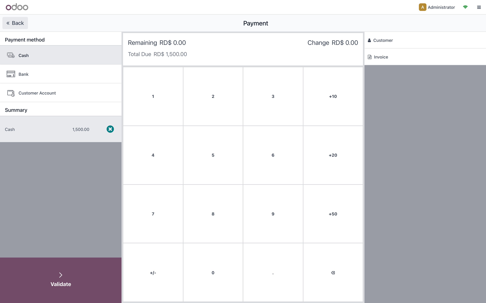
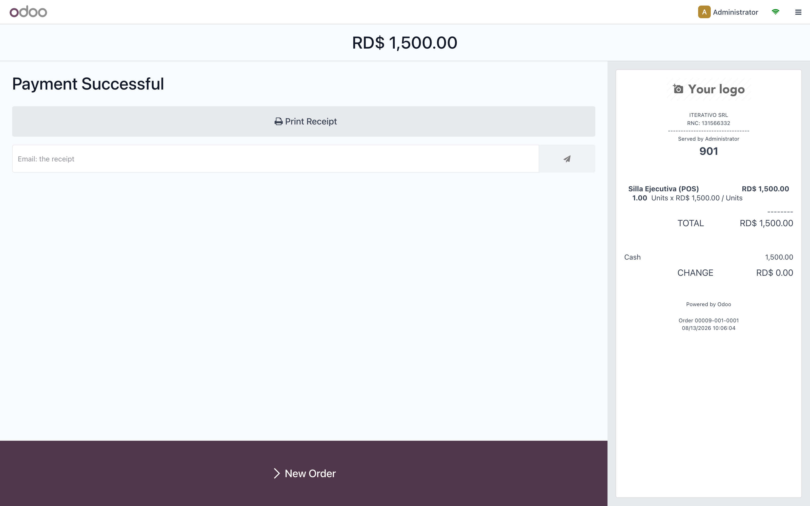
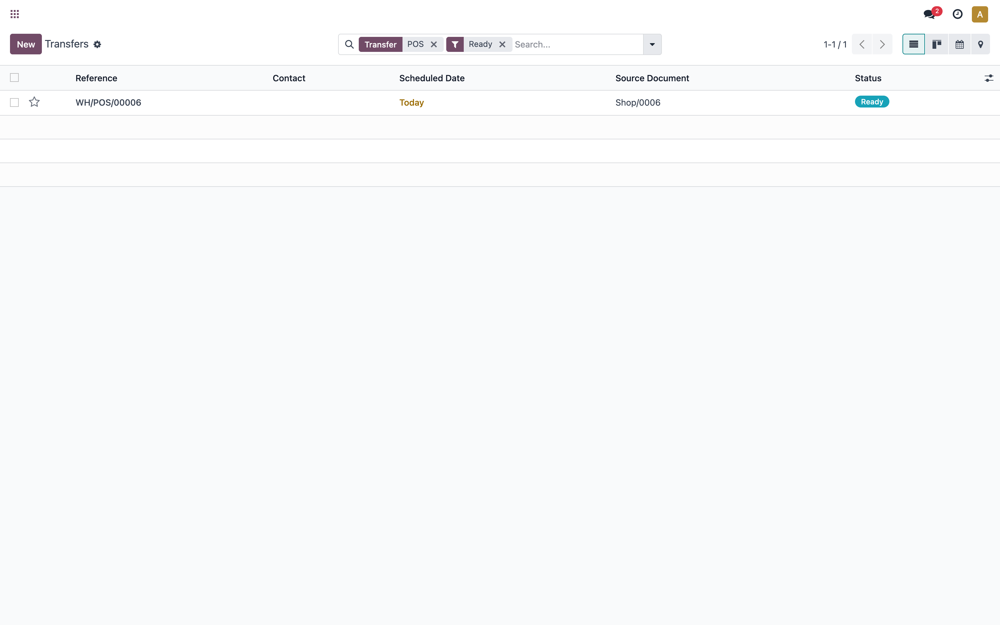
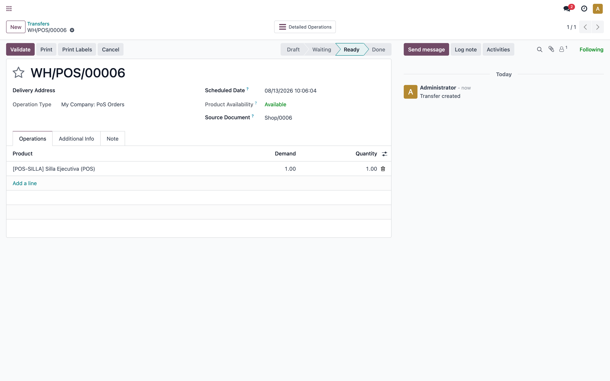
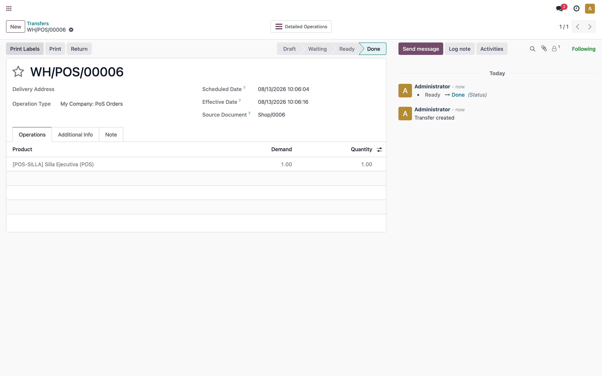
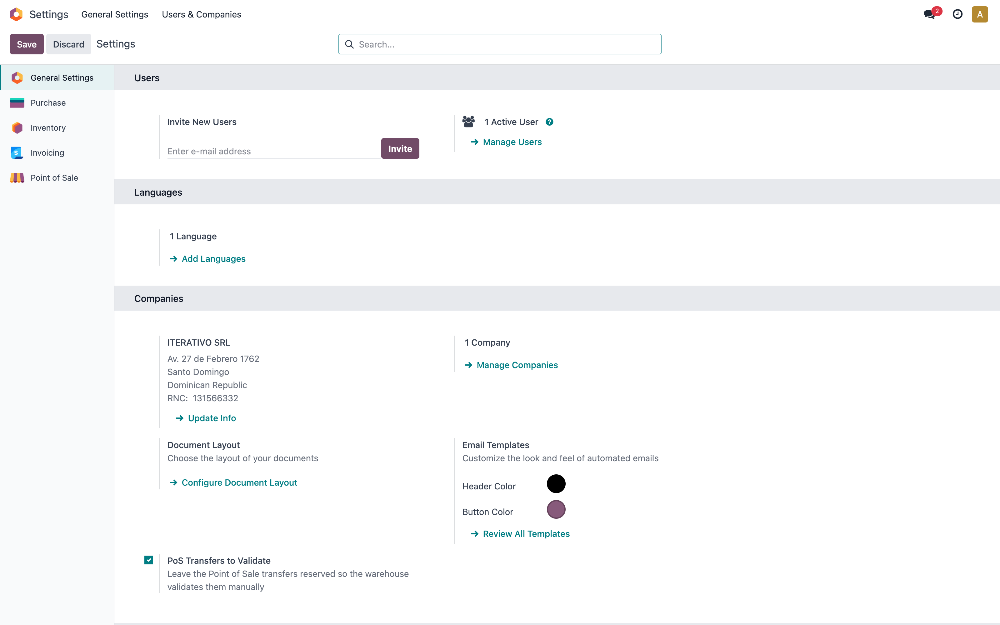
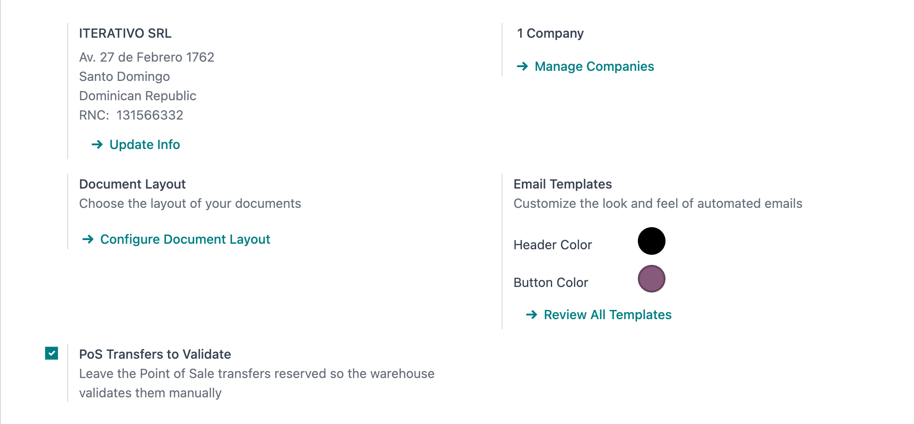

# POS Picking Draft — el albarán del Punto de Venta queda sin validar

> Manual generado con `tools/manual-generator`: `node capture.mjs --config=configs/pos_picking_draft.json --db=test_ecf_purchase_reception`. Las capturas se regeneran corriendo ese comando contra la base de pruebas.

Manual corto con capturas de una venta real en el Punto de Venta y del albarán que genera. 

Odoo de fábrica **valida solo** el albarán de cada pedido del POS: al cobrar, la mercancía ya salió del almacén sin que nadie la tocara. Con `pos_picking_draft` instalado ese albarán se crea igual, con las cantidades ya reservadas y marcadas, pero **se queda en estado _Listo_**: el stock no se mueve hasta que el almacén le da a **Validar**.

El comportamiento es **configurable por compañía** y se puede apagar sin desinstalar el módulo, desde *Ajustes ▸ Ajustes generales ▸ Companies* (ver los dos últimos apartados). No se configura caja por caja: una sola casilla manda sobre todos los puntos de venta de la compañía. Viene **encendido** al instalar.

**Base de datos de las capturas:** `test_ecf_purchase_reception` (usuario `admin`, clave `admin`). Preparada con `tools/manual-generator/configs/pos_picking_draft.seed.py`: producto almacenable *Silla Ejecutiva (POS)* con 50 unidades, método de pago en efectivo, la compañía actualizando stock **en tiempo real** y el ajuste *PoS Transfers to Validate* encendido.

## Requisitos previos

- Módulo instalado: `pos_picking_draft` (depende de `point_of_sale` y `base_setup`).
- El ajuste **PoS Transfers to Validate** encendido en la compañía (es el valor por defecto al instalar), en *Ajustes ▸ Ajustes generales ▸ Companies*. Con el ajuste apagado, Odoo valida el albarán como siempre.
- Un producto **almacenable** (`type = product`) disponible en el POS: los consumibles y servicios no generan albarán.
- Un método de pago en efectivo en el punto de venta, para que la apertura pida el fondo de caja.
- Funciona igual con la compañía en *Actualizar cantidades en tiempo real* (el albarán aparece al cobrar) que en *Al cerrar la sesión* (aparece al cerrar la caja). En ambos casos queda sin validar.

## 1. Punto de Venta ▸ Panel

El panel con el punto de venta **Shop**. Sin sesión abierta, el botón dice **New Session**.

## 2. Abrir la caja

Al pulsar **New Session** el POS pide el **fondo de caja** (control de apertura). Se confirma el efectivo con el que arranca el turno y se entra con **Open session**. Esta es la caja del cajero: no tiene nada que ver con el almacén, pero es el punto de partida de la prueba.

## 3. Hacer una venta

Ya dentro del POS, se añade **Silla Ejecutiva (POS)** al pedido. Es un producto almacenable, así que este pedido sí va a generar movimiento de almacén.

## 4. Cobrar en efectivo

**Payment** y método **Cash**. El botón **Validate** cierra la venta.

## 5. Venta cerrada

Recibo impreso: el pedido queda **pagado**. Hasta aquí el flujo es el estándar de Odoo; la diferencia está en el almacén.

## 6. El albarán del POS: estado Listo, no Hecho

**Inventario ▸ Transferencias**, buscando los albaranes del punto de venta y filtrando por **Ready**. El de la venta que acabamos de cobrar aparece ahí, en **Ready** (Listo), esperando a que alguien lo valide.

Sin el módulo esta lista saldría vacía y el albarán estaría en **Done**: Odoo llama a `_action_done()` sobre él en cuanto el pedido se paga. Ese es exactamente el paso que el módulo suprime.

## 7. El albarán, por dentro

El albarán abierto. Tres cosas que confirman que el módulo hace lo suyo:

- La barra de estado está en **Ready**, no en **Done**.
- El botón **Validate** sigue disponible: el almacén es quien decide cuándo sale la mercancía.
- La línea ya trae la cantidad reservada y marcada (`Quantity` = 1), así que validar es un solo clic — no hay que volver a teclear nada.

Mientras el albarán siga aquí, el stock del producto **no ha bajado**: en esta prueba la Silla Ejecutiva seguía con sus **50 unidades** en `WH/Stock` después de cobrar.

## 8. El almacén valida cuando toca

Al pulsar **Validate** el albarán pasa a **Done** y ahí sí se descuenta el stock: `WH/Stock` bajó de 50 a **49 unidades** y la unidad vendida aparece en `Partners/Customers`. El módulo no impide validar: solo quita el automatismo.

## 9. Dónde se enciende y se apaga: Ajustes ▸ Ajustes generales

**Ajustes ▸ Ajustes generales**, bloque **Companies**. Ahí está la casilla **PoS Transfers to Validate** (*Albaranes del POS pendientes de validar*).

Está deliberadamente **fuera de la página del Punto de Venta**: esa página se configura por caja (arriba se elige el punto de venta al que aplican los ajustes) y ahí la casilla daba a entender que había que encenderla caja por caja. No es así — el ajuste es **de la compañía** y aplica a todos sus puntos de venta a la vez; pasando el ratón por encima sale el aviso *Applies to every point of sale of the company at once; it is not set register by register*.

En una base multicompañía cada compañía decide por separado, y lo que manda es la compañía **del pedido del POS**, no la compañía activa del usuario que mira la pantalla.

## 10. El ajuste de cerca

Acercamiento al bloque **Companies** con la casilla marcada, que es como queda al instalar el módulo (y como sigue quedando tras actualizar: las compañías que ya existían se rellenan encendidas, así que nada cambia de comportamiento por actualizar).

- **Marcada** — lo que muestran los ocho apartados anteriores: el albarán del POS espera a que el almacén lo valide.
- **Sin marcar** — Odoo estándar: al cobrar (o al cerrar la sesión) el albarán se valida solo y el stock baja en ese momento. No hace falta desinstalar el módulo ni tocar nada más.

Después de cambiarla hay que pulsar **Save**; el cambio aplica a todas las cajas de la compañía y a los pedidos nuevos, no reabre los albaranes ya validados.

## Notas

El módulo no toca los albaranes ajenos al POS: marca con una clave de contexto (`pos_picking_keep_draft`) únicamente los que crea el flujo del punto de venta, y solo para esos ignora la validación automática. Una transferencia normal de inventario se sigue validando igual que siempre.

Devoluciones incluidas: una línea negativa genera su albarán de entrada, también sin validar.

El ajuste vive en `res.company.pos_picking_keep_draft` (por defecto `True`), así que se puede consultar o cambiar en masa por SQL o por `odoo shell` si hace falta, sin pasar por la pantalla de Ajustes.
