# Bot Claude para tareas de proyecto — Manual de usuario

> Manual generado con `tools/manual-generator`: `node capture.mjs --config=/Users/luisfernandez/repos/dev_env_odoo_pro-19/tools/manual-generator/configs/project_ai_bot.json --db=test_v19_project_ai_bot`. Las capturas se regeneran corriendo ese comando contra la base de pruebas.

Este módulo conecta las tareas de Odoo con el **bot de Claude Code**. Cuando una tarea marcada para el bot pasa a la etapa **1 In Progress**, Odoo le envía al bot todo lo que necesita saber: qué tipo de trabajo es (bug, migración, desarrollo o QA), en qué versión de Odoo, qué tan compleja es y en qué repositorios trabajar. El bot abre una sesión de Claude, hace el trabajo, pregunta por el chatter cuando tiene dudas y abre el pull request.

Toda la configuración vive en Odoo: qué etiquetas activan el bot, qué versiones existen, a qué versión se migra cada una y qué repositorios usa. Cambiarla **no** requiere tocar el bot.

## Requisitos previos

- El **gateway del bot** está instalado y publicado por HTTPS (lo hace el equipo técnico; ver la guía de instalación en `indexa-git/bot_ia_odoo`).
- Cada versión de Odoo tiene su **routine de Claude** creada en claude.ai (ID y token).
- Para configurar: permiso **Proyecto: Administrador**. Para ver el secreto del webhook y el token de la routine: **Administración: Ajustes**.
- Para usar el bot en una tarea: ser usuario de Proyecto. Los comandos se escriben como **nota interna**.

## 1. Menú del bot

Vaya a **Proyecto ▸ Configuración ▸ Bot Claude**. Ahí están las seis pantallas de configuración:

- **Configuración**: conexión con el gateway y cuándo trabaja el bot.
- **Flujos**: tipos de trabajo y sus etiquetas.
- **Versiones**: versiones de Odoo, routines y cadena de migración.
- **Repositorios**: catálogo de repos.
- **Esfuerzo** y **Áreas**: reglas extra según etiquetas.

Al instalar el módulo, Odoo **enlaza solo** las etiquetas y etapas que ya existen (`1. Type - …`, `3. Versión - …`, `4. Base - …`, `5. Complejidad - …`, `Documentación`, *1 In Progress*, *Review*) y crea la etiqueta `0. Team - Claude 🤖` si no existe.

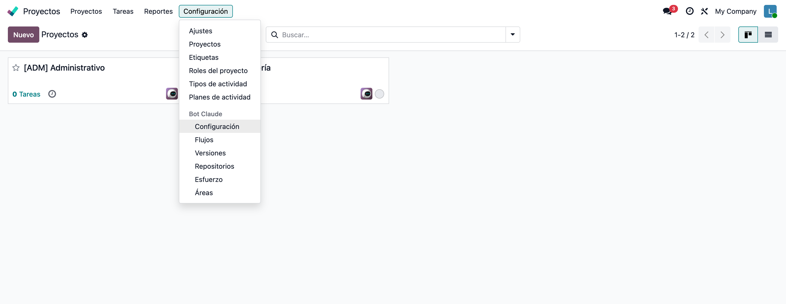

## 2. Configuración general

**Bot Claude ▸ Configuración.** Hay un solo registro.

**Gateway**

- **URL del gateway**: la dirección HTTPS del bot, sin `/hooks/…` (p. ej. `https://claudebot.progressa.group`).
- **Secreto del webhook**: el mismo valor que `BOT_WEBHOOK_SECRET` del gateway. Sin URL y secreto, Odoo no avisa al bot.
- **Usuario del bot**: el usuario técnico con el que el bot escribe en las tareas. Sus notas nunca se reenvían al bot.
- **Máx. sesiones simultáneas**: tope de tareas trabajándose a la vez (`0` = sin tope).
- **Prefijo del comando**: con qué empiezan las notas que van al bot (`/claude`).

**Cuándo trabaja el bot**

- **Etiquetas de activación**: la tarea debe tener una de estas. Puede añadir cualquier etiqueta que ya exista.
- **Etapas de inicio**: mover la tarea a una de estas etapas abre (o retoma) la sesión.
- **Etapas de revisión**: adonde el bot puede mover la tarea cuando abre el PR.
- **Etiquetas de documentación**: la tarea debe actualizar también el manual.
- **Proyectos**: vacío = todos. Úselo para limitar el bot mientras se prueba.

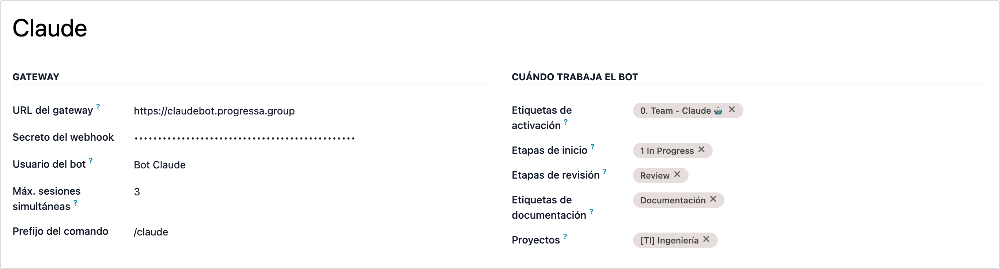

## 3. Flujos

**Bot Claude ▸ Flujos.** Cada flujo es un tipo de trabajo y se elige por las etiquetas de **tipo** de la tarea.

| Flujo | Qué hace el bot |
|---|---|
| Corrección de error | Reproduce el error, escribe el test, corrige y abre el PR |
| Migración | Porta el módulo de una versión a otra |
| Desarrollo | Propone un análisis y **espera aprobación** antes de cambiar código |
| QA funcional | Prueba la funcionalidad y reporta |

Las etiquetas se editan en la misma lista (son muchos a muchos: se agregan o quitan sin crear etiquetas nuevas). **Requiere aprobación** obliga a aprobar el análisis con `/claude aprobar`. Abra un flujo para añadir **instrucciones** propias.

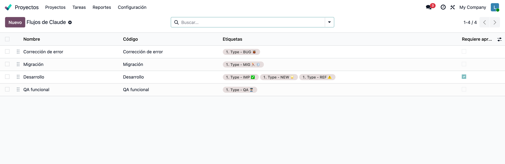

## 4. Versiones

**Bot Claude ▸ Versiones.** Un registro por versión de Odoo. Aquí se define **de qué versión a qué versión** se migra, sin tocar el bot.

- **Etiquetas**: las etiquetas `3. Versión - …` que identifican la versión.
- **Forward-port a**: la siguiente versión de la cadena (17.0 → 19.0 → 20.0).
- **Migrar a**: destino por defecto cuando una tarea de migración tiene **una sola** etiqueta de versión.
- **Routine ID**: la routine de Claude que abre las sesiones de esa versión.

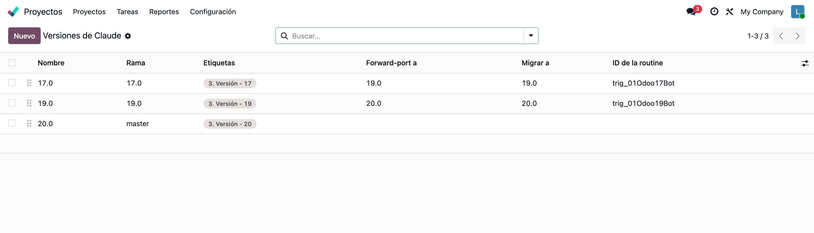

## 5. Detalle de una versión

Abra una versión para completarla:

- **Rama** e **Imagen Docker** de esa versión.
- **Nube de Claude**: **Entorno en la nube**, **Routine ID** y **Token de la routine** (sólo lo ven los administradores). Ambos salen de claude.ai/code/routines al crear la routine con disparador API.
- Pestaña **Repositorios**: qué repos y con qué rama recibe la sesión. Para 19.0: `odoo/odoo`, `indexa-git/enterprise` y `indexa-git/odoo-pro` en `19.0`; `indexa-git/upgrade-util` y `indexa-git/pyazul` en `master`.

Para una versión nueva (p. ej. 21.0): cree el registro con su etiqueta, rama, routine y repositorios, y ponga **Forward-port a** / **Migrar a** en la versión anterior. El destino siempre debe ser una versión más nueva: Odoo no deja guardar lo contrario.

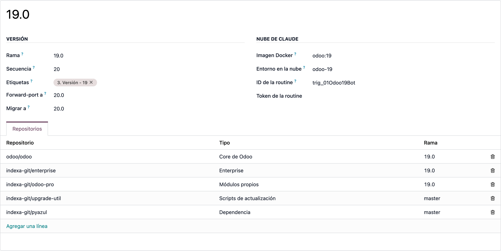

## 6. Repositorios

**Bot Claude ▸ Repositorios.** Catálogo de repos que pueden usar las versiones (`organización/repositorio`). Un repo nuevo se crea aquí y luego se agrega en la pestaña **Repositorios** de cada versión con su rama.

La sesión sólo puede clonar repos a los que la **Claude GitHub App** tiene acceso en la organización `indexa-git`.

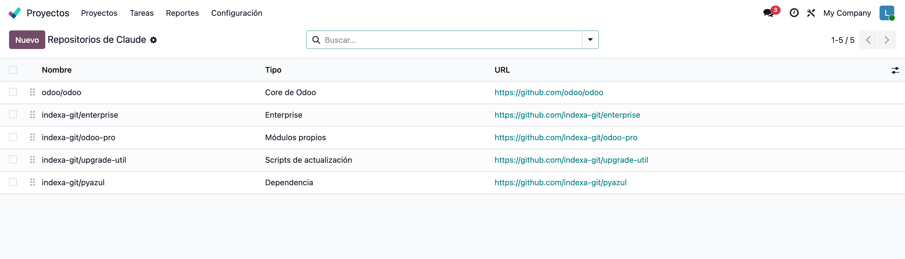

## 7. Esfuerzo

**Bot Claude ▸ Esfuerzo.** Relaciona las etiquetas de complejidad con el **nivel de razonamiento** de Claude: más esfuerzo = análisis más profundo (y más costo). Si la tarea tiene varias, gana la más alta; sin ninguna, se usa `medium`.

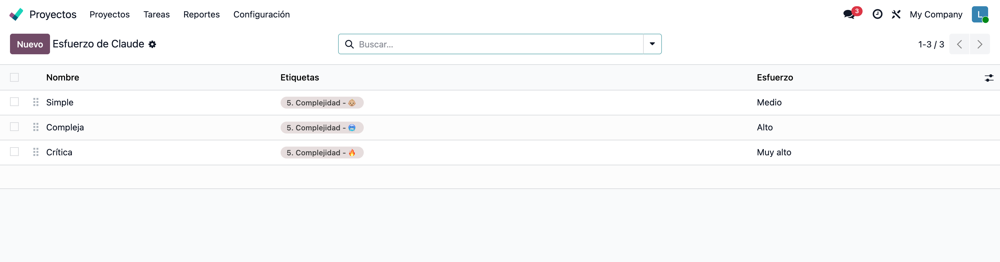

## 8. Áreas

**Bot Claude ▸ Áreas.** Una por cada etiqueta `4. Base - …`. Cuando la tarea tiene la etiqueta del área, el bot recibe las **skills** y las **instrucciones** de esa área (p. ej. *Payroll*: validar contra la escala ISR vigente).

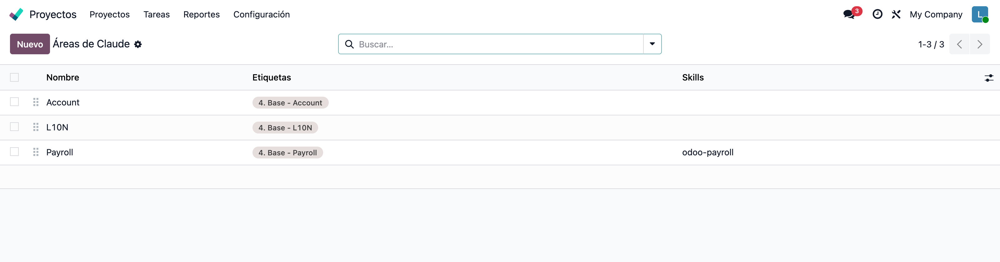

## 9. Marque la tarea para el bot

En la tarea, ponga las etiquetas:

1. **Activación**: `0. Team - Claude 🤖`.
2. **Tipo**: `1. Type - BUG`, `MIG`, `NEW`/`IMP`/`REF` o `QA`.
3. **Versión**: `3. Versión - 19` (o la que corresponda).
4. Opcional: **complejidad** (`5. Complejidad - …`), **área** (`4. Base - …`) y `Documentación`.

Con la etiqueta de activación aparecen el botón **Enviar a Claude** y la pestaña **Claude**. Escriba en la **descripción** lo que se debe hacer, con el mayor detalle posible: es lo primero que lee el bot.

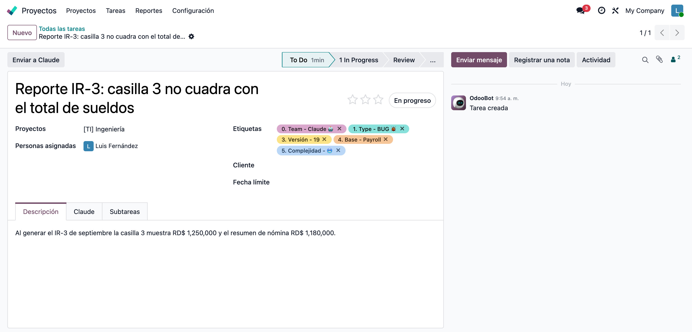

## 10. Revise cómo la va a trabajar

La pestaña **Claude** muestra lo que el bot entendió de las etiquetas, **antes** de enviarla:

- **La trabaja Claude**: la tarea tiene la etiqueta de activación y está en un proyecto habilitado.
- **Flujo de Claude**: el tipo de trabajo.
- **Versión de Claude**: la versión en la que trabajará.

Si **Flujo** o **Versión** salen vacíos, falta la etiqueta correspondiente o no está enlazada en *Flujos* / *Versiones*.

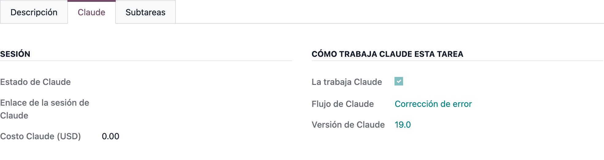

## 11. Tareas de migración

En una migración, la pestaña muestra además **Migrar desde**:

- **Una** etiqueta de versión (p. ej. `3. Versión - 17`): migra desde esa versión hacia su **Migrar a** (17.0 → 19.0).
- **Dos** etiquetas (p. ej. 17 y 20): migra de la menor a la mayor (17.0 → 20.0).

Para cambiar el destino de todas las migraciones de una versión, cambie **Migrar a** en *Versiones*.

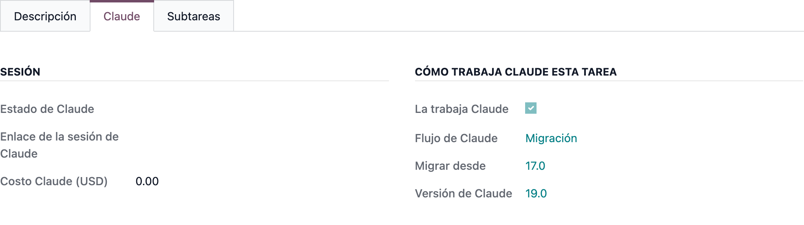

## 12. Inicie el trabajo

Hay dos formas:

- **Mover la tarea a 1 In Progress** (la etapa de inicio): es la forma normal.
- Botón **Enviar a Claude**: para iniciar o reintentar a mano, por ejemplo si el gateway estaba caído.

Odoo confirma **Enviada a Claude** y el estado pasa a **Iniciando**. En unos segundos el bot deja una nota interna con el enlace a la sesión y el estado pasa a **Trabajando**.

Si la tarea ya tiene sesión, no se abre otra: el bot **retoma** la misma.

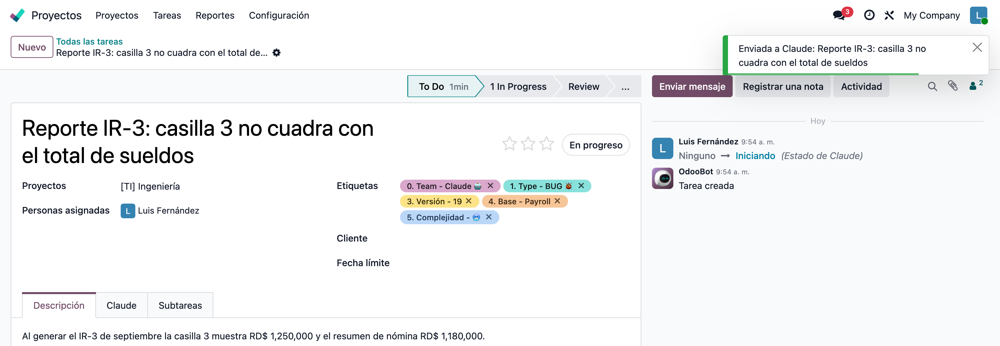

## 13. Cuando falta algo

Si falta configuración, **Enviar a Claude** explica qué:

| Mensaje | Qué hacer |
|---|---|
| La tarea no tiene la etiqueta de activación del bot Claude. | Añadir `0. Team - Claude 🤖` |
| Ningún flujo de Claude coincide con las etiquetas de tipo de la tarea. | Añadir una etiqueta `1. Type - …` |
| Ninguna versión de Claude coincide con las etiquetas de versión de la tarea. | Añadir una etiqueta `3. Versión - …` |
| La versión X no tiene routine de Claude. | El administrador carga la routine en *Versiones* |
| Configure la URL y el secreto del gateway… | El administrador completa *Configuración* |

Al **mover de etapa** no aparece ningún mensaje: si falta algo, la tarea simplemente no se envía. Use el botón para saber por qué.

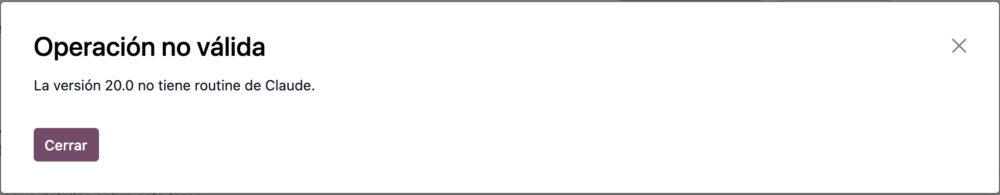

## 14. Siga el trabajo y responda

Mientras trabaja, la pestaña **Claude** muestra:

- **Estado de Claude**: Iniciando, Trabajando, **Espera respuesta**, **Espera aprobación**, Bloqueada, Falló o Terminada.
- **Enlace de la sesión**: abre la sesión en claude.ai para ver en vivo lo que hace.
- **Costo Claude (USD)**: lo consumido por la sesión.

El bot pregunta con **notas internas** que terminan en `status: needs_input`. Para responder, escriba una **nota interna** que empiece con `/claude`:

> `/claude Sí, aplica también a E34. Usa la misma regla.`

La respuesta llega a la misma sesión y el bot continúa.

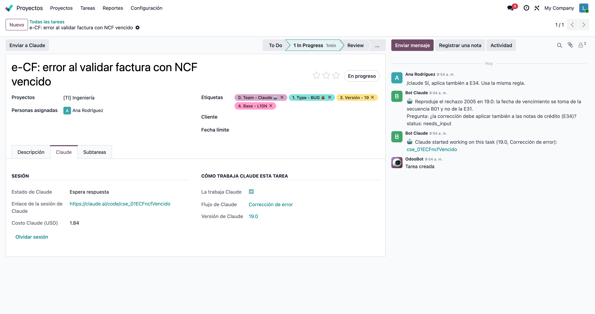

## 15. Apruebe un desarrollo

En el flujo **Desarrollo** el bot no cambia código hasta que alguien apruebe su análisis. La tarea queda en **Espera aprobación**. Responda con una nota interna:

- `/claude aprobar` para que empiece.
- `/claude rechazar <motivo>` para que corrija el análisis.

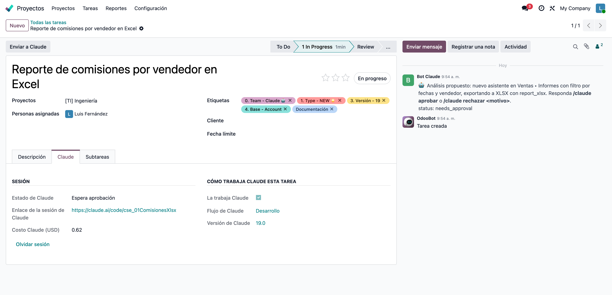

## 16. Comandos del chatter

Siempre como **nota interna** (botón *Registrar nota*), nunca como mensaje: los mensajes a seguidores **no** se envían al bot.

| Comando | Efecto |
|---|---|
| `/claude <texto>` | Responde una pregunta o da una indicación |
| `/claude aprobar` | Aprueba el análisis (flujo Desarrollo) |
| `/claude rechazar <motivo>` | Rechaza el análisis |
| `/claude estado` | Pide un resumen del avance |
| `/claude detener` | Detiene la sesión |

Las notas que no empiezan con `/claude` son normales: el bot no las recibe.

## 17. PR abierto y tarea en Review

Al terminar, el bot deja en el chatter el enlace del **pull request**, mueve la tarea a la etapa de revisión (**Review**) y el estado pasa a **Terminada**. A partir de ahí el PR se revisa como cualquier otro.

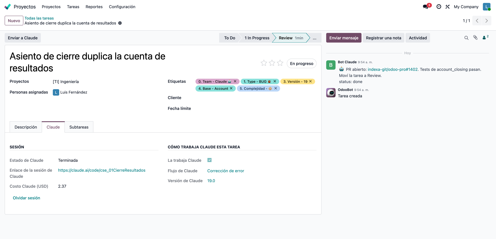

## 18. Ver todas las tareas del bot

En la lista de tareas, el filtro **Tareas de Claude** muestra las que tienen sesión. Agrupe por **Estado de Claude** para ver cuáles esperan una respuesta o una aprobación.

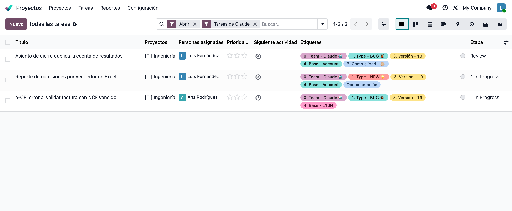

## 19. Empezar de cero

**Olvidar sesión** (pestaña *Claude*, sólo administradores de proyecto) desvincula la sesión y limpia el estado. El siguiente inicio abre una sesión **nueva**. Úselo si la sesión quedó trabada (por ejemplo en **Iniciando** porque el gateway no respondió) o si se quiere rehacer la tarea desde cero.

## Notas

Código del módulo: `odoo-pro/project_ai_bot` (rama 19.0, PR [indexa-git/odoo-pro#1386](https://github.com/indexa-git/odoo-pro/pull/1386)). Gateway, guía de instalación y guía de pruebas: [indexa-git/bot_ia_odoo](https://github.com/indexa-git/bot_ia_odoo) (`docs/GUIA_INSTALACION.md`, `docs/GUIA_PRUEBAS.md`). Tarea: [#75227 — Bot de migración/corrección/desarrollo Odoo](https://www.progressa.group/odoo/project.task/75227).
