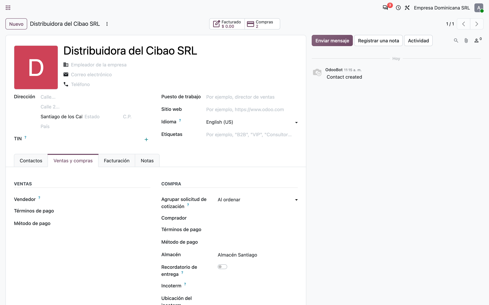
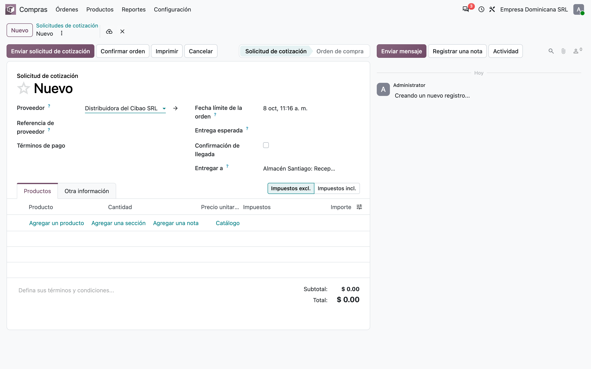
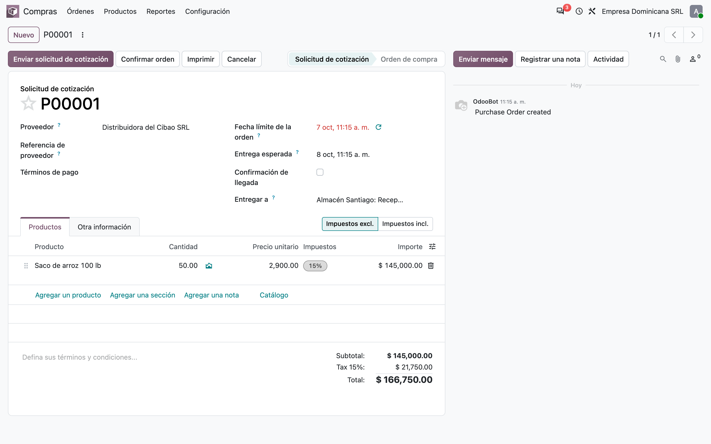

# Almacén por proveedor en compras — Manual de usuario (purchase_picking_default, Odoo 20.0)

> Manual generado con `tools/manual-generator`. Las capturas se regeneran ejecutando el generador contra una base `test_v20_<módulo>`.

Este módulo permite asignar a cada **proveedor** el **almacén** donde se reciben sus compras. Con ese dato Odoo propone automáticamente la operación de recepción (*Entregar a*) de ese almacén:

- al elegir el proveedor en una **solicitud de cotización** creada a mano, y
- en las **solicitudes generadas por reabastecimiento** (reglas de abastecimiento, reabastecimiento desde ventas o MTO).

Odoo 20.0 no ofrece un almacén por proveedor: la operación *Entregar a* sale siempre del almacén por defecto de la compañía o de la regla de compra, por eso el módulo se porta.

**Qué cambió en 20.0:**

- En 20.0 el reabastecimiento pasa los datos del proveedor como un diccionario y el proveedor de la orden por separado. El módulo ahora toma el proveedor de la orden; sin este ajuste **cualquier reabastecimiento por compra fallaba** al generar la solicitud.
- El campo **Almacén** sigue en la pestaña *Ventas y compras* del contacto, sección *Compra*, y es por compañía.

## Requisitos previos

- Módulo **`purchase_picking_default`** `20.0.1.0.0` instalado. Depende de **`purchase_stock`**.
- Inventario con **Almacenes múltiples** activado para ver y elegir el almacén en el proveedor y el campo *Entregar a* en la orden.
- Cada almacén debe tener su operación de **Recepciones** (Odoo la crea al crear el almacén).

## 1. Asignar el almacén al proveedor

Abra el proveedor (**Compras → Órdenes → Proveedores**) y en la pestaña **Ventas y compras**, sección *Compra*, elija el **Almacén** donde se reciben sus mercancías. El valor es por compañía: en otra compañía el mismo contacto puede tener otro almacén o ninguno.

## 2. Solicitud de presupuesto creada a mano

En una nueva solicitud de cotización (**Compras → Órdenes → Solicitudes de cotización → Nuevo**), al elegir el proveedor el campo **Entregar a** cambia a la recepción de su almacén (aquí *Almacén Santiago: Recepciones*). Si el proveedor no tiene almacén, se mantiene la recepción por defecto. El campo se puede cambiar a mano antes de confirmar.

## 3. Solicitud generada por reabastecimiento

Cuando un reabastecimiento compra al proveedor (regla de abastecimiento, venta con ruta *Comprar*, etc.), la solicitud se crea con la recepción del almacén del proveedor en **Entregar a**, aunque la regla de compra pertenezca a otro almacén.

## Notas

- Se usa la primera operación de tipo **Recepción** del almacén del proveedor; si el almacén no tiene ninguna, la orden conserva la operación por defecto.
- Las solicitudes de reabastecimiento se agrupan por la operación de la regla de compra; como el módulo cambia esa operación, cada reabastecimiento hacia un proveedor con almacén crea una **nueva** solicitud en lugar de añadir líneas a la existente.
