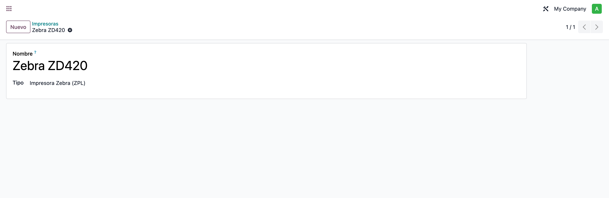
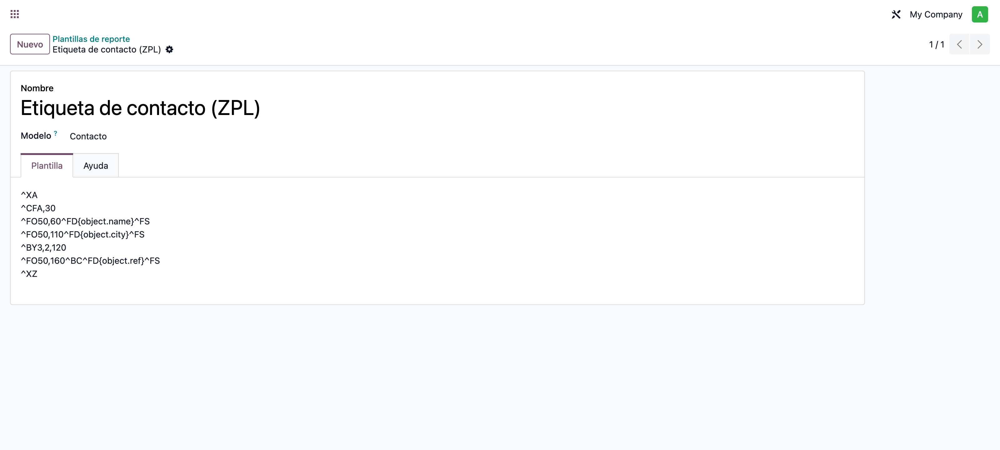
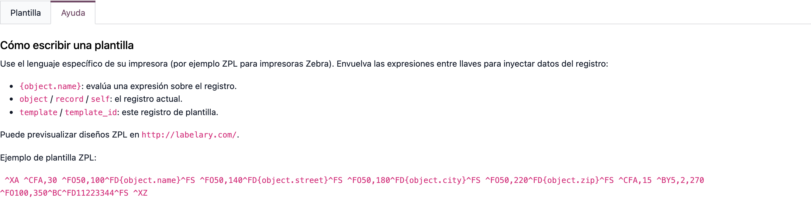
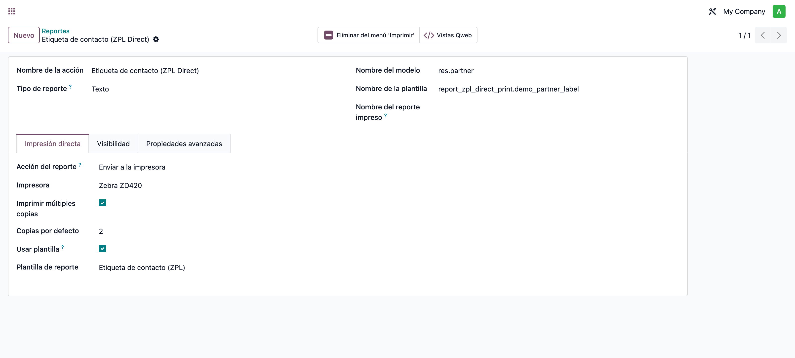

# Report ZPL Direct Print — Manual técnico

> Manual generado con `tools/manual-generator`: `node capture.mjs --config=/Users/luisfernandez/repos/dev_env_odoo_pro-19/tools/manual-generator/configs/report_zpl_direct_print.json --db=test_v19_report_zpl_direct_print`. Las capturas se regeneran corriendo ese comando contra la base de pruebas.

`report_zpl_direct_print` manda un reporte de Odoo directo a una impresora de etiquetas Zebra con [QZ Tray](https://qz.io/), en lugar de descargar el PDF. Sirve para etiquetas de productos, envíos y códigos de barras.

Es el reemplazo en 19.0 del módulo de Webkul `wk_odoo_directly_print_reports`. Se creó en la tarea [#65917 — Mejoras en módulos de impresión](https://www.progressa.group/odoo/project.task/65917).

Las capturas salen de una base que arma el generador: `tools/manual-generator/configs/report_zpl_direct_print.seed.py` crea la impresora *Zebra ZD420*, la plantilla *Etiqueta de contacto (ZPL)* y el reporte *Etiqueta de contacto (ZPL Direct)* sobre contactos. No hay QZ Tray ni impresora conectados, así que la impresión real no aparece en el manual.

**Base de datos de las capturas:** `test_v19_report_zpl_direct_print`, creada con `cd tools/manual-generator && ./generate-manual.sh --module=report_zpl_direct_print --keep-db` (usuario `admin`, clave `admin`).

## Requisitos previos

- Módulo instalado: `report_zpl_direct_print` (sólo depende de `web`).
- La librería Python `zplgrf` en el servidor (`pip install zplgrf`). Sólo se usa para convertir un reporte PDF a ZPL; las plantillas y los reportes de texto no la necesitan.
- QZ Tray instalado y abierto en cada PC que imprime, con la impresora visible en el sistema operativo.
- Modo desarrollador para ver los menús **Impresoras** y **Plantillas de reporte** (`base.group_no_one`).
- Permiso de **Ajustes** (`base.group_system`) para crear o editar impresoras y plantillas.

## 1. Impresoras

**Ajustes ▸ Técnico ▸ Reportes ▸ Impresoras** (`report.zpl.printer`).

- **Nombre**: tiene que ser exactamente el nombre con el que la impresora aparece en el sistema operativo y en QZ Tray. Es lo que el navegador le pasa a QZ Tray para imprimir.
- **Tipo**: hoy sólo existe **Impresora Zebra (ZPL)**.

## 2. Plantillas ZPL

**Ajustes ▸ Técnico ▸ Reportes ▸ Plantillas de reporte** (`report.zpl.template`).

- **Modelo**: el modelo cuyos registros imprime la plantilla. En el reporte sólo se ofrecen las plantillas de su mismo modelo.
- **Plantilla**: el código ZPL. Lo que va entre llaves se evalúa por cada registro, por ejemplo `{object.name}` o `{object.ref}`.

## 3. Sintaxis de las expresiones

La pestaña **Ayuda** de la plantilla lista los nombres disponibles dentro de las llaves:

- `object`, `record`, `self`: el registro que se imprime.
- `template`, `template_id`: la plantilla.

Las expresiones se evalúan con `safe_eval` (no con `eval`). Si una falla, el usuario ve un `UserError` con la expresión y el error.

## 4. El reporte: pestaña Impresión directa

**Ajustes ▸ Técnico ▸ Acciones ▸ Reportes ▸ (reporte) ▸ Impresión directa.**

- **Acción del reporte** (`report_user_action`): *Acción de Odoo por defecto* deja el comportamiento normal; *Enviar a la impresora* activa la impresión directa.
- **Impresora** (`printer_id`): la impresora a la que va.
- **Imprimir múltiples copias** (`multi_copy_print`) y **Copias por defecto** (`default_copies`, mayor que 0): si está marcado, el usuario elige cuántas copias en cada impresión.
- **Usar plantilla** (`use_template`) y **Plantilla de reporte** (`report_template_id`): sólo para impresoras ZPL. Imprime con la plantilla en vez de convertir el reporte.

Para que aparezca en **Acciones ▸ Imprimir** del modelo, el reporte necesita su vínculo al modelo (botón *Agregar al menú Imprimir*).

## 5. Qué pasa al imprimir

El módulo agrega el handler `zpl_direct_print` al registro `ir.actions.report handlers` (`static/src/js/report_print_handler.js`). Por ahí pasan tanto **Acciones ▸ Imprimir** como el visor de reportes, así que no hay que parchear el servicio de acciones.

1. Lee del reporte `report_user_action`, `printer_id`, `multi_copy_print` y `default_copies`. Si la acción no es *Enviar a la impresora*, devuelve `false` y Odoo sigue con el PDF normal.
2. Conecta con QZ Tray. Si no puede, avisa *"Could not connect to QZ Tray…"* y no imprime.
3. Busca la impresora configurada en QZ Tray. Si no existe, o si el reporte permite varias copias, abre el diálogo **Select Printer** para elegir impresora y copias.
4. Llama a `render_zpl` en el servidor con los registros seleccionados.
5. Manda el resultado a QZ Tray (`qz.print`, con `altPrinting` y las copias) y se desconecta.

## 6. Las tres formas de generar el ZPL

`render_zpl(res_ids)` (`models/ir_actions_report.py`) devuelve una lista de textos ZPL:

1. **Con plantilla** (`use_template` y `report_template_id`): una etiqueta por registro, con las expresiones `{…}` reemplazadas.
2. **Reporte de texto** (`report_type = qweb-text`): el texto del reporte tal cual, como un solo trabajo.
3. **Reporte PDF**: genera el PDF y lo convierte a ZPL con `zplgrf` (`GRF.from_pdf`, una etiqueta por página, con `optimise_barcodes`). Sin `zplgrf` instalado, da un `UserError` que pide instalarla.

## 7. Permisos

- **Usuario interno** (`base.group_user`): sólo lectura de impresoras y plantillas. Es lo que necesita para imprimir.
- **Ajustes** (`base.group_system`): crea, edita y borra impresoras y plantillas.
- Los menús sólo se ven en modo desarrollador (`base.group_no_one`).

## 8. Migración desde `wk_odoo_directly_print_reports`

El script `upgrade-util/src/l10n_do_banks/19.0.1.0.0/pre-report-zpl-direct-print-merge.py` corre sólo si el módulo de Webkul está instalado:

1. Renombra los modelos y conserva sus datos: `report.template` → `report.zpl.template` y `wk_printer.printer` → `report.zpl.printer`. Los campos del reporte tienen el mismo nombre, así que su configuración se conserva.
2. Une el módulo viejo con el nuevo (`merge_module`): pasan dependencias, xmlids y vistas, y después se borra el módulo viejo.
3. Si el módulo viejo siguiera instalado, lo desinstala.

`product_label_for_zebra_printer` ya depende de este módulo en 19.0 y su reporte de etiqueta de producto viene configurado para imprimir con plantilla.

## 9. Límites conocidos

- **Sólo impresoras ZPL.** El único tipo es *Impresora Zebra (ZPL)*: no imprime tickets ni documentos en impresoras térmicas de recibos u oficina. Para eso está la IoT (`user_default_iot_printer`).
- **QZ Tray en cada PC.** Sin la aplicación abierta no se imprime.
- **Sin certificado de QZ Tray.** El módulo no firma las peticiones: QZ Tray le pide al usuario permitir el sitio la primera vez (puede marcar *recordar*).
- **El nombre de la impresora tiene que coincidir** con el del sistema operativo; si no, sale el diálogo para elegirla.
- **`zplgrf`** sólo hace falta para reportes PDF; si no está, el módulo se instala igual y la conversión de PDF queda desactivada.

## Notas

Código: `odoo-pro/store-addons/report_zpl_direct_print` (rama 19.0). Documentación original: `README.rst` del módulo. PRs: [store-addons#76](https://github.com/indexa-git/store-addons/pull/76) y [upgrade-util#49](https://github.com/indexa-git/upgrade-util/pull/49). Tarea: [#65917](https://www.progressa.group/odoo/project.task/65917).
