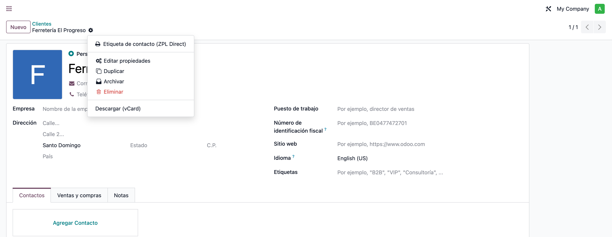
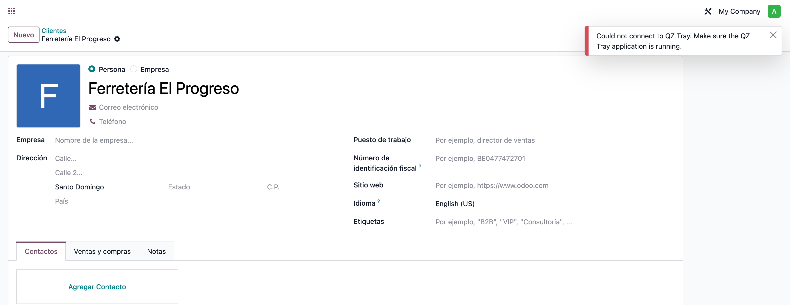

# Impresión directa de etiquetas — Manual de usuario

> Manual generado con `tools/manual-generator`: `node capture.mjs --config=configs/report_zpl_direct_print_usuario.json --db=test_v19_report_zpl_direct_print`. Las capturas se regeneran corriendo ese comando contra la base de pruebas.

Las etiquetas que el administrador configuró para impresión directa salen en la impresora Zebra en cuanto usted las manda a imprimir. No se descarga ningún PDF.

Para que funcione, su PC tiene que tener abierta la aplicación **QZ Tray**, que es la que conecta el navegador con la impresora.

## Requisitos previos

- QZ Tray instalado y abierto en su PC (el icono aparece junto al reloj de Windows o en la barra de menú del Mac).
- La impresora Zebra encendida, con etiquetas y conectada a su PC.
- El administrador ya configuró la etiqueta para impresión directa. Usted no configura nada.

## Mande la etiqueta a imprimir

Abra el registro (en el ejemplo, un contacto), pulse **Acciones (engranaje)** y escoja la etiqueta, la que tiene el icono de impresora: **Etiqueta de contacto (ZPL Direct)**. Si el registro tiene varios reportes, las etiquetas están dentro de **Imprimir**.

También puede marcar varios registros en la lista y hacer lo mismo desde **Acciones**: sale una etiqueta por registro.

## Elija la impresora y las copias, si se lo pide

Normalmente la etiqueta sale sin preguntar nada. Odoo le muestra la ventana **Select Printer** sólo en dos casos:

- **La etiqueta permite varias copias.** Escriba cuántas en **Number of Copies** y pulse **Print**.
- **No encuentra la impresora configurada** en su PC. Escoja su Zebra en **Printer** y pulse **Print**.

## Aviso: no se pudo conectar con QZ Tray

Si al imprimir aparece este aviso en rojo, QZ Tray no está abierto en su PC:

1. Abra **QZ Tray** desde el menú de inicio (o Aplicaciones en el Mac).
2. Espere a que su icono aparezca junto al reloj.
3. Vuelva a imprimir.

La primera vez, QZ Tray le pregunta si permite que el sitio de Odoo imprima: pulse **Allow** y marque **Remember this decision**.

## Preguntas frecuentes

- **Se descargó un PDF en lugar de imprimir.** Esa etiqueta no está configurada para impresión directa. Avise al administrador.
- **Me pide escoger impresora cada vez.** El nombre de la impresora en Odoo no coincide con el de su PC. Avise al administrador para que lo corrija.
- **Salió un aviso de que falta `zplgrf`.** Esa etiqueta se convierte desde un PDF y al servidor le falta una librería. Avise al administrador.
- **No salió nada en la Zebra.** Revise que esté encendida, con etiquetas y conectada. Si sigue igual, reinicie QZ Tray y vuelva a imprimir.
