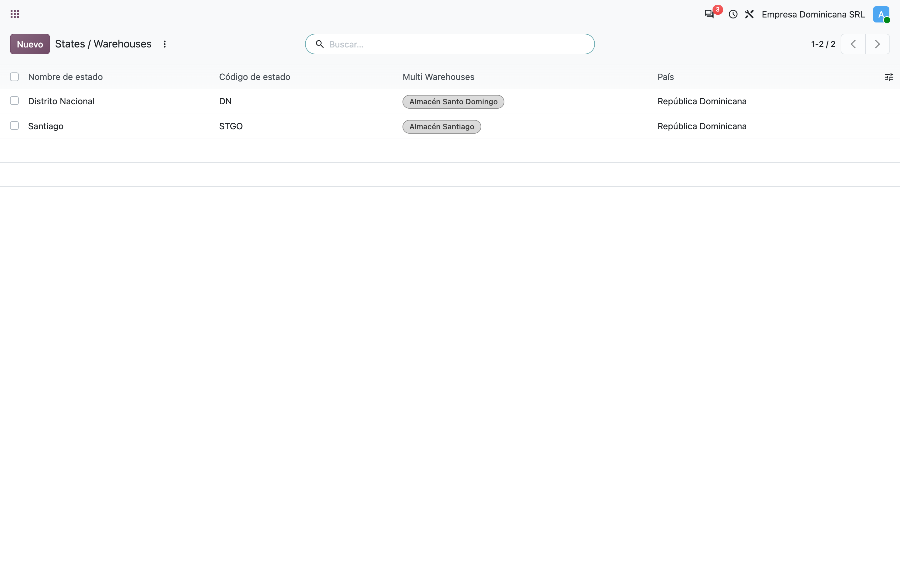
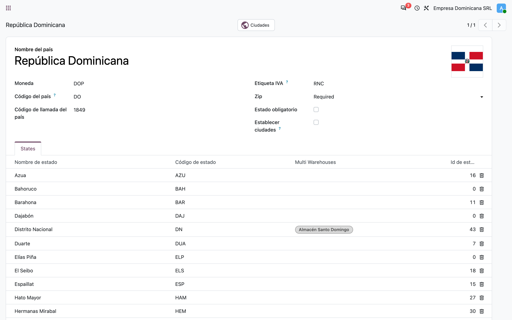
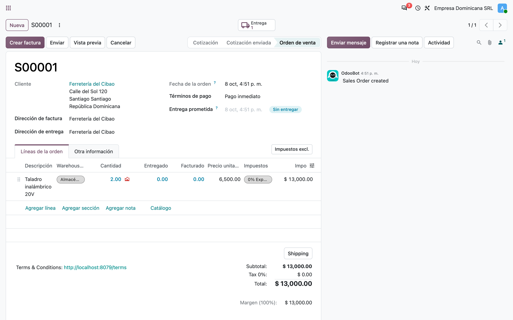
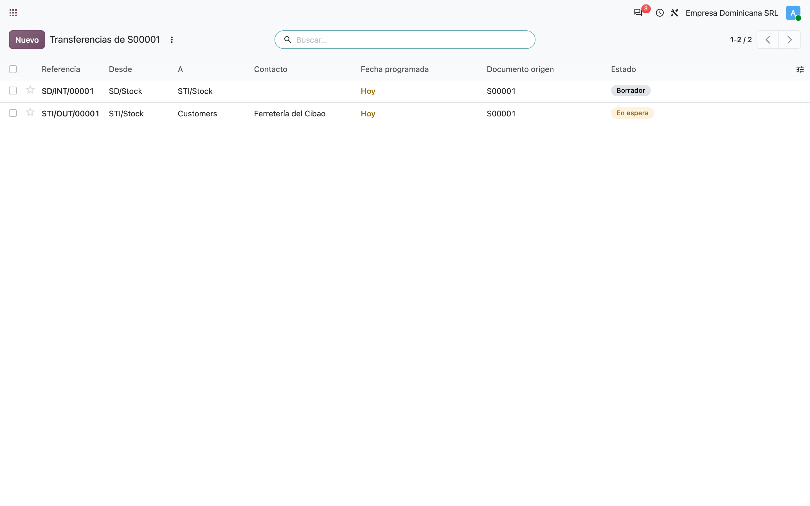
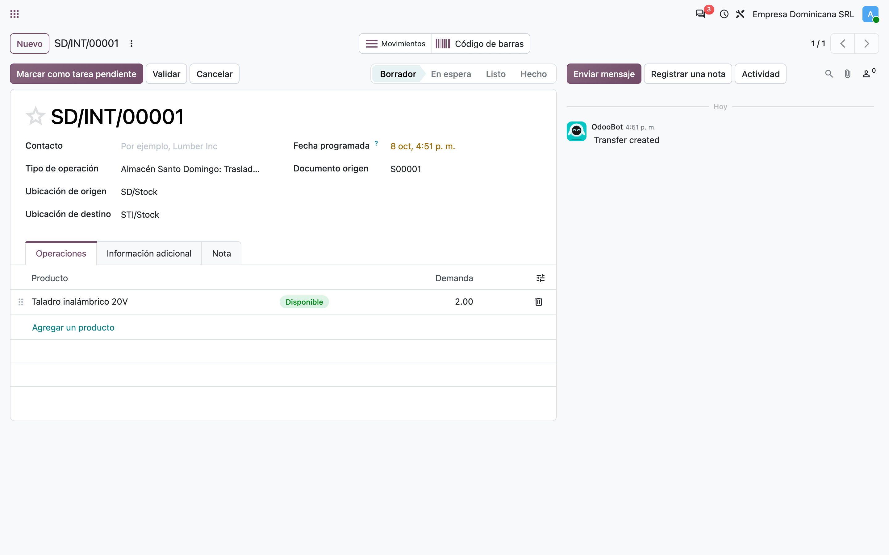

# Ventas desde otros almacenes — Manual de usuario (sale_order_with_other_locations, Odoo 20.0)

> Manual generado con `tools/manual-generator`. Las capturas se regeneran ejecutando el generador contra una base `test_v20_<módulo>`.

Este módulo asigna a cada provincia los almacenes que la atienden y los usa en las ventas del sitio web:

- El **carrito** del sitio web toma como almacén el primero de la provincia del cliente.
- En la línea de venta, la columna **Warehouse available** indica de qué otros almacenes se puede traer la mercancía.
- Al **confirmar** la orden, el módulo crea una **transferencia interna** desde cada uno de esos almacenes hacia el almacén de la orden, agrupando las líneas por almacén.
- La cotización y el envío con **Buenvío** salen desde la dirección del almacén de la orden, no desde la de la compañía.

Odoo 20.0 no asigna almacenes por provincia ni crea transferencias entre almacenes por línea de venta: *website_sale_stock* solo permite un almacén por sitio web y las rutas de reabastecimiento entre almacenes son fijas por almacén, por eso el módulo se porta.

**Qué cambió en 20.0:** nada visible para el usuario. La columna de almacenes de la línea se ubica ahora junto a la columna *Descripción* de la nueva lista de líneas de venta, y las transferencias internas se crean con la unidad de medida de la línea (en 20.0 el campo cambió de nombre y la confirmación fallaba).

## Requisitos previos

- Módulo **`sale_order_with_other_locations`** `20.0.1.0.0` instalado. Depende de **`sale_stock`**, **`website_sale`** y **`delivery_buenvio`**.
- Aplicación **Ventas** (`sale_management`) instalada, para tener el menú *Ventas → Configuración*.
- Inventario con **Ubicaciones de almacenamiento** activado: sin él Odoo deja inactivo el tipo de operación *Transferencias internas* de cada almacén y el módulo no crea la transferencia.
- Contactos con **provincia** en su dirección.
- Para Buenvío: la dirección del almacén (calle, *Casa/Apt*, *Número del Sector* y provincia con *Id de estado de Buenvío*).

## 1. Asignar almacenes a cada provincia

**Ventas → Configuración → States / Warehouses** lista todas las provincias con la columna **Multi Warehouses**. La lista es editable: agregue uno o varios almacenes a cada provincia. El **primero** es el que se usará como almacén de las órdenes del sitio web de clientes de esa provincia. En la captura se muestran solo las provincias que ya tienen almacén.

## 2. Desde el país

La misma columna aparece en la pestaña de provincias del país (**Contactos → Configuración → Países → República Dominicana**).

## 3. La orden de venta del sitio web

El cliente es de Santiago, así que la orden toma el **Almacén Santiago** (pestaña *Otra información → Entrega → Almacén*). El producto solo hay en Santo Domingo: la columna **Warehouse available** de la línea muestra **Almacén Santo Domingo**. La columna se llena en la línea, eligiendo los almacenes desde los que se traerá la mercancía.

## 4. Transferencias creadas al confirmar

Al confirmar, además de la **entrega** desde el almacén de la orden (*STI/OUT*), Odoo crea una **transferencia interna** desde cada almacén de la columna *Warehouse available* (*SD/INT*) hacia el almacén de la orden, con origen igual al número de la orden.

## 5. La transferencia interna

La transferencia mueve las cantidades de las líneas, en la unidad de medida de la línea, de **SD/Existencias** a **STI/Existencias**. Se crea en borrador: márquela **Por hacer**, valídela cuando la mercancía llegue y luego valide la entrega al cliente.

## Notas

- Si una línea tiene varios almacenes, el módulo prioriza el almacén que cubre más líneas y crea una sola transferencia por almacén.
- Si el almacén de origen no tiene un tipo de operación *Transferencias internas* activo, no se crea la transferencia y la orden se confirma igual.
- Los textos propios del módulo (*States / Warehouses*, *Multi Warehouses*, *Warehouse available*) no tienen traducción al español.
