# Punto de Ventas Backend — Manual de usuario

> Manual generado con `tools/manual-generator`: `node capture.mjs --config=/Users/luisfernandez/repos/dev_env_odoo_pro-19/tools/manual-generator/configs/sale_pos_backend.json --db=test_v19_sale_pos_backend`. Las capturas se regeneran corriendo ese comando contra la base de pruebas.

**Punto de Ventas Backend** (`sale_pos_backend`) convierte el pedido de venta del backend en una caja registradora: cada usuario abre una **sesión** sobre una **caja**, vende con pedidos de venta, cobra en el mismo asistente que crea la factura, entrega el cambio, hace devoluciones y al final del turno cuadra el efectivo por denominación y por moneda.

Todo ocurre dentro del cliente web normal de Odoo (pedidos, facturas, pagos y albaranes estándar), sin la interfaz del punto de venta nativo. Este manual cubre la versión **19.0**, migrada desde la 17.0.

**Base de datos de las capturas:** Base de pruebas `test_v19_sale_pos_backend`, compañía **Ferretería El Martillo** (RD, DOP, plan contable dominicano, US$ a 60.00), sin datos de demostración. La siembra crea tres cajas: **Caja Principal** (control de efectivo multimoneda, diferencia autorizada RD$ 50), **Caja Express** (sin control de efectivo, con una sesión ya cerrada) y **Caja Almacén** (sesión de Pedro Almacén esperando el saldo de apertura). En la sesión abierta de la Caja Principal hay una venta de contado con cambio, una venta con tarjeta con una devolución parcial, un pedido confirmado pendiente de cobro y una cotización.

## Requisitos previos

- Odoo 19 con `sale_pos_backend` instalado (arrastra `sale_stock`, `operating_unit`, `sale_order_rate`, `sale_stock_serial`, `account_payment_authorization_code` y `sale_partner_fields`).
- Plan contable cargado, un diario de ventas y al menos un diario de **efectivo** y uno de **banco** para cobrar.
- Usuarios con el grupo **Caja de Ventas / Usuario** (cajeros) o **Administrador** (supervisores).
- Para el control de efectivo: las monedas/billetes configurados en *Configuración › Monedas/Billetes*.

## 1. El tablero de cajas

**Punto de Ventas Backend › Tablero** muestra una tarjeta por caja. El botón cambia según el estado de la sesión actual:

- **Nueva sesión**: la caja no tiene sesión o la última está cerrada.
- **Abrir sesión**: la sesión espera el saldo de apertura (*Control de apertura*).
- **Reanudar** / **Cerrar**: la sesión está en curso.

El menú de los tres puntos de la tarjeta lleva a las órdenes y sesiones de esa caja y, para administradores, a su configuración. Si la caja usa **usuarios genéricos**, *Nueva sesión* pide usuario y PIN en lugar de abrir con el usuario conectado.

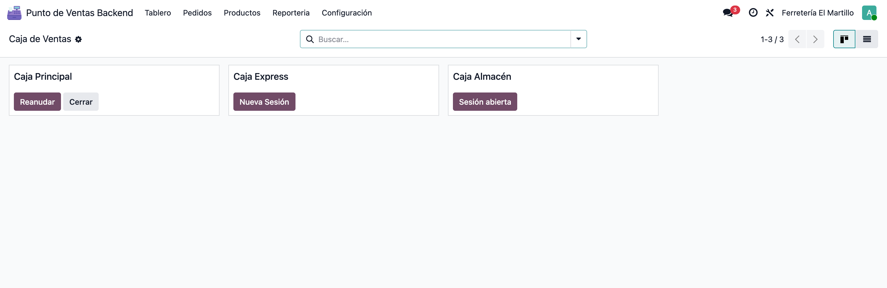

## 2. La caja: métodos de pago

**Configuración › Caja de Ventas**. En la pestaña de pagos se definen:

- **Métodos de pago** y el **método por defecto** que propone el asistente de cobro.
- **Métodos de devolución**: los diarios desde los que se devuelve dinero en un reembolso.
- **Permitir cambio** (*cash back*) y **confirmación automática del cambio**, que al facturar abre directamente la ventana para devolverlo.
- Si el cajero puede editar la **fecha del pago**, la **referencia** o la **lista de precios**, y si se exige **código de autorización** en los pagos con tarjeta.

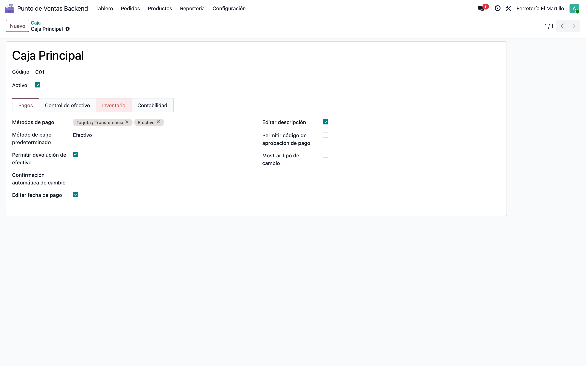

## 3. La caja: control de efectivo

Con **Control de efectivo** activo, la sesión no arranca hasta registrar el saldo de apertura y no cierra sin el saldo de cierre. **Control de efectivo multimoneda** permite contar billetes en otra moneda (aquí, US$ 100); sin él la caja rechaza monedas/billetes que no estén en la moneda de la compañía.

**Saldo por defecto** son las denominaciones que aparecen al abrir y cerrar. **Diferencia autorizada** es el faltante que un cajero puede dejar sin permisos especiales.

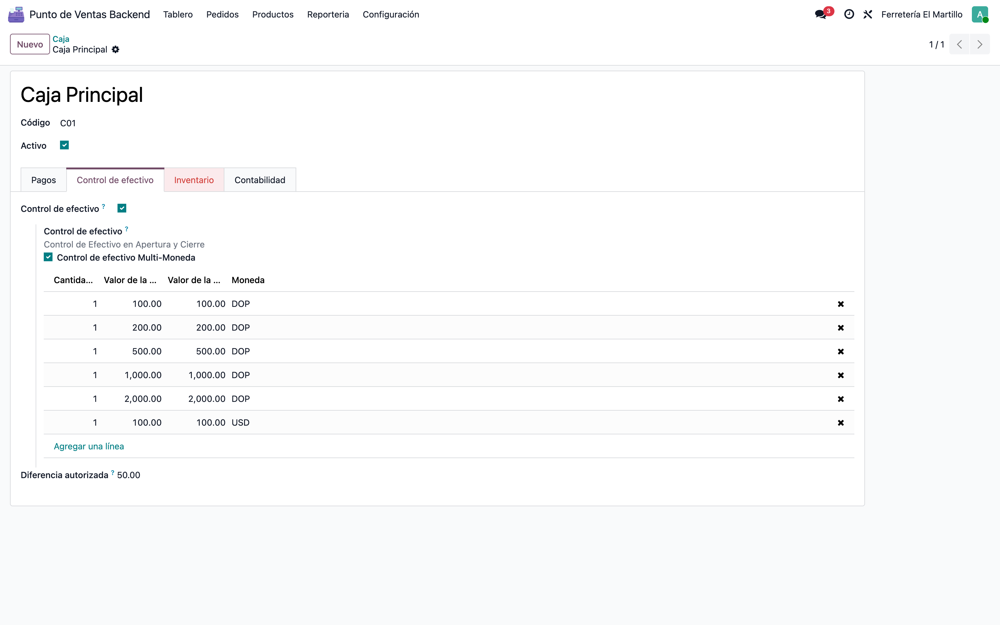

## 4. La caja: inventario y devoluciones

- **Almacén** de las ventas y **almacenes** donde se aceptan devoluciones.
- **Auto confirmar albaranes**: valida la entrega al facturar. Es incompatible con *Confirmación de cantidades entregadas*.
- **Auto confirmar albaranes de devolución** valida la entrada de mercancía del reembolso.
- **Editar lotes y series** desde la línea del pedido.
- **Motivos de devolución** y si el motivo es **obligatorio**.

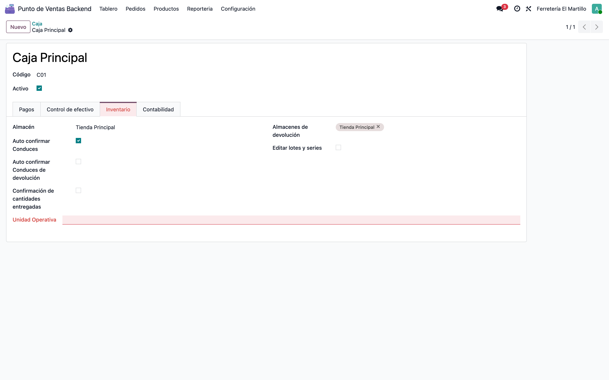

## 5. Monedas y billetes

**Configuración › Monedas/Billetes** guarda las denominaciones que se cuentan en la apertura y el cierre. Cada línea tiene valor, moneda y la cantidad que se propone por defecto. El nombre se arma solo con el símbolo de la moneda y su valor convertido se muestra en la moneda de la compañía.

El módulo instala las denominaciones dominicanas (RD$ 1 a RD$ 2,000) en la moneda de la compañía al momento de instalar.

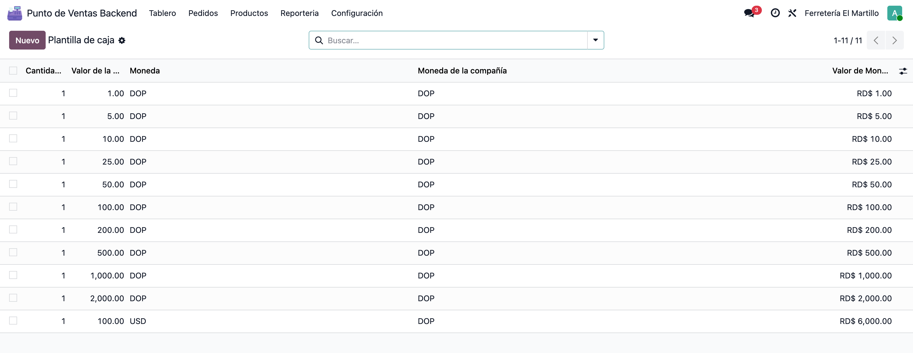

## 6. Saldo de apertura

En una caja con control de efectivo la sesión nueva queda en **Control de apertura**. *Establecer balance de apertura* abre el conteo por denominación: se indica cuántas monedas o billetes de cada tipo hay en la gaveta y el total se convierte a la moneda de la compañía.

Al guardar se crea un saldo por moneda en la pestaña *Saldo de caja* de la sesión y aparece el botón **Iniciar sesión**.

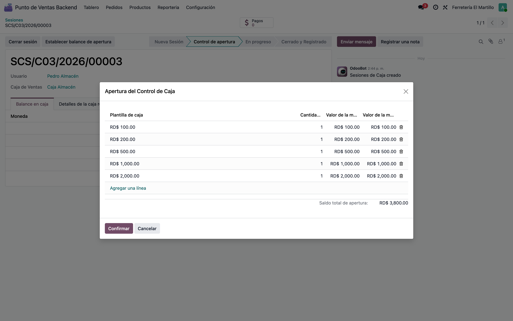

## 7. La sesión en curso

La sesión de la Caja Principal abrió con **RD$ 2,500.00 y US$ 100.00** (RD$ 8,500.00 en total a 60.00). Los botones inteligentes cuentan los pedidos abiertos y totales, las facturas, las notas de crédito generadas y consumidas, y los pagos de la sesión.

Desde aquí se crean pedidos (*Crear pedido de venta*), pagos sueltos (*Crear pago*, para abonos o anticipos) y se inicia el cierre.

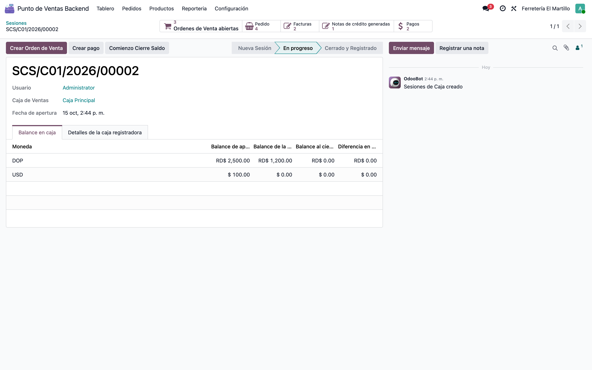

## 8. El pedido de caja

El pedido se abre con el formulario propio de la caja: cliente por defecto de la caja (*Cliente de contado*), lista de precios, almacén y sesión ya puestos. El precio y los impuestos de la línea sólo se editan con los grupos *Puede editar precio* / *Puede editar impuesto*.

*Crear cliente* abre un formulario corto que guarda el contacto y lo pone en el pedido.

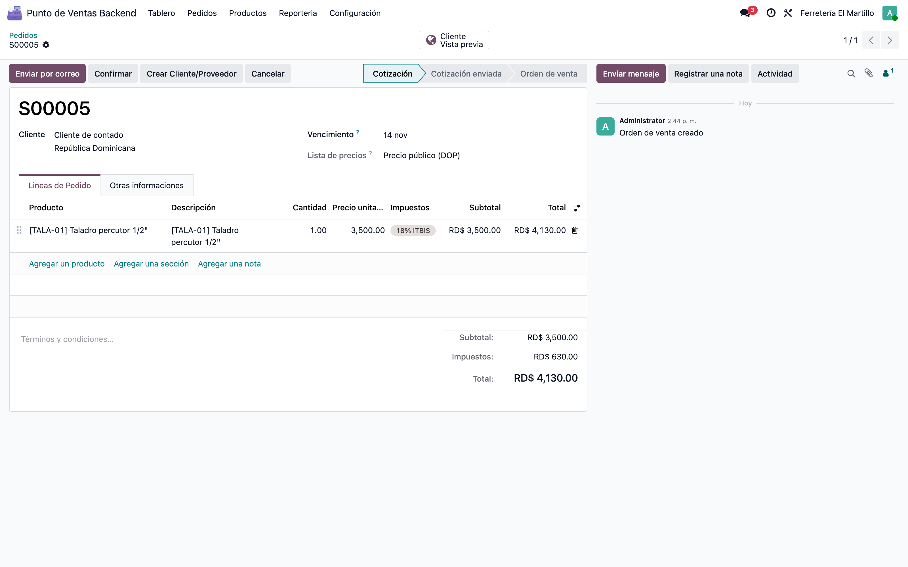

## 9. Cobrar y facturar en un paso

En un pedido confirmado, **Crear factura** abre el asistente de cobro de la caja: método de pago (sólo los de la caja), monto, moneda, fecha y referencia. También permite aplicar **notas de crédito** y **anticipos** pendientes del cliente.

Al confirmar: valida la entrega (si la caja lo indica), publica la factura, aplica las notas de crédito y anticipos, y registra el pago por la diferencia ligado a la sesión. Sin pago no se factura salvo con el grupo *Puede validar facturas sin pago*; un pago menor al total exige *Puede hacer pagos parciales*.

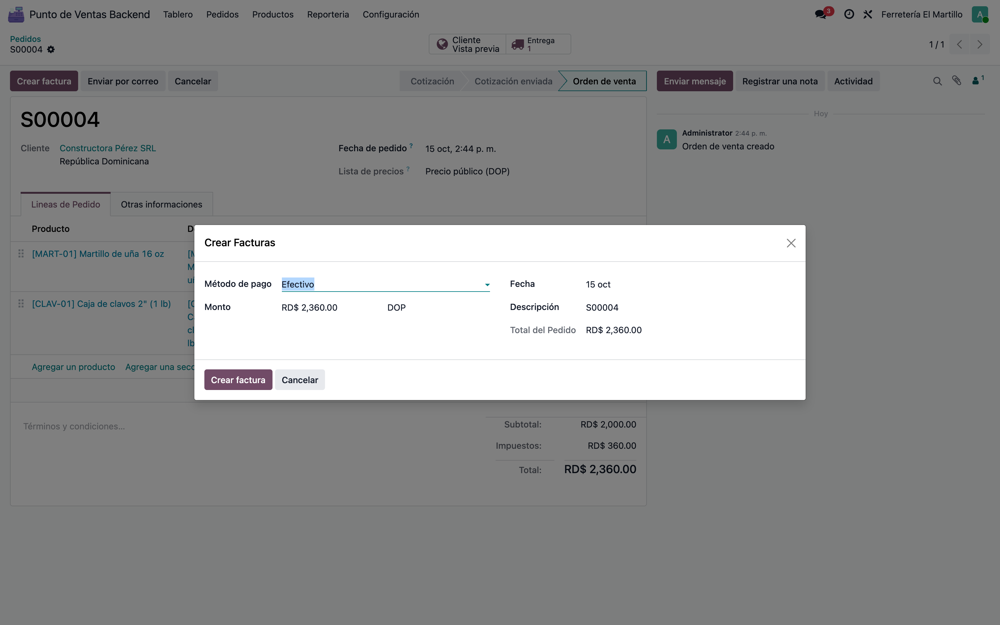

## 10. La factura con cambio

La venta de contado fue de **RD$ 1,180.00** y el cliente entregó **RD$ 1,200.00**. La factura queda pagada y muestra **Cambio: 20.00** bajo el importe adeudado. El ticket de caja (*Imprimir › Factura de caja*) imprime los pagos y el cambio.

Cuando la factura se abre desde la caja aparece el botón **Devolver**: registra la devolución del cambio a la sesión ajustando el pago de efectivo al total de la factura. Con *Confirmación automática del cambio* esa ventana se abre sola y, para quien no es administrador, no deja salir de la factura hasta devolverlo.

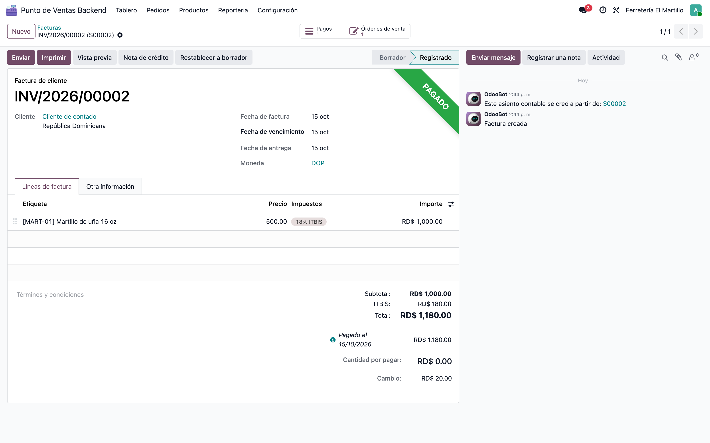

## 11. Reembolso de un pedido

En un pedido facturado y entregado, **Reembolso** (grupo *Puede reembolsar pedidos*) abre el asistente:

- **Devolución de producto**: nota de crédito por lo devuelto, que queda a favor del cliente para usarla como pago en otra venta.
- **Reembolso**: además devuelve el dinero desde el diario de devolución elegido y deja la nota de crédito conciliada.
- Por línea se indica la **cantidad hecha** (no más de lo entregado) y las **series** cuando el producto las lleva.
- **Devolver albarán** crea la entrada de mercancía a la ubicación elegida.

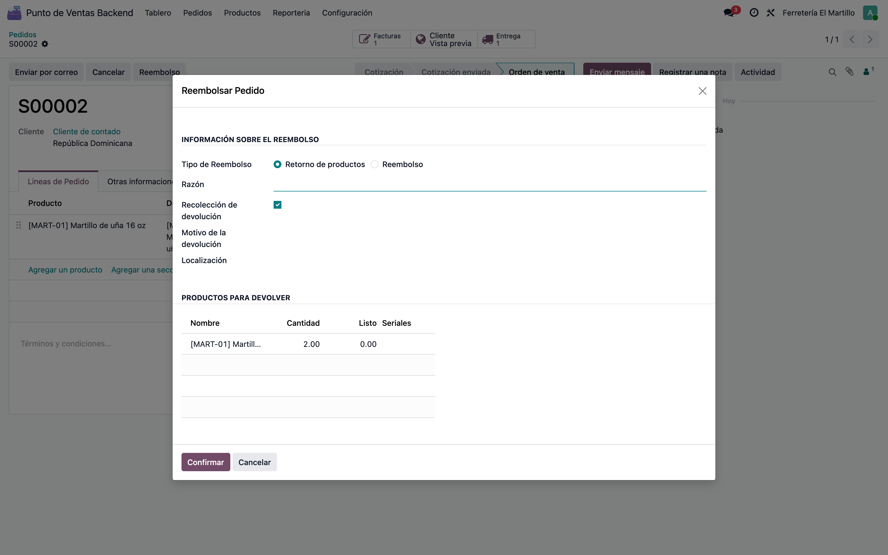

## 12. Notas de crédito de la sesión

La venta con tarjeta tuvo una devolución de un paquete de clavos: la nota de crédito **RD$ 177.00** queda ligada a la sesión y se ve en el botón *Notas de crédito generadas*. Cuando otra venta la consume como pago, cuenta en *Notas de crédito consumidas* de la sesión donde se usó.

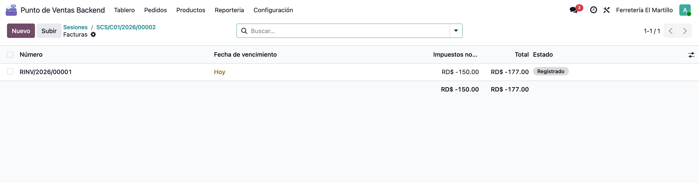

## 13. Saldo de cierre

*Comienzo cierre saldo* pasa la sesión a **Control de cierre** y *Establecer balance de cierre* abre el conteo final con las mismas denominaciones. La sesión compara, por moneda, lo contado contra apertura + cobros en efectivo y guarda la diferencia en *Saldo de caja*.

Al **Cerrar sesión**:

- Si quedan pedidos sin facturar o pagos en borrador, un asistente avisa y los cancela.
- Un faltante mayor a la **diferencia autorizada** sólo lo puede cerrar quien tenga *Puede cerrar sesión con diferencia de efectivo*; el cierre deja la nota *Sesión cerrada con diferencia de efectivo* en el chatter.

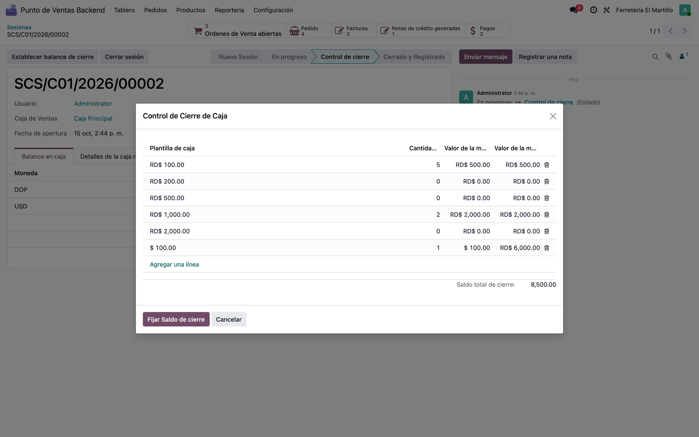

## 14. Historial de sesiones

**Órdenes › Sesiones** lista todas las sesiones con su caja, usuario, fechas y estado (verde en curso, amarillo en cierre, rojo cerrada).

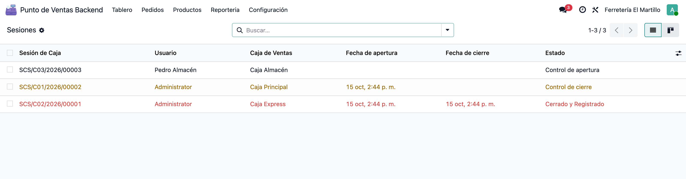

## 15. Reportes

El menú **Reportes** trae seis informes en PDF, cada uno con un pequeño asistente (rango de fechas y cajas, o una sesión):

| Reporte | Qué muestra |
|---|---|
| Detalles de venta | Productos vendidos, impuestos, totales y pagos por método |
| Reporte diario | Lo mismo para una sesión |
| Detalle por caja | Pagos por diario y moneda, notas de crédito aplicadas |
| Diario por sesión | Pagos de una sesión |
| Detalle de facturas por caja | Facturas y notas de crédito con su saldo |
| Diario de facturas por sesión | Lo mismo para una sesión |

## 16. Grupos de seguridad

En el usuario, privilegio **Caja de Ventas** (*Usuario* / *Administrador*) y estos permisos sueltos, que el administrador del sistema trae por defecto:

- Puede editar precio / impuesto de la orden de caja
- Puede hacer pagos parciales
- Puede validar facturas sin pago
- Puede aplicar notas de crédito
- Puede reembolsar pedidos
- Puede cerrar una sesión
- Puede cerrar sesión con diferencia de efectivo

El usuario de caja sólo ve las facturas y pagos donde es el vendedor; el administrador de contabilidad hereda el administrador de caja.

## 17. Cambios de la migración a 19.0

- Las vistas kanban usan las plantillas `card`/`menu` de v19; las listas son `list` y el chatter es `<chatter/>`.
- Los grupos cuelgan del privilegio `res_groups_privilege_sale_cashier` (antes categoría `module_category_sale_cashier`).
- El pedido ya no tiene cuenta analítica: la **cuenta analítica de la caja** se copia a la distribución analítica de las líneas.
- La tasa del ticket usa el `invoice_currency_rate` nativo (en 17 venía de `account_invoice_rate`, que no existe en 19). Los campos de tasa del pedido de `sale_order_rate` tampoco existen en 19 y salieron del formulario.
- La devolución de mercancía usa el asistente de 19 (`action_create_returns`, cantidades en `product_return_moves`).
- Estados de pago de 19: *En proceso* / *Pagado* / *Cancelado* (antes *Publicado*).
- El asistente de reembolso expone `_prepare_credit_note_lines(credit_note, line_vals_list)` para que la localización ajuste los impuestos de la nota de crédito.

## Notas

**Si la sesión no abre:** el usuario ya tiene otra sesión sin cerrar en la misma compañía.

**Si *Crear factura* no deja cobrar:** el pago es cero o menor al total y el usuario no tiene *Puede validar facturas sin pago* / *Puede hacer pagos parciales*.

**Si el cierre se niega por diferencia:** contar de nuevo o pedirlo a un usuario con *Puede cerrar sesión con diferencia de efectivo*.
