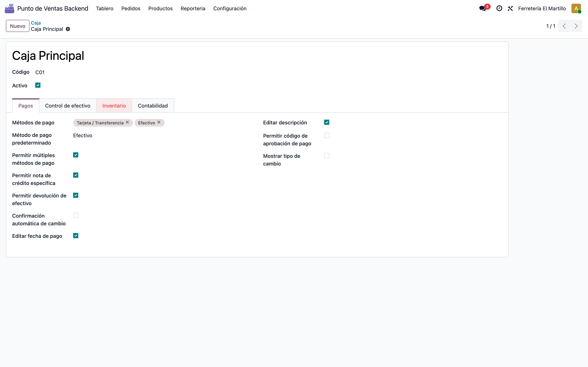
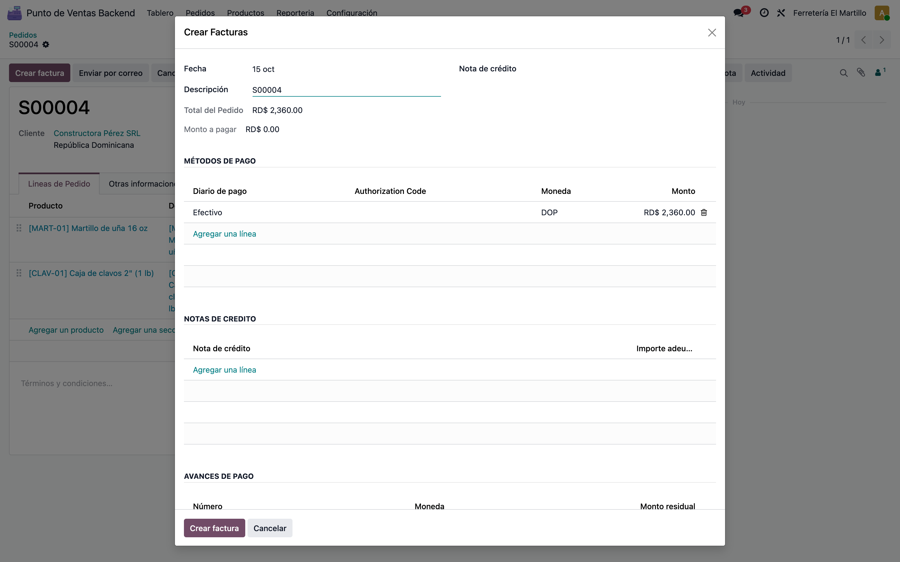
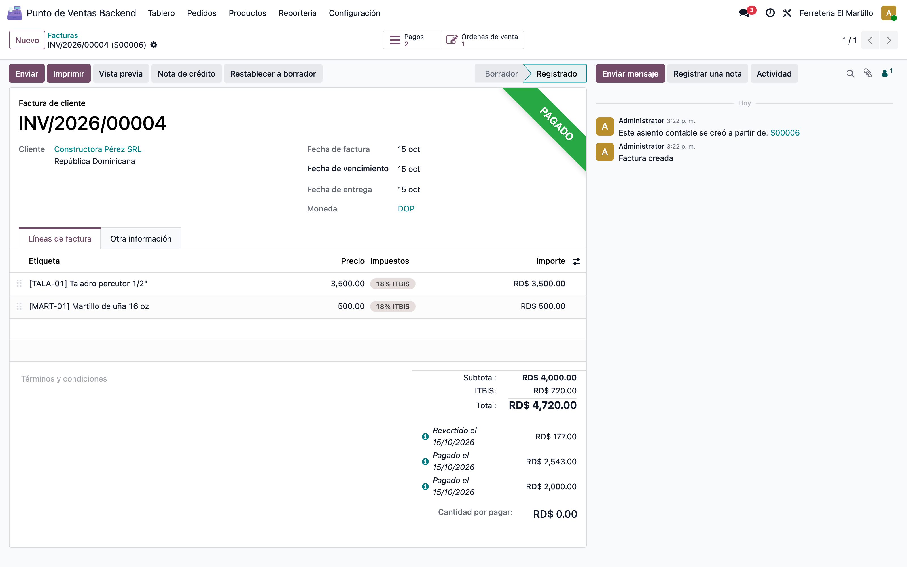

# Punto de Ventas Backend — Pagos con varios métodos — Manual de usuario

> Manual generado con `tools/manual-generator`: `node capture.mjs --config=/Users/luisfernandez/repos/dev_env_odoo_pro-19/tools/manual-generator/configs/sale_pos_backend_multi_journal_payment.json --db=test_v19_sale_pos_backend_multi_journal_payment`. Las capturas se regeneran corriendo ese comando contra la base de pruebas.

**Punto de Ventas Backend — Pagos con varios métodos** (`sale_pos_backend_multi_journal_payment`) permite cobrar un pedido de caja con **varios métodos de pago a la vez** (efectivo + tarjeta, RD$ + US$…) en el mismo asistente *Crear factura*. Usa el registro de pagos múltiples de `account_multi_journal_payment`: una línea por método, y un pago por línea, todos ligados a la sesión de la caja.

Además agrega la opción **Nota de crédito específica**: en lugar de elegir de la lista de notas de crédito del cliente, el cajero escribe el número de la nota que el cliente trae y se aplica como pago.

**Base de datos de las capturas:** Base de pruebas `test_v19_sale_pos_backend_multi_journal_payment`: la siembra del manual de `sale_pos_backend` (Ferretería El Martillo, Caja Principal con sesión abierta y una nota de crédito RINV de RD$ 177.00) con la Caja Principal en **pagos múltiples** y **nota de crédito específica**. Un pedido de RD$ 4,720.00 se cobró con la nota de crédito, RD$ 2,000.00 en efectivo y RD$ 2,543.00 con tarjeta.

## Requisitos previos

- Odoo 19 con `sale_pos_backend_multi_journal_payment` (instala `sale_pos_backend`, `account_multi_journal_payment` y `account_multi_journal_payment_authorization_code`).
- `account_multi_journal_payment` con la corrección `ref` → `memo` (PR aparte): sin ella el cobro con varios métodos falla al crear los pagos.
- La caja con **Permitir múltiples métodos de pago** activo.

## 1. Activar los pagos múltiples en la caja

En la pestaña de pagos de la caja, bajo el método por defecto, aparecen **Permitir múltiples métodos de pago** y, con ese activo, **Permitir nota de crédito específica**. La nota específica exige pagos múltiples.

## 2. Cobrar con varios métodos

*Crear factura* en un pedido de caja muestra la tabla **Métodos de pago** en lugar del método único. Arranca con una línea en el método por defecto por el total; se edita el monto y se agregan líneas con otros diarios (efectivo, tarjeta, transferencia), cada una con su moneda. **Monto a pagar** dice cuánto falta; si se pasa, cambia a **Monto a devolver**.

Debajo están las **notas de crédito** del cliente y los **anticipos**; con *nota de crédito específica* activa, el campo **Nota de crédito** recibe el número de la nota (por ejemplo *RINV/2026/00001*) y la agrega.

Al crear la factura se registra un pago por línea, todos ligados a la sesión.

## 3. La factura pagada con tres medios

El pedido de RD$ 4,720.00 quedó pagado con la nota de crédito de RD$ 177.00, RD$ 2,000.00 en efectivo y RD$ 2,543.00 con tarjeta: tres conciliaciones en la factura, y los dos pagos aparecen en el botón *Pagos* de la sesión.

## 4. Notas de la migración a 19.0

- Se eliminó el script de 17.0 que fusionaba `sale_pos_backend_multi_journal_payment_authorization_code`, `sale_pos_backend_specific_credit_note` y `sale_pos_features_multi_journal_payment_cash_back`: esos módulos no existen en 19.
- La línea de pago (`account.payment.journal`) ya no tiene `payment_id`; se quitó de la vista.
- **Dependencia corregida aparte**: `account_multi_journal_payment` creaba los pagos con `ref`, que en 19 se llama `memo`; el cobro con varios métodos fallaba con *Invalid field 'ref' in 'account.payment'* en cualquier factura, no sólo en la caja.

## Notas

**Si el asistente muestra un solo método:** la caja no tiene *Permitir múltiples métodos de pago*.

**Si al crear la factura sale *Invalid field 'ref' in 'account.payment'*:** falta la corrección de `account_multi_journal_payment`.
