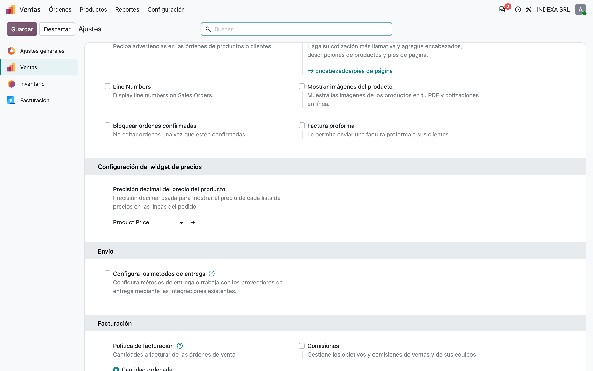
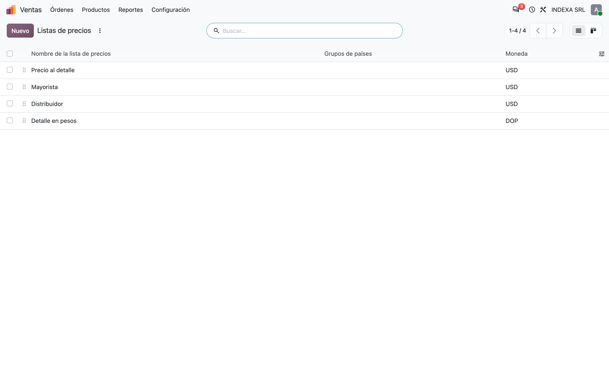
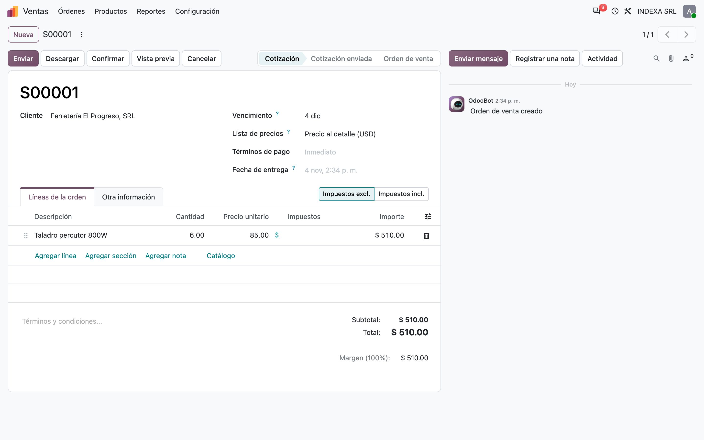
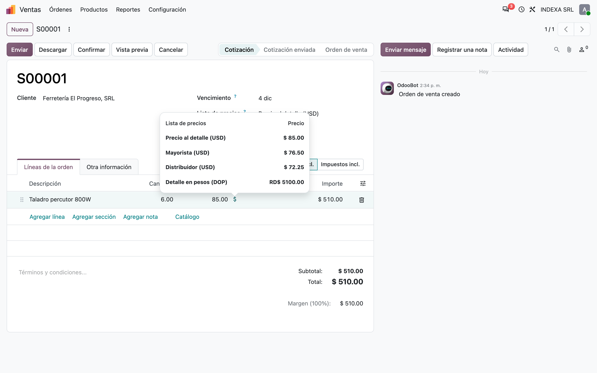
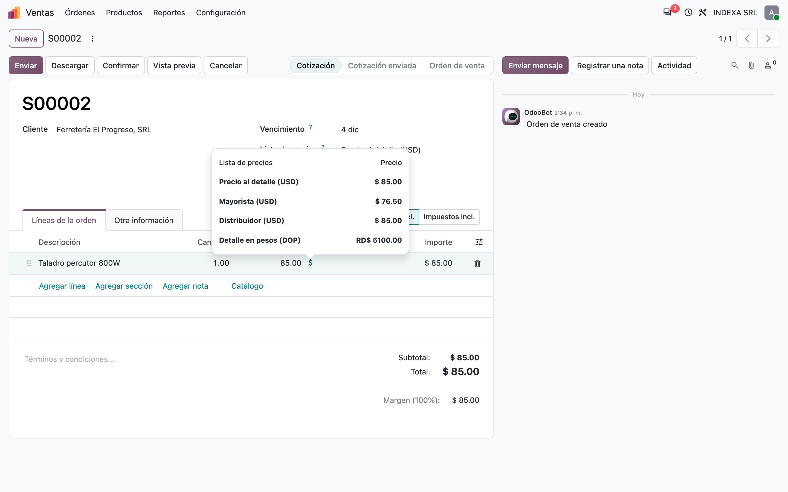

# Precio por lista de precios en la línea de venta — Manual de usuario (sale_stock_product_price_widget)

> Manual generado con `tools/manual-generator`. Las capturas se regeneran ejecutando el generador contra una base `test_v20_<módulo>`.

En Odoo estándar la línea de un pedido de venta muestra solo el precio de la lista de precios del pedido. Para saber cuánto costaría el mismo producto con otra lista (mayorista, distribuidor, en otra moneda) hay que cambiar la lista del pedido o abrir cada lista por separado.

Este módulo agrega un icono **$** junto a la columna *Precio unitario* de cada línea. Al pulsarlo se abre una ventana con el precio del producto **en todas las listas de precios de la compañía**, calculado con la cantidad, la unidad de medida, la fecha y el cliente de esa línea.

## Requisitos previos

- Módulo **`sale_stock_product_price_widget`** instalado (versión `20.0.1.0.0`, línea 20.0). Depende de **`sale_stock`**.
- La opción **Listas de precios** encendida en *Ventas › Configuración › Ajustes*.
- Una **precisión decimal** elegida en el bloque *Configuración del widget de precios* (paso 1). Sin ella, el icono muestra el aviso *No se encontró la precisión decimal. Revise la configuración.*

## 1. Elegir la precisión decimal

En *Ventas › Configuración › Ajustes*, debajo de *Cotizaciones y pedidos*, aparece el bloque **Configuración del widget de precios** con el campo **Precisión decimal del precio del producto**.

Se elige un registro de precisión decimal (en el ejemplo, *Product Price*). Los precios de la ventana se redondean y se muestran con esa cantidad de decimales.

## 2. Las listas de precios de la compañía

La ventana del icono **$** muestra una fila por cada lista de precios activa que pertenece a la compañía del pedido o que no tiene compañía.

En el ejemplo hay cuatro listas:

| Lista | Regla |
|---|---|
| **Precio al detalle** | precio de venta del producto, en USD |
| **Mayorista** | 10 % de descuento |
| **Distribuidor** | 15 % de descuento a partir de 5 unidades |
| **Detalle en pesos** | precio de venta convertido a RD$ |

## 3. El icono $ en la línea del pedido

En el pedido de venta, cada línea muestra el icono **$** justo después de la columna *Precio unitario*.

En el ejemplo, la línea vende **6** unidades de *Taladro percutor 800W* (precio de venta US$ 85.00) con la lista *Precio al detalle*.

## 4. El precio en cada lista

Al pulsar el icono **$** se abre la ventana con dos columnas, **Lista de precios** y **Precio**. Cada fila muestra el nombre de la lista con su moneda y el precio unitario con el símbolo en la posición de esa moneda.

Con 6 unidades se cumple el mínimo de la lista *Distribuidor*, así que aparece su descuento del 15 %:

| Lista | Precio |
|---|---|
| Precio al detalle (USD) | $ 85.00 |
| Mayorista (USD) | $ 76.50 |
| Distribuidor (USD) | $ 72.25 |
| Detalle en pesos (DOP) | RD$ 5100.00 |

La ventana se cierra al hacer clic fuera de ella.

## 5. El precio depende de la cantidad de la línea

Los precios se calculan con la cantidad de la línea. En un pedido de **1** unidad, la lista *Distribuidor* no aplica su descuento (pide 5 unidades) y muestra el precio de venta sin descuento.

## Notas

**Alcance y límites**

- El precio que se muestra es el **precio unitario** que tendría la línea con esa lista, **antes de impuestos**. Si el producto tiene un impuesto incluido en el precio y el pedido tiene una posición fiscal que lo cambia, el precio se ajusta igual que en la línea.
- Si la línea todavía no está guardada, al pulsar el icono se guarda primero el pedido.
- Los precios se muestran sin separador de miles (p. ej. `RD$ 5100.00`).
- Se listan todas las listas activas de la compañía del pedido y las que no tienen compañía, aunque el cliente no tenga acceso a ellas.

**Notas de la migración a 20.0**

- `pricelist._get_product_price_rule()` ahora devuelve solo la regla; el precio se obtiene con `_get_product_price()`.
- `ir.config_parameter.get_param()` se reemplazó por `get_int()`.
- El campo de la línea `product_uom` es `product_uom_id` (ya en 19.0).
- El widget se reescribió para Owl 3 y usa el icono `attach_money` de Odoo UI Icons, porque Font Awesome ya no se carga.
