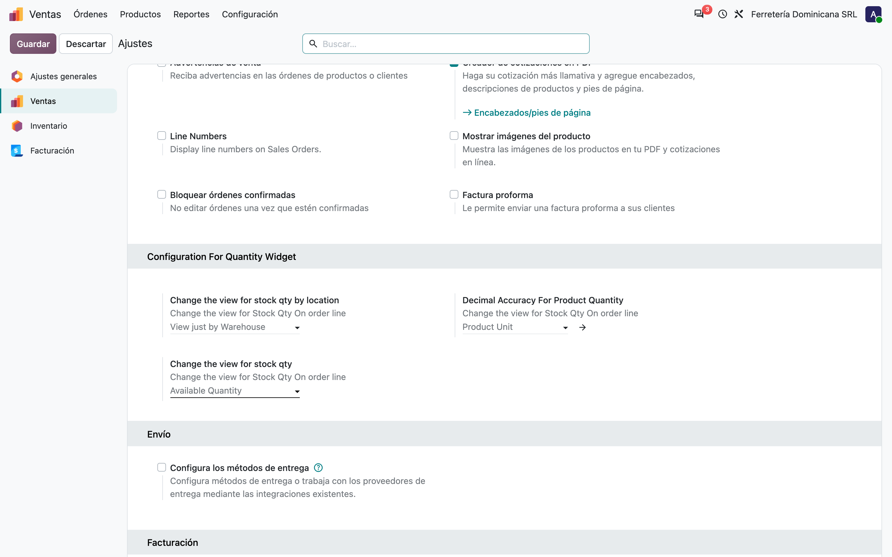
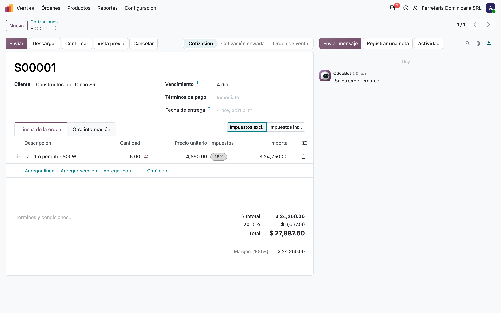
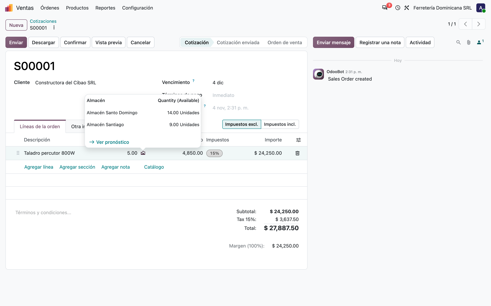
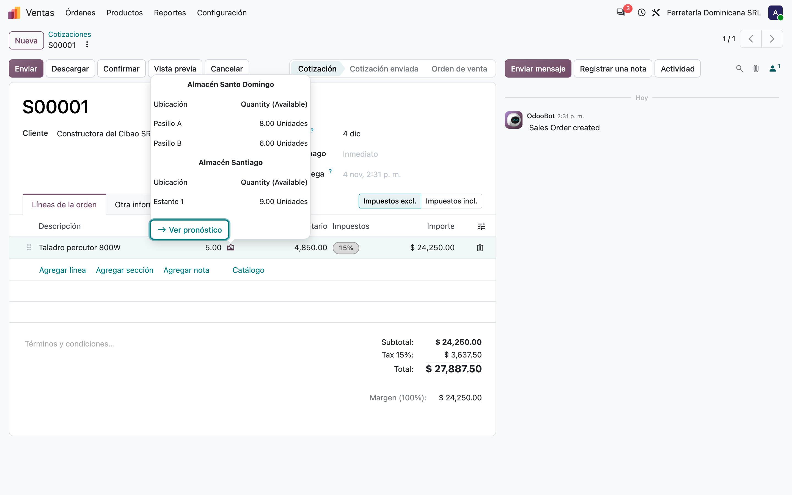
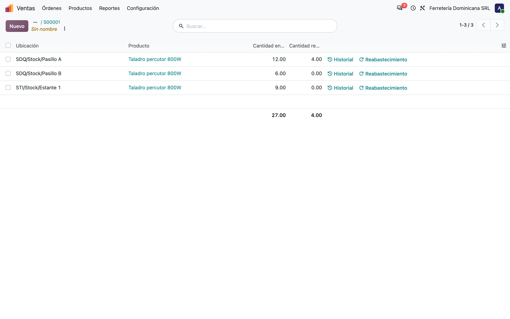

# Existencias por almacén en la línea de venta — Manual de usuario (sale_stock_qty_date_widgets)

> Manual generado con `tools/manual-generator`. Las capturas se regeneran ejecutando el generador contra una base `test_v20_<módulo>`.

En una cotización, Odoo muestra junto a cada línea un ícono de gráfico. Al pulsarlo, Odoo core solo dice cuánto hay **pronosticado y disponible en el almacén de la orden**: un único número, sin saber dónde está la mercancía.

Este módulo reemplaza ese ícono en la lista de líneas por uno que abre la **existencia del producto en cada almacén de la compañía**, y si se quiere, **desglosada por ubicación** (pasillo, estante). Así el vendedor sabe en el momento si puede despachar desde otro almacén antes de prometer una fecha.

Tres ajustes controlan lo que se ve: el detalle (solo almacén, o almacén y ubicación), el tipo de cantidad (a mano o disponible) y los decimales.

## Requisitos previos

- Módulo **`sale_stock_qty_date_widgets`** instalado (v `20.0.1.0.0`). Única dependencia: **`sale_stock`**. Este manual además instala la aplicación *Ventas* (`sale_management`) para tener el menú de ajustes de ventas.
- Productos almacenables con existencias en ubicaciones **internas**. Las cantidades en ubicaciones de tránsito, clientes o proveedores no se cuentan.
- Para ver varios almacenes y ubicaciones en *Inventario* el usuario necesita los grupos *Varios almacenes* y *Ubicaciones de almacenamiento*; el ícono de la línea de venta funciona sin ellos.

## 1. Configurar el ícono de existencias

En *Ventas › Configuración › Ajustes*, debajo de **Cotizaciones y órdenes**, el módulo agrega el bloque **Configuration For Quantity Widget** con tres opciones:

- **Change the view for stock qty by location**: *View just by Warehouse* muestra un total por almacén; *View by Warehouse and Location* agrega el detalle por ubicación.
- **Decimal Accuracy For Product Quantity**: la precisión decimal con la que se muestran las cantidades (por defecto, 2 decimales).
- **Change the view for stock qty**: *On Hand Quantity* (todo lo que hay físicamente) o *Available Quantity* (lo que hay menos lo ya reservado para otras entregas).

Los textos del bloque se ven en inglés porque el módulo no trae traducción al español.

## 2. La cotización y su ícono

En la lista de productos de una cotización, cada línea de producto almacenable tiene el ícono de gráfico a la derecha. Es el mismo lugar donde Odoo core pone el suyo; el módulo lo sustituye solo en la **lista de líneas**.

En el ejemplo, la cotización pide 5 *Taladro percutor 800W* para el *Almacén Santo Domingo*.

## 3. Existencia por almacén

Al pulsar el ícono se abre la ventana con **la cantidad disponible en cada almacén**. En el ejemplo: 14 unidades en *Almacén Santo Domingo* (18 a mano menos 4 reservadas) y 9 en *Almacén Santiago*.

La ventana funciona también en líneas que aún no se han guardado: toma el producto, la compañía y la unidad de medida de la línea tal como está en pantalla.

## 4. Existencia por almacén y ubicación

Con **View by Warehouse and Location**, la misma ventana agrupa por almacén y lista cada ubicación interna que tiene el producto: *Pasillo A* y *Pasillo B* en Santo Domingo, *Estante 1* en Santiago.

Con *Available Quantity*, Pasillo A muestra 8 unidades y no 12, porque 4 ya están reservadas.

## 5. Ver el detalle en Inventario

El enlace **View Forecast** al pie de la ventana abre las existencias del producto (*Inventario › Existencias*) filtradas a ese producto, con el filtro *A mano* puesto. Ahí se ve cada ubicación con su cantidad a mano y reservada, y se puede seguir hacia el inventario o los movimientos.

## Notas

- El ícono reemplaza al de Odoo **solo en la lista de líneas** de la orden. En el formulario de línea (vista móvil) sigue el ícono de Odoo core con el pronóstico del almacén de la orden.
- Se cuentan solo las ubicaciones **internas** con cantidad positiva y de la **misma compañía** que la orden.
- Los ajustes son globales para la base de datos, no por compañía ni por usuario.
- *Available Quantity* resta lo reservado para otras entregas, pero no las cantidades de cotizaciones sin confirmar.
- Si se borra la precisión decimal elegida en los ajustes, las cantidades vuelven a mostrarse con 2 decimales.
