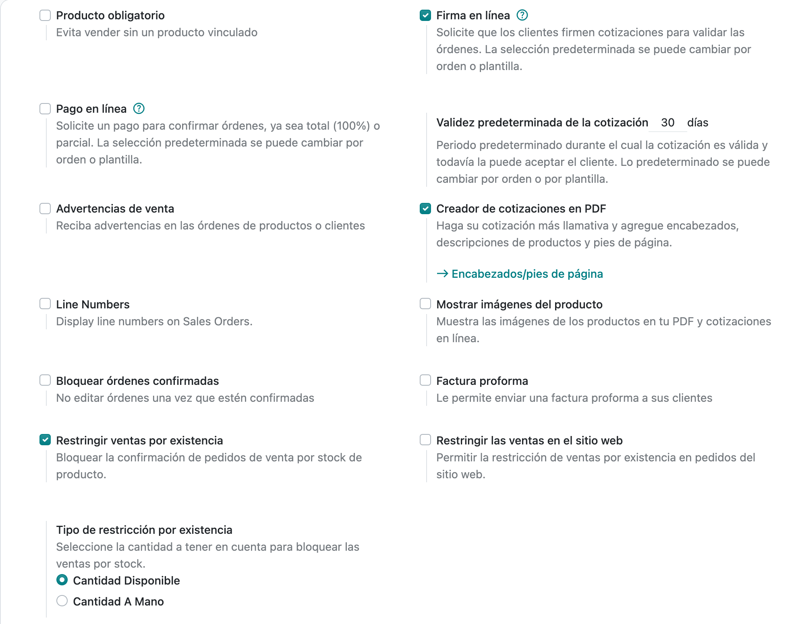
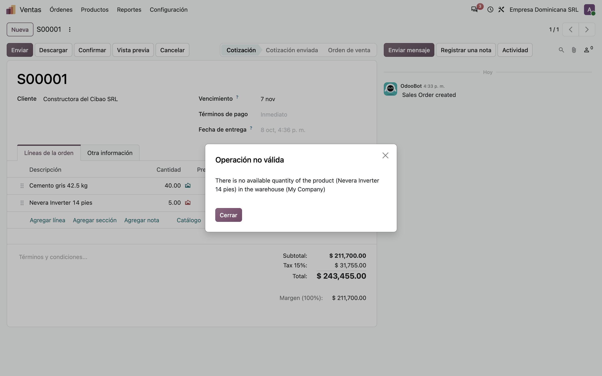
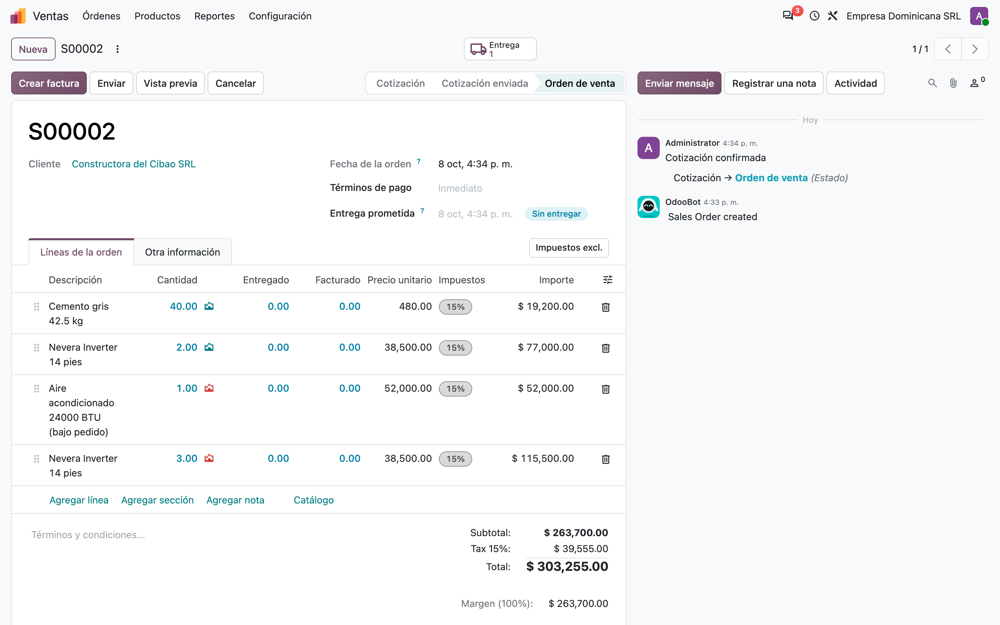
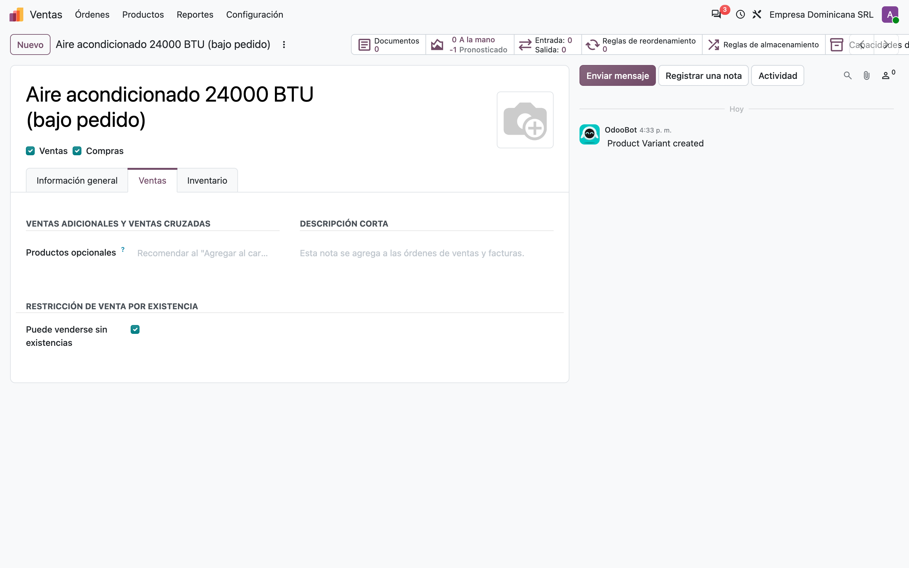
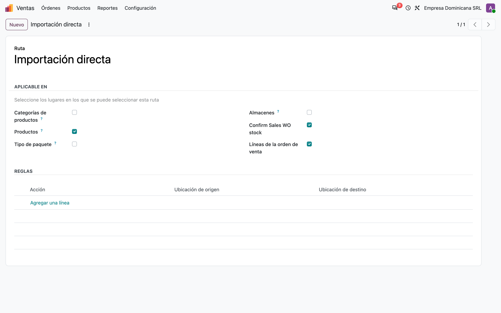
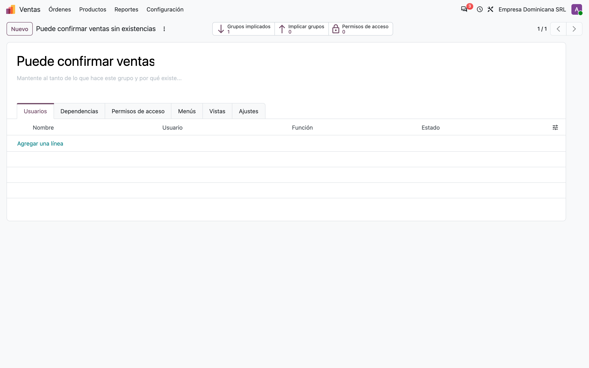

# Restricción de ventas por existencia — Manual de usuario (sale_stock_restriction, Odoo 20.0)

> Manual generado con `tools/manual-generator`. Las capturas se regeneran ejecutando el generador contra una base `test_v20_<módulo>`.

Este módulo **impide confirmar una orden de venta** cuando no hay existencias suficientes de los productos almacenables que contiene. La verificación se hace al pulsar **Confirmar**, línea por línea, en la ubicación de existencias del almacén de la orden (o en la ubicación de origen de la ruta elegida en la línea).

Odoo 20.0 no ofrece este bloqueo en el backend: *Ventas* solo muestra un aviso de disponibilidad junto a la línea y permite confirmar igualmente, por eso el módulo se porta.

**Excepciones al bloqueo:**

- Productos marcados como **Puede venderse sin existencias**.
- Líneas cuya ruta tiene **Confirmar ventas sin existencia**.
- Usuarios del grupo **Puede confirmar ventas sin existencias**.
- Productos de servicio o consumibles sin seguimiento de inventario.

## Requisitos previos

- Módulo **`sale_stock_restriction`** `20.0.1.0.0` instalado. Depende de **`sale_stock`** y **`sale_management`** (aplicación Ventas).
- Productos almacenables (**Seguimiento de inventario** activado) con existencias reales (recepción validada o ajuste de inventario).
- Para el ajuste de rutas: Inventario con **Rutas multipaso** activado.

## 1. Activar la restricción

**Ventas → Configuración → Ajustes**, bloque *Cotizaciones y órdenes* (al final del bloque):

- **Restringir ventas por existencia**: activa el bloqueo para la compañía.
- **Tipo de restricción por existencia**: *Cantidad disponible* (existencia libre, descontando lo ya reservado y lo comprometido) o *Cantidad a mano* (todo lo que hay físicamente en la ubicación).
- **Restringir las ventas en el sitio web**: si está apagado, las órdenes que llegan del sitio web se confirman sin verificar existencias.

## 2. Confirmar una orden sin existencias suficientes

La orden pide 5 *Nevera Inverter 14 pies*, pero el almacén solo tiene 2. Al pulsar **Confirmar**, Odoo muestra el error y la orden sigue como cotización.

## 3. Orden confirmada

Esta orden sí se confirma:

- *Cemento* y las 2 *Neveras* de la segunda línea tienen existencias.
- El *Aire acondicionado (bajo pedido)* está marcado como **Puede venderse sin existencias**.
- Las 3 *Neveras* restantes usan la ruta **Importación directa**, marcada como **Confirmar ventas sin existencia** (la ruta se elige en la columna opcional *Rutas* de la línea).

Las cantidades de líneas con el mismo producto y la misma ubicación se suman antes de comparar con la existencia.

## 4. Producto que se vende sin existencias

En la ficha de la variante de producto, pestaña **Ventas**, sección *Restricción de venta por existencia*, marque **Puede venderse sin existencias** para que el producto nunca bloquee una confirmación.

## 5. Ruta que permite confirmar sin existencias

**Inventario → Configuración → Rutas**: en la ruta marque **Confirmar ventas sin existencia** (en pantalla aparece aún como *Confirm Sales WO stock*). La ruta debe poder seleccionarse en **Líneas de órdenes de venta** para elegirla en la orden.

Si la línea usa una ruta *sin* esta marca, la existencia se verifica en la **ubicación de origen** de la última regla de la ruta, no en la del almacén.

## 6. Usuarios que pueden confirmar sin existencias

El grupo **Puede confirmar ventas sin existencias** omite la verificación para sus usuarios. Al instalar el módulo se agrega el administrador; en este manual se le quitó para mostrar el bloqueo. Agregue o quite usuarios en la pestaña *Usuarios* del grupo (**Ajustes → Usuarios y compañías → Grupos**, modo desarrollador).

## Notas

- La verificación usa la existencia del almacén **de la orden** (incluidas sus sububicaciones), no la de todos los almacenes.
- Las órdenes que vienen de **Reparaciones** se confirman sin verificar existencias.
- El mensaje de error y la etiqueta *Confirm Sales WO stock* de la ruta se muestran en inglés: el archivo de traducción del módulo tiene esas entradas desactualizadas (pendiente aparte del port).
- **Restringir las ventas en el sitio web** solo decide si las órdenes del sitio web se verifican al confirmarse; en 20.0 no limita la cantidad que el cliente agrega al carrito (eso lo hace la opción de Odoo *Continuar vendiendo* / *Vender sin existencias* del producto).
