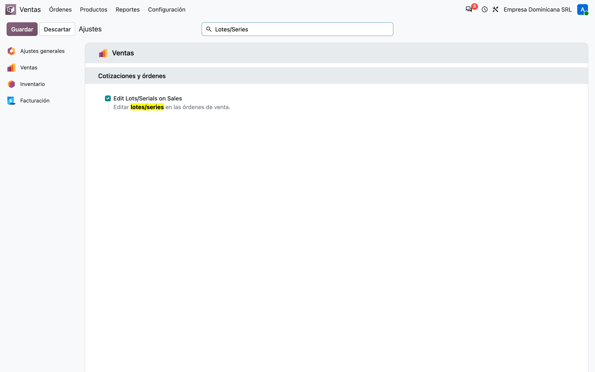
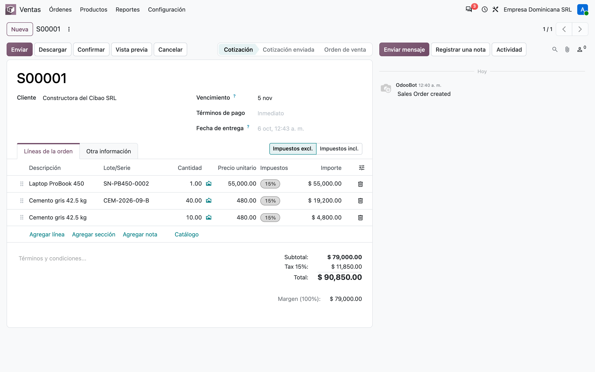
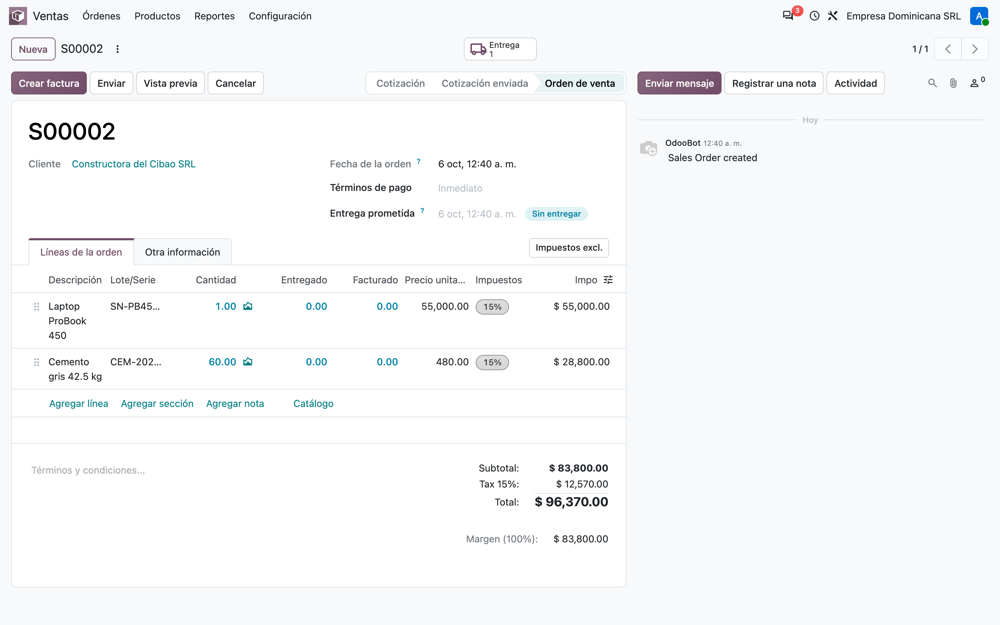
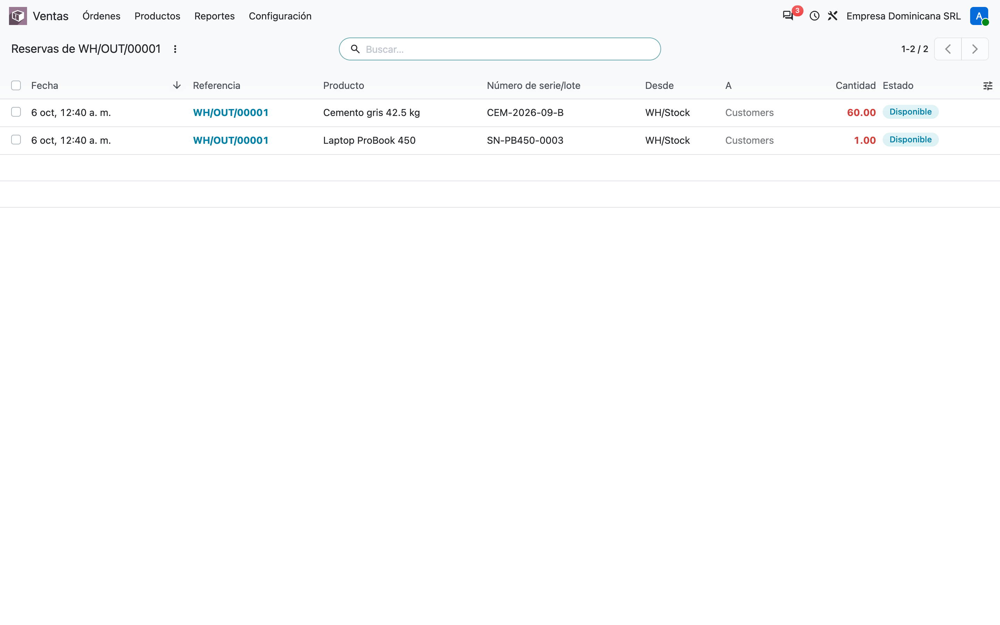

# Lotes y series en ventas — Manual de usuario (sale_stock_serial, Odoo 20.0)

> Manual generado con `tools/manual-generator`. Las capturas se regeneran ejecutando el generador contra una base `test_v20_<módulo>`.

Este módulo permite elegir el **lote** o **número de serie** directamente en cada línea de la orden de venta. Al confirmar la orden, la entrega **reserva exactamente ese lote/serie** en lugar del que elegiría la estrategia de salida (FIFO, FEFO…).

Odoo 20.0 no ofrece esta selección en ventas (solo Alquiler y Servicio de campo tienen campos de lote, para sus propios flujos), por eso el módulo se porta.

**Qué cambió en 20.0:**

- La columna **Lote/Serie** aparece justo después de *Producto/Descripción*, que en 20.0 es una columna agrupada.
- En 20.0 un producto **sin seguimiento** ya no tiene el valor *Ninguno*: la columna queda bloqueada para cualquier producto que no se rastree por lotes o series.
- Los permisos pasan al nuevo modelo de accesos de 20.0 (`ir.access`); el grupo *Ventas: Seleccionar Lotes/Series en Órdenes* sigue dando lectura de lotes a vendedores sin acceso a Inventario.

## Requisitos previos

- Módulo **`sale_stock_serial`** `20.0.2.0.0` instalado. Depende de **`sale_stock`**.
- Aplicación **Ventas** (`sale_management`) instalada: sin ella Odoo no muestra la sección *Ventas* en Ajustes.
- Inventario con **Lotes y números de serie** activado (grupo *Gestionar lotes / números de serie*).
- Productos almacenables con seguimiento **Por lotes** o **Por número de serie único**, con existencias reales (recepción validada o ajuste de inventario).
- Vendedores sin acceso a Inventario: asignarles el grupo **Ventas: Seleccionar Lotes/Series en Órdenes**.

## 1. Activar la edición de lotes en ventas

**Ventas → Configuración → Ajustes**, bloque *Cotizaciones y órdenes*: marque **Editar Lotes/Series en Ventas** (en la captura se filtró con la búsqueda de ajustes). El ajuste es por compañía; mientras esté apagado la columna Lote/Serie se muestra pero no se puede editar.

## 2. Elegir el lote o serie en la orden

En la orden de venta, la columna **Lote/Serie** está junto a la descripción del producto:

- Para productos **por número de serie**, la cantidad queda bloqueada en 1: cada serie es una línea.
- Para productos **por lotes**, elija el lote del que debe salir la mercancía.
- Si deja el lote vacío (tercera línea), Odoo reserva como siempre, según la estrategia de salida.
- Para productos sin seguimiento la columna no es editable.

## 3. Confirmar la orden

Al **Confirmar**, Odoo crea la entrega. El lote/serie elegido queda guardado en la línea de la orden.

## 4. La entrega reserva el lote elegido

Al **Comprobar disponibilidad** de la entrega, la reserva toma el lote/serie de la línea de venta (aquí **SN-PB450-0003** y **CEM-2026-09-B**), aunque existan otros lotes con existencias.

## Notas

- El lote debe tener **existencias reales** en la ubicación de la entrega; si no las tiene, la entrega queda en espera.
- El ajuste *Editar Lotes/Series en Ventas* se toma de la compañía de la orden al elegir el producto.
