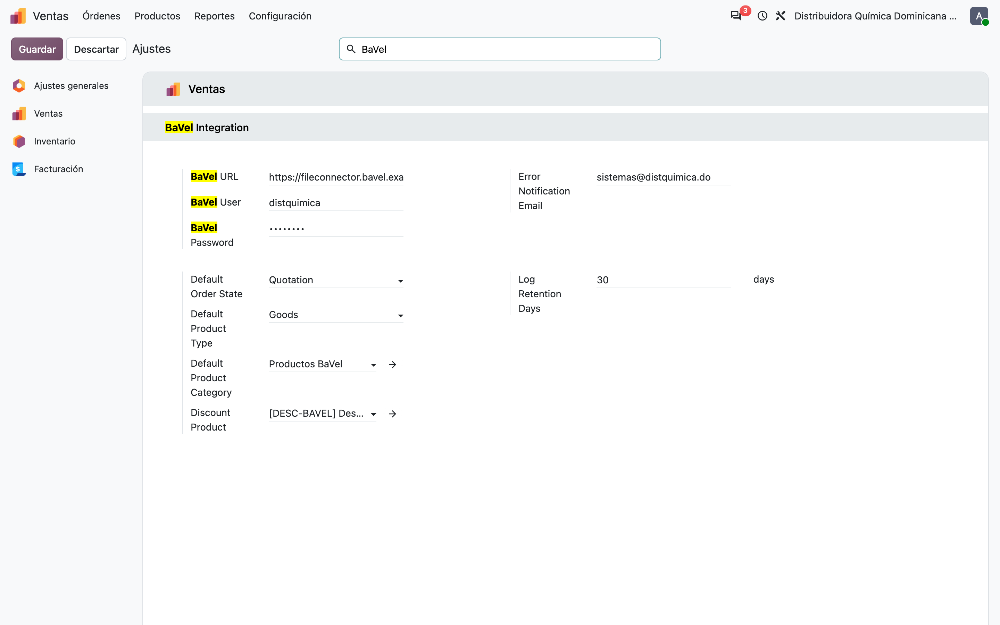
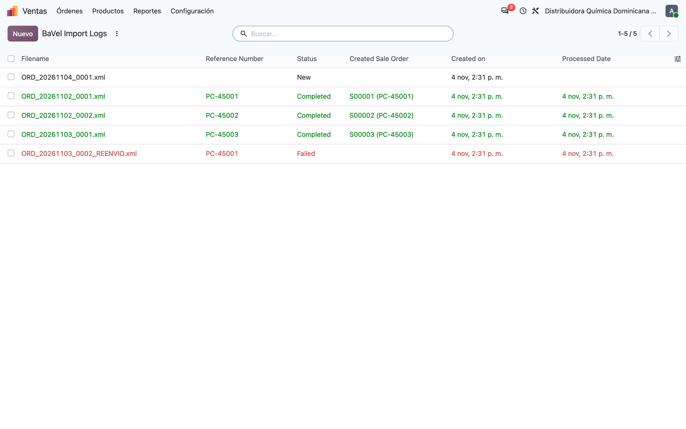
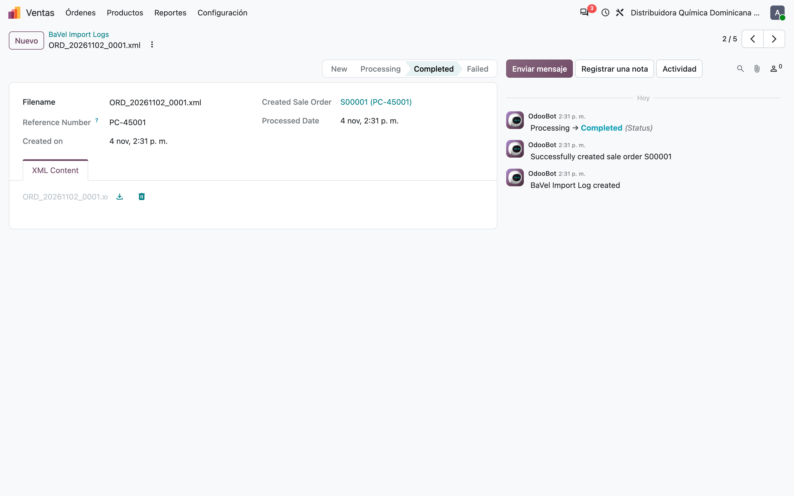
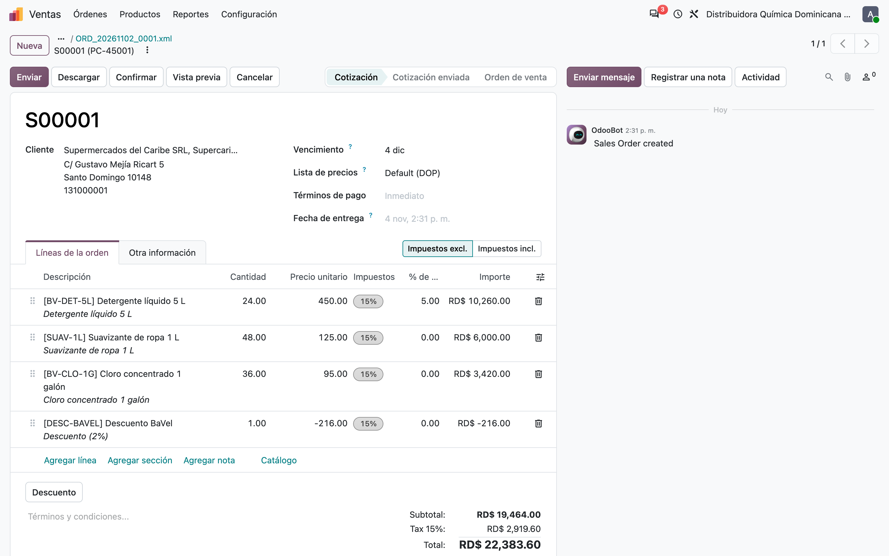
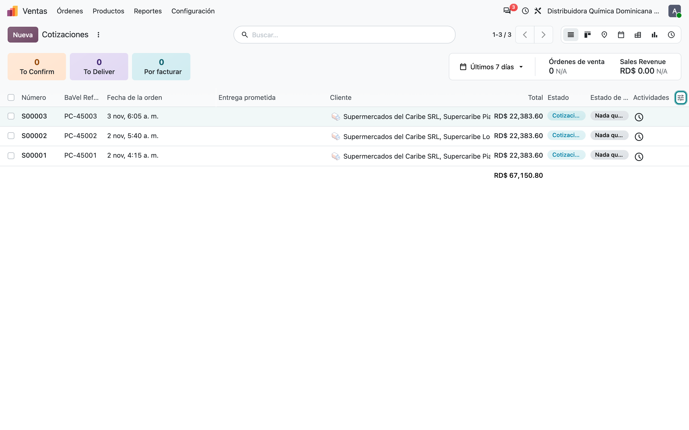
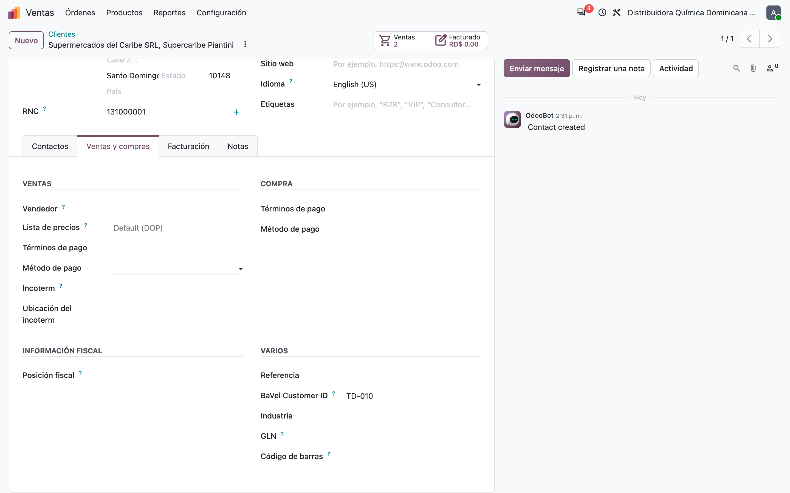
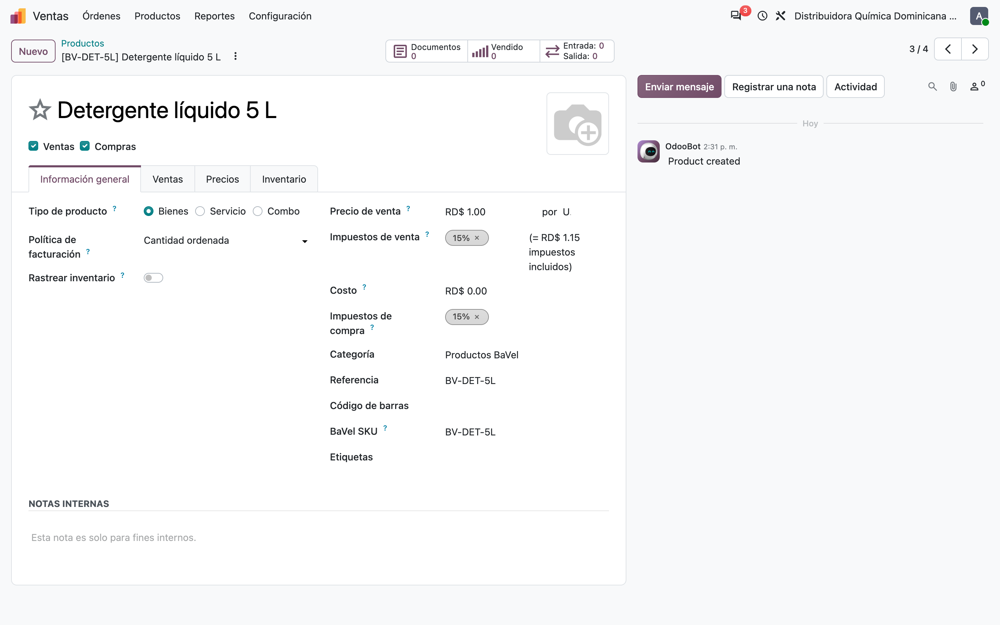
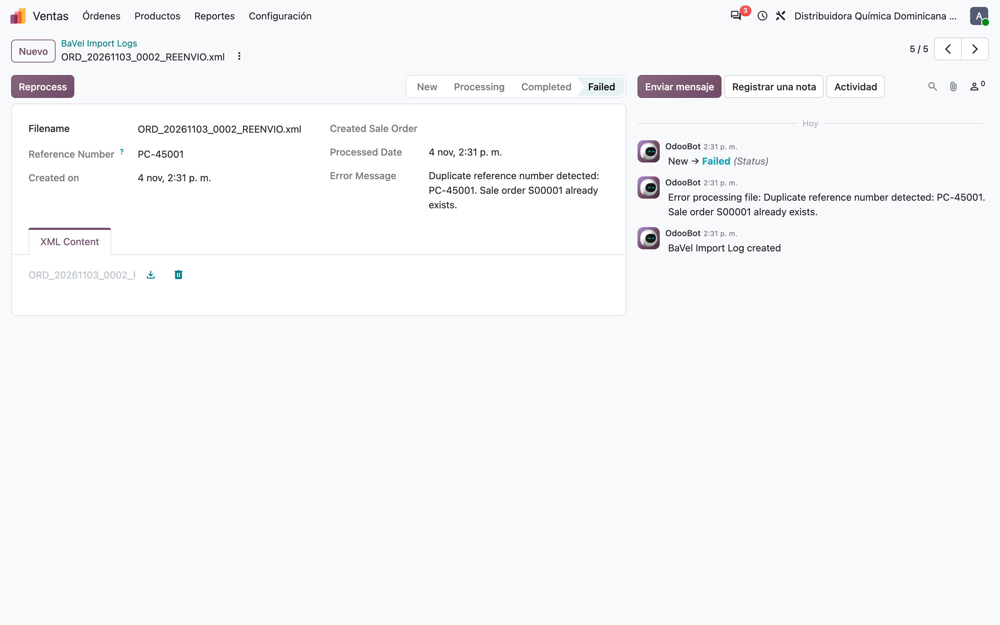

# Integración de ventas con baVel — Manual de usuario (sales_bavel, Odoo 20.0)

> Manual generado con `tools/manual-generator`. Las capturas se regeneran ejecutando el generador contra una base `test_v20_<módulo>`.

Este módulo conecta Odoo con el **Fileconnector de baVel**, la plataforma de intercambio electrónico de pedidos. Cada pocos minutos Odoo descarga los archivos XML de pedidos que los clientes envían por baVel, crea el cliente, la dirección de entrega y los productos que no existan, y genera la **cotización** (o el pedido confirmado) con sus precios y descuentos. Cada archivo queda registrado en **Importaciones BaVel** con su estado, para revisar y reprocesar los que fallen.

Ni Odoo 20.0 ni Enterprise traen un conector con baVel, por eso el módulo se porta.

**Qué cambió en 20.0:**

- El CIF/RNC que llega en el XML se guarda tal cual, sin la validación de formato que Odoo 20.0 aplica ahora a todos los contactos (antes solo con *base_vat*). Así un CIF de otro país no detiene el pedido.
- La dirección de cada tienda se crea como contacto de tipo **Dirección de entrega**, y los pedidos siguientes de la misma tienda la reutilizan en lugar de crear otra.
- El tipo de producto por defecto ofrece *Bienes* y *Servicio* (Odoo ya no tiene *Almacenable* como tipo).
- La acción **Unir contactos duplicados** está disponible en el menú de Ventas para limpiar los duplicados creados por versiones anteriores.

## Requisitos previos

- Módulo **`sales_bavel`** `20.0.2.0.0` instalado. Depende de **`sale_management`**, **`account`**, **`stock`** y **`mail`**.
- Usuario, contraseña y URL del **Fileconnector de baVel** de la empresa.
- Pertenecer al grupo **BaVel Integration User** (Ventas) para ver el menú, los registros de importación y los campos BaVel. El administrador lo tiene por defecto.
- Las acciones planificadas *BaVel: Download Files*, *BaVel: Process Files* y *BaVel: Cleanup Old Logs* activas (se crean activas al instalar).

## 1. Configurar la conexión con baVel

**Ventas → Configuración → Ajustes**, sección **BaVel**:

- **URL**, **usuario** y **contraseña** del Fileconnector.
- **Correo de notificación de errores**: recibe un aviso cuando un archivo no se puede descargar o procesar.
- **Estado del pedido por defecto**: *Cotización* deja el pedido en borrador; *Pedido de venta* lo confirma al importarlo.
- **Tipo y categoría por defecto** para los productos nuevos que lleguen en el XML.
- **Producto de descuento**: se usa en la línea de descuento global del pedido.
- **Días de retención**: los registros completados más antiguos se borran solos.

## 2. Revisar las importaciones

**Ventas → Órdenes → BaVel Imports** lista cada archivo descargado: nombre, **referencia** del pedido de compra del cliente, **estado** y el pedido de venta creado. En verde los completados y en rojo los fallidos; *Nuevo* indica un archivo descargado que se procesará en la siguiente ejecución (cada 5 minutos).

## 3. Una importación completada

Al abrir un registro completado se ven el archivo, la referencia, la fecha de proceso y el **pedido de venta creado**. El chatter guarda el mensaje *Successfully created sale order* y la pestaña **XML Content** permite descargar el archivo original.

## 4. El pedido generado

La cotización queda a nombre de la **dirección de entrega** de la tienda (contacto hijo del cliente) con la **referencia del cliente** y la **Referencia BaVel** del XML. Cada producto trae su cantidad, precio y el **descuento del proveedor** (`DESC PROVEEDOR`); el descuento por grupo de artículos (`DescNoDevGpoArticulo`) se suma en una línea con el producto de descuento configurado.

## 5. Cotizaciones con referencia BaVel

En **Ventas → Órdenes → Cotizaciones** (sin el filtro *Mis cotizaciones*: los pedidos importados quedan sin vendedor) active la columna opcional **BaVel Reference** desde el selector de columnas (icono a la derecha de los encabezados) para identificar los pedidos que llegaron por baVel. Los dos pedidos de *Supercaribe Piantini* usan el mismo contacto de entrega.

## 6. Cliente y dirección de entrega

El cliente se busca por el **CIF/RNC** del nodo `<Client>`; si no existe se crea como empresa. Cada tienda (`<Customer>`) se guarda como **Dirección de entrega** de esa empresa, con su **BaVel Customer ID**, que es la clave para reutilizarla en los pedidos siguientes. El campo está en la pestaña **Ventas y compras**, sección *Varios*.

## 7. Producto creado desde baVel

Los productos se buscan por el **BaVel SKU** (`SupplierSKU`). Si no existe, se crea con ese código como **Referencia interna**, el nombre del XML y el tipo y la categoría por defecto de los ajustes. Para enlazar un producto existente, escriba su SKU de baVel en el campo **BaVel SKU** de la ficha.

## 8. Importación fallida y reproceso

Si el archivo trae una referencia que ya generó un pedido, o le falta un dato obligatorio (CIF del cliente, `CustomerID`, `SupplierSKU`), el registro queda en **Fallido** con el **mensaje de error**, y se envía un correo al buzón de notificaciones. Corrija la causa y pulse **Reprocess**: el registro vuelve a *Nuevo* y se procesa en la siguiente ejecución.

## Notas

- En bases neutralizadas (copias de prueba) la descarga deja los archivos en baVel, para no quitárselos a producción.
- La acción **Ventas → Órdenes → Merge Duplicate Contacts** une las direcciones de entrega repetidas (mismo cliente y mismo *BaVel Customer ID*) en la más antigua, que conserva el historial.
- El cliente y los productos nuevos se guardan aunque luego falle la creación del pedido; al reprocesar se reutilizan.
- Los textos del módulo (menús, botones, estados) se muestran en inglés en algunos puntos porque su traducción al español está incompleta.
