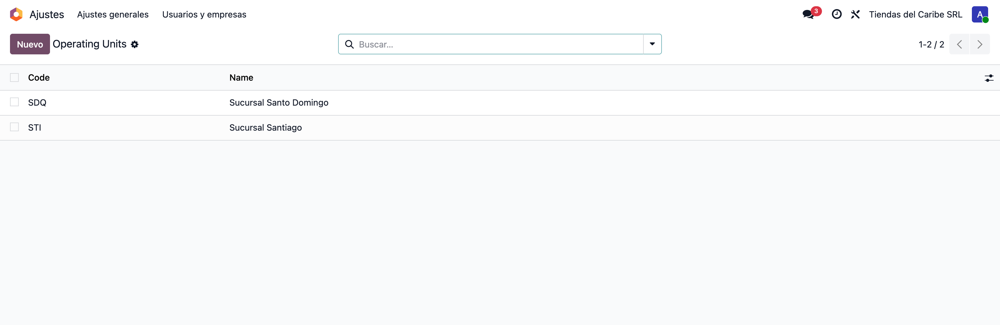
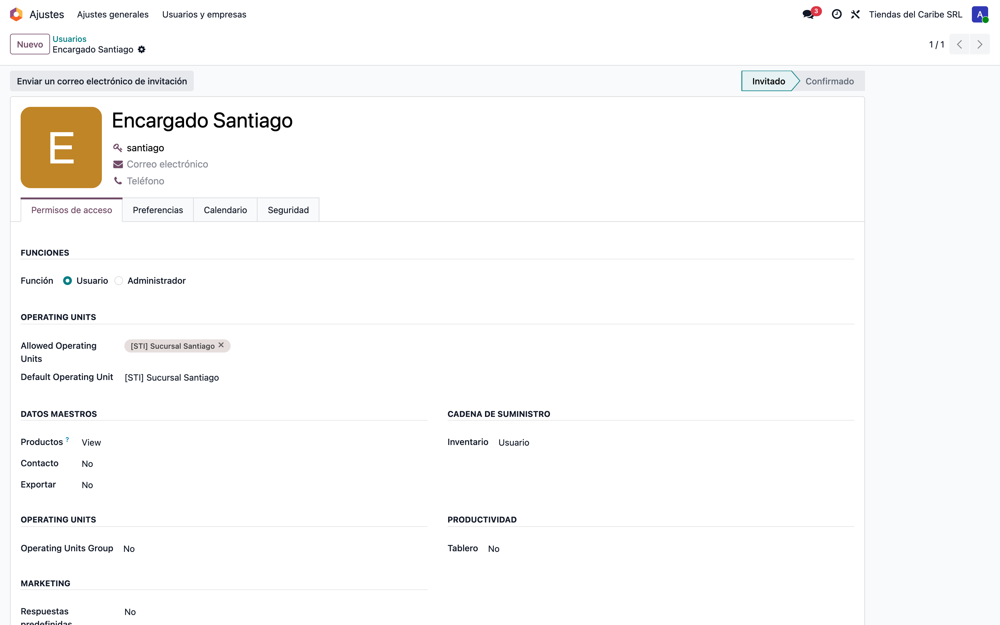
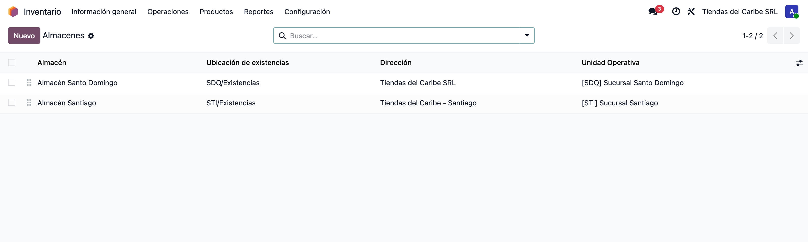
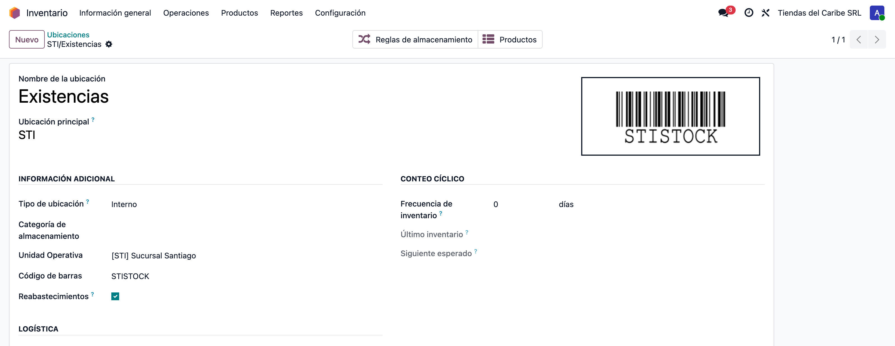
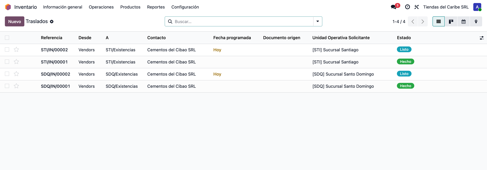
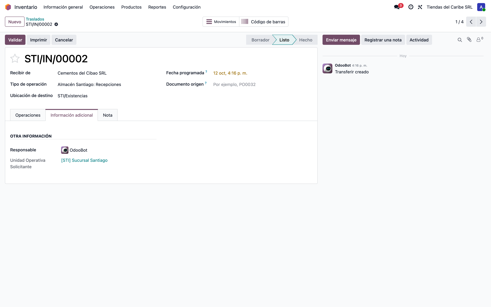
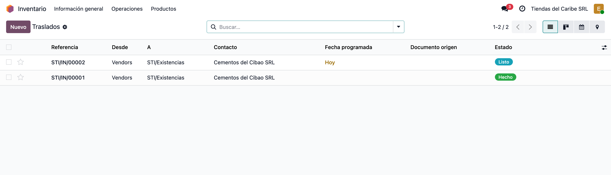
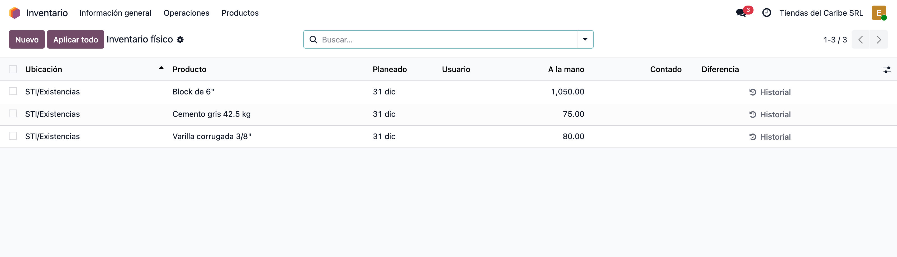

# Inventario por unidad operativa — Manual de usuario

> Manual generado con `tools/manual-generator`: `node capture.mjs --config=/Users/luisfernandez/repos/dev_env_odoo_pro-19/tools/manual-generator/configs/stock_operating_unit.json --db=test_v19_stock_operating_unit`. Las capturas se regeneran corriendo ese comando contra la base de pruebas.

Una **unidad operativa** es una parte de la empresa que trabaja por su cuenta dentro de la misma compañía: una sucursal, una tienda, una división. El módulo base `operating_unit` las crea y dice a qué unidades pertenece cada usuario.

Con **Stock with Operating Units** el inventario se separa por unidad operativa:

- Cada **almacén** y cada **ubicación interna** pertenece a una unidad operativa.
- Cada **transferencia** toma la unidad operativa del almacén de su tipo de operación.
- Cada usuario **sólo ve** los almacenes, ubicaciones, transferencias, movimientos y existencias de sus unidades operativas.

Así el encargado de una sucursal trabaja su inventario sin ver ni tocar el de las demás, aunque todas estén en la misma compañía.

**Base de datos de las capturas:** test_v19_stock_operating_unit

## Requisitos previos

- Odoo 19 con `stock` instalado.
- Módulo `operating_unit` (OCA/operating-unit 19.0).
- Módulo `stock_operating_unit` instalado (store-addons 19.0).
- Para ver y editar el campo *Unidad operativa* en almacenes, ubicaciones y transferencias, el usuario necesita el grupo **Multiple Operating Unit** o **Manager of Operating Units**.

## 1. Crear las unidades operativas

Entra a **Ajustes → Usuarios y compañías → Operating Units**. Cada unidad lleva un **nombre**, un **código** corto y un **contacto** (la dirección de la sucursal).

En el ejemplo hay dos: **Sucursal Santo Domingo** (SDQ), que es la unidad principal que trae el módulo renombrada, y **Sucursal Santiago** (STI).

Las pantallas del módulo base `operating_unit` (OCA) todavía no están traducidas al español; por eso este menú y los campos del usuario salen en inglés.

## 2. Asignar las unidades operativas al usuario

Abre el usuario en **Ajustes → Usuarios y compañías → Usuarios**. En la pestaña **Permisos de acceso**, el bloque **Operating Units** tiene dos campos:

1. **Allowed Operating Units**: las unidades cuyo inventario puede ver y operar.
2. **Default Operating Unit**: la que se propone en los documentos nuevos (un almacén nuevo, por ejemplo).

El *Encargado Santiago* sólo tiene **Sucursal Santiago**. El administrador tiene las dos.

El bloque sólo se ve si quien edita tiene el grupo **Multiple Operating Unit** (en *Operating Units Group*). El administrador lo trae al instalar.

## 3. Un almacén por unidad operativa

Entra a **Inventario → Configuración → Almacenes**. La columna **Unidad Operativa** dice a qué sucursal pertenece cada almacén.

Al crear un almacén nuevo, el campo se llena con la unidad operativa por defecto de quien lo crea; se puede cambiar antes de guardar.

## 4. La ubicación de existencias también lleva unidad operativa

Entra a **Inventario → Configuración → Ubicaciones** y abre **STI/Existencias**. El campo **Unidad Operativa** está en *Información adicional*.

Reglas que el módulo hace cumplir:

- Sólo las ubicaciones **internas** llevan unidad operativa. Las de proveedor y cliente se comparten entre todas.
- Una sububicación (*STI/Existencias/Estante 1*) debe tener **la misma** unidad operativa que su ubicación padre.
- Las ubicaciones de entrada, existencias y salida de un almacén deben ser de la unidad operativa del almacén.

## 5. Las transferencias quedan en la unidad de su almacén

Entra a **Inventario → Operaciones → Transferencias**. La columna **Unidad Operativa Solicitante** se llena sola con la unidad operativa del almacén del tipo de operación: las recepciones de *SDQ* quedan en Santo Domingo y las de *STI* en Santiago.

En la búsqueda hay un filtro y una agrupación por unidad operativa para revisar cada sucursal por separado.

## 6. Detalle de una transferencia

Abre la recepción **STI/IN/00002**. En **Información adicional** aparece la **Unidad Operativa Solicitante**.

Si se cambia por una unidad distinta a la del almacén del tipo de operación, el sistema no deja guardar y avisa que la unidad operativa de la transferencia debe ser la misma que la del almacén del tipo de operación. Los movimientos de la transferencia también se validan: su ubicación de origen o de destino tiene que ser de esa unidad.

## 7. Entrar como el encargado de Santiago

Lo que sigue se ve con el usuario **Encargado Santiago**, que sólo tiene la unidad operativa *Sucursal Santiago* y el permiso normal de usuario de Inventario.

## 8. Sólo sus transferencias

En **Inventario → Operaciones → Transferencias** el encargado ve **sólo las dos recepciones de Santiago**. Las de Santo Domingo no aparecen ni buscándolas: el filtro lo aplican las reglas de acceso del módulo, no la vista.

Lo mismo pasa con los almacenes, los tipos de operación, las ubicaciones internas, los movimientos y las líneas de movimiento.

La columna de unidad operativa no aparece porque el encargado no tiene el grupo *Multiple Operating Unit*: con una sola unidad no la necesita.

## 9. Sólo sus existencias

En **Inventario → Operaciones → Inventario físico**, quitando el filtro *Mis conteos*, el encargado ve únicamente lo que hay en **STI/Existencias**: 75 sacos de cemento, 80 varillas y 1,050 blocks. El inventario de Santo Domingo no se muestra.

## 10. Qué hace y qué no hace el módulo

- **Separa por unidad operativa, no por compañía.** Las dos sucursales siguen en la misma compañía, con el mismo plan contable y los mismos productos.
- **Lo que no tiene unidad operativa lo ven todos.** Un almacén o una ubicación interna sin unidad operativa queda visible para cualquier usuario de la compañía. Conviene asignarla en todos.
- **Las ubicaciones de proveedor, cliente y tránsito son compartidas.** Por eso una recepción de Santiago se ve desde Santiago aunque venga de *Proveedores*.
- **Transferencias entre sucursales.** Un movimiento es válido si su origen **o** su destino es de la unidad de la transferencia; el usuario de la otra sucursal la ve si tiene acceso al tipo de operación.
- **Valoración y contabilidad.** Este módulo no lleva la unidad operativa a los asientos contables; para eso existe `stock_account_operating_unit`, que no forma parte de esta entrega.

## Notas

Usuarios de la base de ejemplo: **admin / admin** (las dos unidades operativas) y **santiago / santiago** (sólo Sucursal Santiago).
