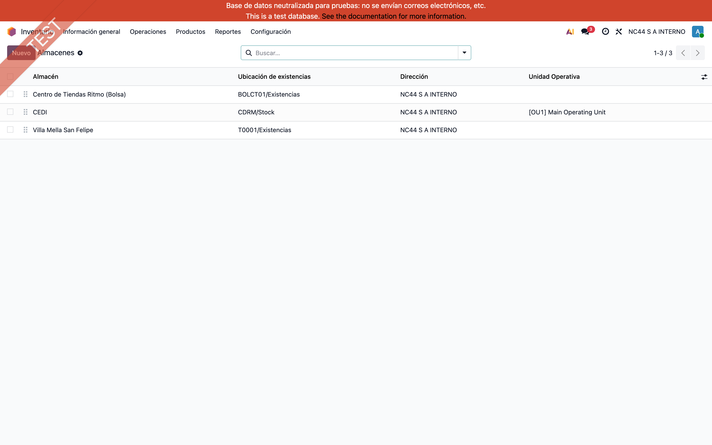
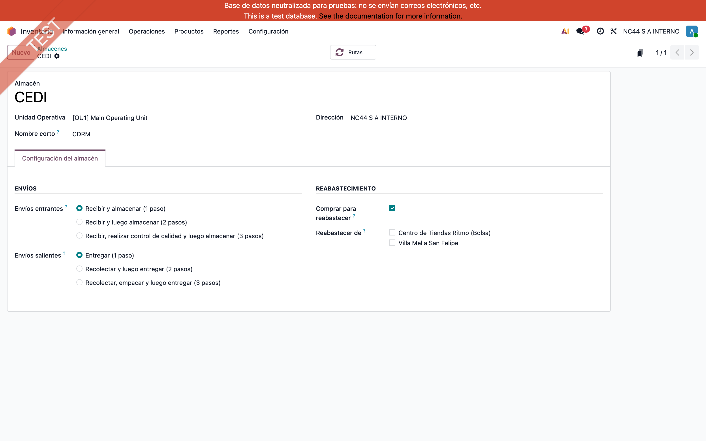
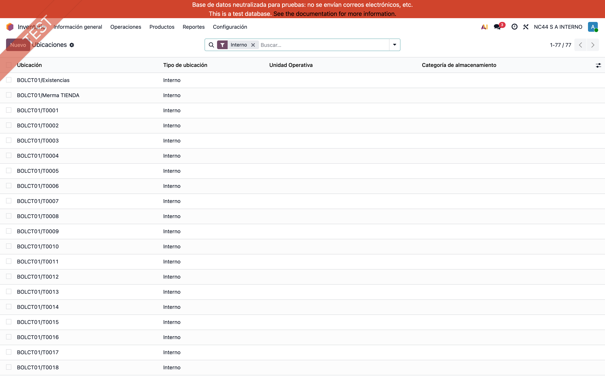
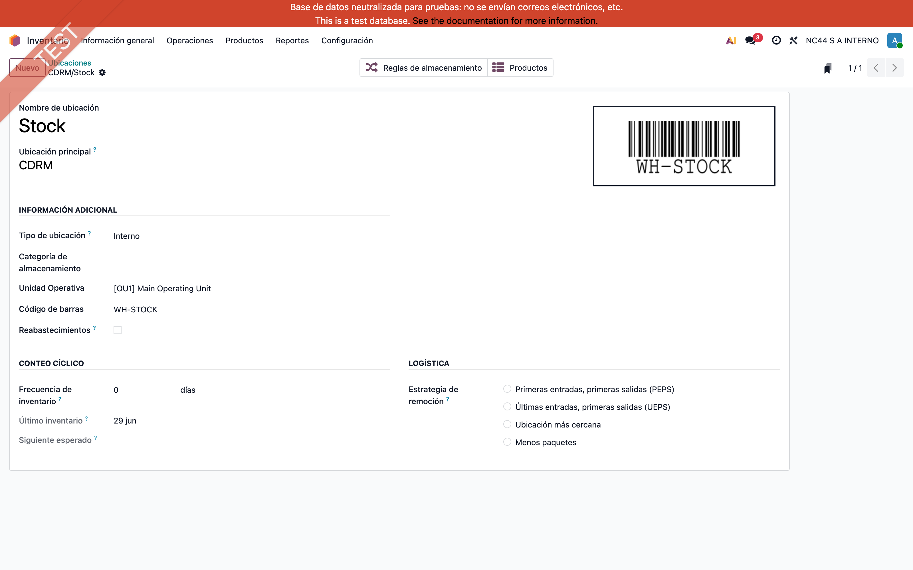
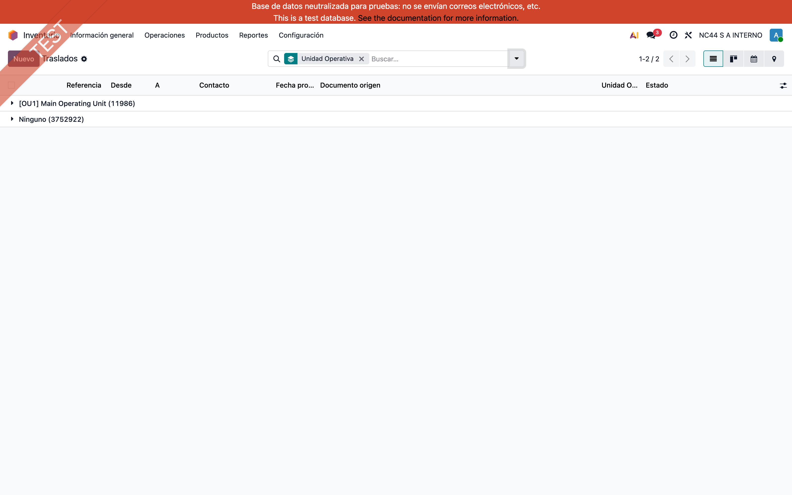
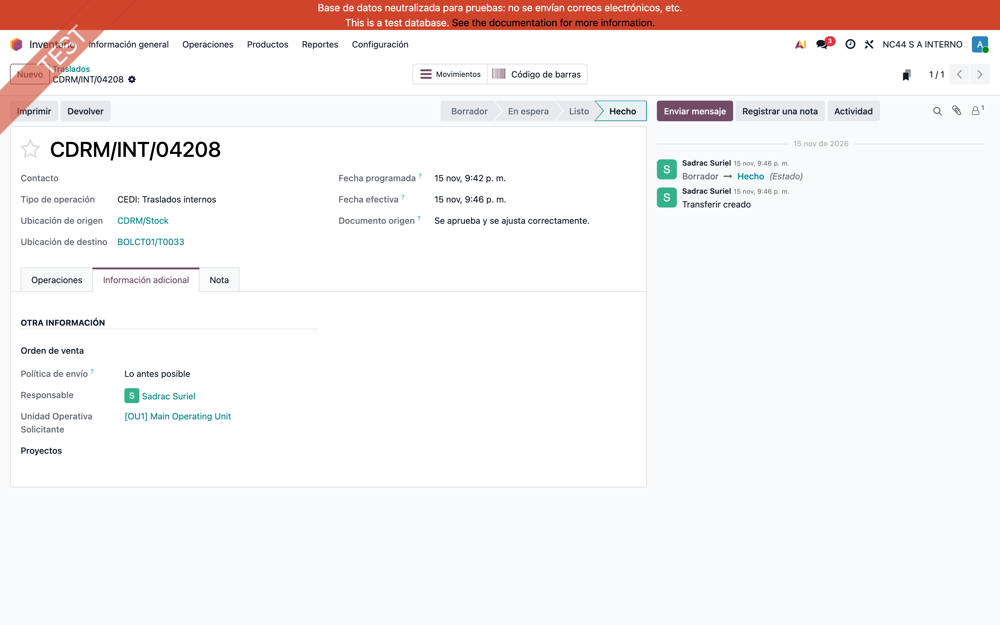

# Inventario por unidad operativa — Manual de usuario

> Manual generado con `tools/manual-generator`: `node capture.mjs --config=configs/stock_operating_unit_segregation.json --db=odoo-nc44-test-42073117`. Las capturas se regeneran corriendo ese comando contra la base de pruebas.

Una **unidad operativa** es una parte de la empresa que trabaja por su cuenta dentro de la misma compañía. En NC44 cada tienda es una unidad operativa (*Tienda San Felipe*, *Tienda Caciques*, …), además de **Main Operating Unit** (oficina central y CEDI) y **REGIONAL 01**.

El módulo **Inventario por unidad operativa** (`stock_operating_unit_segregation`) separa el inventario por unidad:

- Cada **almacén** y cada **ubicación interna** puede pertenecer a una unidad operativa.
- Cada **transferencia** toma la unidad del almacén de su tipo de operación.
- Cada usuario sólo ve los almacenes, ubicaciones, transferencias, movimientos y existencias de sus unidades, más los que no tienen unidad.

Reemplaza a `stock_operating_unit` (store-addons). En la base migrada, las unidades de almacenes, ubicaciones, transferencias y existencias siguen en su lugar.

**Base de datos de las capturas:** odoo-nc44-test-42073117 (upgrade de prueba NC44 17.0 → 19.0, Odoo.sh)

## Requisitos previos

- Odoo 19 con **Inventario** y **Unidades operativas** (`operating_unit_base`).
- Módulo **Inventario por unidad operativa** (`stock_operating_unit_segregation`).
- Para ver y editar el campo *Unidad operativa*, el grupo **Múltiples unidades operativas**.

## 1. Almacenes por unidad operativa

Entra a **Inventario → Configuración → Gestión del almacén → Almacenes**. La columna **Unidad operativa** dice a qué unidad pertenece cada almacén.

En NC44 sólo el **CEDI** tiene unidad (*Main Operating Unit*). *Centro de Tiendas Ritmo (Bolsa)* y *Villa Mella San Felipe* no tienen: los ven todos los usuarios de inventario.

## 2. Unidad operativa del almacén

Abre el almacén. El campo **Unidad operativa** está debajo del nombre, junto al **Nombre corto**.

- Un almacén nuevo toma la unidad por defecto de quien lo crea; se puede cambiar antes de guardar.
- Si se cambia la unidad de un almacén, sus ubicaciones internas cambian con él.

## 3. Ubicaciones

Entra a **Inventario → Configuración → Gestión del almacén → Ubicaciones**. La columna **Unidad operativa** muestra la unidad de cada ubicación interna. En NC44 las ubicaciones del almacén *Bolsa* (`BOLCT01/…`) no tienen unidad; sólo **CDRM/Stock** la tiene.

Reglas que el módulo hace cumplir al guardar:

- Sólo las ubicaciones **internas** llevan unidad; las de proveedor, cliente o virtuales no.
- Una sububicación tiene que tener la misma unidad que su ubicación padre.

## 4. Unidad operativa de una ubicación

Abre la ubicación **CDRM/Stock**, la única ubicación interna con unidad en NC44. El campo **Unidad operativa** está en el formulario.

## 5. Transferencias agrupadas por unidad operativa

Entra a **Inventario → Operaciones → Traslados** (Recepciones, Entregas o Interno). En la búsqueda, **Agrupar por → Unidad operativa** separa las transferencias por unidad.

Cada transferencia toma la unidad del almacén de su tipo de operación. Las del CEDI quedan en *Main Operating Unit*; las del almacén *Bolsa* quedan sin unidad porque ese almacén no la tiene.

## 6. Unidad operativa en la transferencia

Abre una transferencia del CEDI, por ejemplo **CDRM/INT/04208**. En la pestaña **Información adicional** está el campo **Unidad operativa solicitante**, que se llena con la unidad del almacén del tipo de operación.

No se puede guardar una transferencia con una unidad distinta a la de su almacén.

## 7. Reglas de reabastecimiento

En **Inventario → Operaciones → Aprovisionamiento → Reabastecimiento**, una regla exige que el almacén y la ubicación sean de la misma unidad operativa.

Un usuario puede abrir las reglas de inventario de almacenes de otras unidades (por ejemplo, la ruta del CEDI desde una tienda) sin error de acceso.

## 8. Qué hace y qué no hace el módulo

- **Limita lo que se ve.** Quién puede crear o validar sigue dependiendo de los permisos normales de Inventario.
- **Lo que no tiene unidad lo ven todos.** En NC44 es el caso de los almacenes *Bolsa* y *Villa Mella San Felipe* y de sus transferencias.
- **No verificado en esta revisión:** lo que ve un usuario de tienda. La revisión se hizo en solo lectura con un administrador que tiene todas las unidades.

## Notas

Revisión hecha en solo lectura sobre la base migrada: no se crearon ni modificaron registros. Las capturas se tomaron con un administrador que tiene asignadas todas las unidades operativas.
