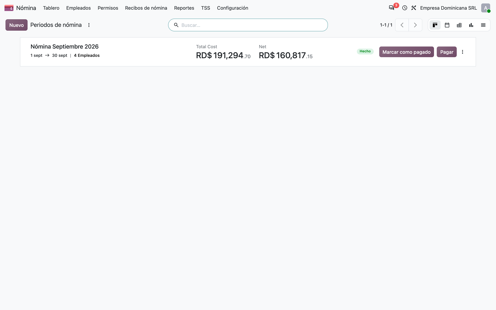
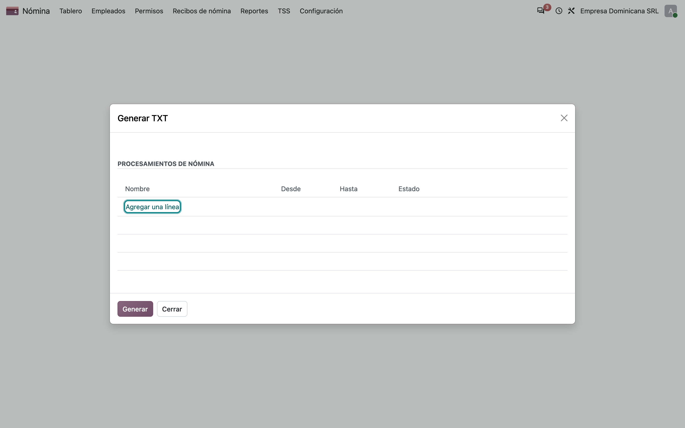
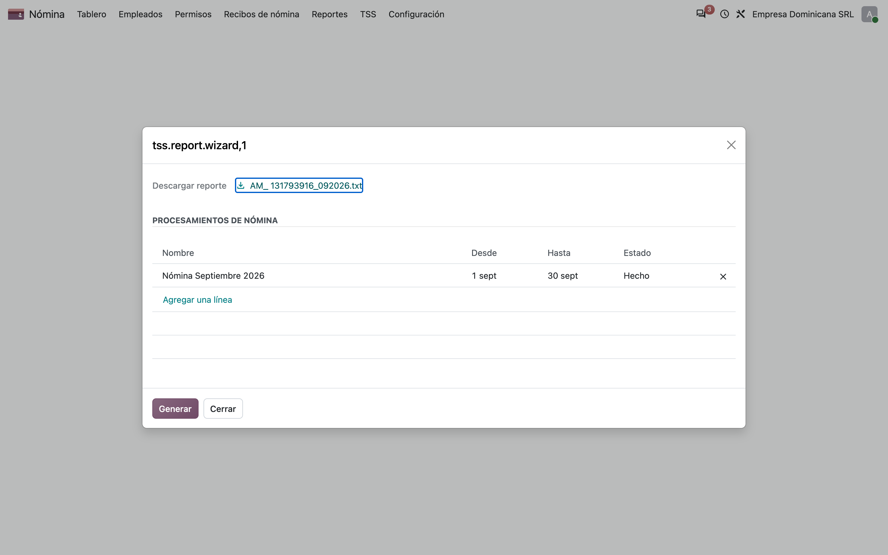

# Archivo de autodeterminación TSS — Manual de usuario (tss_report, Odoo 20.0)

> Manual generado con `tools/manual-generator`. Las capturas se regeneran ejecutando el generador contra una base `test_v20_<módulo>`.

Este módulo genera el **archivo TXT de autodeterminación (AM)** que se carga en el portal de la **TSS** cada mes, a partir de los recibos de nómina de uno o varios lotes del mismo mes. Los datos del empleado (nombres, apellidos, documento, clave de nómina, tipo de ingreso) y el cálculo de los montos vienen de `l10n_do_hr_report_base`.

Odoo 20.0 no genera el archivo de la TSS, por eso el módulo se porta.

**Qué cambió en 20.0:** el menú pasó al menú principal de **Nómina** (en 19.0 colgaba del menú de entradas de trabajo de enterprise), los recibos se leen en el orden en que se crearon y el enlace de descarga solo aparece cuando ya hay un archivo (20.0 mostraba *false*). El formato del archivo no cambió.

## Requisitos previos

- Módulo **`tss_report`** `20.0.2.0.0` instalado. Depende de **`l10n_do_hr_report_base`** `20.0.2.0.0`.
- Compañía con **RNC** (encabeza el archivo).
- Empleados con nombres y apellidos separados (pestaña **TSS / DGT**), un documento (cédula, NSS o pasaporte), clave de nómina y tipo de ingreso (ver el manual de `l10n_do_hr_report_base`).
- Periodos de nómina del mes con los recibos **validados**.

## 1. Periodo de nómina del mes

**Nómina → Recibos de nómina → Periodos de nómina**: el archivo se arma con los recibos de los periodos de nómina (lotes) que se escojan, ya **validados**. Todos deben terminar en el mismo mes; si se escogen periodos de meses distintos el asistente lo rechaza.



## 2. Asistente de autodeterminación

**Nómina → TSS → Autodeterminación** abre el asistente **Generar TXT**. En **Procesamientos de nómina** se agregan los periodos del mes y se pulsa **Generar**.



## 3. Archivo generado

El asistente muestra el archivo para descargar, con el nombre `AM_<RNC>_<MMAAAA>.txt`. El archivo tiene:

- un **encabezado** `E` + `AM` + RNC (11 posiciones) + período `MMAAAA`;
- una línea **`D`** por empleado: clave de nómina, tipo y número de documento (`C` cédula, `N` NSS, `P` pasaporte), nombres y apellidos en mayúsculas y sin acentos, sexo, fecha de nacimiento, salario cotizable, aporte voluntario, salario ISR, otras remuneraciones, agente de retención, ingresos exentos, saldo a favor, salario INFOTEP y tipo de ingreso, más regalía pascual, preaviso/cesantía y retención por pensión alimenticia cuando los hay;
- un **resumen** `S` con el total de líneas.

Si un empleado sale en dos lotes del mismo mes, sale una sola vez y sus montos se suman.

Ejemplo con la nómina de septiembre 2026 (las líneas `D` se cortan aquí después de la fecha de nacimiento y el salario cotizable):

```
EAM  131793916092026
D001C00112345678   JUAN ... PEREZ ... RODRIGUEZ ... M15031985 0000000030000.00 ...
D001C00223456789   MARIA ... GOMEZ ... SANTANA ... F15041988 0000000045000.00 ...
D001N1234567       PEDRO ... MARTINEZ ... CRUZ ... M15051991 0000000038000.00 ...
D001PAB123456      JOHN ... SMITH ... DOE ... M15061994 0000000060000.00 ...
S000006
```



## Notas

- Los datos que faltan en un empleado (documento, nombre incompleto en un pasaporte, clave de nómina en el contrato) detienen la generación con un mensaje que dice qué empleado corregir.
- El *Saldo a favor* del período y el *Aporte voluntario* salen en 0 aunque el recibo tenga esas líneas: el cálculo los compara contra una categoría y una regla equivocadas desde antes de 20.0; se informó al portar y no se cambió.
