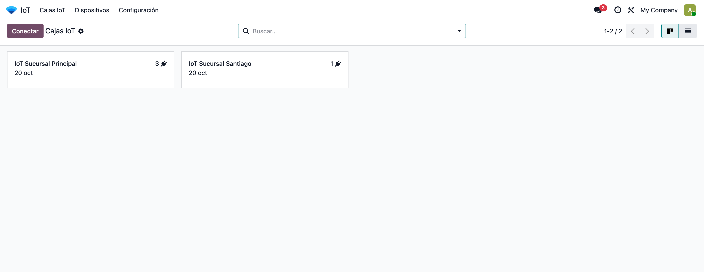
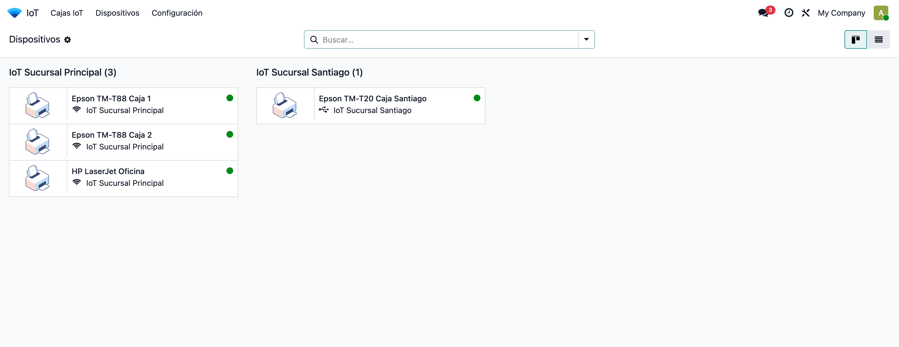
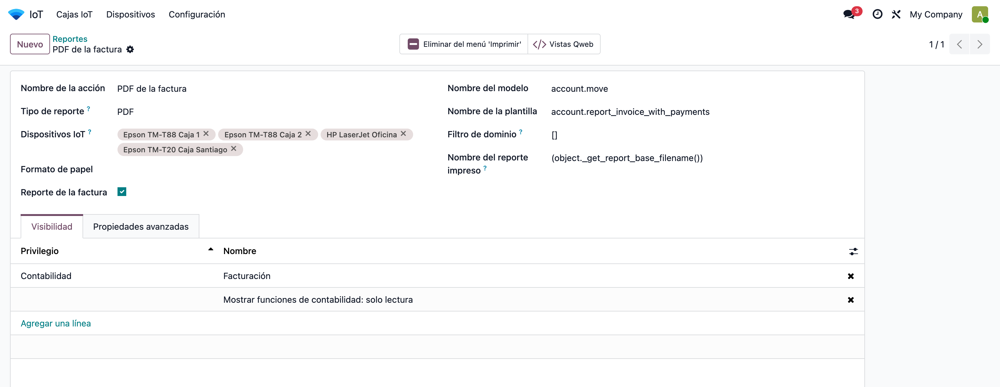
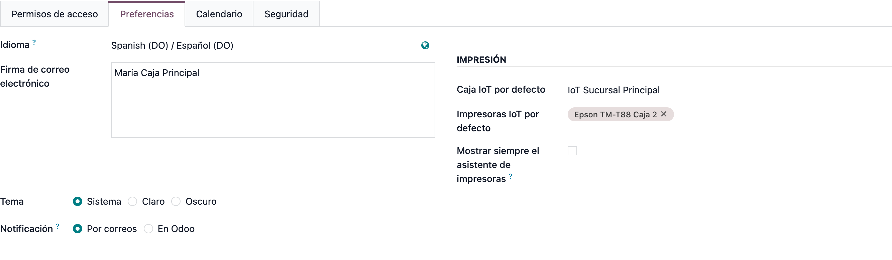
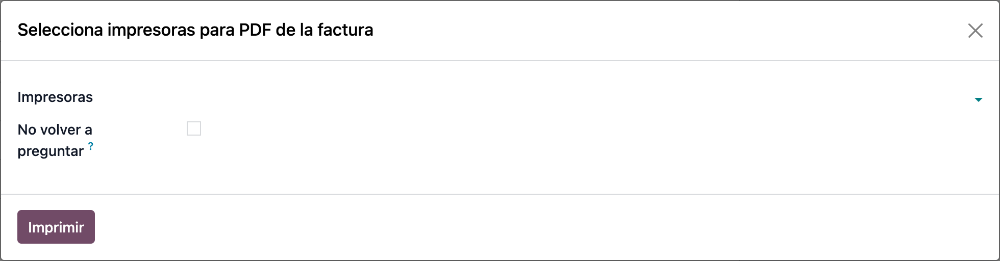

# User Default IoT Printer — Manual técnico

> Manual generado con `tools/manual-generator`: `node capture.mjs --config=configs/user_default_iot_printer.json --db=test_v19_user_default_iot_printer`. Las capturas se regeneran corriendo ese comando contra la base de pruebas.

`user_default_iot_printer` deja que cada usuario tenga una **IoT Box** y unas **impresoras IoT por defecto**. Cuando imprime un reporte vinculado a una impresora de esa misma IoT Box, Odoo manda el documento directo a sus impresoras y no abre el asistente de selección de impresora del módulo `iot`.

Es el reemplazo en 19.0 de la impresión con QZ Tray (`odoo_document_printer` y `odoo_document_printer_customization_base`). El script de upgrade de `l10n_do_banks` desinstala esos módulos y fuerza la instalación de este.

Las capturas salen de una base que arma el generador: `tools/manual-generator/configs/user_default_iot_printer.seed.py` crea dos IoT Box, cuatro impresoras, vincula el reporte de factura **PDF de la factura** a ellas y configura tres usuarios. No hay una IoT Box física conectada, así que la impresión real no aparece en el manual.

**Base de datos de las capturas:** `test_v19_user_default_iot_printer`, creada con `cd tools/manual-generator && ./generate-manual.sh --module=user_default_iot_printer --keep-db` (usuario `admin`, clave `admin`).

## Requisitos previos

- Odoo Enterprise con el módulo `iot` instalado (lo arrastra la dependencia).
- Al menos una IoT Box emparejada con la base de datos y sus impresoras detectadas en **IoT ▸ Dispositivos**.
- El reporte que se quiere imprimir directo con sus **Dispositivos IoT** configurados (Ajustes ▸ Técnico ▸ Reportes).
- Modo desarrollador para ver el menú técnico de reportes.

## 1. IoT Box emparejadas

**IoT ▸ Cajas IoT.** Cada IoT Box es un equipo (o la IoT virtual de Windows) que está en la red de una sucursal y tiene las impresoras conectadas. El módulo trabaja sobre estos registros: no crea ni modifica IoT Box.

## 2. Impresoras detectadas

**IoT ▸ Dispositivos.** Las impresoras aparecen con el tipo **Impresora** y la IoT Box a la que están conectadas. Sólo los dispositivos de tipo `printer` se pueden elegir como impresora por defecto del usuario.

## 3. Reporte vinculado a impresoras IoT

**Ajustes ▸ Técnico ▸ Acciones ▸ Reportes ▸ PDF de la factura.** El campo **Dispositivos IoT** (`device_ids`, del módulo `iot`) dice a qué impresoras puede ir el reporte. Sin este campo el reporte se descarga en PDF como siempre y el módulo no interviene.

Para que la impresión sea directa, el reporte tiene que tener **al menos una impresora de la IoT Box por defecto del usuario**. Aquí el reporte tiene impresoras de las dos sucursales.

## 4. Campos nuevos en el usuario

**Ajustes ▸ Usuarios ▸ (usuario) ▸ Preferencias**, grupo **Impresión**. La misma sección aparece en **Mis preferencias** (`base.view_users_form_simple_modif`).

- **Caja IoT por defecto** — `default_iot_box_id` (Many2one `iot.box`): la IoT Box a la que está conectado el usuario.
- **Impresoras IoT por defecto** — `default_iot_printer_ids` (Many2many `iot.device`): impresoras por defecto; el dominio sólo deja impresoras (`type = printer`) de esa IoT Box.
- **Mostrar siempre el asistente de impresoras** — `force_iot_printer_wizard` (Boolean): fuerza el asistente estándar aunque haya impresoras por defecto.

Al cambiar la IoT Box, un `onchange` quita las impresoras que no son de la nueva IoT Box. Las impresoras sólo se ven cuando hay IoT Box, y la casilla sólo cuando hay IoT Box e impresoras.

Los tres campos están en `SELF_READABLE_FIELDS` y `SELF_WRITEABLE_FIELDS`: cada usuario los puede cambiar en su perfil sin ser administrador.

## 5. Qué pasa al imprimir

El módulo reemplaza el handler `iot_report_action_handler` (archivo `static/src/iot_report_action_patch.js`). Al imprimir un reporte con `device_ids`:

1. Lee del usuario `default_iot_box_id`, `default_iot_printer_ids` y `force_iot_printer_wizard`.
2. Si la casilla **Mostrar siempre el asistente de impresoras** está marcada, o falta la IoT Box o las impresoras, sigue con el flujo estándar.
3. Lee los `device_ids` del reporte. Si ninguno es de la IoT Box del usuario, sigue con el flujo estándar.
4. Toma las impresoras por defecto del usuario que son de esa IoT Box y les manda el documento con `printReport`, sin abrir ningún asistente.

**Flujo estándar** = `getSelectedPrintersForReport` del módulo `iot`: usa la selección guardada en el navegador (`localStorage`) si el usuario marcó *no volver a preguntar*, y si no, abre el asistente **Selecciona impresoras**.

El documento va a las impresoras del **usuario**, no a las del reporte: basta con que el reporte tenga alguna impresora de su IoT Box. Los reportes sin `device_ids` no pasan por el handler y se descargan en PDF.

## 6. El asistente estándar cuando se fuerza

El usuario `admin` de la base de pruebas tiene **Mostrar siempre el asistente de impresoras** marcado. Al imprimir la factura con **Acciones ▸ Imprimir ▸ PDF de la factura** se abre el asistente del módulo `iot` con todas las impresoras del reporte, aunque tenga una impresora por defecto.

## 7. Casos de la base de pruebas

Al imprimir **PDF de la factura** en la base de pruebas:

- **María Caja Principal** — caja IoT Sucursal Principal, impresora Epson TM-T88 Caja 2, sin asistente forzado: va directo a Caja 2.
- **Pedro Caja Santiago** — caja IoT Sucursal Santiago, impresora Epson TM-T20 Caja Santiago, sin asistente forzado: va directo a Caja Santiago.
- **Administrator** — caja IoT Sucursal Principal, impresora Epson TM-T88 Caja 1, con asistente forzado: abre el asistente con las cuatro impresoras del reporte.
- **Usuario sin configurar** — flujo estándar: el asistente, o la selección guardada en el navegador.

Si a **PDF de la factura** se le quitaran las impresoras de Santiago, Pedro volvería al flujo estándar: el reporte ya no tendría impresoras de su IoT Box.

## 8. Límites conocidos

- **Una IoT Box por usuario.** Quien trabaja en dos sucursales tiene que cambiar la IoT Box en su perfil, o marcar *Mostrar siempre el asistente de impresoras*.
- **Traducción sólo a `es_DO`.** El módulo trae `i18n/es_DO.po`; en otros idiomas las etiquetas salen en inglés.
- **No crea reportes.** Sólo decide a qué impresora va un reporte que ya existe. Un ticket térmico propio necesita su propio `ir.actions.report`.
- **Sin pruebas automáticas.** El módulo no trae `tests/`.

## Notas

Código del módulo: `odoo-pro/user_default_iot_printer` (rama 19.0). Documentación original: `README.rst` del módulo. PR que lo creó: [indexa-git/odoo-pro#876](https://github.com/indexa-git/odoo-pro/pull/876). Tarea: [#65917 — Mejoras en módulos de impresión](https://www.progressa.group/odoo/project.task/65917).
