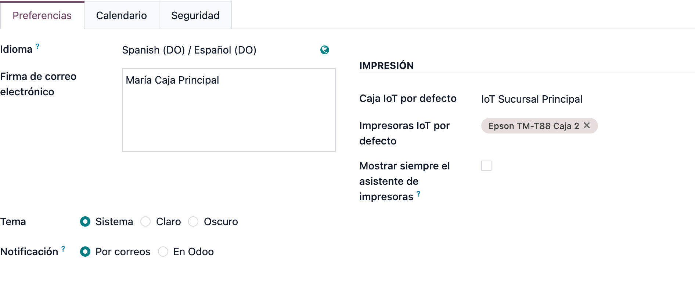
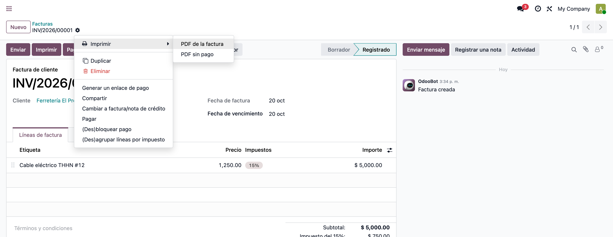
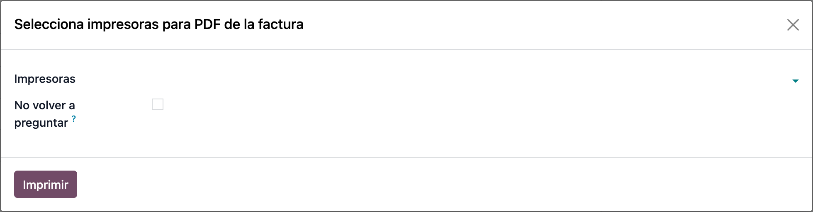

# Impresora IoT por usuario — Manual de usuario

> Manual generado con `tools/manual-generator`: `node capture.mjs --config=configs/user_default_iot_printer_usuario.json --db=test_v19_user_default_iot_printer`. Las capturas se regeneran corriendo ese comando contra la base de pruebas.

Cuando un documento de Odoo se imprime en una impresora conectada a una caja IoT, Odoo pregunta cada vez en qué impresora imprimir.

Con este módulo usted le dice a Odoo una sola vez cuál es su caja IoT y cuál es su impresora. Desde ese momento, el documento sale directo en su impresora, sin preguntas.

## Requisitos previos

- El administrador ya conectó la caja IoT de su sucursal y vinculó el documento a sus impresoras.
- Usted no necesita permisos especiales: cada usuario configura su propio perfil.
- Las etiquetas del módulo aparecen en inglés: **Printing**, **Caja IoT por defecto**, **Impresoras IoT por defecto** y **Mostrar siempre el asistente de impresoras**.

## Abra su perfil

Haga clic en su **avatar** (arriba a la derecha) y luego en **Mis preferencias**. Entre en la pestaña **Preferencias** y busque el grupo **Impresión**.

## Escoja su IoT Box y su impresora

1. En **Caja IoT por defecto**, escoja la caja IoT de su sucursal (por ejemplo, *IoT Sucursal Principal*).
2. En **Impresoras IoT por defecto**, escoja la impresora de su caja. La lista sólo muestra las impresoras de esa caja IoT. Puede escoger más de una: el documento sale en todas.
3. Deje **Mostrar siempre el asistente de impresoras** sin marcar.
4. Guarde.

Si cambia de caja IoT, Odoo quita sola las impresoras que no son de la nueva.

## Imprima como siempre

Abra la factura y use **Acciones (engranaje) ▸ Imprimir ▸ PDF de la factura**.

- **Si su impresora está configurada**, la factura sale directo en ella. No aparece ninguna ventana.
- **Si no la configuró**, Odoo le muestra la ventana para escoger la impresora, como antes.

## Cuando quiere escoger la impresora cada vez

Si usted imprime en impresoras distintas según el día, marque **Mostrar siempre el asistente de impresoras** en su perfil. Odoo le mostrará siempre esta ventana:

1. En **Impresoras**, escoja dónde imprimir.
2. Pulse **Imprimir**.

Si en esta ventana marca **No volver a preguntar**, Odoo recuerda la impresora en ese navegador.

## Preguntas frecuentes

- **Me sigue saliendo la ventana de impresoras.** Revise que tenga caja IoT e impresora en su perfil y que **Mostrar siempre el asistente de impresoras** esté sin marcar. Si todo está bien, pida al administrador que vincule el documento a una impresora de su caja IoT.
- **Me cambiaron de sucursal.** Cambie la **Caja IoT por defecto** y la impresora en su perfil.
- **El documento se descarga en PDF.** Ese documento no está vinculado a ninguna impresora IoT. Avise al administrador.
- **No salió nada en la impresora.** Revise que la impresora esté encendida y con papel, y que la caja IoT esté conectada. Si sigue igual, avise al administrador.
