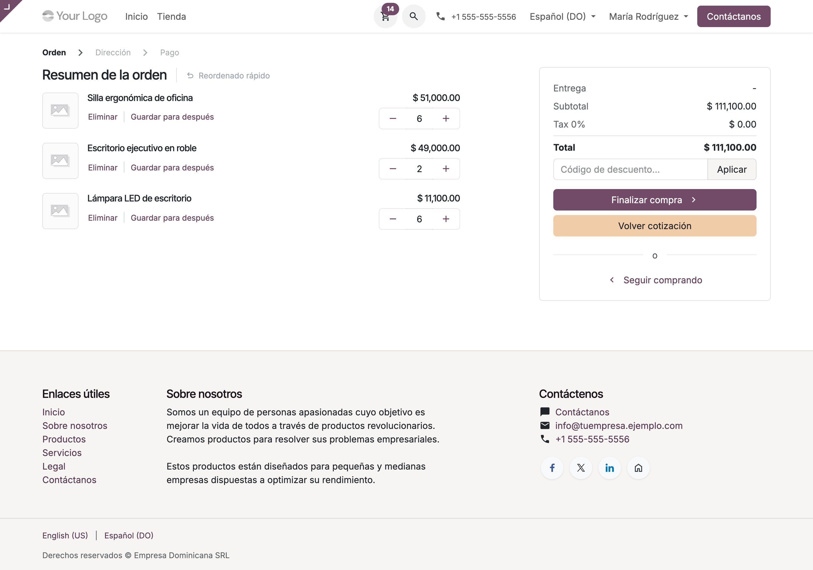
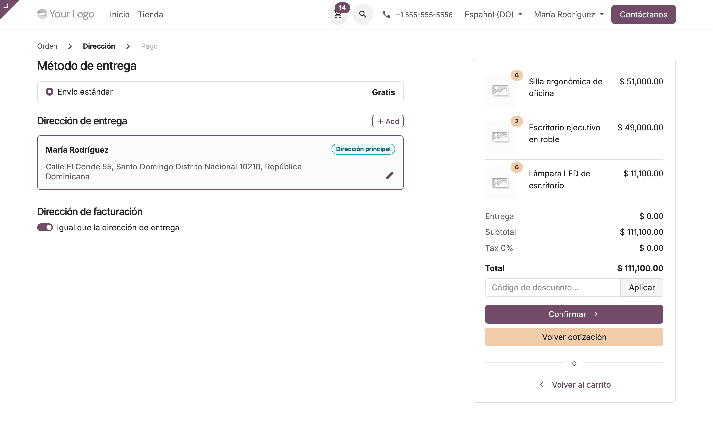
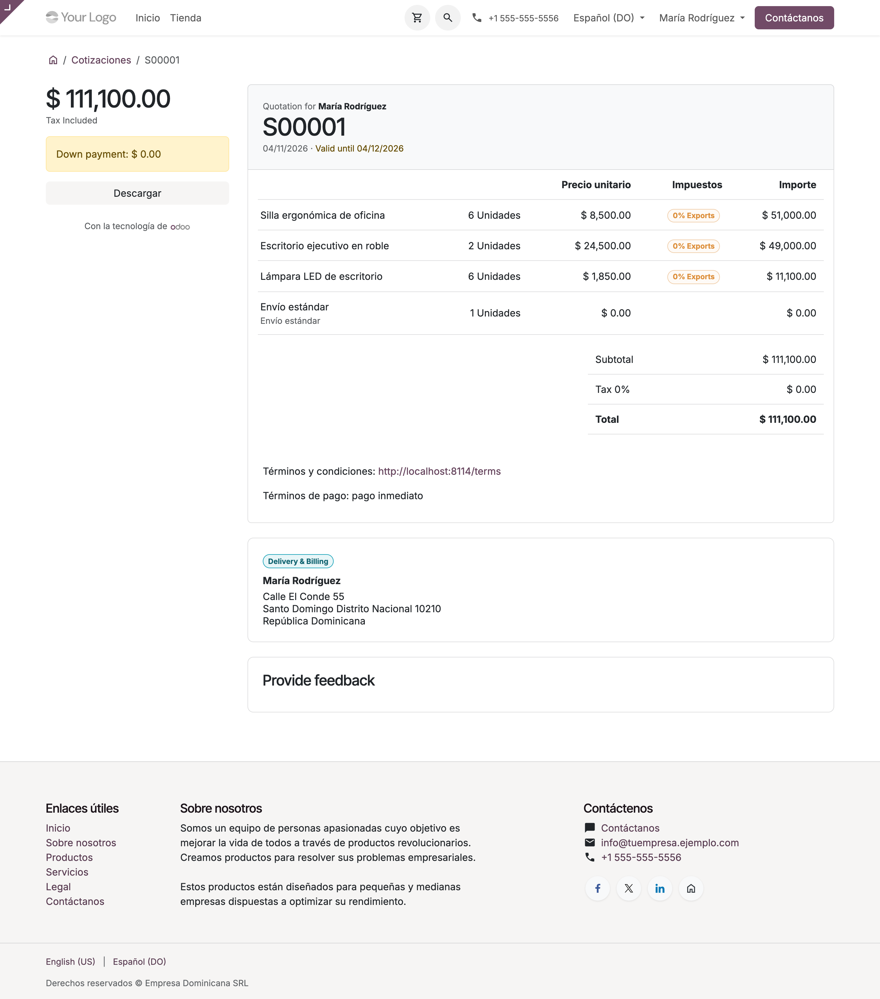
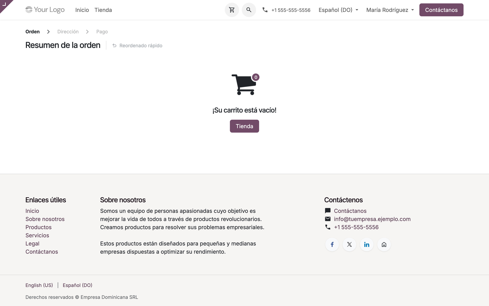
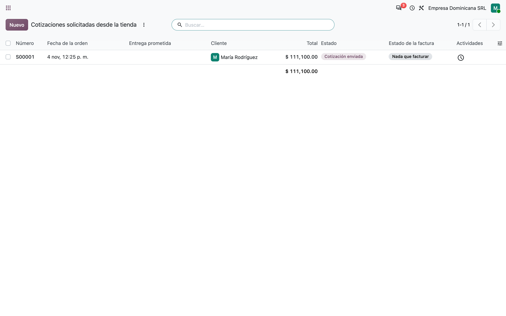
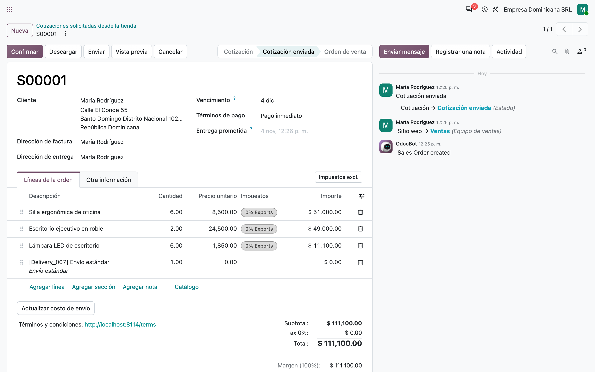

# Cotización desde la tienda en línea — Manual de usuario (website_quotation, Odoo 20.0)

> Manual generado con `tools/manual-generator`. Las capturas se regeneran ejecutando el generador contra una base `test_v20_<módulo>`.

Este módulo agrega el botón **Volver cotización** al carrito y a los pasos del checkout de la tienda en línea. En lugar de pagar en el momento, el cliente convierte su carrito en una **cotización enviada** y la consulta en su portal (*Mi cuenta → Cotizaciones*). El equipo de ventas la recibe en Odoo para negociar precios, condiciones o descuentos.

Odoo 20.0 no trae esta opción en *eCommerce*: el checkout estándar siempre termina en el pago, por eso el módulo se porta.

**Qué cambió en 20.0:**

- El botón dejaba la página en **error 500** con cualquier carrito con productos: Odoo 20.0 ya no expone el sitio web en la petición. El módulo usa ahora las APIs de 20.0 y vuelve a funcionar.
- Después de crear la cotización, el carrito de la sesión se vacía en el mismo paso: el contador del carrito queda en cero y el siguiente producto que agregue el cliente abre un carrito nuevo.
- El enlace al portal se construye con la URL estándar de la orden (incluye el token de acceso), igual que los correos de Odoo.

## Requisitos previos

- Módulo **`website_quotation`** `20.0.1.0.0` instalado. Depende de **`website_sale`** (eCommerce).
- Aplicación **Ventas** (`sale_management`) para revisar las cotizaciones en el backend.
- Productos publicados en la tienda con precio de venta.
- El cliente debe tener una dirección: si navega como visitante anónimo, el botón lo envía primero al formulario de dirección.

## 1. El carrito muestra «Volver cotización»

El cliente agrega productos y abre el carrito (**/shop/cart**). Debajo del botón principal del checkout aparece **Volver cotización**. El botón también aparece en los pasos *Dirección* y *Confirmar orden*, pero no en el paso de pago.

## 2. También disponible al confirmar la orden

En **Confirmar orden** (*/shop/checkout*) el cliente revisa su dirección de facturación y entrega. Si decide no pagar todavía, usa **Volver cotización** en lugar de continuar al pago.

## 3. El cliente ve su cotización en el portal

Al pulsar **Volver cotización**, Odoo marca la orden como **Cotización enviada** y lleva al cliente a la página de la cotización en su portal (*/my/orders/…*, con el token de acceso). Desde ahí puede descargarla en PDF, escribir al vendedor o aceptarla y firmarla cuando esté lista.

## 4. El carrito queda vacío

La orden ya no es un carrito: al volver a la tienda el contador del carrito está en cero y el siguiente producto abre un carrito nuevo. Si el cliente abre */shop/quotation_sent* con el carrito vacío, vuelve al carrito sin crear nada.

## 5. Ventas recibe la cotización

En **Ventas → Pedidos → Cotizaciones** la orden aparece con estado **Cotización enviada**, el sitio web de origen y el cliente. Esta captura usa una vista filtrada por órdenes del sitio web.

## 6. Negociar y confirmar

El vendedor abre la cotización, ajusta precios, cantidades o descuentos y la vuelve a enviar con **Enviar por correo electrónico**, o la confirma con **Confirmar** cuando el cliente la acepta.

## 7. Visitantes sin dirección

Si el carrito es de un visitante que aún no ha indicado su dirección, **Volver cotización** lo lleva primero a */shop/address*. Al completar la dirección y pulsar de nuevo el botón, se crea la cotización.

## Notas

- El botón crea la cotización con una petición **GET** a */shop/quotation_sent*: cualquier enlace a esa URL convierte el carrito actual del visitante en cotización.
- La cotización no envía correo al cliente: solo cambia el estado a *Cotización enviada* y abre el portal. Para notificar al cliente, el vendedor usa **Enviar por correo electrónico**.
- Solo se convierten carritos en estado *Cotización* (borrador); un carrito con un pago en proceso no se puede convertir.
